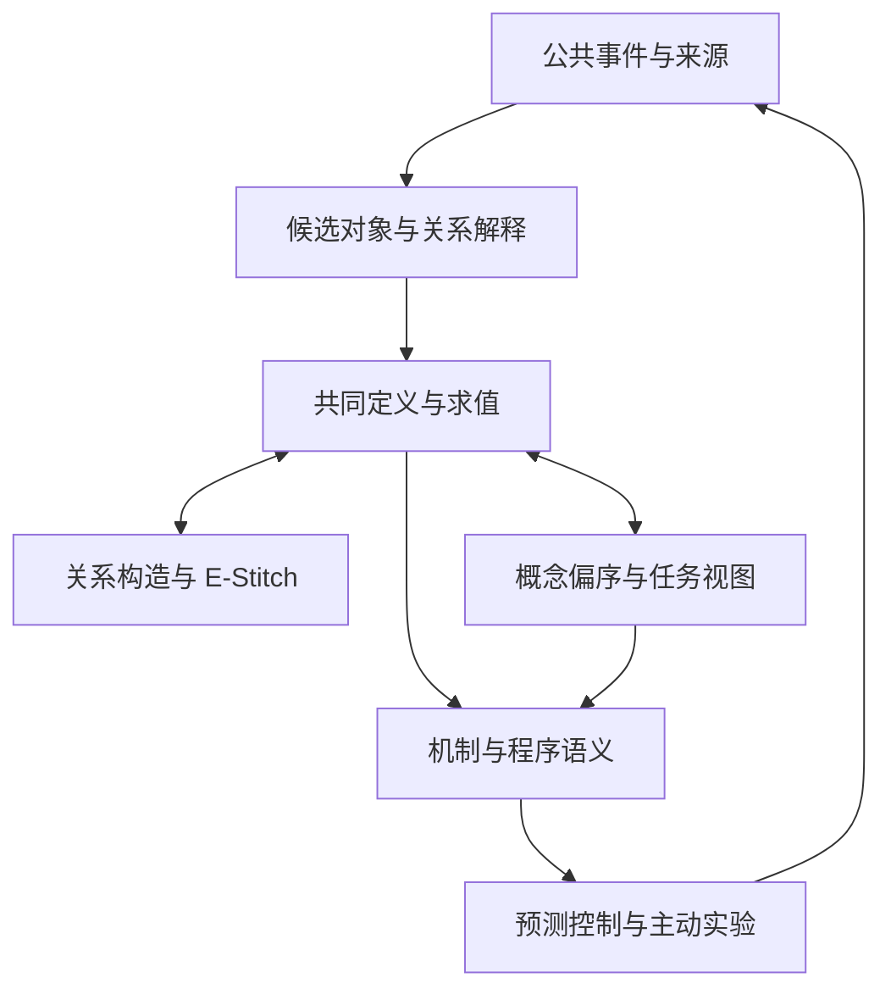

# 理论、算法与软件的作用层级及统一接口：ARC3 认知架构深化分析

日期：2026-11-23，台北时间，星期一。

本文接续 [20-论文代码核验与关系定义集成潜力.md](20-论文代码核验与关系定义集成潜力.md)。分析对象是无 Large Language Model（大语言模型，LLM）的 ARC-AGI-3 认知系统：Julia 拥有证据、概念语义、模型与控制，实际 Rust E-Stitch 承担结构搜索和库学习。Python 保留官方环境接口职责，不因研究作者代码而扩建 Python 认知栈。

本轮文档分支基线为 23bfe5c7c8b465e7b4e90dccc1bae943c4f8f613；另行只读核对实现分支 impl/2026-11-23-toolchain-bootstrap 的 fe4ab44b73d992c5962222625868762f34f7fc13。两个分支用途不同，文档分支不含运行代码，不能用它判断实现不存在。本轮没有修改运行代码、没有重跑 ARC3 或声称下述新接口已落地。

## 1. 核心判断：分清三种层级，再建立共同语义

需要同时组织三种层级：

| 层级 | 回答的问题 | 例子 |
| --- | --- | --- |
| 认知内容层级 | 系统正在表示什么 | 像素、对象片段、对象对应、关系、事件、机制、程序、功能 |
| 理论责任层级 | 哪种关系成立，凭什么可以组合或替换 | 限制相容、类型、合取语义、概念包含、查询保持、机制一致性、控制精化 |
| 软件计算层级 | 谁实际生成、求值、搜索、缓存和执行 | 数组与索引、Catlab、统一解释器、RCA/Libra 式构造、E-Stitch、计划器与公共 API |

不能把软件清单排列成认知高度。例如 E-Stitch 可以发现像素描述、关系式或程序表达中的共享结构；概念格也可以组织不同高度的可求值描述。Catlab 提供的是跨层计算能力，不是一个位于“对象以上、因果以下”的独立认知阶段。

建议采用：**以带类型、可展开的定义为共同载体，以多个小范畴及其语义接口组织不同责任，以统一证据和版本依赖连接学习与控制。**

共同载体不能退化成“所有东西都是一个布尔标签”。关系定义、状态转移、动作程序和策略需要不同类型及解释方式，但可以共享角色、定义调用、组合、来源和版本机制。

## 2. 认知主干与横贯支撑的整体结构

下表是职责划分，不是新增六个实施里程碑，也不要求每个事件从头运行全部计算。

| 职责层 | 输入 | 实际产物 | 下一个消费者 |
| --- | --- | --- | --- |
| 公共证据 | 完整公开观察、自己提交的动作、响应与历史 | 可回放事件及局部视图 | Grounding、反例回查、实验评估 |
| 候选解释 | 网格与局部历史 | 对象片段、对应假设、基础关系及歧义 | 关系求值与构造 |
| 定义与语义 | 带角色的表达、候选解释 | 查询实例、内部见证、作用范围、未知 | 构造器、索引、机制学习 |
| 构造与压缩 | 实例、目标差异、现有定义与程序 | 新关系、新条件、共享宏、组合程序 | 同一语义内核及下一轮构造 |
| 机制与任务视图 | 动作前定义、动作后效果、候选模型、目标 | 条件化转移、抽象映射、可区分模型 | 预测、实验选择和控制回推 |
| 控制与修订 | 当前公开信息、机制、目标与预算 | 可执行动作／反馈策略、冻结预测、修订影响 | 公共环境及下一轮所有消费者 |

图中的往返表示定义和证据反复消费；严格的语义检查、预算、版本与来源贯穿所有节点。

横贯这些层的支撑是：类型与时序检查、有限匹配、预算与未完成标记、来源与定义版本、依赖失效、索引和成本评估。

真正的闭环是新定义被后续查询、构造或动作消费。构造出一个名字、增加一个节点、压缩一批训练表达，都只是中间进展。

## 3. 各种理论到底作用在哪里

| 理论或研究线 | 最直接的作用层次 | 有价值的保证或方法 | 不能据此宣称 |
| --- | --- | --- | --- |
| Presheaf（预层） | 局部观察；模式匹配的限制 | 局部到更局部的操作相容 | 任意对象提取自然、Diff 因果充分 |
| Attributed C-sets（带属性的 C 集，ACSets） | 类型化实例、关系与来源 | schema 一致、保结构匹配与组合 | 对象身份或关系意义已由数据确认 |
| Conjunctive Concept Algebras（合取概念代数） | 关系定义与概念操作 | 公开角色、合取、存在隐藏、关系外延 | 自动获得否定、时间、概率和因果学习 |
| Formal Concept Analysis（形式概念分析，FCA）与 Pattern Structures（模式结构） | 已可求值描述的共享与顺序 | 闭包、共同描述、可比较的泛化结构 | 现有属性之外的所有新关系自动出现 |
| Anti-unification（反统一） | 结构共同模式构造 | 替换见证说明原结构是候选的实例 | 共同模式在所有新情境因果成立 |
| Relational Concept Analysis（关系概念分析，RCA） | 概念递归构造 | 既有概念沿关系成为下一轮属性 | 自动保留任意多元共享见证 |
| 关系查询综合 | 新连接、投影与条件构造 | 在给定语言和目标样例内搜索可执行定义 | 输入词表与完整目标不再必要 |
| E-graph（等价图）与 E-Stitch | 结构搜索、宏学习与压缩 | 在明确等式下共享结构，定义可展开 | 经验相似自动是恒等；压缩等于因果发现 |
| Succinct Representations for Concepts | 定义展开与任务相容的规范 | 研究简洁表示及递归分解的保持关系 | 文中的 extractor 和基础概念已经从像素实现 |
| Indexed Posets（索引偏序）及伴随 | 接口内概念顺序、接口间角色变换 | 重命名、存在投影、条件逆像相互联系 | 不同类型的概念可以直接放在同一集合包含序中 |
| Abstract Interpretation（抽象解释）与 Reduced Product（约化积） | 多种信息视图与保守计算 | 明确具体语义、抽象语义和跨维约束交换 | 独立边际自动恢复已丢失的相关性 |
| Causal and Compositional Abstraction | 查询和组件的跨层语义 | 给定模型与翻译的自然性、结构一致性 | 已经有原始像素到模型的学习器 |
| Post–wlp 伴随 | 给定机制的前向预测与反向条件 | 同一转移关系同时解释两个计算方向 | 已知关系正确，或空后继意味着控制成功 |
| Feedback Refinement Relation（反馈精化关系） | 抽象控制到具体执行 | 动作可用与后继覆盖下的控制转移 | 自动发现对象与机制、自动实现任意宏动作 |
| Above and beyond the concrete | 表示需求与认知功能区分 | 提醒感知、事件、类别、脚本和带角色构造的差异 | 提供现成的软件分层或完整自动构造算法 |

这些理论的结合应当以明确接口为单位，而不是按论文各建立一个独立世界模型。[R1–R12]

## 4. 第一类范畴：局部公共证据与限制

### 4.1 预层起点

固定一个事件和公共坐标系。令 𝒰 是空间窗口及允许局部历史形成的上下文范畴。先看空间窗口：V 包含于 U 时，限制操作把较大窗口的记录裁成较小窗口。

简化到一对帧，可以写：

$$
R(U)=\mathrm{Color}^{U}\times\mathrm{Action}\times\mathrm{Color}^{U}.
$$

完整实现还应保留公共响应中的全部帧、事件身份及响应字段。实际事件是其中的具体记录，不是“任意三个数组天然就是一个已实现预层”。

限制满足：

$$
\rho_{U,U}=\mathrm{id},
\qquad
\rho_{V,W}\circ\rho_{U,V}=\rho_{U,W}.
$$

因此 R 是 𝒰 的对偶范畴到 Set 的函子。公共动作和事件身份随限制保留；ACTION6 坐标若仍用全局坐标就不重解释，若改为局部坐标必须显式携带坐标变换。

### 4.2 Raw 到 Diff 的自然性

逐像素比较得到变化视图 D，满足：

$$
\rho^D_{U,V}\circ\Delta_U
=
\Delta_V\circ\rho^R_{U,V}.
$$

两条路径是“先计算变化，再裁剪”与“先裁剪，再计算变化”。这是一条可实际验证的自然性。

它只保证局部操作相容。未变化的墙、机关、资源显示等仍可能决定后续动作。Diff 可以作为索引和压缩视图，原记录仍应可追溯。

### 4.3 连通对象不是自动自然的

全局连通块经裁剪，可能变成两个断片；先裁剪再重新分块，会得到不同对象。因此 ConnectedComponents 不能在任意窗口上未经证明就宣称为自然变换。

可行接口是：对象片段携带原始支持、边界和来源；跨窗口连接未知时保留未知或候选解释；在明确局部完整性的范围才要求等式。四联通与八联通是不同视图，均不自动等于游戏中的真实对象。

当前 Grounding.jl 确实提供 color_components 的 4/8 选项，但 support_candidates 调用默认四联通，并形成单块及相邻两块候选；这是一种已实现的候选语言，不是所有对象语义。ground_event 以最后前后帧进行当前对应，完整公共记录与这个派生视图必须区分。[C1]

## 5. 第二类范畴：schema 实例与对象解释

窗口预层使用逆变的限制；ACSets 中常用的有限实例则是 schema S 到 Set 的协变函子。这里 schema 箭头通常代表外键或关系记录的槽位，例如一条候选对应分别指向前帧对象、后帧对象和事件。[R2]

有歧义的追踪应当把“对应候选”建成有身份的关联记录，而不是立即把 BeforeObject→AfterObject 写成唯一函数。后者会提前注入尚未获得证据的唯一性。

软件上不必把全部像素及所有像素对永久展开成图。可以：

- 紧凑数组保存真实帧；
- 局部生成有限支持与关系视图；
- 通过显式映射把视图指回事件、帧和像素；
- 查询所需时才生成匹配因子。

范畴规范要求语义与映射正确，不要求某种低效物理存储。

当前 CategoryBackend.jl 调用 Catlab.homomorphisms、pushout 和 is_natural；其 match_pattern 额外要求单射、颜色匹配和共同平移。这是有具体边界的匹配器。这里 is_natural 检查的是 schema 映射保结构，不是因果抽象成立。[C2]

## 6. 第三类范畴：可求值关系与角色接口

### 6.1 关系定义的含义

设 N 是模式，X 是公开角色，ν:X→N 指明这些角色落在模式哪里，G 是数据解释。合取查询的答案可以表示为：

$$
\operatorname{Ans}_G(N,\nu)
=
\{f\circ\nu\mid f:N\to G\}.
$$

内部节点是存在见证，公开角色是调用者得到的对象或数值。多个内部匹配可以投影到同一公开元组，概念外延按集合去重，来源见证单独保留。[R3]

例如“共同移动”可有事件 e、对象 x/y 三个公开角色，共同位移 d 是内部角色。把一个 d 拆成两个互不相关的 d，会改变概念；在隐藏角色前后混淆变量作用域也会改变概念。

不能把不同对象解释中的半条匹配拼成同一条事实。事件身份、解释分支和定义版本是求值范围的一部分。

### 6.2 模式匹配本身形成另一个预层

固定 G 时：

$$
\operatorname{Hom}(-,G):\mathcal P^{op}\to\mathbf{Set}.
$$

模式映射 h:P→Q 诱导从 Q 的匹配到 P 的匹配：f 映到 f∘h。这和窗口观察预层不同，但直接有助于模式展开、条件增加、候选缓存和匹配复用。

### 6.3 拼接与连接的接口律

对于选定模式范畴中的推出，全部态射匹配满足：

$$
\operatorname{Hom}(P_1\sqcup_I P_2,G)
\cong
\operatorname{Hom}(P_1,G)
\times_{\operatorname{Hom}(I,G)}
\operatorname{Hom}(P_2,G).
$$

I 指共享角色。它同时解释语法拼接、求值连接、见证因式分解和依赖追溯。

如果左关系只有 Holds(a,k1)，右关系只有 Matches(k2,d)，且 k1≠k2，正确连接为空。若先把钥匙角色分别投影掉，再笛卡尔积连接，就会伪造“a 可以开 d”的组合。接口优化必须保留尚未完成的连接所需要的角色。

这一律不保证任意查询都便宜，也不保证局部单射拼接后整体单射；对象互异、否定及额外约束仍要共同检查。

## 7. 共同中间表示应该是一族有类型的定义

Intermediate Representation（中间表示，IR）应共同保存构造与依赖，但区分以下含义：

| 定义种类 | 对外回答的问题 | 实际语义 |
| --- | --- | --- |
| 关系定义 | 哪些对象／事件／值满足描述 | 角色元组集合，或带未知范围的查询结果 |
| 机制定义 | 满足条件时，执行动作会怎样变化 | 带动作、前后接口的转移关系／通道 |
| 程序定义 | 哪些步骤按什么顺序和分支执行 | 有状态与观察接口的组合行为 |
| 抽象定义 | 哪些详细情况被合并、保留哪些答案 | 映射、等价类及对应查询翻译 |
| 构造算子定义 | 怎样从已有定义生成新定义 | 有类型的表达变换，不能与对象变量混同 |

关系可以作为机制的条件和效果；程序可以调用机制；抽象可以比较程序效果；高层构造算子又可以操作这些定义。因此它们联系紧密，但读一帧的布尔查询与真正改变环境的动作不能共用未分型的解释。

共同机制包括：公开角色、内部见证、构造主体、读写时点、展开依赖、作用范围、版本和证据。每项的作用分别是调用、变量共享、求值、阻止时间泄漏、复用、限定结论、修订和查证。

基础表达由固定解释器运行。学得知识作为定义数据，不需要 LLM 生成任意 Julia 源码。

## 8. 多维偏序：接口内比较，接口间变换

### 8.1 概念范围的偏序

固定角色接口 Γ、语义和范围，可定义：

$$
P\le_\Gamma Q
\iff
\llbracket P\rrbracket\subseteq\llbracket Q\rrbracket.
$$

P 更具体，Q 更一般。若比较的是所有允许解释中的蕴含，与只在当前有限数据上外延包含，是两个不同声明，必须分别记录。

未按语义等价取商时可能只是预序。任意两个图模式也未必有唯一最小共同泛化；需要保留不可比候选，或选用已证明满足共同描述规律的模式域。

Meet 和 Join 必须按所用闭集系统解释。形式概念外延上的 Meet 是相交；Join 是并后闭包。不能默认原始属性集合的交并与概念序的方向相同。

### 8.2 隐藏角色改变接口

R(e,x,y) 和 C(x) 不在同一个元组空间中。令 f:Val(Γ)→Val(Δ) 是明确的角色投影或替换，在有限完整集合语义下：

$$
\exists_f A\subseteq B
\iff
A\subseteq f^{-1}B.
$$

这条 Galois Connection（伽罗瓦连接）连接两个接口的偏序。存在投影说明“至少有一个详细绑定”；逆像给出所有满足高层条件的详细绑定，不能自动选定当前对象或执行程序。

因此，统一骨架可以表述为角色上下文上的索引偏序：每个接口有自己的概念空间，接口映射诱导重新解释，存在投影连接它们。工程上可以实现有限表达与已支持操作，不必先实现一个巨大的高阶范畴框架。

若受限语言不对某个操作闭合，就明确说明只有近似或尚不支持；不能把任意表达语言宣称为拥有精确的全部伴随。

### 8.3 信息粒度另有偏序

对同一详细域 X 上的视图 α、β，定义：

$$
\alpha\preceq\beta
\iff
\exists h,\ \alpha=h\circ\beta.
$$

这表示 β 保留的信息足以恢复 α。未取商时这一般只是预序；先按互相可恢复的视图取等价类，才得到信息偏序。它不同于概念适用范围的包含序，也不同于定义调用深度和经验证据强度。

一个只保留“是否能够到达”的高层功能视图，可能十分粗；一个同样高层的预算条件却可以非常具体。不能用单一整数“抽象等级”替代这些关系。

### 8.4 模式投影与任务充分性是两个接口

Revisiting Pattern Structure Projections 使用单调、收缩、幂等的投影，并把投影后共同描述操作改成：

$$
a\sqcap_\psi b=\psi(a\sqcap b).
$$

该操作在投影固定点域中解释；不是任意 ψ 都保持原来的 meet。[R4]

而任务是否仍可回答还要求：

$$
q=\bar q\circ\alpha.
$$

模式投影的代数正确，不自动推出任务充分。需要另检查询冲突或使用相应分区细化算法。

### 8.5 跨维相关性需要关系域

位置、颜色、资源等不同视图可以组合，Reduced Product（约化积）提供约束交换与精度改进的理论。[R5]

但若只保存 d1∈{0,1} 和 d2∈{0,1}，就会允许四种组合；“d1=d2”必须作为关系约束或更丰富抽象域中的信息保留。约化积不会凭空从已丢失的边际信息恢复这条关系。

## 9. 构造算法在同一层反复合作，而非排成固定流水线

### 9.1 不同候选生成器各提出什么

| 算法来源 | 读取材料 | 提出或优化的对象 | 下一个具体消费者 |
| --- | --- | --- | --- |
| Libra 式查询综合 | 关系事实、目标实例、允许比较 | 哪些关系连接、角色共享、投影和条件 | 统一解释器及新定义登记 |
| FCA4J 式 RCA | 已有概念外延与关系 | ∃r.C 等关系属性及进一步概念 | 同一解释器、下一轮上下文与其他构造器 |
| E-Stitch | 有语义的表达语料、旧库、允许等式 | 参数化共享结构、宏及重写语料 | 展开检查、同一概念库、后续构造和机制 |
| Paspailleur 式模式计算 | 已定义的描述域与求值结果 | 原子索引、闭包、概念、稳定候选 | 召回、顺序比较和搜索范围选择 |
| 反统一 | 表达及类型／作用域 | 带替换见证的共同结构 | 候选库与求值筛选 |
| Relational Decomposition | 复杂结果事实 | 较小的关系归纳目标 | 关系构造与规则学习 |

E-Stitch 不必永远等在 Libra 后面。已有宏可以缩短后续候选、作为构造材料；关系构造也能提供新的共享结构语料。RCA 式回灌说明新概念可以进入下一轮，但具体多元共享角色仍由统一语义保留。

选择哪个操作应由当前缺口触发：重复多用结构压缩；现有条件无法区分反例时用关系构造；已有概念未被复用时做定义回灌；目标查询不能经当前抽象映射因子化时做视图细化。无需每次动作运行所有学习器。

### 9.2 不能混淆三类基础单位

像素或基础事实、模式结构中的原子描述、E-Stitch 的语法变量，分别属于证据、描述代数和搜索状态。它们可以关联，但不是同一种 ID 或最小认知单位。

### 9.3 FCA4J 接口的保留范围

当前默认 existential scaling 可以编译为 ∃r.C；其他 scaling 必须保存其各自的量化／比较语义。内部 RelationalAttribute 保存了关系与目标概念，可用于结构化编译。仅导出属性名的一元 Datalog 字符串不足以恢复一般多元定义。[R7]

不能把两个独立的 ∃r.C 合取，误当成它们共享同一个内部对象。多元绑定若需要重化为对象，应按实际候选和来源生成，避免全笛卡尔积。

### 9.4 本轮新核出的 Libra 接口问题

固定 Libra 0f5e0d7d 的 ProjectedDT/DecisionTree.scala 中，Node.predicate 实际输出 AND、OR 和 NOT。其完整产物超过纯合取关系片段。

同一版本 nonrecursiveQueries/Rule.scala 的 apply 只执行 body 的连接和投影，没有应用 decisionTree。条件另用于 DecisionTree.filteredTuples 和 SQL 输出。

因此导入必须同时保留 head、body、condition，并在 Julia 中求完整语义。若只调用 Rule.apply 或只导入连接主体，会丢掉学得条件。这是具体集成边界，不等于断言作者论文或实验错误。[R8]

否定不随一般同态自动保持，不能把正合取片段的全部泛化规律直接用于含 NOT 的定义。

数值、布尔条件、未知和闭世界假设也需统一。不存在于已观察表中的元组，不必然是环境中的假事实。

## 10. 压缩应区分三种保持责任

| 压缩 | 保持的内容 | 检查形式 |
| --- | --- | --- |
| 记录无损压缩 | 完整公共记录 | Decode(Encode(e))=e |
| 定义／匹配无损压缩 | 定义含义、公开结果和必要来源 | 宏展开等价；因式分解的解码结果相同 |
| 相对任务的有损抽象 | 指定查询或行为能力 | q=bar(q)∘α，或相应转移交换／包含 |

E-Stitch 的共享宏可以减少重复表达，却不必减少保留的信息；Diff 丢掉未变化内容，却未必减少定义复杂度。两者不能用同一个“压缩率”代替验证。

E-graph 中可直接合并的等式必须在声明语义范围内成立。当前几条记录的外延相同，是带范围的经验等价，不应自动变成所有未来状态中的全局重写规则。

物理优化可以包括位集合、共享 DAG、因子化绑定、索引连接、缓存与 Tree Decision Diagram（树决策图，TDD）。这些主要改善匹配和约束求值。Probabilistic Circuit（概率电路）还需要概率变量、分布估计和概率运算合同；都不自动承担概念选择。

复杂度不能靠理论名称消失。若约束图稠密、模式变量多、结果本身大，完全匹配仍可能昂贵。成本模型应同时考虑表达长度、匹配物化、求值次数、修订成本和真实消费，不能只追求最短语料。

## 11. 三种自然变换必须明确区分

| 自然变换所在层 | 两个解释及底层箭头 | 保持什么 |
| --- | --- | --- |
| 观察视图 | Raw 与 Diff；窗口限制 | 局部计算相容 |
| schema 实例 | 两个 S→Set 实例；schema 外键 | 关系端点、类型和结构保持 |
| 查询／机制语义 | 高低层模型的查询解释；组合查询或组件 | 指定过程的跨层作用规律一致 |

当前 Catlab.is_natural 检查某个 ACSetTransformation，只能直接支持第二类声明。第三类还需要构造模型、查询翻译、抽象通道和对应方块。

自然变换本身不会自动决定要保留什么变量。它用于约束候选解释；候选的提出、最简选择和经验验证仍须具体算法。

## 12. 因果组合抽象位于机制与查询之间

为避免缩写混淆，本文把 Conjunctive Concept Algebras 称为合取概念代数，把 Causal and Compositional Abstraction 称为因果组合抽象论文。两者作用不同。

在后者的模型框架中，单个查询是查询范畴中的态射；整套查询的语义解释才是函子。高层查询翻译到低层由 π_Q 表达，低高层查询语义的自然性可写成：

$$
\tau_Y\circ\llbracket\pi_Q(q)\rrbracket_L
=
\llbracket q\rrbracket_H\circ\tau_X.
$$

意思是先执行低层展开再抽象输出，与先抽象输入再执行高层查询一致。[R9]

组件级进一步要求结构翻译 π_S 与查询展开相容：

$$
|{-}|_L\circ\pi_Q
=
\pi_S\circ|{-}|_H.
$$

这里 |−| 把查询展开成组件图。它要求“先展开高层查询再逐组件翻译”和“先翻译查询再展开低层查询”得到同样结构。原论文还要求相应满态射自然变换等条件；不能只凭画了交换方块就认为所有定义条件成立。

这对我们的实际价值是可局部检查与复用：一条高层机制对应哪些低层关系和动作组件，组件接口怎样接，查询的翻译是否与该组合一致。给定结构和满足条件的组件检查，可以把一致性传递给组合；它不提供从像素自动识别这些组件的算法。

经验学得的有限转移关系可以使用一般范畴语义检查；若套用论文针对 Markov／因果模型的特定机制定理，必须满足其语义假设。不能把任意可能后继关系直接宣称为概率因果模型。

论文中的 Model induction（模型诱导）主要研究满足条件的模型变换，不能直接当作从事件进行机器学习归纳的算法。

反事实还需要保持同一外生背景的跨世界对应，或其他明确规定事实与反事实联系的耦合结构。单次动作前后记录或两个相似帧的对照，并不足以自动获得此对应。

## 13. 从关系描述到机制，需要增加哪些含义

一次事件中 CoMove 成立，说明一种效果关系。机制还需要：

- 哪个公共动作及参数触发它；
- 哪些动作前条件可识别；
- 作用到哪些绑定对象；
- 允许哪些后继和副作用；
- 哪些条件已有支持、反例或尚未覆盖。

这些内容可以用同一表达家族构造，但其地位是对环境作用规律的经验假设，不是普通关系定义的语法事实。

不能把动作后关系直接放进动作前条件池。若 R(e,x,y) 读取未来后帧，调用时必须标为历史解释或结果核验；要用于控制，需学习只读取当前公开历史的条件 C(h,a)，预测相应后继效果。

新条件可能是颜色、关系、资源或历史摘要。真正的概念提升在于条件语言能消费先前学得的可求值定义，而不仅是从固定四类模板选组合。

概念也不必都具有因果作用：感知属性、结构关系和历史事件有认知价值；只有进入动作模型并得到相应证据时，才增加因果与控制声明。

## 14. 条件回推与控制精化的准确接口

给定具体机制关系 R⊆X×Y 和起始条件 P⊆X，定义：

$$
\operatorname{Post}_R(P)
=
\{y\mid\exists x\in P,\ (x,y)\in R\}.
$$

对目标 G⊆Y，定义 Weakest Liberal Precondition（最弱自由前置条件，wlp）：

$$
\operatorname{wlp}_R(G)
=
\{x\mid\forall y,\ (x,y)\in R\Rightarrow y\in G\}.
$$

于是：

$$
\operatorname{Post}_R(P)\subseteq G
\iff
P\subseteq\operatorname{wlp}_R(G).
$$

同一关系确实支持前向预测和反向条件。但 wlp 允许空后继空真；实际控制还要检查动作启用、后继非空、模型覆盖和终止／进度条件。

设当前兼容模型—状态集合 B 非空，相关后继求解已完成，动作 a 只能依赖当前公共历史，且目标 G 已解释到对应状态域。可靠选择需要：

$$
\exists a\ \forall(m,x)\in B:
\quad
a\in\operatorname{Enabled}_m(x)
\ \land\
\operatorname{Succ}_m(x,a)\ne\varnothing
\ \land\
\operatorname{Succ}_m(x,a)\subseteq G.
$$

这和“每个隐藏状态各自存在一个成功动作”不同。公共信息无法区分状态时，不能为它们偷偷选择不同动作。有限规划应在公共观察／信念状态及后续反馈上运算。

Feedback Refinement Relation（反馈精化关系）的作用正是检查抽象动作是否在关联具体状态中可用，以及具体后继是否被抽象后继覆盖。原理论在其系统与控制接口假设下支持控制精化；把高层宏动作展开成不同低层程序时，还需检查新的适配接口。[R10]

SCOTS: A Tool for the Synthesis of Symbolic Controllers（符号控制器综合工具）提供相关控制综合软件，其输入是给定动力学及所需界；它位于模型到控制器层，不负责像素 grounding。本框架借鉴其理论接口，不据此新增在线依赖。[R16]

因此，机制保持与控制落实彼此相接，却不是同一条定理。

## 15. 不确定性、经验支持与预算怎样穿过所有层

若当前有非空候选解释集合 H，各解释的查询答案先通过公开角色及对象对应映射到同一答案空间；内部对象编号本身不充当跨解释身份。在这个共同答案域中，可定义：

$$
\operatorname{MustAns}(P)=\bigcap_{h\in H}\operatorname{Ans}_{G_h}(P),
\qquad
\operatorname{MayAns}(P)=\bigcup_{h\in H}\operatorname{Ans}_{G_h}(P).
$$

共同支持的结果在 Must 中，至少一个解释支持的结果在 May 中。介于两者之间是当前歧义。

这只是对所声明 H 的判断。H 若没有覆盖真实情况，不能据此断言环境真值；H 为空应报告模型冲突，不能用空交得到所有结论。预算中止也不能把未搜到当不存在。

在不完整数据上，布尔否定、全称、计数和递归需要相应范围语义。Julia 解释器应统一返回真／假／未知及计算是否完成；缓存与外部构造器不能各自把缺失解释为否定。

经验版本可以在没有反例时暂时留用，但要保留范围和覆盖。严格的类型、作用域、展开相等、来源与角色共享则应当在发布前满足；确定的语义错误不是“低置信度假设”。

新增证据后按依赖修订：先定位观察解释、关系定义、机制断言或抽象映射哪一项冲突，再只重算受影响的派生内容。置信度更新和定义版本更新不是同一操作。

## 16. 认知类型的提升：哪些构造缺口值得长期补齐

Above and beyond the concrete 区分感知相关表征、跨模态联系、类别以及情节、脚本和带参数的 predicator 等不同表征功能；其中“categorical”是心理学的类别表征，不是直接在讲数学范畴。本文借鉴其需求分类，不把它当成已实现的构造算法。[R11]

在 ARC3 中可以对应以下能力：

| 表征功能 | 可构造的工程对象 | 主要支撑 | 额外难点 |
| --- | --- | --- | --- |
| 感知相似 | 支持片段、形状／颜色视图 | 局部预层、候选匹配、归一化 | 裁剪、遮挡、不同对象同色 |
| 跨时空绑定 | 对应关系与事件角色 | 候选关系、共享接口、历史证据 | 身份歧义及隐藏状态 |
| 类别与关系 | 可求值的对象／多元谓词 | 模式结构、CCA、RCA、查询综合 | 选择有用语言与共享见证 |
| 情节与脚本 | 有时间顺序和分支的程序定义 | 类型化组合、E-Stitch、前后条件 | 不能把时序动作当交换的合取 |
| 功能概念 | 多种程序共同满足某目标的实现族 | 查询保持、条件回推、控制精化 | 前提、资源、副作用和可靠性不同 |
| 构造算子 | “保持某关系”“把某条件提升为前提”等表达变换 | 有类型的元层表达与受限综合 | 高阶参数、作用域、搜索复杂度 |

Succinct Representations for Concepts 适合用于讨论定义展开与任务相容，但原文算法以 foundation model、limit extractor 和相应验证假设为输入，算法2还使用反向传播。无 LLM 方案可以借鉴其表示与替换目标，不能把原文算法直接称为我们的自动 grounding 实现。[R12]

对“保持某关系 R”的通用算子，R 是定义参数，不是对象 ID。首个有限实现可以对已登记关系定义进行有类型展开；以后再研究受限高阶构造。它和简单把颜色常量替换成变量有本质差别。

## 17. 一条贯穿所有层的示例

以下是架构推演，不是本轮新实测。

1. 公共动作后，两个区域出现相同位移。保留完整事件，Diff 提供关注位置。
2. Grounding 提出多个对象片段及前后对应；保色平移只是其中一个当前解释。
3. 关系构造把两个位移绑定到同一参数，得到 R(e,x,y)；类型与求值检查保证角色和事件没有混合。
4. E-Stitch 在多条表达中发现共享子结构，形成参数化宏。宏展开保持定义含义，不增加经验真实性。
5. 在对象接口上投影事件与另一对象，构造“曾共同移动”的对象概念；RCA 式回灌让该概念参与其他关系描述。
6. 后续某事件只移动了一个对象。冲突触发对对象对应、效果规律或条件的区分，不能直接归因于某一种。
7. 当前基础条件无法解释差异，关系综合从动作前事实搜索“接触／包围／连接某状态区域”等候选。名称只是解释，具体结构由允许语法和数据产生。
8. 新条件在未参与构造的公共记录中求值，并与动作和效果组合成暂定机制。
9. 任务只关心目标是否可达，可尝试合并不影响该查询的状态；未来后继发生冲突则细分视图。
10. 计划器用同一机制回推条件，找到当前公共信息下可执行的动作或区分实验。
11. 执行前冻结预测，执行后核对；新反例沿依赖使相关条件、宏调用实例或控制结论失效，影响下一消费者。

这条链中的抽象提升既包括变量化、存在投影和共享压缩，也包括新关系构造、条件发现和功能等价。它们可以反复发生在不同层，不能只用“向上新增一层概念”描述。

## 18. 当前实现接口：具体问题、位置、逻辑、后果与改进

以下项目源码均固定到 fe4ab44b73d992c5962222625868762f34f7fc13，本轮直接读取；不是仅根据 changelog 推断。

| 具体问题或边界 | 代码位置 | 当前逻辑 | 后果 | 对应改进方向 |
| --- | --- | --- | --- | --- |
| 候选解释范围受限 | Grounding.jl::support_candidates、correspondence_candidates | 单块及相邻两块、保色整数平移 | 现有对象视角明确，但不能代表一般对象与变换 | 把候选解释登记为有域、有来源的视图；新视图仍消费同一公共记录 |
| 描述语法受效果原语限制 | ConceptTerms.jl::evidence_signature | link、pigment、count_shift、selection、marked、pair | 可学习这些语义中的共享定义，未普遍构造任意新谓词 | 增加有类型的关系连接、投影与条件解释，沿已有 ConceptTerm 与库接口扩展 |
| 宏回流解释仍落到效果族 | JointMechanisms.jl::joint_model；LocalEffects.jl::effect_program | 展开宏并与具体效果族核对 | 真实回流已存在，但新关系未必成为新测量维度 | 从已验证定义生成统一可求值关系，再由机制语义消费，而非继续增加游戏专用分支 |
| 条件候选仍是有限类型 | GuardRepair.jl::predicate_pool | ComponentColor、DestinationColor、RecentAction、HistorySuffix | 自动筛条件不等于发现新的条件关系 | 将动作前可求值定义纳入同一条件入口，未知与读时点检查一致 |
| 结构自然性可能被过度解释 | CategoryBackend.jl::check_schema_map | Catlab.is_natural 检查图 schema | 不能据此宣布因果抽象已通过 | 给查询、组件和状态抽象另建明确方块及检查范围 |
| 集合级方块过弱于逐状态一致 | QueryAbstraction.jl::check_causal_square | 比较传入状态集两路径像集合 | 一个大集合相等可掩盖其中单状态冲突 | 在声明域逐状态／逐生成查询检查，保留反例与覆盖 |
| 匹配连接可能大量物化 | CategoryBackend.jl::bounded_glue_matches | 双层枚举左右记录，满足接口后追加行 | 有界但组合规模仍可能大 | 用共享接口索引或精确因子表示，保持同一绑定与完整性语义 |
| 项目不是尚无回流 | OnlineSession.jl::online_learn!、fit_joint_condition；Library.jl | 实际 Rust 搜索、展开发布、机制读取、条件拟合与后续消费 | 应复用已有闭环，而非新建独立世界模型 | 改造通用定义消费边界，保留现有版本、证据和发布流程 |

新增外部源码接口问题是 Libra 的布尔条件与 Rule.apply 边界，见第9节。上轮 cgnav 标签匹配错误、Catlab 多重见证和 FCA4J 导出边界继续适用，见20文档，不在本轮重复宣称新实测。

## 19. 软件如何整合而不失去职责边界

### 19.1 Julia 内核拥有唯一语义

Julia 负责类型、角色作用域、时点、定义展开、求值、来源、模型断言和发布。一个候选无论来自哪种搜索，都经过同一检查路径。旧效果原语可以成为新语言中的基础运算，但不维持另一套不相容的备用解释器。

### 19.2 构造器只提出候选

Libra/RCA 式算法提供候选；E-Stitch 提供候选宏和语料改写。它们可以读取冻结快照及成本信息，不直接修改公共事实或在线模型。

这是状态所有权的划分，不是把 E-Stitch 降为离线参照。已有 online_learn! 继续驱动真实 Rust 结果发布与后续消费。

### 19.3 索引与后端不拥有世界真值

概念偏序、原子索引、TDD 或匹配因子是定义与语义结果的派生组织。缓存必须以数据解释、定义版本、角色接口和查询范围为键；不能仅以概念名或当前外延相同就跨任务合并。

### 19.4 单一发布与失效过程

候选结构检查→冻结证据求值→必要的展开/翻译合同检查→记录经验范围→原子发布→更新依赖消费者。若新证据在计算期间到达，发布前应确认版本范围，而不是默默把旧快照结果标为最新。

失效范围来自定义调用、证据支持、条件读取和抽象映射依赖。优化应减少无关重算，不删除仍相关的历史或反例。

### 19.5 调度是按缺口调用操作

~~~text
读入一个已确认公共事件，更新来源与受影响解释
重新求值依赖该事件的已用定义与机制断言
若已有候选能一致解释：更新经验范围与当前消费者
若冲突：
    先区分绑定、条件、效果、视图或组合接口
    从受影响的有限语法与上下文提出新候选
    需要新连接/条件时调用关系构造
    重复结构增加时调用真实 E-Stitch
    新定义可供已有关系提升时执行 RCA 式回灌
    索引成为瓶颈时更新闭包/原子/因子表示
统一检查并发布有用候选
按当前公共信息选动作、计划或区分实验
冻结预测，执行公共动作，等待新事件
~~~

该流程是架构调度建议，不是已提交的运行实现，也不要求一次动作运行全部深度搜索。

## 20. 潜力与实际增益的判定

理论潜力应按三种收益判断：

1. 表达能力：是否新增了以前表达不了的关系、历史条件或程序接口。
2. 发现能力：是否在同一输入与预算下，自动构造并选择了新的有用定义。
3. 计算能力：是否在保持同样语义的情况下减少重复搜索、匹配物化和修订成本。

CCA/索引偏序的主要收益是使跨模块表达相容；Libra/RCA 的主要潜力是生成和递归使用定义；E-Stitch 同时贡献结构发现与库压缩；Paspailleur/因子化/TDD 主要改变计算成本；因果抽象和反馈精化决定哪些跨层替换与控制使用成立。

实际评估应追踪一条定义从来源、构造、求值、宏展开到后续消费和反例修订的全过程，再分析成本。概念数增加、语料变短或一次游戏分数变化，不能独立代替这些证据。

动作—对象最小因果单元的闭合覆盖仍须显式保留：未尝试、歧义、未知、模型冲突和计算未完成不能因压缩或稳定模式筛选消失。

本轮完成理论责任和软件接口分析、当前关键源码核对以及文档交付。没有完成新关系语言、外部算法移植、跨组件联合运行、真实 ARC3 消融或完整性能验证。本文的接口式和集成回路属于在已核理论与代码基础上的设计推导；它们不冒充原论文提供的完整系统定理。

## 参考文献与代码

- [R1] MIT Applied Category Theory：偏序、资源、数据库、程序与组合系统的背景框架。[课程](https://ocw.mit.edu/courses/18-s097-applied-category-theory-january-iap-2019/)
- [R2] Patterson et al., Categorical Data Structures for Technical Computing。[论文](https://arxiv.org/abs/2106.04703)；[ACSets 文档](https://algebraicjulia.github.io/ACSets.jl/)；[合取查询与极限的官方说明](https://blog.algebraicjulia.org/post/2020/12/cset-conjunctive-queries/)。
- [R3] Kötters & Schmidt, Conjunctive Concept Algebras — Named Perspective, 2024。[全文](https://ceur-ws.org/Vol-3911/paper2.pdf)。
- [R4] Buzmakov et al., Revisiting Pattern Structure Projections, 2015。[全文](https://arxiv.org/pdf/1506.05018)。
- [R5] Cousot et al., The reduced product of abstract domains and the combination of decision procedures, 2011。[作者页面与全文入口](https://www.di.ens.fr/~cousot/COUSOTpapers/FoSSaCS-11.shtml)。
- [R6] Paspailleur。[固定源码](https://github.com/smartFCA/paspailleur/tree/0476872a8c40ba655f1937be811d47b751d0aeff)；[算法接口](https://smartfca.github.io/paspailleur/algorithms_api.html)。
- [R7] FCA4J。[固定 ExploRCA 实现](https://github.com/guti34/fca4j-project/blob/75b536850cffd0138e8796859533f2a989e47bec/fca4j-core/src/main/java/fr/lirmm/fca4j/algo/ExploRCA.java)；[RCA 官方接口](https://www.lirmm.fr/fca4j/Rca.html)。
- [R8] Naik et al., Relational Query Synthesis ⋈ Decision Tree Learning。[论文](https://www.vldb.org/pvldb/vol17/p250-naik.pdf)；[DecisionTree.scala](https://github.com/aadityanaik/libra/blob/0f5e0d7dd6393566417d1f459958b35db5fc038a/src/main/scala/mustar/ProjectedDT/DecisionTree.scala)；[Rule.scala](https://github.com/aadityanaik/libra/blob/0f5e0d7dd6393566417d1f459958b35db5fc038a/src/main/scala/mustar/nonrecursiveQueries/Rule.scala)。
- [R9] Lorenz & Tull, Causal and Compositional Abstraction, 2026。[全文](https://arxiv.org/html/2602.16612v1)，查询与语义、Definition 46、Proposition 47 及机制级条件。
- [R10] Reissig et al., Feedback Refinement Relations for the Synthesis of Symbolic Controllers。[全文](https://arxiv.org/pdf/1503.03715)，尤其控制可用性与后继覆盖条件。
- [R11] Gilead et al., Above and beyond the concrete, 2020。[官方全文](https://www.cambridge.org/core/journals/behavioral-and-brain-sciences/article/above-and-beyond-the-concrete-the-diverse-representational-substrates-of-the-predictive-brain/67E56681B709473DEF64AFF253C63731)。
- [R12] Yuan, Succinct Representations for Concepts, 2023。[全文](https://arxiv.org/pdf/2303.00446)，Definition 9、Algorithm 1–4 及其输入假设。
- [R13] E-Stitch。[固定 search.rs](https://github.com/mlb2251/egg-stitch/blob/e4cd59047b9e1c7d04bc035a3c1cadd66a1b7c92/src/search.rs)；[多轮学习测试](https://github.com/mlb2251/egg-stitch/blob/e4cd59047b9e1c7d04bc035a3c1cadd66a1b7c92/tests/multi_abstraction_test.rs)。
- [R14] Catlab 0.17.6。[查询实现](https://github.com/AlgebraicJulia/Catlab.jl/blob/ca2b685bdc5fb7507460a42e8dc4aa3b5d202a32/src/wiring_diagrams/Algebras.jl)。
- [R15] Hocquette & Cropper, Relational Decomposition for Program Synthesis, IJCAI 2025。[全文](https://ijcai.org/proceedings/2025/0504.pdf)；[固定源码](https://github.com/celinehocquette/ijcai25-relational-decomposition/tree/5c3822176dfb19524dd559b150e57c9716444cc7)。

- [R16] SCOTS 官方工具页面：[软件与论文入口](https://www.hyconsys.com/software/scots/)。

### 当前项目固定源码

以下全部属于实现分支固定提交 fe4ab44b73d992c5962222625868762f34f7fc13。

- [C1] [Grounding.jl](https://github.com/zdx3578/TddESCat/blob/fe4ab44b73d992c5962222625868762f34f7fc13/julia/TddESCat/src/Grounding.jl)。
- [C2] [CategoryBackend.jl](https://github.com/zdx3578/TddESCat/blob/fe4ab44b73d992c5962222625868762f34f7fc13/julia/TddESCat/src/CategoryBackend.jl)。
- [C3] [ConceptTerms.jl](https://github.com/zdx3578/TddESCat/blob/fe4ab44b73d992c5962222625868762f34f7fc13/julia/TddESCat/src/ConceptTerms.jl)。
- [C4] [GuardRepair.jl](https://github.com/zdx3578/TddESCat/blob/fe4ab44b73d992c5962222625868762f34f7fc13/julia/TddESCat/src/GuardRepair.jl)。
- [C5] [JointMechanisms.jl](https://github.com/zdx3578/TddESCat/blob/fe4ab44b73d992c5962222625868762f34f7fc13/julia/TddESCat/src/JointMechanisms.jl)。
- [C6] [OnlineSession.jl](https://github.com/zdx3578/TddESCat/blob/fe4ab44b73d992c5962222625868762f34f7fc13/julia/TddESCat/src/OnlineSession.jl)。
- [C7] [Library.jl](https://github.com/zdx3578/TddESCat/blob/fe4ab44b73d992c5962222625868762f34f7fc13/julia/TddESCat/src/Library.jl)。
- [C8] [QueryAbstraction.jl](https://github.com/zdx3578/TddESCat/blob/fe4ab44b73d992c5962222625868762f34f7fc13/julia/TddESCat/src/QueryAbstraction.jl)。
- [C9] [LocalEffects.jl](https://github.com/zdx3578/TddESCat/blob/fe4ab44b73d992c5962222625868762f34f7fc13/julia/TddESCat/src/LocalEffects.jl)。
