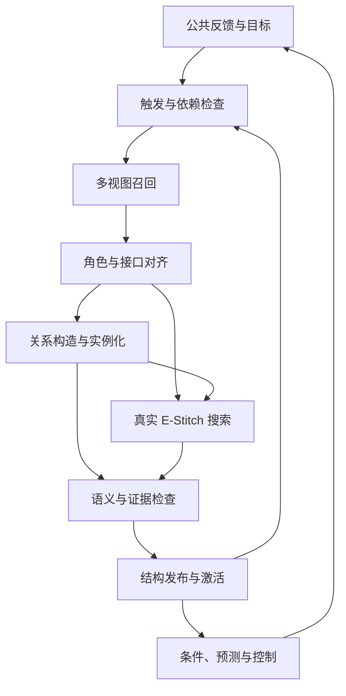
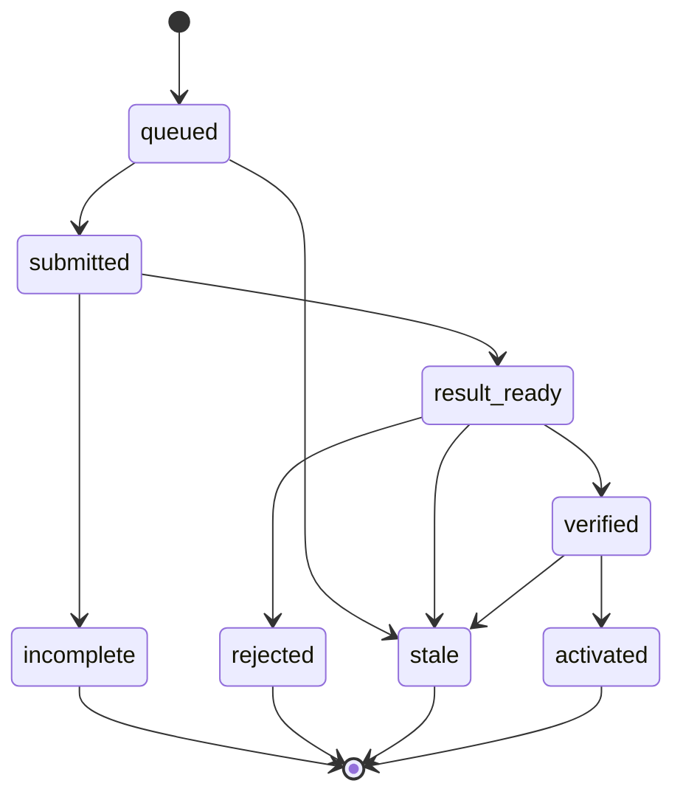

# 多层联想、真实 E-Stitch 搜索与持续改进调度

日期：2026-11-24。基线为 `c710498367637149c8664ddeee87eb4adffb3cef`。本文件承接 03 的任务顺序和 04 的关系语义，规定待实现的触发、检索、调度及消费闭环。

## 1. 联想的可执行含义

联想不是记录“这两个东西相似”。一项有效联想必须说明：**谁触发、想起谁、如何对齐、准备运行什么算子、读哪些版本、预期哪个消费者使用结果。**

用 Many Are Called / Few Are Chosen（多召回、少量精确选择，MAC/FAC）的两阶段组织思想：廉价特征扩大候选范围，精确结构检查确定可以进行什么计算。本项目不照搬其心理模型，也不引入 Common Lisp 依赖。



这里有两个不同循环：新数据驱动学习；新定义也驱动旧证据的重解释、条件扩展和再压缩。每次循环须有新的输入版本、新的未解决义务或明确新增预算，不能无进展自触发。

## 2. 三类身份、五层视图

### 2.1 三类身份

| 内容 | 用途 | 不允许承担的作用 |
| --- | --- | --- |
| 精确内容 ID | 同一原始记录或定义的去重、来源、版本追踪 | 数值距离不表示相似 |
| 规范结构 ID | 在明确的变量重命名／坐标视图下共享相同正文 | 不能把两个 occurrence 当同一个现实对象 |
| 相似特征集合 | 倒排召回与优先排序 | 不能成为 e-class union、真值或因果证明 |

规范结构 ID 的每一步变换都有可恢复见证；若忽略颜色只是为了召回，候选结果仍要回到原颜色和角色语义检查。当前 `JointMechanisms.jl::model_binding` 中“保色匹配失败后改几何匹配”的行为应改成两个显式视图：机制必须声明使用哪个视图，不能隐式放宽。

### 2.2 五层视图

| 层次 | 来源 | 首版提取特征 | 精确检查 |
| --- | --- | --- | --- |
| 对象出现 | 四／八连通支持、局部支持片段 | 相对坐标形状、大小、颜色直方图、边界、拓扑 | 原视图的像素支持、坐标恢复、颜色与边界条件 |
| 对象组／关系实例 | 同事件中接触、共变、共享接口的有界组合 | 角色类型、相对位置、关系边、共享角色 | 同一解释 scope、角色一致性与 distinct 约束 |
| 关系定义 | 已发布或待验证的关系 AST | 算子子项、列接口、Join 键、Project 列、读取相位 | 类型、列映射、参数替换、实际求值 |
| 机制 | 条件、动作、效果、读写区域、依赖 | 动作接口、条件／效果图、共享角色、资源角色 | 适用域、动作前条件、效果测量、版本与残差 |
| 有序程序 | 当前规划器的机制序列与组件接口 | 有序 n-gram、依赖边、共享资源、目标／前提接口 | 顺序、启用条件、中间状态与资源消费 |

对象组不是任意对象子集。由至少一个已知关联边连接候选，限制组大小，并保留未枚举范围。一个“六环”和“两个三角形”即使局部图特征一样，也不得在精确对齐时合并。

跨层联系使用已有依赖：对象参与关系，关系被 guard 使用，guard 限定机制，机制是程序组件，程序引用定义。对一块像素和一段程序直接算无类型距离没有明确用途，本轮不实现。

## 3. 相似特征的固定算法

### 3.1 有类型的关联图

用角色节点、算子／关系节点和带编号的端口边表示每个视图。节点初始标签包含节点种类、类型、时间相位、原语语义 ID；边包含方向、关系种类和端口位置。

共享同一角色使用同一个节点。`R(x,y) ∧ S(y,z)` 和 `R(x,y) ∧ S(w,z)` 必须生成不同结构。程序保留 `before/after/next` 有向边，不把动作序列改成无序袋。

### 3.2 Weisfeiler–Lehman 特征

局部聚合深度是召回特征的配置，不是概念表达能力或完整匹配的上限。可以先计算两轮特征并按需要加深；无论使用几轮，相似桶之后都需精确对齐，未召回材料不能据此判为不存在，也不能永久丢弃。

$$
\ell_{k+1}(v)=\operatorname{intern}\left(\ell_k(v),
\operatorname{sortmultiset}\{(e_{type},e_{dir},e_{port},\ell_k(u)):u\sim v\}\right).
$$

将每轮标签及计数、精确子项、接口和相位 token 合成稀疏多重集。`intern` 的哈希只是字典键；碰撞时比较规范标签内容。图特征相等不是图同构证明。

对象几何可生成两个显式召回视图：保色平移规范形、仅几何规范形。后者有明确的“只召回”能力，不能改变机制的适用条件。所有归一化均保存原点与坐标恢复，点击仍使用公共 64×64 坐标。

### 3.3 倒排召回

在可比较接口桶内维护 `token → 有序 view 引用及计数`。桶只使用确有意义的硬条件，例如对象／关系类型、可用的读取相位、请求的输入输出接口。

机制使用时动作 ID 是硬约束；结构压缩可以跨动作召回同形表达，但每个 occurrence 的动作仍保留，不能把两个动作的经验作用合并。

相似得分使用多重集加权 Jaccard：

$$
S(x,y)=\frac{\sum_t w_t\min(c_x(t),c_y(t))}{\sum_t w_t\max(c_x(t),c_y(t))}.
$$

首版各组权重来自配置文件，默认相同；分母为零时返回“无特征”，不伪造相似度。使用整数计数／确定的比较顺序，避免浮点并列导致回放不可复现。按分数、待处理年龄和稳定 ID 排序。

```text
recall(seed, index, budget):
    buckets = compatible_interface_buckets(seed)
    postings = 确定顺序列出 seed tokens 的 posting
    逐 posting 访问并累计候选，按页返回并保存后续游标
    对已访问候选计算真实 token 多重集得分
    返回候选、访问范围、游标、是否穷尽；本地验收持续消费到该范围完成
```

强制义务不依赖相似前 K 名：被反驳的机制及其精确依赖、当前目标需要的定义、未覆盖动作记录直接进入对应工作项。相似检索只负责发现与优化；**在线确定性控制不得因 WL 得分低而丢弃一个本来合法的动作或已适用机制**。控制剪枝只能使用精确类型／动作／前提索引。

撤销上一版“最多 32 个普通召回候选”的通用默认。若保留 top-K 接口，K 只表示一页处理量，后续相容候选继续可达并自动调度；不能永久删除第 K+1 个之后的材料。范围内的完整检索验收必须把相应分页实际处理完。

## 4. 精确对齐与结果形态

`align_views` 使用有限 Constraint Satisfaction Problem（约束满足问题，CSP）搜索。角色是变量，目标角色是候选值，类型、相位、端口、共享键和显式不同约束组成约束。现有 `match_pattern` 只用于它实际支持的保色平移嵌入；一般关系图不能借该函数名字假装已支持。

搜索顺序固定为：候选域最小的角色优先；并列按规范角色 ID；每步核对已经完全绑定的约束。允许部分对齐成为候选构造线索，但必须标明未对齐角色，不能作为完整模式复用。

对齐结果保存下列含义：

| 内容 | 含义 |
| --- | --- |
| 源／目标引用 | 对齐的是哪两个不可变版本 |
| 角色映射 | 每个源角色对应哪个目标角色 |
| 参数替换 | 哪些具体值被变量化，哪些必须保持相等 |
| 视图恢复 | 平移、列重排等如何回到原证据 |
| 已检查约束 | 类型、相位、共享角色、不同角色、边关系 |
| 未完成部分 | 预算或视野导致哪些约束仍未知 |
| 作用域与依赖 | 后续生成任务和修订要引用的版本 |

单射只在对象嵌入等明确要求时启用；一般关系变量可以相等，除非有 distinct 约束。跨两个局部单射匹配拼接时，还要核对两侧未共享角色是否发生冲突。

## 5. 触发器必须有具体计算输出

| 触发点 | 从当前代码哪里取得 | 立即处理 | 后续任务／消费者 |
| --- | --- | --- | --- |
| 新 confirmed 公共事件 | `run_online!` 收到 `completion == confirmed` 后 | 归档完整响应；对已执行预测检查 | 更新视图；登记未覆盖动作／对象作用 |
| 已使用预测被反驳 | `measure_joint`、`confirm_goal_step` | 撤销或隔离受影响实例和策略 | 对象重绑定、条件构造、机制修订、区分实验 |
| 多个机制给出不同预测 | `ranked_public_actions`、整帧投影冲突 | 保留分歧，不选任意一个当真 | 调用现有 `distinguish_predictions`，生成公共实验提案 |
| 新结构／重复残差 | 视图索引与当前残差 | 保存结构与来源 | 从旧批次召回相关表达，构造关系并启动 E-Stitch |
| 新关系可用 | `publish_activation!` 成功 | 更新定义索引、精确读者依赖 | 在相关历史上重求值，进入 guard／目标候选，必要时再压缩 |
| 新宏发布 | `publish_stitch!` 成功后语义检查 | 登记正文、调用点和来源 | 重写复用、关系编译、机制读取；不能直接发动作 |
| 目标或公共阶段变化 | 显式目标版本、公共关卡字段、可用动作变化、画面变动候选 | 使不相容的绑定和计划失效 | 按目标接口召回，条件回推与重规划，处理尾批 |
| 批次阈值或终止边界 | 现有批计数和公共终止状态 | 固定此阶段未处理证据范围 | 合并相容需求，启动一次有界深搜索 |
| 预算增加／新证据补齐 | 配置版本变化或相关新证据 | 检查任务义务仍存在 | 继续 Julia 游标或重新冻结 Rust 输入，区分重跑与续搜 |

画面大变只能触发“可能阶段变化”的检查，不能单凭像素比例宣布环境规律变了。用户给定目标和自动检测到的公共字段变化分别保留来源。

触发批次可配置，例如新增 8 个确认事件、出现 2 个独立重复结构、1 个已使用预测反例。这些数字只说明怎样设置调度时机，不限制最终处理的材料；反例失效不等待任何阈值。达到终止／阶段边界时，不足整批的尾部事件也必须进入待处理账本。

## 6. 从联想到操作的固定派发

一项触发可以提出多个工作，但每项工作对应一个具体算子：

| 当前缺口 | 首选算子 | 必须带回的结果 |
| --- | --- | --- |
| 模式已知但当前对象未绑定 | Instantiate（实例化） | 当前角色映射及约束见证 |
| 同模式多处出现、参数不同 | 规范化＋真实 E-Stitch Expand／Reuse 搜索 | 参数定义、选中调用、展开证明、来源 |
| 现有条件分不开成功与失败 | Join／SelectEqual／Project 的有界关系构造 | 新候选及正反例／unknown 评估 |
| 两组件可用但共享角色未接 | 精确 Join／接口组合 | 一致绑定、前后条件及资源读写 |
| 旧抽象合并了决策相关后果 | Representation refinement（表示细化） | 新区分、更新查询分区、重验转移方块 |
| 需要减少目标无关字段 | 查询投影与充分性检查 | 被保留查询、失去的信息、检查范围 |
| 候选规律相互竞争 | 区分实验 | 一个可执行公共动作提案及预期分歧；不是执行命令 |

构造器不直接向控制器写“动作可用”。它产出有类型的候选，经过统一验证和激活后才进入消费者。

## 7. 工作项、任务尝试和持久文件

先区分三个概念：

- **Work（认知工作义务）**：例如“解释事件 e 的未预测效果”。它可以因新证据和新预算产生多次计算。
- **Job（冻结计算）**：固定输入证据、基础库、语义版本、算法配置和预算的一次计算问题。
- **Attempt（执行尝试）**：对同一个不可变 Job 启动 worker；进程失败不改变问题内容。

相同来源重复回放只确认同一个 Work；扩大预算生成新 Job 并引用原 Work；重复 Attempt 的相同结果只激活一次。

每个 Job 必须解释这些字段：

| 字段 | 含义 |
| --- | --- |
| `work_ref / trigger_refs` | 为什么需要计算，哪些公共事件或定义引发 |
| `operation / target_interface` | 执行什么构造／搜索，期望怎样的输出 |
| `evidence_snapshot_id / input_refs` | 精确冻结的公共来源，沿用现有摘要核验 |
| `library_base_version` | 结果将写回哪个全局库版本 |
| `prelude_version / prelude_ids` | 该 worker 实际读取的依赖闭合子库，见第 9 节 |
| `semantic_revision / read_versions` | 原语、求值器、解释和适用断言的版本 |
| `scope / cutoff` | 此次计算范围以及训练读取的时间边界 |
| `algorithm_config_digest / budget` | 真实搜索器和预算配置，不能运行后改写 |
| `consumer_intent` | 希望进入哪个关系、guard、查询或规划入口 |

目录复用当前 run：`association/` 存索引快照、视图引用和义务；`learning/` 存冻结输入与 worker 输出；`publication/` 存结构库；`activation/` 存当前语义快照。全部用现有 `RunStore` 原子写入能力，不引入第二套事实数据库。

新学习任务目录采用 `learning/job-<job_digest>/attempt-<序号>/`，Julia 明确写入 ready 引用；Python 不再依靠旧的固定六位任务名猜测要运行什么。路径仍必须在受监管 run 内、禁止符号链接逃逸，manifest 最后写入作为冻结完成标志。

## 8. 状态机、去重和公平服务

语义状态由 Julia 唯一写入：



`incomplete` 指计算未完成；`rejected` 指类型／来源／证明或候选义务失败；`stale` 指依赖版本已改变。`capacity_blocked`、`worker_unavailable` 是带原因的阻塞状态，恢复条件必须记录。对一个 Work 尚未完成的义务另有 pending 记录，不能因某个 Job 终止而丢失。

Python 单独写执行状态：started、exited、timeout、memory failure、binary identity。Rust 只写它的原始结果。两种语言不竞争修改同一个任务状态文件。

### 8.1 去重

Work 的键为 `(算子, 种子引用, 目标接口, 问题域, 相关语义版本)`；同键新触发仅补充来源，不无限创建任务。Job 的键再加冻结语料与算法预算。定义发布的自触发必须满足至少一个条件：新增独立 occurrence、新目标端口、未解决反例、新语义版本或明确追加预算。

### 8.2 服务顺序

反例导致的**立即失效**不排在慢任务队列。慢任务分三个队列：修复、发现、压缩复用。采用 Deficit Round Robin（亏欠轮转）式工作额度，每类额度为正，首版比例 `4:2:1`，不按任务数假设相同成本。

Julia 构造和求值可按 work slice（工作片段）运行并保存游标，片段结束自动继续；本地 Rust 深度验证不强加固定秒数或步数截止。当前 Rust 不能任意抢占后恢复完整 heap，因此不能为了调度每 60 秒杀死并从头重复。同一发布 worker 先完成当前声明的搜索问题，再服务后续任务；长任务持续报告进展并可由显式停止或实机资源保护中断。只有单次服务可结束时才有后续队列服务保证，开放无终点的搜索不宣称固定公平时限。

记录实际工作扣减额度；估计值只用于排列，不能免记已花成本。失效任务出队、同义任务合并，旧触发的未决义务保留。

调度 credit 统一用实际执行服务时间，Julia 与 Rust 分别记录执行占用，等待同一结果不反复收费；不再预置 50 毫秒或短 worker 硬时限作为本地验收标准。队列比例只影响开始顺序和后续服务，不限定某项认知总共能计算多少。算法内部的行数、节点数、字节仍分别计量，不混加为一个模糊成本。blocked／stale 项移出 ready 队头，保留恢复条件与 Work 义务。

实际服务时间受硬件影响，因此持久记录每次额度结算和就绪次序；调度回放使用已记录值。确定性保证主要是固定输入下的特征、排序、构造与证明计算，不宣称不同机器上异步学习完成时点和在线动作轨迹完全相同。

## 9. 语料选择与依赖闭合子库

### 9.1 冻结语料的来源

`select_learning_corpus` 按稳定顺序合并：当前种子；精确对齐的历史发生；相关反例／未知情境；未处理动作的一定份额；与目标接口相关的表达。每一项均有 origin，不能只有匿名 AST。

反例中的**实际结构**可以参与压缩，但“此机制失败”的标签留在 Julia 验证集中。不能因为它进入语料就把它计成支持。验证集要与候选生成使用的记录分开登记；同一事件的多视图按一个独立样本计数。

按槽上下文、返回类型和相位组织相容语料组。当前 Rust 的 sorts、arity、AST 和字节常量是实现边界，需要扩展时应修改两端合同或改进装载／表示；不能因为旧上限低就把正常本地实验永久拆散。确需分组时保留跨组来源与后续联合搜索义务，不把不同 header 合成无区分的 `Relation`，也不把单组完成称为全局完成。

### 9.2 持续库增长不能靠每次传整库解决

现有 `freeze_stitch_job` 传入完整 `base.entries`。只把 `max_new_definitions` 改成单次配额仍不足以支持持续增长。

首版增加**选择依赖闭合子库**：

1. 根集合是本次语料中实际调用的定义、精确对齐要求的定义及当前目标明确依赖的定义。
2. 递归加入它们的全部定义依赖，拓扑排序。
3. 追加本次相关候选定义；每追加一个必须连同完整闭包一起计量，按实际使用与资源情况安排加载。
4. 测量定义数、展开节点、sorts 与输入字节。必要闭包超过现有软件小常量时改进合同／装载，不删依赖；超过实机资源时诊断并选择精确分块／共享或扩大资源后继续。
5. 保存 `prelude_ids`、闭包摘要、每个定义正文摘要，以及全局库版本。

worker 只导入这个 prelude，但新定义回写的是全局库。发布校验必须调整：检查全局基础版本仍一致；prelude 是该版本的确切依赖闭合子集；返回依赖仅来自 prelude 和本轮先前定义；新定义加入全局库时不删除未参加本轮的旧定义。禁止把子库版号冒充全局版号绕过现有校验。

不再使用固定 `max_new_definitions_per_job=2` 作为本地学习终点。按完整轮次的实际结构收益、验证结果和认知义务推进；历史定义按 ID 可加载。活动缓存由实机内存情况管理，索引可淘汰重建但定义依赖不能悬空。真实资源不足要继续解决，不能写 capacity_blocked 就宣布核心验收完成。

### 9.3 证明与成本账本必须同子库一起改

当前 `publish_stitch!` 要求完整 `base.entries == checkpoint.entries`；`publication_from / publish_library` 用 Job signature 注册整个 base；`verify_published_stitch` 又用 `initial_library_count` 的全局前缀计算成本。这些都必须一起迁移，不能只改成一个子集判断。

新合同把两个问题分开：

- **Job 证明包**：只包含冻结语料、prelude、本轮新定义、该 Job signature、proofs 和成本。`cost.initial_library` 只计 prelude；输入、输出和最终压缩成本也在同一问题上核算。
- **全局库清单**：包含全局 base/result 版本和增量定义目录。未参与的旧定义保留自己的 primitive descriptor 与依赖摘要，不拿局部 signature 重新注册无关全库。`read_published_stitch` 与 `verify_published_stitch` 分别验证清单完整性和 Job 证明包，再按需装载定义闭包。

publication 记录 global base/result、prelude ID／摘要、新定义 ID 和 Job 证明包引用；不用一个 `initial_library_count` 同时表示全局前缀与子库。全局存在不同 sort 的无关定义时，本 Job 的证明和压缩成本应保持不变，发布后那个旧定义仍能按其依赖装载。

当前 Rust `MAX_DOCUMENT_BYTES` 为 4 MiB，是既有序列化合同而非硬件定律。撤销上一版总输入 8 MiB／单文件 4 MiB 作为未来本地验收默认。合法输入需要更大空间时，修改两端受控装载或流式分块，保持文件摘要、范围和完整性检查；提交前识别现有合同不支持的输入，修复后再运行，不反复启动注定解析失败的 worker。

## 10. 改造 `online_learn!` 的实际接口

拆为三个职责，内部继续调用已有代码：

```text
prepare_learning_job!
  → select_learning_corpus
  → compile effect/query programs and origins
  → select_dependency_closed_prelude
  → freeze_stitch_job
  → durable ready record

poll_learning_results!
  → read worker-status
  → read_stitch_rounds
  → check types/proofs/origins/semantic digest
  → validate base library and dependencies

verify_and_activate!
  → publish_stitch!
  → read_joint_mechanisms / read_query_definitions
  → evaluate affected guards and queries
  → check new relevant evidence after job cutoff
  → publish_activation! atomically
  → emit DefinitionActivated
```

`wait_worker` 不再位于每步在线动作路径。先前同步训练仍可通过调度器的显式训练 barrier（屏障）等待，而不是保留另一套 `online_learn!` 旧实现。

### 10.1 每次决策前

```julia
function before_decision!(runtime)
    poll_learning_results!(runtime)
    verify_and_activate_ready!(runtime)  # 有界；无效版本不能进入控制
    submit_next_ready_job!(runtime)     # 至多一个 Rust worker
    decision = ranked_public_actions(runtime.active_snapshot, ...)
    revalidate_current_policy_and_bindings!(runtime, decision)
    freeze_prediction_with_pre_action_reads!(runtime, decision)
    return decision                    # 原有 Recorder 是唯一动作发出者
end
```

### 10.2 每次 confirmed 反馈后

```julia
function on_confirmed_feedback!(runtime, event)
    seen_event(runtime, event.id) && return recover_event_processing!(runtime, event)
    assess_executed_prediction!(runtime, event)
    quarantine_refuted_or_unchecked_claims!(runtime, event)
    invalidate_dependent_policy_suffixes!(runtime, event)
    archive_confirmed_event_once!(runtime, event)
    update_affected_views_and_index!(runtime, event)
    for trigger in collect_triggers(runtime, event)
        enqueue_or_merge_work!(runtime, trigger)
    end
    checkpoint_processing_watermark!(runtime, event)
end
```

事件处理水位不能在全部派生更新前提前写“完成”。若中途崩溃，按每步幂等键恢复尚未完成的派生步骤，不再追加第二条公共事件。

把条件重拟放入慢任务后，受影响但未核清的条件先变成 `pending_revalidation / unknown`。不能让下一动作继续消费一个已经收到反例但尚未修好的旧机制。

## 11. 结构发布、语义激活和版本失效

沿用现有 `publish_stitch!` 的严格验证，增加 04 所述 activation 快照。序列为：暂存完整候选 → 求值与依赖检查 → 写不可变 activation → 原子切活动指针 → 内存替换同一快照。

| 验证期间发生的变化 | 处理 |
| --- | --- |
| 全局库版本变化 | Job 标 stale；重新冻结当前库，不做自动重基 |
| 原语／解释器语义变化 | stale；相关定义求值、证明缓存和索引重建 |
| 输入绑定／经验断言失效 | stale；不能沿用旧对齐激活 |
| 仅新增公共证据 | 结构展开证明仍可检查；激活前补验新增相关记录并更新验证水位 |
| 新记录太多，补验预算不足 | 保留待激活结构和 incomplete，不先激活再补验 |
| 相同结果再次送达 | 按结果摘要与 activation 引用幂等处理，不重复增加支持 |
| 某一个机制适用性被反驳 | 只撤销其适用记录及下游；仍成立的结构定义保留 |

将现有 `DependencyIndex` 用于所有派生读者：视图 → 关系求值 → 条件 → 机制预测 → 计划边 → 待执行动作，以及定义 → 任务／派生定义。每条边都有实际读取含义，不用相似关系代替依赖关系。

结构发布返回不可变 commit receipt，含 `job_id/result_digest/base_version/published_version/publication_ref`。激活校验只允许此 receipt 证明的本 Job `base→published` 转换，不能把自己的提交误判为外部 stale。若结构指针已切但账本尚未记成功时崩溃，先按 receipt 恢复既有发布，再继续激活，不能重复提交。活动指针已切、内存尚未更新时重启，内存从该指针重建。O12/O13 必须在这两个窗口注入故障。

首版全局结构提交串行化：一个 Rust Job 冻结运行期间，其他构造结果进入待发布集合；本 Job 完成验证和结构提交后，再按稳定顺序处理其他提交。反例隔离、依赖失效和只读求值仍立即执行，不受结构提交次序阻塞。构造器的候选目录不是已发布库；不能因候选生成不断推进全局库版本，导致真实 Rust 结果无限 stale。

## 12. worker 监管与恢复

Julia 拥有任务语义账本；Python 只领取 Julia 已 ready 的 Job、核二进制身份、启动一个受限 Rust 子进程、轮询并写独立执行状态。

`public_run.py::process_jobs` 改为非阻塞监管：有 worker 时只 poll；完成后写状态；无 worker 时取 ready 引用。领取使用独占锁和 attempt ID，启动状态包含可验证的进程身份，不仅靠一个可能被复用的 PID。恢复时先确认旧 worker 已结束或处于当前监管组，不能重复同时启动。

同时拆分 `python/src/tddesc_tools/stitch.py::run_worker` 内部当前阻塞的 `subprocess.run(systemd-run --wait...)`，形成 prepare/start/poll/finish；保留原 sandbox、cgroup、deadline 和结果 Contracts 校验。systemd unit 使用 Job＋Attempt 的唯一名字并持久化，恢复时校验 unit 与 binary／输入摘要，不能只改外层 process_jobs 而让内部继续阻塞。

完成轮次继续通过 `read_stitch_rounds` 使用；未完成半轮没有持久化完整 Rust 搜索前沿，**重新执行不是从旧 heap 精确续搜**。新 Attempt 必须写新输出目录，不能在旧半写结果上继续冒充一次完整输出。

执行终止、搜索穷尽和某个 round 证书有效是三个状态。沿用当前 code 10 可带回有效完整轮次的能力：已校验 round 可进入 verified／activated，剩余搜索义务保持 pending；不能把所有超时输出一律丢弃，也不能把有效前缀写成全域已搜索完。

现有 `Recorder` 拒绝已含 commands 的目录，`recover_run` 是证据恢复，不是官方在线 resume。首版保证计算任务恢复、幂等回放和不重发未知动作；不承诺重启后无缝恢复原游戏。原 run 有 `outcome_unknown` 时继续隔离；另起公共会话可读取已 confirmed 的 prior evidence，不推断原环境当前位置。

## 13. 冻结评估的显式边界

修改 `scripts/run.jl`，使用同一调度器执行：

1. `prepare_training`：从给定 prior evidence 完成指定训练、结构发布与激活。
2. `freeze_boundary`：drain 或明确取消所有训练任务，固定库、语义、activation、机制、条件和训练水位摘要。
3. `evaluate`：保存新公共观测、做只读查询和控制；禁止新训练定义、条件重拟、经验适用版本更新和待到达 worker 结果激活。

只读求值缓存可重建，但不能改变冻结知识语义。反例可使当前待执行策略失效或使系统拒绝使用已反驳实例；不得借“修订”在冻结评估中重新训练。评估结果与后续训练数据的转移必须发生在新的显式阶段。

实现一个仅用于本次评估执行隔离的 `evaluation_quarantine`，由 `ranked_public_actions / live_goal_step` 读取；反例使受影响实例进入该集合并撤销 cursor，但不修改冻结 activation、guard、训练证据或知识摘要。这是执行约束状态，不是新训练模型。

训练 barrier 只 drain 一组已经冻结的 Work，不能把定义自触发的新任务无限追加到当前等待集合。本地核心验收必须完成这组工作；触及实际资源保护仍未完成时，记录原因并继续解决。在线 WIN／动作上限退出时执行 `finalize_learning!`：有限退出等待只负责关闭或移交工作，不代替本地充分验证；收取已完成结果，剩余任务保存 pending，停止或登记正在运行的 worker 后再退出；不发额外公共动作，不留下无人监管的新 worker。

## 14. E-Stitch 内部哈希：已有能力与三项精确优化

Hash（哈希）既用于外部材料召回，也用于 E-Stitch 内部。当前实现已包含结构驻留、模式去重和形状聚合；缺口是部分昂贵计算发生在去重之前，实际匹配仍有重复扫描与笛卡尔枚举。本节优化的目标是**同一语义问题少做重复计算**，不通过缩小搜索范围获得速度。

### 14.1 当前已经使用的哈希

| 位置 | 已有能力 | 真实生产状态 |
| --- | --- | --- |
| `third_party/egg/src/egraph.rs::memo/lookup_internal/add` | Hash-consing（结构哈希驻留）：规范子节点后复用相同 e-node | 已使用 |
| `search.rs::SeenTracker` | 以模式、类型和冻结集合处理重复状态 | bridge 明确启用 opt-seen |
| `search.rs::expand_shapes/compute_eclass_shapes` | 按算子判别、arity 聚合候选形状与支持 | 已使用 |
| `factor.rs` | 以精确集合／投影基数辅助无损因子分解 | 已使用 |
| `shift_equal.rs` | 带 e-class 与绑定深度的递归缓存 | 已使用 |
| `footprint/tracker.rs` | 匹配脚印的 hash／fingerprint 去重 | 当前 bridge 明确关闭，不能写成在线已采用 |

### 14.2 优化一：先精确查重，再展开匹配，并逐个生成后继

当前 `best_first.rs:246–254` 对所有 action 调 `apply_action`，先 collect 成完整 successors；到 278–280 行才用 SeenTracker 去重。重复候选的匹配表因此可能已经花费大量构造和分配。

新增 `preview_child`，在生成完整匹配前精确计算 child pattern、变量重命名、sorts、绑定深度和 freeze policy：

    for action in deterministic_actions(parent):
        preview = preview_child(parent, action)
        if seen.proves_redundant(preview.key):
            continue
        child = materialize_child(parent, action)
        assert exact_key(child) == preview.key
        apply_existing_admission_checks(child)
        commit_seen_after_success(child)
        enqueue(child)

SeenTracker 的预查询必须是非变更 probe；未成功构造、未通过相应检查的 child 不提前登记为已完成，防止误剪合法搜索。冻结集合的支配语义按当前实现保留，不能仅比较一个裸 pattern hash。预计算键必须与原 apply_action 逐项差分一致；先把当前生产一阶类型语法的全部 Expand／Reuse 情形覆盖完整，再替换生产入口。

逐个后继处理避免同时持有全部 successors 的匹配表。保持当前确定的 action 顺序、队列 tie-break、候选计量和证明含义；减少临时分配不是改变搜索问题。

### 14.3 优化二：Expand 直接访问 e-class 的目标形状桶

`search.rs::build_subset_matches:316–355` 当前对每个 factor 行扫描其 e-class 的全部节点，再执行 `node.matches(target)`。形状候选已经使用哈希，实际展开却仍重复扫描。

在当前静态搜索 epoch 建立：

    (canonical_eclass_id, operator_discriminant, arity)
        → ordered matching enode references / child tuples

展开时只访问目标桶，桶内仍执行必要的精确 `matches` 判断；保留全部匹配、子节点顺序、其他列、来源和多重性。当前搜索内 e-graph 不 union，索引可在该轮复用；跨 union/rebuild、新语料、新库或语义版本时重建／失效。

哈希桶不能只保存一个代表 child，因为同一算子可能有多组合法子节点。真正的输出规模仍需处理，不宣称哈希能消掉真实答案。

### 14.4 优化三：Reuse 的精确哈希连接，同时改计数与物化

必须一起修改：

1. `search.rs::enumerate_successor_actions` 的跨因子支持计数（约 969–990 行）。
2. `search.rs::build_subset_matches_reuse` 的实际构造（约 393–414 行）。

`shift_equal.rs` 给出：同绑定深度时，相等判断恰好等价于当前规范 e-class ID 相等。因此：

    index right rows by egraph.find(row[shared_column])
    for each left row:
        for right row in index[egraph.find(left[shared_column])]:
            emit exact merged binding

哈希冲突用实际规范键比较消解。同键不同剩余列全部保留；支持数按同键组大小相乘再求和，并保留其他独立 factors 的乘数。计数使用溢出检查。

当前对潜在 `|A|×|B|` 的提前规模拒绝必须同步改掉；否则稀疏连接还没进入哈希算法就被旧检查拦住。资源计量改为实际输入访问、索引大小、候选检查和真实输出。

同一 factor 内仍检查同行两列；不同绑定深度保留其 shift-aware 精确数学分支。共享内部函数 `count_same_depth_join / visit_same_depth_join`，保证计数与输出使用同一键规则。

### 14.5 不直接打开未核验的匹配脚印剪枝

当前 bridge 设置 `--no-opt-dedup-by-match`。`footprint/tracker.rs` 的精确列置换核查仅在 `check_slow` 时执行，现有 fingerprint 路径也未显式承载完整 typed 端口语义。本轮不能直接翻开关，把 hash 相同当已证明可剪枝。

若后续启用，先用 hash 筛桶，再核对保持类型、深度、端口及冻结策略的精确置换／支配见证。未经这一步的相似脚印只可排序，不可删除候选。

### 14.6 共享与缓存的边界

精确缓存键必须涵盖 search/e-graph epoch、规范结构或 factor 内容、算子／动作、槽映射、相关类型与绑定深度，必要时加入冻结策略。裸 e-class ID 不能跨 rebuild 长期复用。

当前 factor 行已有共享引用；是否再加入全局内容驻留，先测不同路径生成相同 factor 的比例及维护成本，不先增加一个未经证明有用的缓存层。

这三项优化各自用独立原算法枚举器作测试预言机：比较合法后继、完整匹配行、支持计数、多重性、类型、冻结信息和证明结果；再比较扫描、展开、临时分配和峰值 RSS。核心本地对照给予充分计算，不能通过更小限额让某一方少做工作来证明“加速”。

## 15. 自动改进怎样有可观察进展

每项联想任务记录其实际后续消费：被哪个查询调用、使哪个条件区分了反例、使哪个计划组件可以复用、是否减少了重复解释工作。候选被召回很多次不是成功；宏正文短也不是控制已经可靠。

调度层可以按已完成工作的统计调整同类任务内部排序，例如使用 `(1 + 有消费结果的任务数) / (2 + 已检查任务数)` 作为一个平滑利用率指标，并结合实际工作成本。这个值只调检索预算，不写为机制因果概率。类别正额度、反例义务和未覆盖动作份额不允许被该指标降为零。

稳定性、经验支持与控制覆盖分别保留：

- 结构定义的类型／展开检查；
- 声明适用域内的独立支持事件、反例、unknown；
- 未用于构造的验证记录；
- 具体动作—角色—查询效果的已尝试／未尝试／未解释残差；
- 控制前提与后继是否完整。

“动作对象最小因果单元的闭合覆盖”采用显式义务表：公共动作 ID（含点击参数域）× 当前可绑定角色接口 × 目标相关查询／效果 × 解释 scope。只统计已声明有限候选域；4096 个点击坐标不能因为抽取了几个候选就写成全覆盖。窗口外对象、未试动作、未解释变化和预算截断必须出现在缺口记录中。

## 16. 新增接口与现有调用点

| 计划接口 | 文件 | 接到哪里 |
| --- | --- | --- |
| `association_views / index_view! / recall / align_views` | `AssociationIndex.jl` | 原始事件派生后；新定义激活后 |
| `collect_triggers / enqueue_or_merge_work!` | `AssociationScheduler.jl` | confirmed 反馈、阶段边界、定义激活 |
| `select_learning_corpus / select_dependency_closed_prelude` | `AssociationScheduler.jl` 调现有语料编译器 | `prepare_learning_job!` |
| `prepare_learning_job! / poll_learning_results! / verify_and_activate!` | `OnlineSession.jl`，调度状态委托 scheduler | 替换 `online_learn!` 的单体同步实现 |
| `publish_activation!` | `Library.jl` | 新定义语义检查全部完成之后 |
| `invalidate_typed_dependents!` | 复用 `Plan.jl::DependencyIndex` | 修订关系、条件、绑定与视图时 |
| `poll_worker / start_ready_worker` | `python/src/tddesc_tools/public_run.py` | 外部监管循环 |
| `preview_child / probe_seen / commit_seen_after_success` | `third_party/egg-stitch/src/search.rs` 与 `best_first.rs` | `apply_action` 前精确探查；逐个构造、准入与入队后继 |
| `build_shape_index / matching_shape_nodes` | `third_party/egg-stitch/src/search.rs` | `build_subset_matches` 的 Expand 节点访问；搜索 epoch 管理失效 |
| `count_same_depth_join / visit_same_depth_join` | `third_party/egg-stitch/src` 的匹配实现 | 两个 Reuse 分支 |

### 16.1 程序层必须有真实生产者和消费者

`ProjectedPlanning.jl::search_observed_goal` 或 `Plan.jl::solve_policy` 产生／修订策略时调用 `program_views_from_policy`，提取有序机制引用、共享角色、资源接口、目标与依赖。每个片段标明已执行前缀和仅预测后缀；后缀不能算经验支持。

目标变化或发现同类接口缺口时，`recall_program_candidates` 召回这些程序视图，`align_views` 对齐当前角色；`revalidate_program_candidate` 在当前 activation 和 belief 下逐边检查动作启用、前提、后继覆盖、资源和观察分支。通过的片段仅作为**同一个**规划器的候选动作排序或已有解种子，失败或不完整的片段不成为策略。`solve_policy` 的完备范围不得被相似排序缩减；实际执行仍调用当前 Recorder。06 的 O23 核查它真的进入规划搜索，而不只是被索引。

## 参考文献

1. [MAC/FAC 官方说明及原论文](https://www.qrg.northwestern.edu/ideas/macfac.htm)：两阶段联想检索。
2. [SME v4 官方代码和实验材料](https://www.qrg.northwestern.edu/software/sme4/index.html)：结构对齐的参考实现，不直接加入生产依赖。
3. [Weisfeiler–Lehman Graph Kernels](https://www.jmlr.org/papers/v12/shervashidze11a.html)：局部图结构特征。
4. [E-Stitch 2026 作者会议页](https://pldi26.sigplan.org/details/egraphs-2026-papers/7/E-Stitch-Top-Down-Library-Learning-for-E-Graphs)：结构发现思路；集成细节以本仓库固定源码为准。
5. [Efficient Fair Queueing Using Deficit Round Robin](https://repository.library.washu.edu/cse_research/339/)：服务额度思想；本文的认知任务公平性必须按具体预算实现另行验证，不能直接照搬网络吞吐定理。
