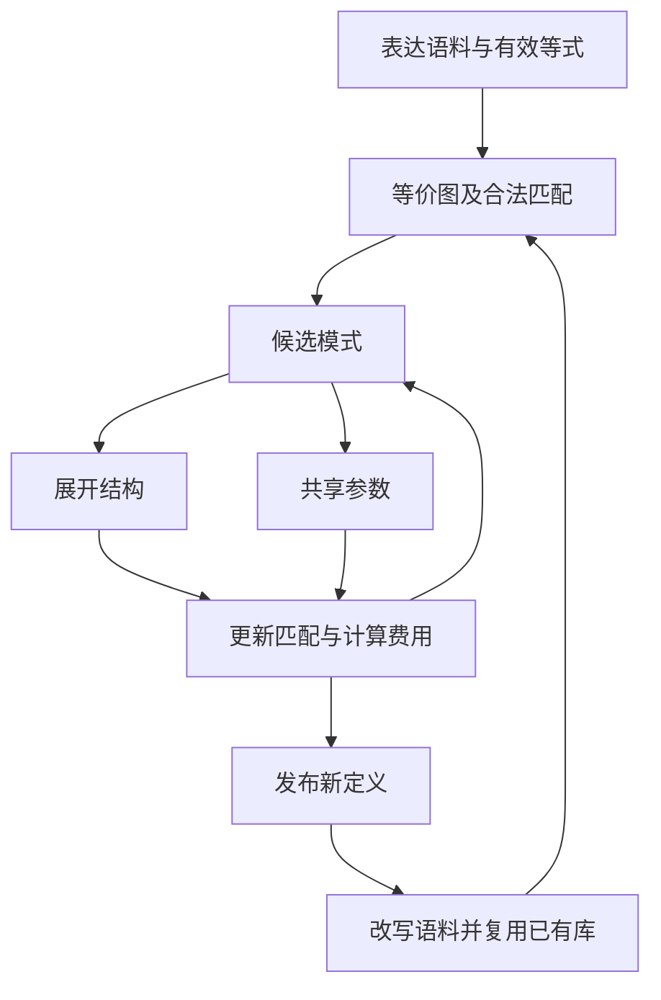

# E-Stitch 功能、全部配置参数与当前项目接入边界

日期：2026-11-24，台北时间。本文是固定源码的功能与参数手册，不是性能实测报告；本次不修改运行代码。

## 1. 先明确版本与最重要的结论

- 公开上游：`mlb2251/egg-stitch`，固定到 `cdbba10e3075a14c9d7933c125807d7dc6a04b42`。该提交的父版本是之前核查的 `e4cd59047b9e1c7d04bc035a3c1cadd66a1b7c92`；此次上游变动是图表标签／图片，没有搜索算法变动。
- 本项目：`zdx3578/TddESCat`，分支 `impl/2026-11-23-toolchain-bootstrap`，检查基线 `027baf6d2c8c89d4d82b45659bc9a2dc69680753`。
- 项目内 `third_party/egg-stitch/UPSTREAM.toml` 固定上游 e4cd，并列出本地类型检查、流式应用、因子行共享与资源检查等修改。因此“原版”和“项目 vendored 版本”不能混称。
- **原版 `--max-arity` 默认是 1000，不是 2。当前两参数是项目配置加上的取值；项目协议和编解码器又把可接受接口硬限制到 8。**
- 原版有真实多轮程序库学习、两种搜索器、等价重写、绑定感知的结构抽象、费用评估、匹配因式分解与哈希去重。当前桥接只开放其中一部分。
- 不能用任意小的搜索步数、参数数、时间或内存默认，代替本地核心能力的完整实现与验证。充分计算修订见 07；本文重点解释已有功能和参数的真实语义。

主要依据：[S1]、[P1]、[P2]、[P3]、[P4]、[P5]。

## 2. E-Stitch 实际学习什么

Library Learning（程序库学习）是从已有表达语料中发现可反复调用的新定义。E-Stitch 把 Stitch 的语料引导自顶向下搜索放进 Equality Graph（等价图，E-Graph），允许在给定等价规则下发现共同结构。官方工作标题为 *E-Stitch: Top-Down Library Learning for E-Graphs*。[S0]

输入材料是已经编码的表达或程序，不是原始像素直接交给搜索器就自动产生对象语义。输出包括新定义、参数、改写后的语料、费用与搜索统计。函数名通常是 `fn_N`，无需运行时大模型编写正文。

### 2.1 一轮学习的具体过程

1. 从输入程序建图：相同节点共享；如果提供规则，把规则产生的等价写法并入图。
2. 从一个通配元变量开始，表示还未确定的结构。
3. Expand（结构展开）：把某个元变量展开成语料中实际出现的算子，生成子变量并更新合法匹配。
4. Reuse（参数复用）：要求两个变量由同一参数承担，筛掉无法共享绑定的匹配。
5. 计算候选被提成函数后，整份语料加定义正文的费用。
6. 普通压缩模式下，只把具有正费用收益的合格候选选为新定义。
7. 把新函数调用写回语料；后续轮次可以继续使用该函数来形成更高层定义。



例如搜索可以先出现：

```text
pair(move(?0, ?1), mark(?2))
```

再通过参数复用得到：

```text
pair(move(?0, ?1), mark(?0))
```

这里第二种模式要求“被移动的对象”和“被标记的对象”是同一个绑定。`?0` 等是说明性元变量；不是游戏动作，也不是自然语言模型生成的答案。

### 2.2 它能做什么，哪些语义由外部提供

| 能直接提供的能力 | 必须由 ARC3 的证据与语义系统提供的内容 |
| --- | --- |
| 搜索共同结构、共享参数、自动形成新函数定义 | 从前帧／公共动作／完整后响应构造有意义的表达 |
| 在给定等式下比较不同写法 | 等式为什么成立、作用域是什么、是否需要条件 |
| 输出定义、调用与结构费用 | 定义对应哪些实际对象、记录和实验 |
| 后一轮调用前一轮新函数 | 新定义怎样进入关系求值、条件、预测与控制 |
| 校核程序改写的结构一致性 | 跨状态因果预测、查询保持与控制实现是否成立 |

`Holds`、`Matches` 这样的算子在原生不透明语法中只是符号。只有当系统给出其可求值含义、证据绑定和组合接口，程序压缩才与我们的认知概念形成连接。E-Stitch 不会凭一个名称自动获得物理语义。[S1]、[S2]、[S4]、[S6]

## 3. 参数个数到底限制什么

Arity（参数个数）是抽象定义的独立元变量数量。必须与以下数量区分：正文节点数、变量出现次数、动作序列长度、对象数量、数据维度和认知层次。

```text
f(x, y) = pair(move(x, y), mark(x))
```

这里 x 出现两次，仍只有两个独立参数。一个参数也可能表示一个集合、一整棵子表达或一个程序。

### 3.1 两个参数不是无用，但不能作为通用能力边界

例如以下有三个独立角色的概念接口：

```text
OpenCondition(agent, key, door)
    = Holds(agent, key)
      ∧ Matches(key, door)
      ∧ Near(agent, door)
```

当语料和语言确实包含这些可求值关系，直接表示这个接口需要三个独立参数。`max_arity=2` 排除了这一直接的三参数定义。

类似地：

```text
MoveEvent(object, x_before, y_before, dx, dy)
```

是五个独立参数的接口。若把坐标组成 Point、位移组成 Vector，接口可以变短，但这需要已经实现的类型、构造和投影语义。不能把任意角色塞进一个包，就宣称内部关系已经学会。

因此：参数数量应由需要表达和复用的接口决定；不能预先固定为两个，也不能把参数越多当作概念越高级。

### 3.2 一个可手算的三参数压缩例

下面是教学算例，不是运行结果。使用 `op-children`，节点费用全为 1：

```text
f(x, y, z) = (+ (* x y) z)
```

- 原正文五个节点。
- 假设十处实例均使用原子实参，原语料费用为 `10 × 5 = 50`。
- 改成十个 `(fn_N a b c)` 调用，每个四节点，共 40。
- 加上定义正文 5，总费用 45，节省 5。
- 计入共同的 `programs` 根时，两边各加 1，节省量不变。

这说明三参数定义本身可以有真实结构收益。两参数上限会把这个定义排除。

### 3.3 中间模式可能超过最终参数数

- Sequential Monte Carlo（序贯蒙特卡洛，SMC）在枚举后继时传 `usize::MAX`，普通 winner 准入处再检查 `arity <= max_arity`。设为 2 时，中间出现更多变量并不矛盾。
- Best-First Search（最佳优先搜索）同样在返回候选处检查参数数；另外 `search.rs` 对规范变量排序中的 `rank[var_idx] > max_arity` 跳过展开。因此它也影响部分搜索路径。
- 不能说“所有中间模式最多两个变量”，也不能说“该参数完全不影响搜索路径”。
- 普通压缩模式且未同时禁止零参数宏时，`--max-arity 0` 只允许零参数宏；不是无限。同时设置 `--no-zero-arity` 则没有满足这一参数范围的普通可返回定义。
- 原生参数是整数，不接受 `--max-arity none`。只有某些其他选项支持 `none`，不可混用。
- `--follow` 是诊断模式，exact target 命中走特殊路径；不应以它作为无目标自动发现的成绩，也不能无条件套用普通 winner 的限制结论。

依据：[S1]、[S2]、[S3]、[S4]。

## 4. 压缩目标、学习轮次和搜索步数

### 4.1 费用目标不是简单数出现次数

一轮的核心目标是：

$$
C_{\mathrm{round}} = C(\text{改写后的语料}) + C(\text{本轮新定义正文}).
$$

多轮累计报告还会加回之前各轮定义的正文费用：

$$
C_{\mathrm{total}} = C(\text{最终语料}) + \sum_i C(\text{定义}_i).
$$

费用由语言和节点权重决定，不是实际执行耗时、文件字节数、因果置信度或游戏控制收益。`compression_limit` 的比例方向是原费用除以新费用，数值越大表示结构压缩越强。[S1]、[S5]

### 4.2 一轮不等于一步，更不等于一层认知

| 名词 | 原版的含义 | 当前项目中的对应差异 |
| --- | --- | --- |
| 一个抽象轮次 | 搜索并至多接受一个新定义，改写语料后进入下轮 | 桥接用 `rounds` 自己组织，不调用原版整个多轮驱动 |
| best-first 一步 | 队列弹出并处理一个候选；可产生许多后继和匹配 | `max_steps` 是整个 Job 多轮共享总数 |
| SMC 一步 | 一批粒子更新、计分与重采样 | 当前桥接没有开放 SMC |
| 一个粒子 | 一种候选模式及其匹配信息；另有重采样多重性 | 不是一个像素、对象或单条匹配 |
| 一个参数 | 新定义一个独立输入接口 | 不是一个对象的固定同义词 |

原版 `--num-abstractions N` 是最多顺序找到 N 个定义；每轮正常情况下需要正压缩收益，没有合格新定义就提前结束。下一轮可以调用之前的定义，因此确实可以形成分层程序库。

两轮并不意味着定义最多嵌套两层，也不意味着整个系统终身只能有两个定义；但把每次有效搜索和后续库增长均限制得很小，仍然会阻碍持续发现。

每轮顺序选一个定义，不等于联合求得所有可能程序库的全局最佳组合。即使单轮搜索完成，也只能相对于当前语言、当前等价图与启用的候选限制说明完成范围。

## 5. 原版全部 41 个业务命令行选项

以下统计来自 `Args` 的 38 个直接业务字段与 `Weights` 展开的 3 个费用字段，不计自动生成的 `--help`、`--version`。默认值是上游固定源码的实际值，不是本项目推荐配置。参数名以真实声明为准，不能把经典 Stitch 的 `--iterations`、`--threads` 搬到 E-Stitch。

### 5.1 输入、输出和语言：6 项

| 参数 | 默认／类型 | 功能与生效范围 |
| --- | --- | --- |
| `--search` | 必填；`best-first` 或 `smc` | 选择搜索器 |
| `-i, --input` | 字符串；`data/domains/cogsci/dials.json` | JSON 字符串数组，每项为 Symbolic Expression（符号表达式，S-expression）；不直接读任意源代码或网格 |
| `-r, --rules` | 可选路径；未设置 | 外部等价重写文件 |
| `--language` | `op-children` | 四种语法族，见下一表 |
| `-o, --output` | 可选路径；未设置 | 写出 JSON 结果；不指定时不写该文件 |
| `--seed` | 可选 64 位无符号整数；未设置 | 未设置则生成并打印；主要用于 SMC 重现。best-first 使用确定的队列顺序 |

| `--language` 的值 | 真正支持什么 |
| --- | --- |
| `op-children` | 平坦多元算子；`(f a b c)` 是 f 节点及三个子节点 |
| `op-children-db` | 平坦多元算子，加 De Bruijn Index（德布鲁因索引）的自由变量处理；没有内部绑定器，外部变量不能被随意固化进定义正文 |
| `lambda-calc` | Lambda Calculus（λ 演算），包含函数应用、绑定与高阶参数捕获处理 |
| `typescript` | 面向相应 Abstract Syntax Tree（抽象语法树，AST）的形状语言，支持 define、lam、app；不等于直接接受并执行任意 TypeScript 文件 |

### 5.2 抽象接口和多轮：5 项

| 参数 | 原版默认 | 功能与相互作用 |
| --- | --- | --- |
| `--max-arity` | **1000** | 普通可返回定义的参数数上限；还参与 best-first 规范展开；不限制所有中间模式为同样宽度 |
| `--no-zero-arity` | false | 开启后禁止返回无参数宏；默认允许压缩重复常量结构 |
| `--num-abstractions` | 1 | 至多依次发现多少个新定义；无合格收益时提前结束 |
| `--roll-over` | false | 开启则把加入宏调用后的等价图保留到下轮；默认提取语料后重建图 |
| `--allow-useless-vars` | false | 允许各匹配中总绑定同一结构的参数；开启时自动关闭 dominance-reuse、useless-frozen、useless-inline 三项优化 |

### 5.3 搜索、采样与顺序：11 项

| 参数 | 原版默认 | 生效范围与含义 |
| --- | --- | --- |
| `--num-particles` | 10000 | SMC；粒子总数／多重性规模，不等于独立模式数，也不限制单粒子的匹配规模 |
| `--num-steps` | 未设置 | SMC 运行时必需，表示粒子更新轮数；best-first 可省略，表示队列处理数。原版每个抽象轮重新使用 |
| `--time-limit` | 未设置；秒 | **只用于 best-first 搜索**，原版每轮重新计时；不包括建图等价饱和，不控制 SMC |
| `--compression-limit` | 未设置 | 达到原费用／新费用指定比值即停；两搜索器均有；必须 `num_abstractions=1` |
| `--temperature` | 未设置 | SMC 必需的正有限重采样温度；影响低费用粒子的集中程度，不是语言模型参数 |
| `--dead-runs` | 50 | SMC 普通模式连续无改善的停止条件；best-first 不使用，follow 诊断也不按此早停 |
| `--boost-reuse-weight` | 1.0 | SMC 提议采样中 Reuse 权重的非负有限乘数；0 会去掉普通 Reuse 的采样权重；不直接修改成本函数 |
| `--priority` | `cost` | best-first 队列顺序，见下一表 |
| `--var-order` | `mean-nodes-per-class` | 冻结规则用的变量顺序；非默认值要求冻结规则开启 |
| `--freeze-rule` | `default` | `default/on/off`；默认 best-first 开、SMC 关，用规范操作顺序减少排列重复 |
| `-f, --follow` | 未设置 | 朝指定目标模式搜索的诊断工具；不是自由发现。不能把给定答案的到达测试写成自动发现 |

| `--priority` 值 | 排序含义 |
| --- | --- |
| `cost` | 当前改写语料加定义费用小的先处理 |
| `depth-first` | 搜索深度大的先处理 |
| `breadth-first` | 搜索深度小的先处理 |
| `most-matches` | 匹配根等价类数量多的先处理；不是所有替换组合总数 |
| `forced-then-cost` | 先比较被迫采用更长表示的程度，再比较费用；费用平衡图中退化为 cost |

`--var-order` 有 `mean-nodes-per-class`（先处理预计展开膨胀小的变量）、`left-to-right`（创建／左右顺序）、`shallowest`（模式较浅变量优先）。冻结规则关闭时指定非默认顺序会被拒绝。

### 5.4 重写和等价图：3 项

| 参数 | 原版默认 | 功能 |
| --- | --- | --- |
| `--only-use-dsrs-at-start` | false | Domain-Specific Rewrite（领域专用重写，DSR）只用于初始整理；提取最小项后重建无这些规则分支的图，后续轮不重施领域规则 |
| `--iter-limit` | 100 | 初始／重建图时等价饱和的迭代数，**不是**抽象搜索步数 |
| `--node-limit` | 50,000,000 | 等价饱和的 e-node 数量，不是全部匹配记录数或进程内存 |

特别注意 `roll-over` 和重写的组合：默认每轮重新构图后可重新应用规则；`roll-over=true` 保存现有等价图，但该分支不再次运行领域规则饱和。`only-use-dsrs-at-start=true` 会把初始等价空间压回提取的表示，并非单纯减少打印或缓存。

### 5.5 去重、剪枝与因式分解：9 项

| 参数 | 默认状态 | 功能与范围 |
| --- | --- | --- |
| `--opt-seen` | 关闭 | best-first 的规范模式／冻结集合去重；SMC 另有每轮模式哈希合并，不由此开关控制 |
| `--no-opt-dedup-by-match` | 默认不传，因此功能开启 | 传入才关闭 best-first 按匹配脚印去重 |
| `--no-opt-dominance-reuse` | 默认功能开启 | 两搜索器均用；传入才关闭“合并参数而不减少替换支持时只需保留优势后继”的优化 |
| `--no-opt-useless-frozen` | 默认功能开启 | 传入才关闭 best-first 冻结变量总绑定相同结构时的剪枝 |
| `--no-opt-useless-inline` | 默认功能开启 | 两搜索器均用；传入才关闭非冻结、当前无区分作用的变量内联短路 |
| `--lower-bound` | `default` | `default/on/off`；best-first 默认开、SMC 默认关；用乐观费用界减少不可能胜过当前最好候选的分支 |
| `--max-forced-expansion` | `none` | 当前消费点在 best-first；设非负整数后限制每个匹配都被迫使用更长写法的程度；会改变候选范围，不是纯无损加速 |
| `--max-match-set` | 未设置 | 两搜索器均用；按最大单个 factor 的行数剪掉后继；不是总答案数、潜在笛卡尔积或总内存。设置后确实会删候选 |
| `--decompose-min-rows` | 48 | 两搜索器均用；factor 至少多少行才尝试精确分解；影响分解开销，不是只保留 48 行。若设置 max-match-set，必须不小于此阈值 |

`no-` 开关容易读反：参数未出现时，这四项内部优化默认是开启；传入对应 `--no-opt-*` 才关闭。原版默认开启，不等于我们带类型和证据接口的实现已证明可以直接开启。

### 5.6 费用模型：3 项

| 参数 | 原版默认 | 解释 |
| --- | --- | --- |
| `--sym-var-cost` | 1 | 符号和变量的节点费用 |
| `--app-cost` | 1 | lambda-calc／typescript 的应用节点费用；op-children 不使用 |
| `--lam-cost` | 1 | lambda-calc／typescript 的 λ 节点费用；op-children 不使用 |

费用改变会改变什么模式值得提成库。源码旧注释有 `--sym-cost 100` 的文字示例，但真实选项是 `--sym-var-cost`，不要照抄旧注释。

### 5.7 检查与诊断：4 项

| 参数 | 默认 | 功能 |
| --- | --- | --- |
| `--check-slow` | false | 用慢路径校核快速费用／改写路径；具体断言随语言不同，不是全部功能的形式证明 |
| `--verbose` | false | 打印逐步进度 |
| `--verbose-forced-expansion` | false | best-first 输出强制展开程度及相关最小项；独立开关，提取本身会增加工作 |
| `--verbose-match-structure` | false | 打印匹配根数量与最大因子行数等，适合定位匹配膨胀 |

全部参数主要依据：[S1]、[S2]、[S3]、[S4]、[S6]。具体选项是否生效以上述实际调用范围为准，不以共同 Args 中存在该字段推断两搜索器都会使用。

## 6. 原版还有一个命令行没有完整暴露的限制

`src/io.rs` 建立 `egg::Runner` 时，显式设置了 `iter_limit` 和 `node_limit`，但没有设置 Runner 的时间。

Cargo 固定的依赖 `mlb2251/egg@196d7d4` 在 `src/run.rs` 的 `Runner::new` 中默认时间为 **5 秒**。因此原生等价饱和继承了这个默认；它不是 `--time-limit` 控制的 best-first 搜索时间。这是 Runner 的合作式时间检查阈值，实际墙钟可能因检查粒度超过 5 秒，不是进程恰好在该时刻被硬终止。

这意味着“best-first 不设时间截止”仍然不能推出“前面的等价图已经完全饱和”。当前原版命令行没有独立暴露这个 Runner 时间选项，也没有在结果主记录中完整报告各次饱和停止原因。

本项目桥接没有走这条原生装载路径，而是 `engine.rs::saturate` 的自有循环，最多 32 遍并受同一 worker 生命周期检查。因此不能再把“上游隐藏 5 秒”错误套到当前项目的同一个执行阶段。

需要实现的改进是：完整透传不同阶段的实际语义和停止原因，不用一个名字掩盖不同阶段；正常本地验证不使用未经测量的小截止。[S7]、[S10]、[P3]

## 7. 为什么小粒子数也会产生大量内存

一个候选模式需要知道它在哪些等价类匹配、每个变量可以绑定什么，以及哪些绑定之间存在相关关系。候选数很少，不代表这些内部匹配很少。

### 7.1 因式分解怎样避免提前展开全部组合

如果两组角色绑定确实独立，可以分别保存两个 factor（匹配因子）。例如两边各有 100 个独立选择，完整组合是 10,000 个，分开保存只需 200 行；需要实际组合时再精确枚举。这个数字只是说明性算例。

但独立性必须检查。当前实现先以列对投影建立相关分组，再用完整基数条件验证分解；验证通过的分解保持答案。

**不能据此声称总能找到最细的分解。** 更高阶的相关性可能导致两两分组候选不够好，最终保持原来的未拆分表示。`decompose-min-rows` 控制何时尝试拆分，不会把更多合法匹配删掉。[S8]

### 7.2 哈希已经存在，但仍有具体优化空间

Hash-consing（结构哈希驻留）共享相同节点；Seen Set（已访问状态集合）去除重复候选；Hash Join（哈希连接）减少共享角色匹配中的无用扫描。三者作用位置不同。

本项目 05 第 14 节已列出三项待实现优化：

1. 后继构造前预计算精确模式／类型／冻结键，先查重，再生成庞大匹配，并逐个处理后继。
2. Expand 按规范等价类和算子形状建索引，避免每个匹配行重复扫描整类节点。
3. 同绑定深度的 Reuse 用规范等价类标识做精确哈希连接，同时修改支持计数、实际输出和潜在笛卡尔积提前拒绝。

相似哈希可指导召回和顺序；精确剪枝必须核对真实键、类型、深度、接口和冻结条件。哈希不能消除确实存在的稠密答案，也不能通过丢匹配制造加速。

## 8. 输出结果怎样读，什么证据不能由它代替

| 输出内容 | 实际含义 |
| --- | --- |
| `original_programs` | 输入的表达字符串 |
| `rewritten_programs` | 使用新库改写后的表达 |
| `library[].pattern` | 新定义名称与模式正文 |
| `library[].lambda` | 闭合 λ 形式，用于说明捕获和展开 |
| `arity / pattern_size` | 参数数和定义正文费用 |
| `num_matches` | 匹配根等价类数量，不是全部绑定组合数量 |
| `usage_matches` | 按当轮语料当前最小提取中的根出现次数加权的匹配支持统计；不等于最终改写语料的实际宏调用次数 |
| `approx_cost` | 近似统计，不能代替真正改写后的费用 |
| `initial_cost / cost_after_rewrites` | 规则重写前／后语料费用 |
| `cost_at_end_of_each_iter / final_cost` | 包含定义正文的多轮累计费用 |
| `compression_ratio` | 重写规则之后的原语料费用与最终费用之比；不要与重写之前口径混用 |
| `best_history` | best-first 找到更佳候选的过程 |
| `heap_sizes_at_end` | 各轮停止时剩余队列大小；非零只能说明仍有前沿，原因不一定只是步数 |
| `iteration_times` | 当前实现是从装载开始到各轮结束的累计时间；求各轮增量需做差 |

还需注意：

- 种子会打印，但当前 `RunResult` 没有专门保存 seed 字段。可重放报告应另保存真实运行配置和版本。
- `heap=0` 只说明当前启用规则与限制下的前沿耗尽；启用了改变搜索域的剪枝时，不等于所有可能抽象均已考虑。
- `check_slow` 在 OpChildren 路径要求快慢费用相等；LambdaCalc 和 TypeScript 路径允许快速值大于或等于慢路径，是特定上界校核。不能笼统宣传所有语言完全等值。[S11]
- 结构展开检查不证明世界里的动作因果效应。原版结果 JSON 不包含完整的公共事件引用、对象绑定证据或跨状态因果自然性证书；这些必须由项目接口保存与校验。

依据：[S9]、[S12]、[S11]。

## 9. 当前项目实际接入的能力与配置

### 9.1 当前 `config/stitch.toml` 的所有字段

此表描述当前代码，**不是推荐继续沿用这些数值**。解除限制的计划已在 07；代码尚未实施。

| 字段 | 当前值 | 真正作用 |
| --- | --- | --- |
| `schema_version` | 1 | 项目配置协议版本 |
| `language` | `typed-op-children-db-v1` | 本项目带单态类型的一阶语法，不是原生 CLI 完整语言选择器 |
| `search` | `best-first` | 当前只接受这一值，直接改 SMC 会拒绝 |
| `seed` | 1729 | 被硬校验为此值，却没有传给 `Args.seed`；当前不是有效随机探索旋钮 |
| `rounds` | 2 | 本次 Job 至多连续发现两个定义；不是整个系统最多两个概念 |
| `max_steps` | 20000 | 整个 Job 多轮共享总数，每轮扣除实际展开量 |
| `max_arity` | 2 | 搜索的普通新定义接口参数数上限 |
| `sym_var_cost` | 1 | 被要求等于 1；图使用 `Weights::default()`，未开放完整费用接口 |
| `budget.wall_ms` | 60000 | 从 worker 开始计时，含装载、建图、搜索、应用、证明、输出 |
| `budget.managed_bytes` | 268435456 | Rust 分配器记录的当前分配量检查；Python 又用同一数值设置进程 MemoryMax，两者口径不相同 |
| `budget.max_egraph_nodes` | 65536 | 图 `total_size()` 检查 |
| `budget.max_live_states` | 4096 | 实际检查搜索 arena 中 `nodes.len()` 累计保留节点，不只是堆前沿 |
| `budget.max_relation_nodes` | 131072 | 多处用于匹配行、潜在因子笛卡尔积、应用访问次数；不是单一“关系节点数” |
| `budget.max_output_bytes` | 4194304 | 每轮输出序列化大小；另外还有单输入文件大小常量 |
| `budget.check_every_work_units` | 128 | 仅要求等于 128，未作为检查周期传入 TypedSearch；不能声称调整它即可改变检查节奏 |
| `budget.apply_chunk_rows` | 128 | 最终定义应用时的流式分块行数；处理一块后继续，不是只处理 128 行 |

依据：[P1]、[P2]、[P3]、[P4]、[P8]。

### 9.2 搜索器实际开关

`engine.rs::search` 创建原生 Args 时明确传入：

```text
--search best-first
--opt-seen
--no-opt-dedup-by-match
--no-opt-dominance-reuse
--no-opt-useless-frozen
--no-opt-useless-inline
```

然后覆盖 `max_arity` 和 `num_steps=Some(step_limit)`。其他参数没有完整透传到 TOML。best-first 的默认冻结规则与下界剪枝仍按原版模式解析。

因此项目已使用真实 E-Stitch，而不是伪造一个同名反统一函数；但它没有开放原版的全部语言、搜索器、规则与优化。

### 9.3 具体问题、位置、逻辑、后果与改法

| 具体问题 | 代码位置 | 当前逻辑 | 后果 | 对应实现要求 |
| --- | --- | --- | --- | --- |
| 两参数取值被更深的八参数合同包围 | `protocol.rs::Config::load`；`codec.rs::Registry::new/Definition::check` | max_arity、原语输入和定义参数分别硬限制 ≤8 | TOML 改成 20／1000 仍失败 | 依据真实类型接口贯通修改两端合同；不保留另一个隐蔽小上限 |
| 语法与搜索器字段看似可配，实际固定 | `protocol.rs:224–229` | language/search/seed/cost 必须为特定值 | 用户调参被拒或没有真实生效 | 真正实现可选功能再暴露；删除或明确标注不消费的配置，不能保留伪旋钮 |
| 多轮被共享步数与总时间截断 | `main.rs::Job::run` | steps_left 各轮递减；统一 deadline | 第一轮消耗即可阻断后续概念形成 | 按 07 的充分计算要求贯通修改，不用固定两轮当持续学习终点 |
| 一般领域等式未开放 | `main.rs:106–110` | rules 必须为空 | 原版等价结构发现能力只接入定义展开／折叠部分 | 仅接入有类型、有作用域、有依据的等式，交给同一证明回放链 |
| 重写循环隐含固定值 | `engine.rs::saturate` | 最多32遍 | 正常定义等式也可能被提前停止 | 明确不动点、停止状态与充分计算路径 |
| 数据规模与表示常量阻挡正常语料 | `main.rs:115`；`codec.rs`；`protocol.rs::FileRef::read` | 最多2048程序、128 sorts／slots、64递归层、4 MiB文件等 | 大语料或较丰富合法表达在学习前被拒 | 按实际接口扩展解析、校验与精确流式装载；不删除正确性检查 |
| 高阶捕获没有接入项目合同 | `codec.rs:138`；`engine.rs:263–265` | binder_children 和捕获参数都必须为空 | 原版 λ 能力不能直接传给 Julia | 首先完成一阶关系接口；若扩展高阶，必须同步实现绑定语义和证书，不只修改开关 |
| 库增长被总数门禁阻断 | `OnlineSession.jl::online_learn!` | max_new_definitions 减去整个已存库大小 | 已有概念积累后停止新发现 | 取消固定总定义数终点，保留依赖闭合、实际收益和真实消费 |

上述限制需要在实际实现中处理；本文没有将它们写成已解除。[P2]、[P3]、[P4]、[P6]、[P7]

## 10. 多轮学习和 Julia 消费已经怎样接上

当前已有的闭环不能被重新描述成“什么都没有”：

1. Julia 冻结由公共记录生成的表达语料、类型、角色槽、来源与已有库。
2. Rust 导入依赖与定义，检查类型，实际运行 best-first。
3. 新定义注册进同一个库，改写语料；后续轮可以使用新定义。
4. Rust 写出完整 round 产物和逐程序展开／来源证明。
5. Julia 独立解码、检查类型、重放证明、核对来源并发布。
6. 当前 OnlineSession、机制与条件路径会读取发布的库。

当前边界是输入表达语法、持续增长限制、一般关系消费范围和实验支持，而不是缺少一次 Rust 调用。要改进应扩展同一闭环，不能再新增一个没有消费者的“认知概念库”。

每个概念是否产生真正作用，仍要检查：实际输入来源、被重写的实例、后续读取它的消费者、预测与动作的影响、反例如何撤销或修订。结构压缩通过不等于全部动作对象因果覆盖已完成。[P6]、[P7]

## 11. 原版运行入口与不能混用的旧参数

原生核心是 Rust 库与命令行程序。可查看真实帮助：

```sh
cargo run --release --bin egg-stitch -- --help
```

原生输入的最小格式是 JSON 字符串数组，例如：

```json
[
  "(+ (* a b) c)",
  "(+ (* d e) f)"
]
```

这只是语法示例，两条短表达不保证足以抵消函数定义成本，也不是已执行测试。

调用者通过参数给出语料、语言、搜索器与输出路径。上游没有直接读取我们 `config/stitch.toml` 的统一接口；TOML 是项目桥接配置。不要误用经典 Stitch 的 `--iterations` 或 `--threads`，当前 E-Stitch Args 没有这两个选项；相应连续学习参数叫 `--num-abstractions`。

规则文件支持 `name: lhs => rhs` 和 `name: lhs <=> rhs`，后者产生两个方向；支持行内注释和一些数值折叠指令。不能无条件把所有数值规则当原问题的精确等式，例如 `!round` 包含近似数值归并。对有顺序副作用的动作程序，不能因出现相同动作集合就添加交换律。

上游 README 的实验／可视化脚本与 Rust 搜索核心也应分开。README 对 `expts/`、`run.py`、`viz/` 明确保留了未经仔细审查的说明；不能把这些脚本的参数或性能报告当生产正确性保证，也不应扩大为“全部算法均没有审查”。[S13]

## 12. 本轮结论及完成范围

当前 E-Stitch 原生能力明显宽于项目封装实际开放的范围。固定两参数会直接排除部分需要独立角色的定义，不能作为通用认知架构的永久默认；两轮、步数和时间等又可能让有能力的搜索没有机会完成。

需要把四件事一起做完整：表达接口足以承载目标关系；真实搜索能得到充分执行；匹配计算通过精确共享和索引减少重复；新定义确实被语义与控制路径使用。单独把 2 改成大整数，也不等于其他三项自然完成。

本轮完成固定源码核查、41项原版业务参数清单、当前项目16项配置说明、隐藏停止条件与接口差异说明。未修改运行代码，未运行搜索、性能测试或真实游戏实验；所有性能优化仍是待实施与待验证项。

## 参考资料

### 上游论文与源码

- [S0：EGRAPHS 2026 官方项目页][S0]
- [S1：全部 Args、语言选择、多轮驱动、定义应用][S1]
- [S2：Best-First Search 实现与队列优先级][S2]
- [S3：Sequential Monte Carlo 实现][S3]
- [S4：Expand、Reuse、变量顺序与匹配构造][S4]
- [S5：费用计算与抽象应用][S5]
- [S6：语言接口与费用权重][S6]
- [S7：语料与规则装载、Runner 调用][S7]
- [S8：匹配因子分解][S8]
- [S9：结果文件字段][S9]
- [S10：固定 egg 依赖的 Runner 默认][S10]
- [S11：不同语言的快速／慢速费用检查][S11]
- [S12：原版 main 与结果时间计算][S12]
- [S13：README 与实验脚本说明][S13]

### 当前项目固定源码

- [P1：项目 E-Stitch 配置][P1]
- [P2：Rust 配置及协议检查][P2]
- [P3：实际图构造、定义等式、搜索调用][P3]
- [P4：Job、多轮生命周期与输入检查][P4]
- [P5：上游锁定与本地修改登记][P5]
- [P6：类型、槽、定义编解码][P6]
- [P7：Julia 在线学习调用与库增长条件][P7]
- [P8：分配器与进程资源计量][P8]

[S0]: https://pldi26.sigplan.org/details/egraphs-2026-papers/7/E-Stitch-Top-Down-Library-Learning-for-E-Graphs
[S1]: https://github.com/mlb2251/egg-stitch/blob/cdbba10e3075a14c9d7933c125807d7dc6a04b42/src/lib.rs
[S2]: https://github.com/mlb2251/egg-stitch/blob/cdbba10e3075a14c9d7933c125807d7dc6a04b42/src/best_first.rs
[S3]: https://github.com/mlb2251/egg-stitch/blob/cdbba10e3075a14c9d7933c125807d7dc6a04b42/src/smc.rs
[S4]: https://github.com/mlb2251/egg-stitch/blob/cdbba10e3075a14c9d7933c125807d7dc6a04b42/src/search.rs
[S5]: https://github.com/mlb2251/egg-stitch/blob/cdbba10e3075a14c9d7933c125807d7dc6a04b42/src/cost.rs
[S6]: https://github.com/mlb2251/egg-stitch/blob/cdbba10e3075a14c9d7933c125807d7dc6a04b42/src/lang/mod.rs
[S7]: https://github.com/mlb2251/egg-stitch/blob/cdbba10e3075a14c9d7933c125807d7dc6a04b42/src/io.rs
[S8]: https://github.com/mlb2251/egg-stitch/blob/cdbba10e3075a14c9d7933c125807d7dc6a04b42/src/factor.rs
[S9]: https://github.com/mlb2251/egg-stitch/blob/cdbba10e3075a14c9d7933c125807d7dc6a04b42/src/results.rs
[S10]: https://github.com/mlb2251/egg/blob/196d7d4/src/run.rs
[S11]: https://github.com/mlb2251/egg-stitch/blob/cdbba10e3075a14c9d7933c125807d7dc6a04b42/src/lang/family.rs
[S12]: https://github.com/mlb2251/egg-stitch/blob/cdbba10e3075a14c9d7933c125807d7dc6a04b42/src/main.rs
[S13]: https://github.com/mlb2251/egg-stitch/blob/cdbba10e3075a14c9d7933c125807d7dc6a04b42/README.md
[P1]: https://github.com/zdx3578/TddESCat/blob/027baf6d2c8c89d4d82b45659bc9a2dc69680753/config/stitch.toml
[P2]: https://github.com/zdx3578/TddESCat/blob/027baf6d2c8c89d4d82b45659bc9a2dc69680753/rust/bridge/src/protocol.rs
[P3]: https://github.com/zdx3578/TddESCat/blob/027baf6d2c8c89d4d82b45659bc9a2dc69680753/rust/bridge/src/engine.rs
[P4]: https://github.com/zdx3578/TddESCat/blob/027baf6d2c8c89d4d82b45659bc9a2dc69680753/rust/bridge/src/main.rs
[P5]: https://github.com/zdx3578/TddESCat/blob/027baf6d2c8c89d4d82b45659bc9a2dc69680753/third_party/egg-stitch/UPSTREAM.toml
[P6]: https://github.com/zdx3578/TddESCat/blob/027baf6d2c8c89d4d82b45659bc9a2dc69680753/rust/bridge/src/codec.rs
[P7]: https://github.com/zdx3578/TddESCat/blob/027baf6d2c8c89d4d82b45659bc9a2dc69680753/julia/TddESCat/src/OnlineSession.jl
[P8]: https://github.com/zdx3578/TddESCat/blob/027baf6d2c8c89d4d82b45659bc9a2dc69680753/rust/bridge/src/resources.rs
