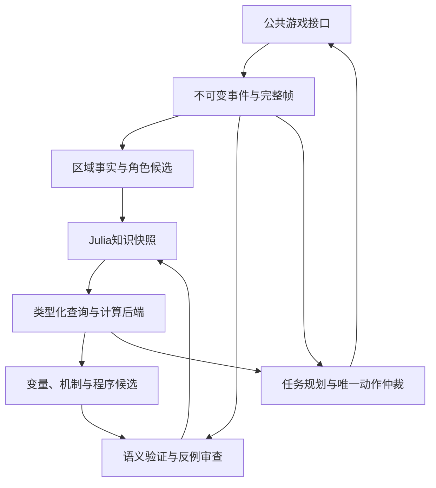

# 版本13架构评审：开源复用、接口缺口与实施修订建议

审查日期：2026-11-26，台北时间，星期四。资料与源码核查截至当日；版本信息是本轮查到的官方状态，并非安装测试结果。

## 一、评审结论与证据范围

**版本13的总体职责结构值得保留；开源选型尚未落实到完整可运行的接口合同，不能宣布整个实现已经闭环。最需要改进的是减少通用算法内核的重复开发，把工程工作集中到语义适配、版本修订和真实行动反馈。**

| 审查问题 | 判断 | 主要依据 |
|---|---|---|
| 从电路统一走到类型化关系与计算的演变是否合理 | 合理，但属于逐步收紧的研究假设 | 已分开布尔、计数、有理数、概率语义，保留原始证据与适用域；没有证明所有认知计算都可统一为一种紧凑电路 |
| 总体架构和模块责任是否合理 | 基本合理 | Julia单一知识语义所有者；Rust计算与搜索；环境公共接口唯一；索引与压缩为横向服务 |
| 已有实现是否真正使用开源软件 | 是 | 当前源码实际调用Catlab结构运算和E-Stitch搜索，不只是文档列名字 |
| 新计划是否充分避免重复开发 | 尚未充分 | 06的通用关系优化、07的概率电路内核仍偏向自写；一些成熟求解器、自动机学习器和规划器未落实接入 |
| 接口是否已可直接接通 | 否 | 已查到JSON版本约束冲突、ATDD标量边界、E-Stitch搜索前沿恢复缺口，以及规划器语义能力限制 |
| 生产功能是否完整闭环 | 本轮不能确认 | 做了计划与源码审查，未安装新依赖、未执行适配测试、未运行真实游戏闭环 |

### 1.1 本轮实际读取了什么

- 上传压缩包中的01—09九份Markdown文件。04明确规定：01—03保留研究演变，04—09为工程实施规格；本评审按这一优先关系判断。
- 实际实施仓库是`zdx3578/TddESCat`，实施分支为`impl/2026-11-23-toolchain-bootstrap`，最初审查锚点为[`acf7da47e02c65af50bdb8b28f0e3d9d93e4a89e`](https://github.com/zdx3578/TddESCat/commit/acf7da47e02c65af50bdb8b28f0e3d9d93e4a89e)。交付前已核查后续提交`a1c2180f`，见1.3。04已经说明`arc3wm`是历史项目，不应误把新架构写回旧项目。
- 固定提交的Julia依赖、类型关系实现、区域提取、局部效果、策略与程序语义、持久化实现、Rust学习桥、Python依赖和v3协议；关键判断依据具体函数，而非仅依赖changelog。
- Factor Rank补充包中的Rust操作与变量树转换源码。补充包SHA-256为`629ca0335faffe63d002c86f6d0fa68d0f1b7381ffb067a35568b70dd20f1983`。
- 官方项目仓库、发行记录、依赖文件、文档与部分关键算法源码。搜索摘要和论文标题仅用于找入口，不作为实现成熟度证据。

### 1.2 本轮未完成的工作

本轮没有修改求解器代码，没有安装所有候选框架，没有执行Julia/Python/Rust依赖联合解析，没有跑性能对照或游戏，也没有证明所有动作、对象和隐藏状态已经因果覆盖。本文提出具体修订与验收方式；“有公开代码”“接口可适配”“已经接入”“生产有效”是四个不同状态。

### 1.3 交付前已核查的新实现

审查过程中，实施分支在台北时间17:29新增[`a1c2180fc7d852e71b6f2a2e406dbbd836e37cba`](https://github.com/zdx3578/TddESCat/commit/a1c2180fc7d852e71b6f2a2e406dbbd836e37cba)，其父提交就是`acf7da47`。本轮读取了提交差异及新增`RelationTasks.jl`，并核查`OnlineSession.jl`的实际调用；没有仅依据新changelog判断。

- 新增`RelationAgenda`，把实际效果、来源事件、角色、终态、延迟效果线索与失败尝试组织到统一任务层。
- `OnlineSession`实际调用`task_arbitration`，根据同一选择结果形成动作、关系任务与事前预测；回执后调用`observe_relations!`，因此此前“点击直接覆盖其他候选”的具体路径已有实质改进。
- 新增远端上下文改变后的重试、延迟准备与下一动作、失败后的合法RESET与重新绑定；`JointMechanisms`加入相对效果角色，拓宽点击作用迁移。
- 这证明新调用链已经进入源码，不能仍评价为“完全没有统一仲裁或反馈”。新增验收程序的存在不等于本轮独立执行通过。
- 当前依赖文件、E-Stitch桥、v3签名、`PolicySemantics`和`ProgramSemantics`未在这次提交中改变；本文关于JSON冲突、PC/关系后端选型、通用程序语料、完整搜索恢复等判断仍适用。

以下固定位置仍以`acf7da47`标注，便于复现；涉及新增控制能力时以本节修正为准。本文文档分支基于已核查的新提交创建，保留该实现进展。

## 二、对几次讨论演变的判断

最初“布尔电路和概率电路统一底座”抓住了共享子结构、编译后重复查询和表示压缩的价值。后来加入关系代数、溯源、类型、变量域和版本，使这个方向更接近可实现系统：它开始回答同一个符号在何处有效、一个结果依据哪些事件、什么更新会让结果失效。

继续引入条件等价、反统一、程序库学习和因果检验也合理，但这几个模块提供的知识强度不同：

| 层次 | 真正能说明什么 | 不能据此推出什么 |
|---|---|---|
| 同一个完整有限函数的精确等价 | 给定编码、变量域和假设下，两个表达式取值相同 | 该编码就是世界的真实因果变量 |
| 结构反统一 | 一组表达式有可回代的共同结构 | 这个结构在未见状态上是一条真实规律 |
| E-Stitch库学习 | 给定程序语料与允许等式中的可复用定义 | 程序语料本身的动作效果已经正确 |
| 概率模型拟合 | 指定数据、变量和模型中的预测分布 | 观测条件概率自动等于干预效果 |
| 真实公开实验 | 指定条件与历史范围中的效果证据 | 无条件覆盖所有隐藏状态与未来游戏 |

因此，合理的演变是“增加语义约束和可证伪接口”，不是“每增加一篇论文就增加一个必须运行的模块”。版本13已经明显改善了前者；实施计划仍需减少后者造成的依赖膨胀。

### 2.1 Grounding应从什么层次开始

Ground Atoms（基原子事实）是后续Inductive Logic Programming（归纳逻辑程序设计，ILP）与程序学习的适当输入。当前任务中的低层处理可以先精确计算像素颜色、坐标、同色四连通区域、区域接触、跨帧变化等，再交给关系学习。

这不等于把四连通区域永久认定为物体。区域是当前帧上可验证的描述；跨帧对象、作用角色、部件组合和因果变量仍是假设，允许在反例下分裂或合并。原始帧与全部回执必须保留，否则概念修订后无法重新解释历史。

像素级精确测量与像素级无约束ILP搜索不是同一件事。前者是必要的数据入口，后者不应成为本框架的主学习方式。

## 三、应该保留的架构与模块边界



图中的计算后端可包含数据库、稀疏张量、电路或求解器，但不各自持有一套世界真值。索引、溯源和压缩贯穿多条边；不应把六维索引、七类压缩排成每次动作都必须经过的流水线。

### 3.1 现有设计中已经正确的部分

- 原始事件、帧、区域与可修订对象身份分离；同内容可以共享存储，但不能合并时间身份。
- 精确证明与经验置信分离；不把缺失事实当假，不把相似度当等价。
- 明确布尔存在量化、自然数计数、有理数求和、概率归一化的不同语义。
- 六个知识检索维度不强称全部天然构成偏序；先检查关系与商集条件。
- 索引与编译缓存可以重建；不作为第二个知识权威。
- E-Stitch返回候选后由Julia验证；正式控制只能消费当前有效定义。
- 已有H1语义正确、H2总计算成本、H3学习与控制收益分开评估，以及索引/压缩2×2对照。
- 公开接口、完整回执、冻结事前预测、证据截止与动作仲裁已经在计划中提出，应保留并落实。

### 3.2 需要修订的一条语言边界

04把Python限定为环境、独立裁判和实验管理。如果要采用CirKit、SPFlow、Popper或AALpy，不能悄悄让Python再成为一个在线知识主体。

建议明确允许一种新的受限角色：**读取冻结语义输入、返回候选或数值结果的纯计算worker**。它没有游戏凭据，不读取私有环境状态，不直接派发动作，不发布正式知识。其输入和输出由Julia验证。这是明确的职责修订，不是新旧求解器兼容分支。

## 四、当前工程已经复用了哪些实现

| 当前依赖 | 固定版本/来源 | 本轮确认的实际用途 | 裁决 |
|---|---|---|---|
| Catlab | 0.17.6 | `CategoryBackend`实际构造ACSet范畴、调用同态匹配和pushout | 保留；不重建第二套对象与关系身份 |
| ACSets | 0.2.29 | 类型化结构数据和Catlab关系表示基础 | 保留；派生表或张量是计算视图 |
| AlgebraicRewriting | 0.5.0 | 当前结构重写依赖 | 保留按现有接口使用；不因新论文盲目换核心 |
| GATlab | 0.2.4 | 广义代数理论与类型语义相关依赖 | 保留；它不自动验证环境因果规律 |
| egg-stitch | 固定提交`e4cd59047b9e1c7d04bc035a3c1cadd66a1b7c92` | Rust桥实际调用`best_first_with_progress` | 保留真实搜索，不另写简化抽取器 |
| egg | 0.10.0与项目锁定patch | E-Stitch需要的等价图实现 | 随已验证E-Stitch依赖组合锁定，不能直接替换成egglog |
| ARC官方Python依赖 | arc-agi 0.9.10；arcengine 0.9.3 | 已存在的公共交互与试验环境工具链 | 继续只经正式公共接口消费观测与动作 |
| JSON Schema及referencing | 4.25.1；0.37.0 | 现有跨语言文档校验 | 扩展明确协议版本，不静默改变字段含义 |

依据：[Julia Project.toml](https://github.com/zdx3578/TddESCat/blob/acf7da47e02c65af50bdb8b28f0e3d9d93e4a89e/julia/TddESCat/Project.toml)、[CategoryBackend.jl](https://github.com/zdx3578/TddESCat/blob/acf7da47e02c65af50bdb8b28f0e3d9d93e4a89e/julia/TddESCat/src/CategoryBackend.jl)、[Rust Cargo.toml](https://github.com/zdx3578/TddESCat/blob/acf7da47e02c65af50bdb8b28f0e3d9d93e4a89e/rust/bridge/Cargo.toml)、[engine.rs](https://github.com/zdx3578/TddESCat/blob/acf7da47e02c65af50bdb8b28f0e3d9d93e4a89e/rust/bridge/src/engine.rs)、[sources.lock.toml](https://github.com/zdx3578/TddESCat/blob/acf7da47e02c65af50bdb8b28f0e3d9d93e4a89e/config/sources.lock.toml)、[Python依赖](https://github.com/zdx3578/TddESCat/blob/acf7da47e02c65af50bdb8b28f0e3d9d93e4a89e/python/pyproject.toml)。

## 五、必须先修正的具体问题

下表中的“05、06”等指上传计划文件编号；代码位置均指上述固定提交。它们是可定位的修订任务，不是声称已修复。

| 具体问题 | 位置 | 当前逻辑 | 后果 | 对应解决方案 |
|---|---|---|---|---|
| 最新稀疏计算依赖与当前JSON不相容 | 当前`Project.toml:22`；Finch v2.2.0及Galley当前Project | 工程要求JSON 0.21；两候选要求JSON 1.2 | 同一未修改Julia环境不能直接满足两组约束 | 优先评估显式迁移到JSON1.x，检查字典类型、规范字节、协议摘要；不能迁移时明确采用隔离纯计算环境。选定路线后不保留运行时新旧回退 |
| Galley迁移关系过时 | 06:81 | 写Galley并入Finch；Finch2.0已把自动调度移回Galley | 按旧教程调用会接错接口 | 以当前源码版本组为准；Finch用于内核，Galley用于其实际支持的查询优化；锁定组合并跑真实查询 |
| 自写概率电路核心 | 07:147 | 先自己实现小型Julia PC，现有库仅供参考 | 重复实现图节点、求值、缺失边缘化、采样与训练基础 | 先验证ProbabilisticCircuits.jl可用性；需要现代张量编译时评估CirKit/SPFlow；项目保留动态特征与证据适配 |
| 自写关系优化器过多 | 06:61–81；`RelationQueries.jl:165`附近 | 既有哈希连接上继续自写连接重排、多路执行与计划选择 | 优化器工程超过独特研究贡献 | 保留类型化查询语义；把受支持的精确子表达式交给Galley/Finch或选定数据库执行；能力缺失显式返回 |
| 慢学习进入同步发布事务 | 05:123–145 | 候选生成、相关历史重算、逐候选验证在发布前完成 | 慢任务阻塞新事实、失效标记及下一次交互 | 同步发布新事实、必要失效和已验证结果；慢任务读取冻结快照，返回提案后按读取依赖重验 |
| ATDD通用project缺少具体操作/返回形态 | 05:73；06:157、163；补充`atdd/ops.rs` | 文字已区分存在与计数，但接口仍过宽；原型消去最后变量不返回图 | 误调用、标量边界panic、非规范结果被当规范键 | 明确`exists_bool`、`sum_out`、`count_distinct`，支持零变量标量，记录约简/规范状态 |
| 计算句柄生命周期未落实 | 05:169–171；06:163 | 有compile/release，但缺进程代次、失效及返回形状约定 | worker重启后旧句柄可能被误用 | 句柄绑定owner/session/generation；语义ID与临时句柄分开；结果带域、类型和依赖版本 |
| E-Stitch完整前沿恢复超出公开API | 05:154；08:117、181、269；09:P41 | 项目有job/round记录；上游搜索堆仍为局部变量 | 保存任务和剩余数量不能恢复具体节点 | 在现有算法上补SearchSession与完整状态编码；中断续算对照测试，不重写搜索算法 |
| 轨迹到分支/循环仍缺算法 | 08:93–99；当前`PolicySemantics.jl:38–108` | 计划写发现Choice/Repeat；当前仍有特定Repeat/Branch骨架 | 可能把固定模板换名后保留 | 明确守卫语言、候选生成、竞争解释、退出条件及验证责任；E-Stitch只压缩已形成语义的程序 |
| 程序描述与动作执行容易混用 | `protocol/v3/signature.schema.json:67–79`；08程序桥 | 当前原语必须pure且无binder children | 把真实动作放入等价重写可能改变执行次数与顺序 | E-Stitch处理纯程序描述/转移关系；解释器独占实际行动；不经证明不交换有影响的动作 |
| 条件等价后端尚未选定 | 08:70–72 | 已规定经验等价不永久union，但树/DAG与失效重建未落地 | 错误共用条件可能泄漏等价 | 先精确公理根加冻结条件视图；Versioned E-Graphs仅承接树状部分，多父条件关系外部维护 |
| 规划器可处理域小于计划目标 | 08:128–184 | 存在、保证、概率前像共用上层接口 | 不能把普通后向搜索当成概率规划 | 给每个导出器明确能力域；确定性布尔子域用SymbolicPlanners，概率模型另行适配 |
| 原子效果与程序效果契约仍不一致 | `ProgramSemantics.jl:17–27` | 主要取第一步条件、最后一步效果 | 中间前提与失败后继可能丢失 | 以完整关系组合定义程序契约，生产者索引同时覆盖机制与程序 |
| ATDD作为第一阶段强制生产门槛 | 04:M1.2；09末尾验收 | 精确语义闭环与特定新表示收益被绑在一起 | 无收益或原型适配未完成会阻塞已有成熟后端 | M1要求真实精确查询闭环；ATDD独立证明正确和总成本收益后进入生产 |
| M2混合多个研究成败条件 | 04:M2；07—09 | BMF、PC、PSR、谓词发明、库学习、所有压缩一起验收 | 无法定位哪个算法对控制有效，容易名义完工 | 保留两个里程碑；闭环是硬责任，各候选算法有独立证据与完成状态 |

### 5.1 JSON冲突是具体依赖事实，不是猜测

当前工程：[JSON="0.21"](https://github.com/zdx3578/TddESCat/blob/acf7da47e02c65af50bdb8b28f0e3d9d93e4a89e/julia/TddESCat/Project.toml)。最新候选：[Finch v2.2.0 Project.toml](https://github.com/finch-tensor/Finch.jl/blob/v2.2.0/Project.toml)与[Galley Project.toml](https://github.com/finch-tensor/Galley.jl/blob/main/Project.toml)声明JSON="1.2"。版本允许区间不相交。这是静态依赖判断，本轮没有实际运行解析器制造一个构建失败记录。

[JSON.jl官方迁移说明](https://github.com/JuliaIO/JSON.jl)介绍1.x的行为变化，其中默认解析对象类型变化需要检查。当前`RunStore.read_json`调用`JSON.parsefile`，其他模块依赖`Dict`和规范序列化的地方必须逐一追踪。Catlab/ACSets涉及的JSON3是另一个包，不能把它们也误报成同一冲突。

迁移验收至少包括：旧证据显式离线读回、关键字段类型、整数精度、规范序列化、摘要恒等或明确协议升版、Julia/Rust/Python双向校验。配置放文件，不通过环境变量拼接依赖版本。

具体检查点为`RunStore.jl:37–38`的读写、`ProgramSemantics.jl:6`和`PolicySemantics.jl:6`的严格Dict字段、`ProgramSemantics.jl:151/338`的JSON往返与语义摘要、`LocalEffects.jl:256`的JSON字符串比较。新版可显式指定`dicttype=Dict{String,Any}`形成统一输入契约，但仍须检查数字与序列化行为。这些是迁移检查点，不声称当前旧版本运行已经出错。

### 5.2 不能错误批评已经正确的实现

- `RunStore.atomic_write`已有文件fsync、rename和目录fsync；不能说持久化完全没有原子写。待补的是多文件知识快照的引用一致性与恢复验收。
- `Grounding.support_candidates`存在96像素限制，但`LocalEffects.observed_effects`直接调用完整`color_components`；不能把96说成所有区域观察的全局上限。
- Factor Rank原型的`forget`确实使用布尔析取，不是错误地做求和。真正缺口是外围合同、零变量结果和规范性责任。
- 当前系统已经有E-Stitch、程序消费和条件策略；应修复其语义范围，不能描述成只有日志、完全没有学习。

## 六、按模块覆盖的开源实现与采用建议

以下按责任覆盖候选，不是要求全部安装。版本号注明本轮核实到的正式发行或源码状态；未列版本的项目不声称已核实最新发行号。最终依赖以兼容性、实际所需能力和维护成本选择，而非只按日期排序。

### 6.1 数据、关系、精确计算与存储传输

| 责任 | 开源项目与核实状态 | 可以复用的能力 | 本项目仍需负责的内容与采用建议 |
|---|---|---|---|
| 区域提取 | [ImageMorphology.jl](https://github.com/JuliaImages/ImageMorphology.jl)，0.4.7，2025-09-22 | 连通组件、成员、边界框等几何计算 | 显式四连通；默认背景0会漏颜色0，须调整；现有短小正确分割函数可保留，非最高收益替换 |
| 小有限集合 | Julia BitSet/BitArray | 交、并、差、成员与紧凑位表示 | 与域和版本绑定；不要为了4096规模域先增加跨语言往返 |
| 大规模压缩集合 | [CRoaring](https://github.com/RoaringBitmap/CRoaring)，5.5.5，2026-11-04，Apache-2.0 | 位图集合运算、包含、基数和序列化 | 不理解语义偏序、条件蕴含或证据；真实规模值得时采用 |
| 稀疏多维计算 | [Finch.jl](https://github.com/finch-tensor/Finch.jl)，2.2.0，2026-11-07，MIT | 稀疏格式、融合、编译内核 | 优先适配候选；不拥有未知和知识语义 |
| 查询优化 | [Galley.jl](https://github.com/finch-tensor/Galley.jl)，main为0.2.2，MIT，未核到latest release | 查询重排、聚合、代价优化 | 当前暂内置Finch，不能任意搭配版本；先完成JSON迁移与一条真实查询 |
| 二元关系与图计算 | [SuiteSparseGraphBLAS.jl](https://github.com/JuliaSparse/SuiteSparseGraphBLAS.jl)，0.12.0，2026-10-27 | 布尔半环矩阵、图关系计算 | 缺项零不是未知；不假定任意BigInt有理数通用支持；明确工作负载后采用 |
| 关系批查询 | [DuckDB.jl](https://github.com/duckdb/DuckDB.jl)，wrapper 2.0.1，2026-11-25，MIT | SQL连接、聚合、扫描、标准优化 | wrapper版本不是引擎版本；集合/多重集、NULL、状态与证据必须适配 |
| 固定查询增量维护 | [Differential Dataflow](https://github.com/TimelyDataflow/differential-dataflow)，文档0.26.1，MIT | insert/remove、join、reduce、iterate | 更新规则、假设回撤、等价类拆分不是自动完成；有持续增量热点再接 |
| Julia逻辑电路 | [LogicCircuits.jl](https://github.com/Tractables/LogicCircuits.jl)，0.4.0，2024-06-10，Apache-2.0 | 逻辑电路、SDD相关运算 | 需验证当前Julia环境；与Rust布尔后端择一主用 |
| Rust决策图 | [OxiDD](https://github.com/OxiDD/oxidd)，0.13.0，2026-09-28，MIT/Apache-2.0 | BDD、BCDD、ZDD、MTBDD等 | TDD在此指Ternary Decision Diagram，不是Tree Decision Diagram；不能当ATDD实现 |
| 独立SDD比较 | [PySDD](https://github.com/ML-KULeuven/PySDD)，Apache-2.0 | SDD、变量树、加权模型计数 | 作正确性对照；已有主线时不必再加一个生产语言往返 |
| 并行决策图备选 | [Sylvan](https://github.com/trolando/sylvan)，Apache-2.0 | 多核BDD/MTBDD | 额外运行时与管理器成本需测量 |
| 规范代数表示研究 | [Factor Rank作者补充](https://doi.org/10.5281/zenodo.24008836)，atddc原型0.1.0，代码MIT | 精确ATDD构造、运算、最小化与规范化实验 | 原型转生产、句柄、标量、紧凑树变换仍需工作；独立研究验收 |
| 精确线性代数 | [Nemo.jl](https://github.com/Nemocas/Nemo.jl) 0.57.2，2026-11-02；[FLINT](https://flintlib.org/) 3.6.0 | 有理数矩阵、秩、阶梯形、整数计算 | 可避免重写通用精确矩阵内核；不替代ATDD语义算法；分别登记底层许可 |
| 张量收缩 | [OMEinsum.jl](https://github.com/under-Peter/OMEinsum.jl) 0.9.4；[OMEinsumContractionOrders.jl](https://github.com/TensorBFS/OMEinsumContractionOrders.jl) 1.3.0 | 收缩执行与顺序优化 | 收缩顺序不是因果结构；按数值/精确域选择后端 |
| 张量网络 | [ITensors.jl](https://github.com/ITensor/ITensors.jl)，0.9.32，2026-09-27，Apache-2.0 | 命名索引、张量与收缩 | MPS/MPO另有ITensorMPS；SVD规范化不等于ATDD精确规范式 |
| 进程间关系批传输 | [Arrow.jl](https://github.com/apache/arrow-julia)，2.8.1，2026-01-14，Apache-2.0 | Arrow记录批次及IPC | Julia实现未支持Tensor/Sparse Tensor、Flight、C Data Interface；不能承诺天然三语言张量零拷贝 |

Finch迁移依据：[v2.0.0发行说明](https://github.com/finch-tensor/Finch.jl/releases/tag/v2.0.0)。ImageMorphology默认背景和接口依据：[稳定API](https://juliaimages.org/ImageMorphology.jl/stable/reference/)。Arrow能力边界以其Julia仓库README为准，不能套用其他语言实现的全部能力。

### 6.2 概率、概念、动态状态与规划

| 责任 | 开源项目与核实状态 | 可以复用的能力 | 本项目仍需负责的内容与采用建议 |
|---|---|---|---|
| Julia概率电路 | [ProbabilisticCircuits.jl](https://github.com/Tractables/ProbabilisticCircuits.jl)，0.5.0，Apache-2.0；默认分支最近提交2024-06 | 输入/和/积节点、概率查询、缺失边缘化、采样等 | 先做Julia1.12.6适配；动态变量和统计撤回自己管理；不能因旧兼容声明就断言新Julia不可用 |
| 张量化电路编译 | [CirKit](https://github.com/april-tools/cirkit)，0.3.1，2026-07-14，GPL-3.0 | 符号电路组合、张量参数化、PyTorch编译 | 更贴近代数电路统一主线；作为纯模型worker，按查询结构条件使用 |
| 现代概率电路库 | [SPFlow](https://github.com/SPFlow/SPFlow)，1.1.0，2026-03-08，Apache-2.0 | 已重构为PyTorch模块、学习与推理 | 与CirKit按实际功能选择，不两套必装；不承担证据版本 |
| 旧概率电路复现 | [DeeProb-kit](https://github.com/deeprob-org/deeprob-kit)，MIT | 老实验复现 | 官方已建议使用CirKit；不作为新核心首选 |
| Boolean Matrix Factorization（布尔矩阵分解，BMF） | [PyBMF](https://github.com/PreferredAI/PyBMF)，MIT；最近核查提交2024-09 | GreConD等分解与因子候选 | 只直接用于完整二值背景；unknown/refute/conflict适配自己负责 |
| Formal Concept Analysis（形式概念分析，FCA） | [Caspailleur](https://github.com/EgorDudyrev/caspailleur)，0.2.2，GPL-3.0 | 概念、闭包、蕴含挖掘 | 不完整关系不能填False；不要每次行动全幂集枚举 |
| Pattern Structures（模式结构） | [Paspailleur](https://github.com/EgorDudyrev/paspailleur)，0.1，GPL-3.0 | 复杂属性描述的概念结构 | 研究适配；不是现成六维索引系统 |
| 历史状态学习 | [AALpy](https://github.com/DES-Lab/AALpy)，2.0.0，2026-10-25，MIT | 被动状态合并、RPNI/ALERGIA、主动自动机学习、区分序列 | 优先读公共轨迹；主动查询由统一仲裁批准与执行；未见转移保留未知 |
| 确定性符号规划 | [PDDL.jl](https://github.com/JuliaPlanners/PDDL.jl) 0.2.18；[SymbolicPlanners.jl](https://github.com/JuliaPlanners/SymbolicPlanners.jl) 0.1.27，Apache-2.0 | 规划域解析、前向/后向搜索、启发式、保存与继续搜索 | 限可精确导出的子域；后向器不支持非布尔fluents/constraint specs |
| 部分可观测规划接口 | [POMDPs.jl](https://github.com/JuliaPOMDP/POMDPs.jl) 1.0.0及[POMDPTools](https://github.com/JuliaPOMDP/POMDPTools.jl)，MIT | 状态/动作/观测、信念更新、策略接口 | 必须已有有效模型；不能自动从像素产生机制 |
| 在线不确定性搜索 | [POMCPOW](https://github.com/JuliaPOMDP/POMCPOW.jl) | 有生成模型和观测模型时的蒙特卡洛搜索 | 模拟调用必须与真实公共动作分开 |
| 因果识别和效应分析 | [DoWhy](https://github.com/py-why/dowhy)、[causal-learn](https://github.com/py-why/causal-learn)，MIT；[Tigramite](https://github.com/jakobrunge/tigramite)，GPL-3.0 | 给定变量与假设下的识别、结构候选、估计和反驳工具 | 用于已语义化数据；不保证变量正确、无混杂或干预可识别 |

概率电路的具体查询合同应以[官方查询文档](https://tractables.github.io/ProbabilisticCircuits.jl/stable/manual/queries/)为准：条件概率目前需要用户组合两个边缘查询；归一化分母为0不能产生一个伪概率。精确边缘推理需要相应结构性质，模型内推理精确不等于模型参数或现实预测无误差。

AALpy可以复用有限状态假设学习，不能冒称已实现Predictive State Representation（预测状态表示，PSR）的谱学习。旧PSR工具未找到满足本计划持续修订和现有语言接口要求的成熟即用实现，应标明研究缺口。

### 6.3 条件推理、程序抽象与谓词学习

| 责任 | 开源项目与核实状态 | 可以复用的能力 | 本项目仍需负责的内容与采用建议 |
|---|---|---|---|
| 程序库学习主线 | [mlb2251/egg-stitch](https://github.com/mlb2251/egg-stitch)，2026-11仍活跃，GPL-3.0-or-later | 等价图上的自顶向下共享抽象搜索 | 保留已接入版本；新上游需验证后升级；语料语义、来源和行动消费自己负责 |
| 普通程序树库学习 | [Stitch](https://github.com/mlb2251/stitch)，MIT | 原始程序库学习 | E-Stitch的研究对照，不另建常驻学习链 |
| 等价图反统一 | [Babble](https://github.com/dcao/babble)，MIT | 反统一与库抽象研究实现 | 不是E-Stitch的必需前置；有自己的egg分支，集成需核对 |
| 规则与等价饱和 | [egglog](https://github.com/egraphs-good/egglog)，3.0，MIT | Datalog、不动点、等价饱和、抽取与部分证明重建 | 用作封闭计算视图；删除行不等于撤销所有证明，不能成为第二知识权威 |
| Python研究绑定 | [egglog-python](https://github.com/egraphs-good/egglog-python)，14.0.0，2026-09-20，MIT | 便捷研究接口 | 当前Julia/Rust主线无必要时不加生产跳转 |
| 条件版本共享 | [Versioned E-Graphs](https://github.com/jahrim/versioned-egraphs)，0.1.0，2026-10提交，MIT | 版本树上的branchout、project、union、rebuild | 最值得试接的条件视图候选；不是任意多父条件DAG与随意撤销 |
| 多父条件等价 | [Predicate E-Graphs](https://pldi26.sigplan.org/details/egraphs-2026-papers/3/Predicate-E-Graphs-with-Symbolic-Conditional-Rewriting) | 条件蕴含图、不变量与操作设计 | 本轮未找到可验证的作者公开实现；只列设计参考，不能写成现成依赖 |
| Julia项重写 | [Metatheory.jl](https://github.com/JuliaSymbolics/Metatheory.jl)，MIT；正式latest为2.0.2，2023-11-10 | 通用重写、项接口、等价图 | 3.0仍是开发分支路线，不能称已稳定发布；按需使用 |
| Satisfiability Modulo Theories（模理论可满足性，SMT） | [Z3](https://github.com/Z3Prover/z3)与[ahumenberger/Z3.jl](https://github.com/ahumenberger/Z3.jl)，MIT；wrapper 1.0.4 | 条件蕴含、互斥、模型与反例、算术/位向量约束 | 核心优先候选；unknown保持unknown，编码与域检查自己负责 |
| Julia SMT前端备选 | [Satisfiability.jl](https://github.com/elsoroka/Satisfiability.jl)，MIT | SMT-LIB公式与Z3/cvc5等求解器接口 | 与直接Z3.jl按所需API择一路线，不强制双维护 |
| Syntax-Guided Synthesis（语法引导合成，SyGuS） | [cvc5](https://github.com/cvc5/cvc5)，1.4.2，2026-10-08，modified BSD | 显式语法下合成守卫/函数、SMT检查 | 必须提供类型、语法、约束与样本；不是无边界的概念发现器 |
| 规则学习与失败约束 | [Popper](https://github.com/logic-and-learning-lab/Popper)，MIT，2026-11仍更新 | 从背景事实和正负例学习逻辑规则 | 接语义Ground Atoms；未知不导出负例；候选机制仍需真实验证 |
| 元解释学习参考 | [Metagol](https://github.com/metagol/metagol)，BSD-3-Clause，2021-09归档 | 元规则与谓词发明研究 | 原仓库推荐Popper，不列最新生产首选 |
| 可微神经符号计算 | [DeepLog](https://github.com/ML-KULeuven/deeplog)，5.1.2，2026-11-13，LGPL-2.1 | 逻辑公式到电路到PyTorch模块 | 需要神经概率模块时再加；当前无此需求不应强依赖 |
| 概率关系推理对照 | [Scallop](https://github.com/scallop-lang/scallop) | Datalog与多种provenance计算 | top-k/minmax等语义不能当任意精确概率；以具体模式说明近似边界 |

Dynamic Predicate Invention论文的[作者入口](https://quiquecrespo.github.io/papers/continual-causal-ilp.html)本轮仅核到论文/PDF，没有核到可直接使用的对应代码。Online Structure Learning of Probabilistic Circuits的公开实现也未定位；不能拿同一研讨会其他论文的代码链接代替。

## 七、把候选清单收敛为实际依赖选择

### 7.1 建议保留与优先接入的组合

| 责任 | 推荐主路线 | 为什么 | 入主路径的条件 |
|---|---|---|---|
| 类型关系与结构变换 | 保留Catlab/ACSets/GATlab/AlgebraicRewriting | 已有真实接入和相应身份体系 | 原契约与新查询适配一致 |
| 事实持久化与公共动作 | 保留RunStore/Recorder及公共入口 | 已有落盘与公共证据协议 | 多文件快照、未确认回执与恢复验证通过 |
| 稀疏关系执行 | 优先试接Finch/Galley受支持片段 | 避免自写复杂格式、编译和优化器 | JSON迁移、锁定版本组合、相同语义和未知适配通过 |
| 六维检索物理结构 | 现有关系ID与BitSet起步；必要时CRoaring/数据库索引 | 索引是访问路径，不是六套世界模型 | 冷启动、更新和查询的总成本有收益 |
| 条件逻辑 | 一条Julia到Z3的接口；按API需要选择Z3.jl或Satisfiability.jl | 现有条件蕴含和反例任务有直接适配价值 | 类型、域、unknown及模型回读通过 |
| 精确有限布尔函数 | 现有关系计算；需要编译时择OxiDD或LogicCircuits作一个主后端 | 成熟功能适合验证语义闭环 | 选择由真实查询和语言桥成本决定，不双重必装 |
| 概率电路 | 先检验ProbabilisticCircuits.jl原生集成；需要现代张量编译时择CirKit或SPFlow | 避免重写概率图与推理；不按语言偏好放弃成熟算法 | 安装兼容、变量编码、缺失与统计迁移通过；生产选定单一职责实现 |
| 程序库学习 | 保留现有E-Stitch及固定egg patch | 已经真实使用 | 补齐语料与动作契约、前沿恢复及跨版本验证 |
| 历史状态候选 | AALpy被动学习 | 可直接使用公共轨迹产生区分候选 | 未见转移保留未知，输出只作为可修订假设 |
| 规划 | 确定性布尔子域使用PDDL/SymbolicPlanners | 标准搜索与保存前沿不宜全部重写 | 实际导出语义、哈希碰撞合同与当前模型版本验收 |

GraphBLAS、DuckDB、Differential Dataflow、Versioned E-Graphs和POMDP求解器各有合理位置，但必须先有具体工作负载或接口需求。它们不是“找到就必须加入”的依赖。

### 7.2 研究线与工程主线分开，但共享接口

Factor Rank、张量网络收缩、新型PC结构学习、PSR、复杂谓词发明、任意条件DAG都是值得继续研究的方向。它们使用同一冻结输入、同一类型域和同一验收裁判，产生可比较结果；某个研究后端尚未完成，不影响其他已满足合同的计算继续工作。

这不是运行时兼容回退。它是对不同数学问题选择明确的实现：布尔关系查询、概率预测、程序抽象各有不同运算与返回语义。一个后端不支持某项运算，应在规划/编译时明确报出，不能偷偷换成含义不同的旧算法。

### 7.3 哪些小函数可以保留自写

已经正确且规模很小的四连通扫描、类型化Least General Generalization（最小一般化，LGG）、域编码和协议验证，不必为了“全用框架”引入庞大依赖。开源复用优先级应由避免的复杂度决定：通用查询优化、概率推理、搜索、精确线代和稀疏编译的收益明显高于替换几十行确定性辅助代码。

## 八、接口必须明确的九项合同

这里补充现有05合同的操作边界，不要求另造一个巨型数据结构。每一项都对应一类真实跨模块错误。

### 8.1 后端能做什么，结果意味着什么

后端需要声明接受的表达式、变量类型、代数、结构条件和返回结果。三类例子不能混用：

- Z3给出编码模型中的可满足、不可满足或未知。
- PC给出指定模型中的概率或样本；输出有参数与数值精度依赖。
- ATDD给出指定有限函数的精确值或运算结果；有变量树与数值域依赖。

`unsupported`表示实现不支持该操作；`unknown`表示当前知识不能决定；`incomplete`表示搜索或枚举未完成；`error`表示执行失败。四者不能全部表现为空集合或`success=false`。证明不可达也不能和搜索还没找到路径混为一谈。

例如egglog 3.0的低层`Write`接口不逐列检查sort matching，`union`要求调用方保证同一eq-sort。其语言层有类型检查，不等于所有低层入口自动保护本项目的域和时态。因此Julia与Rust桥的类型、变量身份和作用域校验不能因为引入库而删除。

### 8.2 关系的缺行、重复与未知

数据库常用多重集；数学关系常用集合。稀疏矩阵缺项常为零；经验关系缺项可能是未知。后端适配必须说明何时去重、何时计数、哪些合法绑定已完整检查。

例：两条不同见证都推导出`Reach(a,c)`。集合查询返回一个绑定，路径计数可以返回两条路径，独立实验计数可能仍是一个事件。统一的加法符号不能消除这三种不同语义。

布尔矩阵分解和FCA仅直接消费“已完整确定的二值背景”。有未知时，要选择完整子问题、保留已知掩码，或采用明确支持不完整背景的算法；不能简单用0填充未知。

### 8.3 ATDD的操作与规范状态

Algebraic Tree Decision Diagram（代数树决策图，ATDD）应把以下操作分开：

- `exists_bool`：布尔存在消去，合并相同输出，不累加重复见证。
- `sum_out`：数值求和消去，适用于声明的计数或概率代数。
- `count_distinct`：先按布尔关系投影去重，再计不同输出绑定。

对恒真函数`f(x,y)=1`，消去y后，存在量化得到1，求和得到2。一个接口不能只叫`project`却不说明采用哪种含义。

原型`code/src/atdd/ops.rs:156–161`的`forget`通过两个条件化结果做OR，数学上正确；第61行和145–147行明确要求至少两个变量。包装层必须支持消去唯一变量后返回Bool/Integer/Rational标量，不能继续调用必然要求父节点的图操作。

同文件11–12行说明操作输出未约简。接口必须区分未约简、已最小化、已规范化，以及是否已认证为布尔函数；只有满足相应条件才能使用规范字节作为等价缓存键。不同变量树下的规范性不能被当作无条件跨树身份。

原型`atdd/vtree_change.rs:207–213`使用完整函数表展开，因此不能直接进入大问题热路径。单次操作的多项式界也不保证整段反复投影相对于原始输入保持多项式大小，应记录中间表示和有理数系数增长。[论文与补充](https://arxiv.org/html/2611.10842v1)。

### 8.4 语义身份与临时计算句柄

一个知识定义的稳定身份，与Rust/Julia/Python进程里的对象句柄不同。句柄至少依赖生成它的worker、会话及重启代次；释放后、worker重启后或依赖版本失效后不能再次使用。

输入要明确列顺序、变量域映射、返回形状、空域与零变量标量。精确有理数用规范整数分子/分母传递，不经过Float64。Arrow可传批量关系列，不能替代域语义、证据和对象生命周期。

### 8.5 慢学习与原子发布

同步部分承担“一致事实与失效可见”；异步部分承担“搜索新的解释”。即使后台学习需要较长时间，也不应拖住已确认公共事件的落盘或让旧错误机制继续可用。

```text
收到已确认公共回执:
    保留完整事件和所有返回帧
    与动作前冻结的预测比较，生成精确事实和反例
    在当前知识快照上计算必要的依赖失效
    发布新事实、失效标记和已完成验证的结果
    把需要重算/发现的范围登记为未完成义务
    以冻结快照启动或继续相应计算任务

后台任务完成:
    检查其实际读取的定义、域、证据截止和引擎版本
    若相关依赖已改变，只重验或重算受影响的部分
    验证候选语义、来源及完整性声明
    由唯一知识所有者发布有效结果
    更新索引、生产者与待行动任务
```

此处未限制学习规模，也不以低参数制造实时性。它通过职责分离和明确未完成状态保持交互一致。无法保证一致的派生结果不能供当前动作使用。

### 8.6 动态变量与统计模型

每个概率/因果模型必须说明：变量编号对应哪个谓词与绑定，取值域是什么，基于哪一版本定义，哪些事件形成了样本，同一次事件如何去重。

“未观测到值”“新概念在旧历史中无法计算”“角色绑定失败”“确定机制遭反例”不是同一种缺失。修改对象或谓词定义后，能重读历史的样本重新编码，无法重算的范围保留未知；不能把旧列计数直接当成新变量的证据。

条件预测、干预效应与结构候选分别发布。PC图满足某种结构条件，只能保证其相应查询可正确计算，不能自动证明其概率已校准或识别了因果。

### 8.7 E-Stitch处理的是纯程序描述

现有v3签名要求原语`purity="pure"`、`binder_children=[]`。可以把`Step/Seq/Choice/Repeat`编码为纯描述符或纯转移关系；解释器才执行实际动作。

真实动作的次数和顺序不能因普通代数重写而改变。交换两个动作、跳过一次动作或把循环替换为闭式程序，需要独立的作用等价条件。E-Stitch获得的是给定等式和语料中的压缩，不是现实执行效果证书。

若需要真正带绑定的高阶语言，必须显式升级签名、变量作用域和捕获避免规则；不能依靠上游支持lambda语言就认为现有无binder协议已支持。

### 8.8 条件等价、回撤与搜索恢复

Versioned E-Graphs的版本是树，Predicate E-Graphs讨论多父条件图。前者可以复用一部分条件共享实现，但不能直接承诺整个多维上下文DAG。可先用已认证公理根和冻结条件视图，外部条件索引选择正确视图。

删除数据库行、删除版本、撤销一个经验假设，是三个不同操作。撤销假设可能需要撤回某些证明、保留其他证明，并重建使用过错误union的视图。第三方等价图是可重建计算结果，事实依赖仍由知识所有者管理。

E-Stitch当前上游[`best_first.rs`](https://github.com/mlb2251/egg-stitch/blob/cdbba10e3075a14c9d7933c125807d7dc6a04b42/src/best_first.rs)的结果包含统计与剩余堆大小，但搜索堆本身为局部状态。需要恢复时，应补保存frontier、节点存储、去重状态、等价图身份和配置的SearchSession，不把轮次恢复宣传为完整轮内恢复。验收用同一冻结语料中断后续算，对照不中断执行，检查搜索结果与完成状态。

### 8.9 规划的模拟与真实实验

Planning Domain Definition Language（规划领域定义语言，PDDL）描述规划模型；PDDL.jl不是求解器本身。SymbolicPlanners提供可复用搜索，但其后向规划器能力有限，`ProbBackwardPlanner`的概率是搜索顺序随机化，并不是概率状态转移。[官方规划器文档](https://juliaplanners.github.io/SymbolicPlanners.jl/stable/planners/)。

存在前像回答“模型中有一个成功后继”；保证前像需要覆盖全部合法后继和失败结果；概率前像还需要完整概率语义。这三种运算不能仅切换一个名字就由同一确定性后向器实现。

`simulate_model`只计算冻结模型的后继，`execute_action`只由唯一动作入口调用真实公共接口。Partially Observable Markov Decision Process（部分可观测马尔可夫决策过程，POMDP）求解器需要模型；内部rollout不能直接改变真实游戏。模型未知时应提出区分实验义务。

SymbolicPlanners部分搜索以`hash(state)`作为节点键。如果沿用09:P15的强制哈希碰撞验收，就需检查相等性或适配真实规范身份，不能未经检查宣称上游已经满足本项目的更强合同。

## 九、程序候选生成必须补到可实现程度

目前08“不同后续产生Choice、重复变换产生Repeat”的描述还不足以保证实施者不会重新写固定模板。建议把候选生成限制在明确的类型与语义中，而不是限制成某一种游戏策略。

### 9.1 从实际作用构造Step与Seq

每个Step引用已解释作用关系、动作参数绑定、适用条件、允许后继、失败后继和来源事件。相邻步骤只有角色与时间接口可组合时才能形成Seq；程序效果是完整关系复合，不能只复制起点条件与终点结果。

```text
对每个可回读任务轨迹:
    为已验证的原子作用建立Step候选
    检查相邻Step的对象角色、变量域与中间前提
    将可证明相容的步骤组成Seq
    保留不能解释的事件范围为义务，不编造Step
```

### 9.2 守卫与分支候选

守卫语言从当前语义关系、类型化比较和已定义概念组成。对相同任务前缀、不同后续的轨迹，构造正负样本和未知范围；用Popper或cvc5 SyGuS搜索可区分条件，也可复用现有小型枚举器，但必须明确其语言和搜索状态。

候选守卫先接受类型检查、历史回代、反例检查，再检查分支覆盖与重叠。已知样本能分开不代表未来覆盖完整；缺失条件应使解释器产生未知/实验义务。

### 9.3 循环候选

重复局部形状只提供候选。Repeat还需要循环状态、角色绑定更新、继续条件、退出条件和每次迭代的作用契约。能给出不变量与下降量时检查其条件；无法证明终止时不得发布无条件终止保证。

对真实执行，每一步读取公开新观测，检查作用契约与继续条件。未知或反例触发当前任务重审，不能继续盲执行原循环，也不能将“没有看到变化”默认当作退出条件。

### 9.4 再交E-Stitch学习共享定义

只有前面得到可解释程序语料后，E-Stitch才搜索共享库。返回定义展开后，必须在本批允许的等式、类型、作用域和变量绑定下与来源程序语义等价，保留来源对应及验证证据；不要求展开语法树与最初语法树逐字相同。其跨实例有效性另用公开证据验证。入库后还需进入同一个效果/生产者索引，被任务规划实际选中。

这个顺序既避免重复实现E-Stitch算法，也保留了项目必须完成的轨迹语义学习。

## 十、动作—对象最小作用单元的闭合覆盖如何验收

“最小”应相对于声明的变量语言、适用域和已有证据判断。“闭合”应体现从观察到行动再到修订的可追溯循环。不能把它解释为有限轨迹已经排除了所有不可见状态。

| 要检查的责任 | 可执行检查 | 可以声称的结论 |
|---|---|---|
| 合法动作覆盖 | 当前公开可用动作、参数域、角色绑定范围均有表示；未实验项保留义务 | 声明域没有被代表点或硬编码模板静默删掉 |
| 完整事件证据 | 一个确认请求关联全部回执帧、公开状态和时间边界；重复读取不增独立样本 | 未漏帧、未重复计数；不自动证明独立同分布 |
| 对象可修订 | 同色接触可分裂、多色可组合、远端共同作用可保留竞争解释 | 对象身份可追溯、可被反例推翻 |
| 作用效果完整性 | 事前冻结预测，核对预期变化、不变部分、残差及延迟观察范围 | 指定窗口和变量域内效果受到检查 |
| 干预识别条件 | 记录为何事件上下文可比较、控制了哪些变量、哪些竞争解释未排除 | 指定条件的作用候选或干预证据，不无条件宣称因果 |
| 最小性 | 删除条件、合并角色、替换变量后比较区分能力；缺少区分实验标未确定 | 相对当前语言和证据不存在已知更简单同效解释 |
| 稳定性与置信度 | 采用Prequential Evaluation（先预测后更新评估）；按上下文记录错误、未知、漂移与样本依赖 | 有范围的预测表现；置信区间需另给假设，零错误不等于绝对稳定 |
| 控制闭环 | 反例修订定义、失效旧缓存和旧计划，下一真实公开动作读取新版本 | 学到的知识确实影响了控制，而非仅增加日志或库条目 |

同一次动作中多个对象发生变化，不自动等于多个独立干预；动作次数也不等于独立样本数。`P(效果|动作,上下文)`与`P(效果|do(动作),上下文)`的等同需要具体识别条件。数学上精确的电路求值不能提供这一条件。

### 10.1 一条必须贯通的示例链

以下是验收场景，不是对任何实际游戏效果的断言。

1. 公共点击回执显示某区域改变；原始请求、全部帧和事前预测先存证。
2. 区域事实提取建立变化、接触、位置等关系；“点击对象”和“受影响对象”作为不同角色。
3. 机制学习提出“条件C下，角色A的动作影响角色B”的候选，并保留其他解释。
4. 类型化查询与条件求解检验绑定和适用域；概率模型只为明确变量提供预测。
5. 规划器在当前模型内生成候选；唯一仲裁器根据当前合法动作与待区分义务选择实际请求。
6. 新回执构成反例时，旧机制及相关程序、索引和预测缓存失效；新的上下文或对象分裂假设重新验证。
7. 下一次真实动作必须读取修订后的版本，并留下选择依据与结果。

若某一环只输出文件，没有下一环消费者，就还没有功能闭环。

## 十一、修订后的两个里程碑

保持原计划两个里程碑，不按库数量拆成多个独立工程。

### 里程碑一：同一语义下的公共证据、计算和动作闭环

**目标：**一条真实公共事件到知识修订、查询、任务选择、实际动作及回执的链路成立，并以成熟计算后端替代选定的重复基础实现。

具体推进：

1. 固定实施分支、协议、已有配置和回放证据；完成JSON1.x迁移方案及确切依赖组合。显式修改输入类型和规范字节边界，重建锁文件，禁止只放宽compat后宣布通过。
2. 保留现有区域事实与类型关系；接通一个实际高频查询的Finch/Galley或选定关系后端，并保留独立小域裁判。所有缺行、重复、未知和作用域合同按相同测试验收。
3. 接通条件求解与统一作用契约；同一个知识快照驱动任务、预测和唯一动作入口。慢学习离线于原子发布，失效信息及时发布。
4. 完成跨语言协议、句柄、全部帧、回执未知、反例失效、崩溃恢复及下一动作真实消费验收。

**完成依据：**明确列出已使用的库版本、真实调用函数、实际生产消费者和通过的语义测试；有公开事件回放可核对新旧知识与动作变化。ATDD正确性和收益独立记录；没有实际收益时不强迫所有关系转成ATDD。

### 里程碑二：候选学习进入控制，反例能修订已学结构

**目标：**至少一条新的变量/机制/程序结构由语义证据产生，经验证入库，被真实任务使用，并在反例下失效或精化。完成工程闭环与评估各研究算法的收益分别记录。

具体推进：

1. 用现有PC/FCA/BMF/自动机工具对明确子问题产生候选；样本与定义版本可回读，特征改变后历史重编码与统计失效完整。
2. 补齐Step/Seq、守卫、Choice和Repeat的通用语义生成与验证；保留现有E-Stitch，补完整前沿恢复。
3. 抽象程序与原子机制进入共同效果索引；确定性子域复用SymbolicPlanners，其余查询明确能力与未知，不借名字宣称概率规划已完成。
4. 用真实反例证明旧知识、缓存、计划与动作选择全部发生一致修订；按H1/H2/H3分别结论，并记录尚未覆盖的上下文与动作义务。

**完成依据：**代码调用链、模型版本、样本来源、实际动作和修订证据齐全。BMF、PC、PSR、ATDD等各有独立“已接入/正确性通过/有收益/未完成”状态，不能用其中一个成功替其他项签收。

## 十二、如何验证开源替换确实降低成本

不能只比较某个库内部一次矩阵乘法。真正的总成本包括：输入转换、编译、索引构建、查询、持续更新、失效重建、跨进程传输和必要的验证。

在相同硬件、软件版本、输入前缀和语义精度下，分别记录：

- 冷启动与首次编译成本；
- 热查询延迟与吞吐；
- 新事件与定义修订的更新成本；
- 中间表示、峰值内存和持久化体积；
- 相同正确性要求下的总执行时间；
- 实际控制是否消费结果、是否减少无效候选或产生更有区分力的实验。

现有09的索引/压缩2×2对照应保留，并纳入维护成本。不得人为把新框架参数设得低于原配置或库默认值来制造优势；配置写文件，原始设置与变更一并记录。搜索中断是未完成，不冒称穷尽；恢复状态真实可用才声明可恢复。

真实游戏结果可能受状态与运行速度影响，应主要分析公开过程、严重失效和功能链路；普通分数升降不能单独证明新架构好坏。

## 十三、优先修订顺序与明确裁决

| 优先性 | 修订 | 直接产物 |
|---|---|---|
| 开始接库前必须完成 | JSON依赖迁移、Galley/Finch真实版本拓扑、计算能力与结果状态合同 | 可解析的锁定环境与一条可执行查询 |
| 开始长期学习前必须完成 | 动态变量版本、事件样本去重、失效与异步发布、worker句柄生命周期 | 可重放且可修订的模型输入与知识快照 |
| 通用程序学习与消费验收前必须完成 | 通用语料生成、pure程序描述、完整作用契约 | 实际可解释、可消费的程序候选 |
| 完整可中断续搜验收前必须完成 | E-Stitch轮内前沿与去重等状态持久化 | 真正的轮内恢复；与已完成轮次的学习能力分别签收 |
| 概率/因果声明前必须完成 | 结构条件、统计假设、干预识别条件、后继与未知范围 | 分开的数学计算、统计预测和环境证据记录 |
| 按实际收益决定 | ATDD、GraphBLAS、Arrow、Differential、版本等价图和复杂POMDP搜索 | 实际工作负载上的语义与成本证据 |

**最终裁决：保留版本13的单一知识语义、类型化接口、证据版本和唯一控制入口；把成熟的数值、关系、求解与搜索内核交给开源实现；把本项目的开发集中到对象语义、作用契约、可修订假设、程序消费与真实反馈。**

目前最有价值的下一步是完成上述接口修订和一条真实接入链，而不是继续增加新的必选模块。本文没有将任何候选框架的“可用”升级为本项目“已经实现”。

## 附录：关键官方资料与源码复核入口

下列资料支持容易被误读的接口事实；完整项目入口已在第六节逐项给出。

1. [Finch 2.0自动调度迁移](https://github.com/finch-tensor/Finch.jl/releases/tag/v2.0.0)、[Finch 2.2.0](https://github.com/finch-tensor/Finch.jl/releases/tag/v2.2.0)、[Galley当前README](https://github.com/finch-tensor/Galley.jl/blob/main/README.md)。
2. [JSON1.x迁移](https://juliaio.github.io/JSON.jl/stable/migrate/)、[Julia Pkg兼容区间](https://pkgdocs.julialang.org/v1/compatibility/)。
3. [Factor Rank全文](https://arxiv.org/html/2611.10842v1)、[作者补充](https://doi.org/10.5281/zenodo.24008836)。
4. [ProbabilisticCircuits查询](https://tractables.github.io/ProbabilisticCircuits.jl/stable/manual/queries/)、[CirKit文档](https://cirkit-docs.readthedocs.io/en/latest/)、[CirKit 0.3.1](https://github.com/april-tools/cirkit/releases/tag/0.3.1)、[SPFlow 1.1.0](https://github.com/SPFlow/SPFlow/releases/tag/v1.1.0)。
5. [E-Stitch官方论文入口](https://pldi26.sigplan.org/details/egraphs-2026-papers/7/E-Stitch-Top-Down-Library-Learning-for-E-Graphs)、[活动上游Cargo](https://github.com/mlb2251/egg-stitch/blob/cdbba10e3075a14c9d7933c125807d7dc6a04b42/Cargo.toml)、[best_first实现](https://github.com/mlb2251/egg-stitch/blob/cdbba10e3075a14c9d7933c125807d7dc6a04b42/src/best_first.rs)。
6. [Predicate E-Graphs扩展摘要](https://pldi26.sigplan.org/details/egraphs-2026-papers/3/Predicate-E-Graphs-with-Symbolic-Conditional-Rewriting)、[Versioned E-Graphs作者入口](https://jahrim.com/portfolio/versioned-egraphs/)。
7. [egglog官方API](https://egraphs-good.github.io/egglog/docs/egglog/index.html)、[低层Write的类型责任](https://egraphs-good.github.io/egglog/docs/egglog/trait.Write.html)、[proof文档](https://egraphs-good.github.io/egglog/docs/egglog/proof/index.html)。
8. [cvc5 SyGuS示例](https://cvc5.github.io/docs/latest/examples/sygus-fun.html)、[cvc5 1.4.2](https://github.com/cvc5/cvc5/releases/tag/cvc5-1.4.2)。
9. [AALpy 2.0.0](https://github.com/DES-Lab/AALpy/releases/tag/v.2.0.0)、[SymbolicPlanners后向搜索源码](https://github.com/JuliaPlanners/SymbolicPlanners.jl/blob/master/src/planners/backward.jl)。
10. [DeepLog 5.1.2](https://github.com/ML-KULeuven/deeplog/releases/tag/v5.1.2)、[Dynamic Predicate Invention作者页](https://quiquecrespo.github.io/papers/continual-causal-ilp.html)。
11. [Arrow Julia能力清单](https://github.com/apache/arrow-julia)、[ImageMorphology稳定API](https://juliaimages.org/ImageMorphology.jl/stable/reference/)、[OxiDD](https://github.com/OxiDD/oxidd)。
12. [SuiteSparseGraphBLAS 0.12.0](https://github.com/JuliaSparse/SuiteSparseGraphBLAS.jl/releases/tag/v0.12.0)、[DuckDB.jl 2.0.1](https://github.com/duckdb/DuckDB.jl/releases/tag/v2.0.1)。

## 本次文档变更记录

- 新增对上传九份计划及固定代码基线的综合评审，确认既有开源调用与正确设计。
- 新增按模块覆盖的开源实现清单，区别正式发行、活动源码、原型和未定位公开实现的论文。
- 新增JSON依赖冲突、Finch/Galley迁移、ATDD边界、E-Stitch恢复、程序合成与规划适配的具体整改。
- 新增接口合同、两里程碑修订、动作—对象作用闭环验收及总成本比较方式。
- 本次仅提交评审文档，不修改运行代码，不声明新库已集成或真实游戏测试通过。

