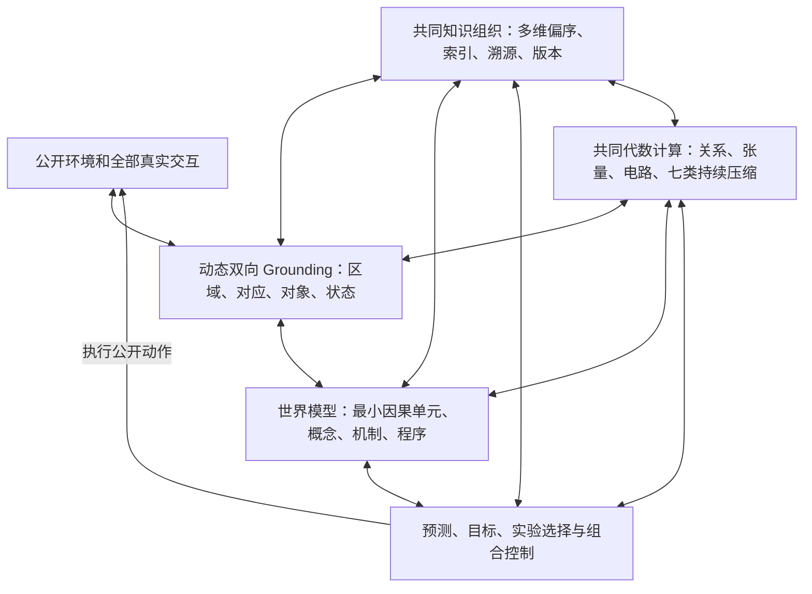

# ARC-AGI-3 第13版统一认知架构：多维偏序索引与多层次持续压缩完整实施计划

2026-11-26 12:10（台北时间，星期四）｜研究与 Codex 实施计划｜未执行远端代码修改、生产实验或提交推送

**本文是本日期 01、02 两份文档与第13版架构评审的整合后实施主文档。实施时以本文为准；01、02 保留为理论依据和演变历史，不是还要依次执行的旧路线。** 只设两个里程碑。本文可独立阅读和实施，包含公共接口约束、算法、索引、持续压缩、反例与控制闭环、实验对照及验收。新增的索引设计和各层压缩是待验证的工程研究方案，不是已经实现的现有仓库功能。

## 1. 目标与不可改变的语义责任

目标不是建立更多的知识表，而是在原始观测完整、动作因果覆盖不降低的前提下，从同色四连通区域逐步发现对象、状态、关系、概念、机制及组合控制程序，使每一层减少重复表示、重复计算、重复搜索和重复学习。保留三项独立假设：

- H1（表示及语义统一）：各层可通过兼容的类型化关系及函数表达，精确查询、组合、绑定和回读保持正确。索引结果不得漏掉合法候选。
- H2（计算统一与净收益）：统一算子、索引及因子化能够减少真实重复计算/搜索，并在计入维护和编译后降低端到端耗时或内存；二者的收益与代价分项报告。
- H3（认知收益）：持续的多层压缩和反例精化能够促进新变量发现、减少重复学习、保持或增强预测/因果区分/控制能力。仅有更小表示或更高似然不能证明 H3。

严格公开应用程序接口（Strict Public Application Programming Interface）：只使用公开返回的全部网格/动画帧、公开动作与参数、公开可用性、公开进度及结果。禁止游戏私有元数据、debug 状态、游戏源码机制、正确对象或解题规则标签进入学习和控制。合成环境的真值仅供隔离裁判。按实际可用 ACTION1–7 覆盖；ACTION6 的显示坐标、实际公开参数与内部网格映射可验证并留存，不能假定同一区域所有点击等价；ACTION7/RESET 按公开语义隔离建模，不能混成普通前向动作。实际动作功能由证据学习，不从编号注入答案。原始观测和已发生事件不可因模型改变而删除；不将未执行、不可达或缺失观察当作负例。

所有配置写配置文件；遵循现行默认或更充分的学习/计算设置。不用人为缩小候选范围、历史、动作覆盖、验证强度来制造加速。实验模式独立显式选择，不做新旧兼容 fallback，不设置人为搜索/学习预算代替正确实现。遇到数学或资源上的实际不可完成，应保留未完成状态、记录原因及可续算信息，不宣布闭合。不要为每类游戏写特定策略、正确机制标签或固定答案模板。

## 2. 第13版的最终职责组织

三项认知过程：动态双向 Grounding（语义落地）、世界模型与抽象学习、预测/主动实验/目标与组合控制。三个过程从第一帧开始协作，不等待某层全部识别后才行动。两个横向基础：统一知识组织与多维偏序索引；统一代数计算与持续多层压缩。一个真实公开行动闭环：预测→执行→观测→反例定位→语义及计算联合修订→下一动作。



图中的连接是计算责任关系，不要求创建相同数量的服务、进程或事实库。一个区域/机制的定义只有一个有效的语义来源；不同索引、因子表达、已编译电路均指向明确的定义和版本。知识组织与计算表示双向演化：索引检索发现共同结构的线索；经验证的抽象反过来让索引、计算和搜索共享结构。溯源、反例、未知范围及版本贯穿全部层次。

## 3. 从原始数据到统一关系与代数计算

### 3.1 确定性第一层：同色四连通区域

对每个公开网格，设位置 p、颜色 c、实际颜色函数 F。关系 B(p,c)=[F(p)=c] 精确描述观测。邻接 E(p,q)=[F(p)=F(q)] AND [曼哈顿距离(p,q)=1]，其含自身的可达闭包等价类构成唯一的极大同色四连通分区。用现有等价的连通分量标记/位集合原语处理全部颜色，含背景候选、单像素、界面；不建立 N×N 的稠密像素邻接矩阵。四连通到八连通的粗化通过区域间同色对角接触闭包精确计算。

U(p,r) 表示像素归属基础区域 r；V(r,c) 表示区域颜色。B(p,c)=OR_r(U(p,r) AND V(r,c))，必须逐像素精确回读。基础分区是单帧空间事实，不因后续对象解释改变而篡改。区域编号仅为帧内身份；对象身份需要跨帧证据。功能对象可为区域子集、跨区域并集、重叠或不连续结构。对象可以一对多、多对一、多对多匹配、分裂/合并、出现/消失及保留歧义。区域成员的精确回读不能被外接矩形等摘要代替。全局计数、对称、跨域关系及历史变量不强制归属单个对象。

区域邻接 A(r,s)=OR_{p,q}(U(p,r) AND J(p,q) AND U(q,s))，J 为四邻接。直接扫描网格边形成稀疏邻接；自然数聚合计数共享边，布尔聚合判断是否接触，两者语义不同。所有动作返回帧按实际顺序存储，不能把一个动作的动画帧算作独立干预。

### 3.2 共同算子与表示

Functional Aggregate Query（函数聚合查询）的共同形式 Q(X)=⊕_Y ⊗_i R_i(V_i)：X 为保留变量，Y 为中间消去变量，R_i 为参与关系，V_i 为各关系涉及的变量。具体算子包括 Product（乘积组合）、Aggregation（聚合）、Elementwise Mapping（逐元素映射）、类型化重索引及 Conditioning（条件化）、有限域单调关系的 Least Fixed Point（最小不动点）。否定、比较、除法、概率归一化、最优查询和非单调修订另有语义条件，不冒充普通半环操作。

- 布尔半环用于存在性、约束和蕴含；自然数半环用于见证计数，若计不同结果需先去重/布尔投影；有理数域用于精确代数分解；非负概率因子用于合法概率组合与边缘化。共享操作形状不等于随意更换运算符。
- Tensor Factorization（张量因子分解）/关系电路提供多维函数、因子化关系及共享执行。Factor Rank（因子秩）和 Algebraic Tree Decision Diagram（ATDD，代数树决策图）针对完整定义函数、固定变量树的精确切分秩和规范化；不把部分未知的真实机制补成已知。原论文 Rust 原型的任意变量树转换中全真值表展开不可直接用于大域生产热路径。每次操作检查相应可处理条件及组合后性质；计入秩、系数位长度及中间规模。
- Probabilistic Circuits（PCs，概率电路）用于不确定对象对应、上下文/响应分布、模型候选评价，不重新训练已经精确可算的同色、邻接或面积。PC 的 Region Graph（变量区域图）不是图像区域图；不可由空间分离推出统计或因果独立。在线分裂/合并的近似高阶统计只作概率模型估计，真实历史可回查并精确修订相关统计。
- Boolean Matrix Factorization（BMF，布尔矩阵因子分解）可产生共同属性、集合及逻辑因子；精确模式需重建原关系（包括残差），不完整域只在已知范围检验。未知、冲突与已知假严格区分。低秩/统计共同性只产生候选，不自动晋升因果概念。
- 从适当关系层进行 Inductive Logic Programming（ILP，归纳逻辑程序设计）、反统一、动态谓词发明和 E-Stitch 程序库学习；不直接在全部像素上枚举规则。缺少关系时通过反例定向请求底层精化，不预置游戏正确机制。各学习策略可以协作但不是必须串行的阶段。

## 4. 多维偏序：一个知识身份体系，多种语义检索投影

### 4.1 为什么不是每维一张哈希表

Hash Table（哈希表）适合精确键匹配，不直接回答集合包含、逻辑蕴含、结构嵌入、机制抽象或序列前缀。应保持一个权威知识身份体系和按实际查询需要建立的可共享索引。Index（索引）是可重建的派生访问结构，不拥有独立知识真值。索引选取依据真实查询的绑定模式、重复频率、选择性和维护成本，不能要求每个维度都物化一份全部偏序边或哈希表。对稀疏/新知识未建立物化索引时，统一查询优化器可选择完整精确的关系查询计划；这是同一语义的计划选择，不是退回旧版算法或跳过验证。

最少区分三种身份，避免把哈希当作因果证明：

| 身份 | 用途 | 必须注意 |
|---|---|---|
| 逻辑知识标识 | 对象、关系、概念、机制的稳定引用 | 语义修订产生版本，引用不能静默指向不同定义；跨关对象对应不能仅靠编号 |
| 内容指纹/规范键 | 查找相同表达、共享子结构、缓存 | 类型、变量域、规范化规则及必要上下文纳入比较；哈希命中后精确内容核对，防碰撞；固定变量树规范 ATDD 不可跨树直接按指纹判等 |
| 证据及定义版本 | 保证推导、索引、统计、编译结果基于一致知识 | 原始证据不可删除；模型版本变动、变量重新绑定或条件变化触发失效；不因缓存命中跳过语义复核 |

哈希用于内容寻址/精确去重，语义身份由可验证定义及作用域确定。相同经验输出、相同秩、相同颜色或相同统计特征只能用于候选检索，不能作为永久等价。已证明的模型等价也不自动等于现实因果等价。

### 4.2 六个偏序维度的数学关系与索引

以下为初始六类查询语义，不是固定游戏特征分类。新谓词/关系维度可注册，需声明比较关系、适用域和查询方式。对不能证明反身性、传递性、反对称性的关系，不称为偏序；互相蕴含的表达先按有效域上的语义等价取商，才得到偏序。空间集合、条件逻辑、对象映射、机制抽象及历史结构使用各自关系，不能无条件作笛卡尔积偏序。

| 维度 | 偏序或结构关系 | 优先研究的访问结构 | 最终精确验证 |
|---|---|---|---|
| 集合 | 固定成员域上的 S⊆T；区分实例集合与概念外延 | 压缩位图/倒排索引、集合字典树（Set Trie）、集合大小及域索引 | 同一域上的精确成员包含；空集、全集、重复及重叠正确 |
| 属性 | 约束增加导致具体化；合取型属性在一致域内可按条件集合反包含 | 属性→知识标识倒排列表；数值范围索引；类型/属性值共享索引 | 约束满足或语义蕴含；否定、范围及缺失属性不能用简单标签交集代替 |
| 条件 | C_specific⇒C_general；有效模型域及上下文限定的逻辑蕴含 | 规范表达式键、文字项倒排、已验证蕴含边与可达索引；可增量维护 | SAT（Satisfiability，布尔可满足性）、SMT（Satisfiability Modulo Theories，模理论可满足性）、精确布尔电路/ATDD 检查 D∧C_specific∧¬C_general 不可满足；另检验非空适用域 |
| 对象 | 成员集合精化/组合与有类型的结构映射；不把任意对应叫偏序 | 区域成员倒排、空间范围、参数化形状/结构签名、映射关系索引 | 实际绑定、成员、结构及证据；不同位置和颜色可经映射匹配，不能因指纹不等排除 |
| 机制 | 同一输入输出接口下适用域的精化；更高抽象须存在保持效果/必要控制区分的映射 | 动作、参数域、读写/影响变量、对象角色、条件、效果的多列索引；条件等价与映射索引 | 先判类型/绑定与适用域，再检验完整声明效果及未变化部分、相关公开结果和组合条件；弱签名只用于检索 |
| 时间 | 事件前缀、历史窗口包含、程序组合/子结构及未来响应区分等分别定义 | 时间范围、序列字典树（Trie）、程序子式/接线模式索引、历史—测试关系索引 | 顺序、事件身份、变量映射和可执行接口；有限响应一致只作可撤销假设，不能直接当作全未来等价 |

空间坐标系、游戏/关卡、当前定义域、知识版本属于限定条件，不当成强制跨环境隔离的唯一语义索引。跨关共享程序/概念通过参数化语义标识、明确映射和适用域重新绑定；实例证据仍保留来源。形状归一化、颜色重命名及时间/空间变换只在对应查询要求的等价下使用，不消除其他任务所需的区别。

不同维度还可共享物理访问结构，例如集合与属性倒排共用稳定知识标识和压缩列表；对象与机制的多变量查询共用关系连接索引；不同条件分支共用已证明的表达式和版本化存储。避免全量物化 O(n²) 的偏序传递闭包：按需维护已证明的关系、常用查询的可达结果以及必要的边，不能将缺少边误判为不蕴含。删除边后可达性必须更新，若不能证明局部正确则执行该依赖范围的完整重算。

### 4.3 具体索引算法与安全边界

**集合查询实例。** 倒排列表 P[x] 存储包含成员 x 的知识标识。查找 Q 的所有超集可求 ∩_{x∈Q}P[x]，随后检查域/版本与精确包含；Q 为空时返回同域全部有效集合。查找所有子集不能直接使用同一交集：可对 x∈Q 的倒排列表累加每个集合匹配的不同成员数，并检查该数等于该集合大小，另处理空集合；Set Trie 作为独立对照。不要把不同关系的未知成员当成不属于集合的事实。

**条件查询实例。** C2=A∧B∧D 蕴含 C1=A∧B。正文字合取可用集合索引提出候选；若存在 C3=A∧(B∨D)，文字项集合不能正确判断蕴含，需要正式布尔查询。索引签名若无法证明不会漏掉候选，只作排序，不作硬排除。对条件版本或背景约束变化，之前证明的蕴含边需检查依赖版本，不能无限外推。

**机制查询实例。** 当前对象、可用动作和上下文分别约束多个候选机制。先按必要类型及合法动作域筛选，通过已绑定字段选择高选择性访问方式，再在共享变量上进行多路关系连接。需要多个对象共同作用时，不能把每个对象各自满足条件当成整个机制已经绑定。效果索引支持反向目标查询；影响变量索引和证据索引支持反例修订。

通用检索伪代码（名称为接口建议，未核对仓库代码位置）：

```text
query_knowledge(query, committed_snapshot):
    resolve domains, context, bindings and required relation
    choose access plan using actual query patterns and maintained statistics
    candidates = full applicable knowledge domain in this snapshot
    for necessary_filter in query's provably necessary restrictions:
        hits = access_by_index_or_exact_relational_plan(necessary_filter)
        candidates = candidates ∩ hits     # must preserve every possible solution
    bindings = join_on_shared_typed_variables(candidates, query)
    order bindings by optional statistical/structural hints
    for binding in bindings:
        result = exact_check_or_unknown(query, binding, snapshot)
        emit result with proof/evidence and scope; preserve unknown if needed
    return results
```

禁止把相似度近邻、秩接近、概率较低、历史上未观察到作为删除候选的充分条件。索引可以减少访问、共享证明和搜索顺序，不能替代逻辑判定。即使不物化某种索引，也必须保持同一查询结果。大域完整输出仍然有与答案规模相关的成本，不能承诺每次检索 O(1)。

### 4.4 反例、依赖索引与一致发布

除六维语义索引外，维护共享的反向依赖访问关系：事实/证据→派生知识；知识定义→索引条目、条件证明、统计、已编译结果、程序及策略。该访问关系不是第七个抽象偏序，而是更新和溯源所需的依赖关系。

```text
revise_and_publish(event, counterexample, old_snapshot):
    append immutable public event
    determine changed facts, object bindings, definitions and assumption scopes
    find all dependent proofs, constraints, indices, statistics and compiled queries
    build next coherent snapshot:
        invalidate/retract unsupported derivations and outdated entries
        preserve derivations with other valid independent support
        update changed definitions and rederive affected historical results
        update/rebuild affected semantic indices, certificates and compiled queries
        verify against independent complete recomputation for declared test cases
    publish model + indices + compiled outputs together at the new version
    ensure the next decision uses this version, not invalid older caches
```

待发布的版本不能与旧索引混读。历史证据仍可回读；撤销的是派生假设，不是已经发生的事实。结构修改后的统计、条件等价及失败约束需要分别判定依赖。版本化等价图有助于共享不同假设分支，不自动支持任意撤销；必须显式保证过期合并不再污染有效查询。

## 5. 七类持续压缩：每一层都有压缩机会，但不能牺牲控制区别

七类压缩不是七个新模块，也不是七次顺序执行。它们是贯穿系统的七种不同责任，可同时作用于同一知识。压缩收益有重叠，不可机械相加；索引本身也占用内存与维护时间。每层必须能识别压缩机会、校验语义、持续修订，并报告净收益或无收益。不能预设任何数据都必然可压缩，更不能为了压缩率而丢失少见但关键的机制。

| 压缩类型 | 具体算法方向 | 必须保留的能力 | 与索引互相促进 |
|---|---|---|---|
| 原始数据 | 颜色紧凑编码、精确区域、可逆时序差分、相同块共享 | 原始完整帧、顺序、参数与公开结果零差异回读 | 区域/事件/像素成员可直接定位，不复制完整帧；差分索引定位实际改变的部分 |
| 关系 | 共享成员及属性集合、因子化连接、稀疏/压缩倒排、公共关系投影 | 精确查询、合法绑定与未知域保持 | 列表交集及关系连接使用共享因子；索引直接消费因子而不先完全展开 |
| 代数计算 | 固定变量树精确规范化、Factor Rank、张量分解、公共子表达式消除 | 声明域内的函数语义、精确算术、组合查询 | 规范键定位相同函数，索引到共享子结构；更新只触及受影响依赖 |
| 语义 | 集合闭包、反统一、条件泛化/具体化、谓词发明 | 内涵、外延、真实绑定和任务需要的区分；泛化范围仍需验证 | 包含/蕴含/映射索引找到共同结构、反例和可复用定义；共享定义后复用索引 |
| 程序 | E-Stitch、参数化函数库、已证明的条件程序等价 | 类型接口、效果、失败、资源/进度及有意义的可见中间变化 | 子式/程序模式索引促进共享函数发现；程序库复用减少重复表达式搜索 |
| 动态状态 | Weighted Finite Automata（加权有限自动机）、Predictive State Representations（预测状态表示）、时序模板及谱学习 | 未来相关实验、隐藏历史区分、控制和目标可达性 | 历史—测试响应索引找到相同与不同响应的状态候选，减少重复预测；新实验可拆分 |
| 搜索 | 精确去重、已证明的偏序剪枝、反例约束、共享搜索子问题、增量续算 | 不删除仍合法或未知的候选；失败约束有作用域、证据及版本 | 反例/蕴含/机制条件索引快速复用已知失败；搜索减少后索引负担下降 |

### 5.1 两类压缩必须分开验收

Lossless Compression（无损压缩）针对已经确定的事实、函数或模型内等价表达：有精确语义证书/独立裁判，才能共享或替换原计算表示。只减少计算量不改变知识含义。

Semantic Abstraction（语义抽象）针对待学习的概念和机制：可能扩大适用域或合并状态区别，需要真实证据及行动语义检验；在验证不足时保留竞争解释和未知区间。对概率模型，近似分裂、合并、参数共享与拟合只是候选结构更新；不得替代原始证据、硬约束或确认因果作用。

对于确定性抽象，在明确域内检查 α'(T(s,a))=T_bar(α(s),a_bar)；α 和 α' 是具体到抽象的输入/输出映射，a_bar 为可绑定的对应动作，T 与 T_bar 为具体/抽象转换。对于概率模型比较相应推前分布，并检查公开终止/进度、后续测试及目标控制区别。形式证明只保证给定模型内部的结构保持，不代表现实模型已经正确。

### 5.2 持续压缩与反向精化算法

触发源：新帧/新动作证据、新关系或定义、重复访问和共同表达、新预测差异或反例。无需为每层在每一步执行全量重新分解；使用依赖范围与真实复用信息定位压缩机会。长期积累的反例、失败约束及旧证据不可衰减删除。概率模型的分布适应不等于事实遗忘。

```text
on_new_evidence_or_definition(changes, snapshot):
    affected = dependency_closure(changes)
    locate repeated structures and already-known equivalences using indices
    propose factor sharing, parameterization, decomposition or merge/split
    for proposal:
        if exact representation transformation:
            require semantic equality and complete recovery in declared domain
        else:
            preserve alternatives; validate prediction/control distinctions
            request reachable distinguishing experiments when evidence is insufficient
        estimate net storage/compute/search reuse including maintenance costs
        accept certified exact sharing or evidence-supported scoped semantic abstraction
        otherwise keep hypothesis unresolved or record refutation with scope
    update/rebuild affected indices, statistics and compiled queries coherently
    confirm subsequent consumers use valid new definitions
```

“反压缩”也是必要操作：发现一个合并的对象、状态或机制存在不同响应时，恢复必要区别并精化其定义。原始证据、参数及依赖可回读使这种修订成为可能；被否定的旧抽象不再提供无条件等价或剪枝。对真正不同的语义即便短期压缩收益下降也必须保留。

最小描述长度（Minimum Description Length，MDL）可辅助模型与数据解释复杂度比较，但不能用一个指标代替预测、因果和控制判定。可以对通过语义检验的方案比较实际表示总字节、计算时间、搜索重复与交互成本，并分别报告利弊；不人为强制每项压缩都发生。

### 5.3 搜索压缩的具体逻辑

假设同一确定性预测问题、固定已知背景、同一作用域和动作/效果定义下，候选条件 C 预测效果 E。在真实反例中 C 成立而 E 未发生，则适用域包含该反例的更一般条件若仍作同样预测，也被该反例推翻。对必须覆盖正例的单调规则学习，过于具体且不覆盖正例的假设，其相应具体化同样不覆盖该正例。必须先验证蕴含方向、单调条件、绑定及效果接口。该思想参考 Learning from Failures（从失败中学习），不能无条件用于含未知状态、非单调规则、随机效果或多机制交互的整个世界模型。部分模型中的概率低不构成这样的逻辑排除证明。

失败约束保存失败假设、可区分的公开事件、前提、证明的泛化/具体化方向和版本。查询候选时用条件/对象/动作/效果索引取相关失败约束，再进行精确匹配；只有证明适用时才剪枝。背景、对象身份、适用域、动作效果或机制版本改变后必须重新验证或撤销旧剪枝。统计性提示只改变排序，不丢弃未验证候选。对称去重亦须证明保持相关动作、目标和证据语义，不得单靠形状相似。

## 6. 动态变量发现、因果单元与双向控制

### 6.1 变量发现不是从零枚举

| 触发依据 | 通过索引/计算取得什么 | 形成的候选及验证 |
|---|---|---|
| 共同集合结构 | 成员包含、交集、跨帧对应及形状关系 | 组成部件、对象候选；可精确回读、保持必要区别 |
| 重复计算结构 | 规范子函数、共享因子、重复表达式、实际访问统计 | 可复用属性/关系；精确等价或待验证参数化定义 |
| 共同变化 | 同一事件和跨事件的区域变化、参数映射及不变部分 | 联合变换、组合对象；共同响应不能直接认定同一因果对象 |
| 预测差异 | 竞争模型对同一可达动作的不同效果 | 新条件、状态区分及主动实验 |
| 无法解释的实际变化 | 残差位置、旧绑定/条件、相关历史与未解释变化 | 新变量、缺失机制、对象分解/组合；重查证据 |
| 动作实验差异 | 不同动作/参数/上下文的实际结果及无变化记录 | 控制相关变量、条件及因果作用域 |

特别检查两两互信息不能发现的高阶依赖，例如均匀独立 X,Y 的 E=X XOR Y：I(X;E)=I(Y;E)=0，但联合条件决定 E。互信息、因子秩、统计分支、逻辑共同性和残差是不同的候选来源。不得用其中之一作为排除其他关系的唯一标准。对同画面不同历史响应，使用历史—未来实验矩阵 D(h,τ) 的可获得证据提出动态状态；未测试项未知，秩只作已知子矩阵的下界或有假设的估计。谱学习得到的负值/非归一化预测须判无效概率语义，不静默截断冒充正确。动态求和乘积网络作为独立比较方案，非必选重复模型。TT-Cross 只引导可到达的实验选择，不把游戏当可任意读取的张量元素预言机。

### 6.2 动作—对象最小因果单元（Action–Object Minimal Causal Unit）

每个机制候选至少可查询以下责任（不是强制每个机制一张表）：

| 责任 | 语义与索引支持 |
|---|---|
| 对象绑定 | 当前哪些结构满足角色、成员及对应；通过对象/成员/跨帧索引联合绑定 |
| 适用条件 | 哪些上下文与参数允许作用；条件蕴含、属性及作用域查询 |
| 效果预测 | 对全部声明相关变量给出转换关系，必要时预测延迟、多对象变化与公开结果 |
| 不变部分 | 哪些相关变量在声明作用域中不变；以完整观测及模型约束核对，不把无可见变化自动当成无作用 |
| 因果证据 | 事件、竞争解释、可区分性及支持/反例；变化区域不一定是直接作用对象，须区分共同原因/中介/连锁及作用目标不确定性 |
| 适用范围 | 声明观察/可达域、动作参数域、对象和相关条件；支持、否定、冲突、未辨别状态及依据 |

最小性是相对于当前可区分的作用接口和实验域而言，允许后来分解。覆盖 ACTION1–7（实际公开可用时）、ACTION6 坐标域及区域内差异、远端/延迟/联合效果、无可见变化和逆向/生命周期动作。分区可压缩参数搜索，但等效类必须由证明或相应证据验证；未测试的类明确未知。分开度量作用对象语义准确、机制预测稳定、适用域覆盖、置信度校准与实际控制能力。不得将重复相关帧当独立证据或把高成功率当充分因果覆盖。

### 6.3 正向、反向、组合及实验共享计算

正向查询 Post_a(s,s')=T(s,a,s')；反向对候选目标 G(s') 计算 Pre_exists_a(G)(s)=∃s'[T(s,a,s')∧G(s')]，它是存在可能结果的前像，不是必然成功条件，也不是已执行过的逆向动作。对非确定模型，保证型前像还需有合法后继且所有允许后继满足目标；概率型前像计算目标成功概率并检查概率模型有效。中间状态消去实现机制组合 T12(s0,s2)=∃s1[T1(s0,s1)∧T2(s1,s2)]，前提是接口、历史状态、动作绑定和失败/终止等语义充分。

目标与子目标作为候选状态关系，从公开进度、真实反馈及预测建立并修订。没有目标证据时保留不确定目标，不注入正确通关条件。利用动作、条件、效果和对象索引双向查找，再用统一代数计算组合、绑定并比较可达实验。多步组合不能跳过中间可执行条件、资源或进度责任。

```text
while public interaction permits:
    observe all public evidence; update immutable event record
    update exact regions, relations and affected dynamic bindings
    retrieve applicable hypotheses and prior failure constraints via typed indices
    propose/revise structures from shared factors, residuals and history tests
    revalidate affected evidence; run continuous compression/refinement
    publish coherent knowledge, indices and compiled computation snapshot
    enumerate publicly available actions and applicable parameters
    compute forward predictions and backward goal preimages
    compare reachable goal actions and hypothesis-distinguishing experiments
    record current predictions, candidate domain, binding and knowledge versions
    execute one public action (or validated sequence, observing each actual step)
    observe actual effects; identify conflicts or missing conditions
    verify that the subsequent choice consumes the new knowledge version
```

区分性实验可按竞争预测的总变差（Total Variation，TV）和已明确的模型权重排序，仍须满足真实可达性；不存在可靠概率时不能伪造置信度。模型修订必须被下一次实际决策消费；并非每次更新都要求改变动作（新知识可能支持同一正确动作）。在预设有决定性反例的测试中，必须验证修订改变预测/可行集合，且确实改变预期应改变的后继公开动作；其他场景报告实际影响，不能为了验收故意改变正确动作。

## 7. 两个实验里程碑（完整替代先前分散的实施安排）

所有实施前先读现行仓库文档，再追踪真实生产调用逻辑。以下函数名称仅是拟定接口，不能直接当作现有文件或行号。按现有结构复用正确实现，避免创建重复的对象库、事实库、学习器或兼容路径。先记录每个具体问题、真实代码位置、当前逻辑、后果、对应解决方案，再开始修改。仓库访问按用户要求使用 GitHub connector；选择明确分支后提交，不擅自切换其他分支。配置写文件，中文日志置于对应日期的 docs/changelog/ 子目录；实施期间按约定定期提交推送并在里程碑提交时说明分支、提交和测试结果。

### 里程碑一：精确区域—关系—偏序索引—代数压缩的生产计算闭环

**核心目标：在不改变需要计算的语义、不降低覆盖的前提下，证明索引与精确压缩能够简化并加速已有 Grounding、联合绑定、证据复核等真实路径。**

#### 1.1 查清基线与真实瓶颈

1. 固定目标分支、提交、配置、公开接口和硬件/线程，查阅现行 Grid64、区域分解、对象匹配、机制候选、联合绑定、历史复核、动作入口及持久化代码。
2. 为每类查询记录实际输入域、绑定字段、输出、调用次数、重复率、耗时、分配及现有索引。特别检查是否已经使用同色四连通、位图、倒排、哈希、部分序关系或增量缓存；已有正确能力直接复用，不能假设基线是稠密像素枚举。
3. 以相同公开轨迹捕获真实查询工作负载（查询内容、上下文、版本、结果），建立可重放的时间序列；基线不能运行则记录阻塞，不虚构性能。先测冷启动与后续热路径的真实占时，再决定哪些派生索引和压缩值得物化。

#### 1.2 确立共同语义及区域关系接口

1. 实现/整合第一层同色四连通分区、全部区域成员回读、稀疏区域邻接、对角接触及八连通粗化；保存所有公开动作返回帧序列及事件身份。
2. 接入类型化关系算子：统一精确集合、同色、区域关系、差分、匹配及条件检查；坐标变换明确类型与范围，区分精确事实、候选、已否定和未知。
3. 生成跨帧候选关系：从精确差分、区域成员、共同属性和可计算参数映射提出对应；保留不唯一的候选，不把重合率最高解释认定为真值。使现有生产消费者直接调用该接口。
4. 建立域/类型/版本/表达身份以及证据关联的共同接口；不另建一份影子真值库。精确查询输出与独立裁判一致后再开展性能实验。

#### 1.3 实现多维索引与联合查询

1. 用规范键进行精确去重；实现碰撞后的内容检查。对集合、属性、条件、对象、机制及时间的必要查询定义接口，按实际负载选择共享倒排/位图、集合字典树、多列连接索引、条件证明索引、时间范围/程序结构索引。已有实现可直接采用；不是要求一次实现所有候选数据结构。
2. 各查询区分「精确查找」「上/下位知识」「对象绑定/条件匹配」「统计候选排序」；实现可证明不漏解的候选生成与后验精确检查，非充分签名不得成为硬排除。
3. 进行多维联合检索，在同一知识版本上进行必要条件过滤及共享变量连接；记录查询计划的中间结果数、读写、访问路径、绑定数及精确验证次数。检索结果同时返回可追溯知识身份及作用域。
4. 采用反向依赖索引、可验证的条件蕴含边及必要缓存，验证插入、撤销、替换、条件变化和对象分解后，全部受影响结果正确更新。不预建所有两两偏序边，按需物化常用证明与查询。语义查询与索引无关，完整查询裁判与优化查询必须给出相同结果。

#### 1.4 建立精确持续压缩与代数执行

1. 原始数据层：复用紧凑位表示、精确区域及可逆差分，比较含索引和引用的总字节；必须逐像素回读并保持事件顺序。
2. 关系层：复用成员集合、属性集合、共享关系因子及连接中间结果；比较直接稀疏关系与因子化关系。BMF 仅在已定义范围精确压缩，经验外推推迟到里程碑二。
3. 计算层：对明确的完整有限函数试验 TDD/ATDD、不同变量树、精确代数和张量因子共享；不把未知函数直接编译为已知事实。64×64、16 色索引函数的 65,536 个输入可完全枚举；其他关系按可穷举域及独立精确裁判检验，声明未穷举域。禁止在大域热路径使用全真值表展开式变量树转换。
4. 利用重复查询与依赖索引定位可共享计算，按实际收益选择合规执行计划（紧凑位集合、稀疏关系、精确电路等），不是以旧路径兜底。只在语义一致情况下共享。对每种编译/规范化方案记录构造、重组、系数位长、峰值内存及实测复用次数，比较总成本而非仅节点数。

#### 1.5 实验对照、测试与验收

在同一真实轨迹及固定查询域上，先做下列短程回放对照，不强制每个实验模式重复跑昂贵游戏：

| 实验模式 | 索引 | 额外精确压缩 | 目的 |
|---|---|---|---|
| A（实际基线） | 保持现有 | 保持现有 | 获取真实生产参考；不能虚构基线没有索引 |
| B00 | 统一接口的基础访问计划 | 保持现有精确紧凑表示 | 测量统一接口本身的成本与正确性 |
| B10 | 增加按负载选取的多维索引 | 与 B00 同 | 隔离索引效应 |
| B01 | 与 B00 同 | 增加共享因子及适合的精确代数表示 | 隔离压缩效应 |
| B11 | 增加多维索引 | 增加精确压缩并使索引直接消费共享因子 | 检查二者协同及维护开销 |

B00/B10/B01/B11 共享同样的语义、输入关系、查询和输出责任；仅开关新增优化，不人为去掉必要的基线数据结构或缓存。独立测试模式均非生产兼容路径。逐项比较 B10/B00、B01/B00、B11/B10 与 B11/B01；如需定量评估协同，可报告时间交互项 T11−T10−T01+T00，并同时解释各项真实成本，不能将不同工作负载混合相减。只将实测有效且通过语义验收的研究方案用于后续生产对照。

测试必须覆盖：

- 空/全域集合、子集与超集、相同基数不同成员、重叠/不交集、重复记录、故意哈希碰撞、不同类型同名变量、跨版本与空上下文；复杂逻辑（合取、析取、否定、范围、矛盾及未知）精确蕴含；偏序的反身、传递和取商后反对称性质。
- 全同色、棋盘格、单像素、环与孔洞、边界、背景变化、四/八连通、同色接触、异色共同区域、多动画帧、部分对象及跨帧分裂合并。精确颜色/区域/邻接/关系查询与独立像素裁判零差异。
- 联合绑定中共享变量一致性、同一对象不同映射、条件等价随上下文变更、不同效果但相似结构、历史前缀、远端依赖、ACTION6 参数与作用域。索引后完整候选答案集合必须与扫描/独立精确裁判一致；对排序候选须确保不被错误截断。
- 随机生成有限关系与更新序列，包含插入、删除、依赖撤销、替换、条件定义变化、缓存过期、多条独立推导与恢复。每个已提交快照的精确查询、索引及因子化表达均与从头重算比较；无失效知识进入后续动作。

性能指标：冷启动、首次动作、连续动作端到端延迟；构造、索引构建/维护、候选生成、绑定、验证、分解/编译、查询、完整历史复核、序列化和跨语言开销；p50/p95、峰值、实际内存/分配及总存储（含索引/证据/系数/缓存）。记录真实候选访问数、精确验证数、输出数、重复查询数、共享结构实际命中次数、全部索引和压缩成本。准确查找并不自动等于算法复杂度降低；构造、查询、更新总成本才是净收益。

**完成门：** 精确语义零差异、合法候选无遗漏、版本一致、完整原始证据不变，真实生产 Grounding/联合绑定/历史复核调用到新接口。H1 与 H2 分开裁决；没有总体收益的表示或索引如实记为不适用，不凭理论秩、节点数或孤立微基准通过。确认热路径实际收益及没有转移瓶颈。达到里程碑后在明确分支提交推送，提供中文 changelog、实际调用链、实验配置、测试结果及失败数据。

### 里程碑二：多层持续认知压缩—因果变量发现—双向控制闭环

**核心目标：让压缩和索引不仅加快已有计算，还能减少重复学习与无效搜索，发现必要的新语义变量，并真正影响后续公开行动。**

#### 2.1 从区域到可修订对象和动态状态

1. 从区域候选、共同结构、跨帧对应、变化及残差生成可精确回读的对象/子结构/组合对象候选。使用通用关系、集合和参数化映射，不预判游戏类别。允许全局属性、重叠、非连续、远端作用及历史状态。
2. 用对象、属性、共同变化、历史测试等索引检索已有解释；BMF、PC 条件响应与 Factor Rank 等提供共同结构线索，不把代数因子直接等同于语义对象。对相同当前帧而未来响应不同的情境，提出历史状态变量候选，保留未辨别测试。
3. 新反例触发六类来源的候选发现，先查绑定/对象解释，再查条件/动态状态和机制效果，但保留竞争诊断，不能固定总是增加条件。必要时向下请求区域内精化、向上形成组合对象或引入历史变量。

#### 2.2 持续语义、程序及动态状态压缩

1. 在合适的关系层通过反统一、概念闭包、谓词发明与 E-Stitch 等方法搜索可复用定义；利用集合、属性、条件、结构签名及历史响应索引寻找已有程序/概念，而不是重复从像素起步。未确认的经验等价不永久合并。
2. 对精确语义共享执行合规的规范化；对扩大适用域、减少状态区分、共享机制条件等操作独立验证。检查可执行定义、具体绑定、反例、条件等价、效果与不变部分；范畴映射与模型内结构保持只在声明域内成立。对动态模型同时检验未来可区分响应、目标与控制。
3. 保留原始证据和可逆/可撤销的假设依赖。任何反例都可使原来压缩的对象或状态重新细化，不静默保留已经失效的等价、程序或索引。概率模型更新不得替代精确证据复核。
4. 对七类压缩分别记录真实净变化：数据总字节、关系因子与查询开销、代数共享和编译成本、概念定义及可复用实例、程序抽取和实际调用、动态状态区分和预测误差、搜索候选/失败约束及重复计算。语义/程序压缩需记录可恢复或可重新绑定的内容。不能靠减少覆盖、输出或验证取得“压缩”。

#### 2.3 持续搜索压缩与双向预测控制

1. 对已证实失败的假设生成有作用域的失败约束，记录证明方向及适用条件；借助偏序与条件、动作、对象、效果索引避免重复生成或验证同类错误候选。不同效果、上下文、历史或概率机制的失败不得无证明继承。排序提示与安全剪枝分开。
2. 对动作—对象最小因果单元实现六项责任查询：绑定、适用条件、效果、不变部分、因果证据和适用范围。追踪全部公开动作和参数，不确定机制不能伪造为已否定/已确认。通过真正区分性的行动验证直接作用、联合作用及后续变化；证据不足时只声明预测或相关关系。
3. 使用统一代数计算与索引进行正向效果预测、反向目标前像、机制组合、合法动作绑定和实验选择；目标与子目标由公开结果学习。对不确定后继区分存在、保证、概率三种可达性；非充分历史状态不可直接用于组合。
4. 实际执行公开动作，预先记下预测、绑定、使用的知识版本、实验区分目标及动作理由；返回后记录全部真实结果，联合修订、索引更新和计算失效；下一真实动作必须消费新知识版本。设计决定性反例验证新知识在应该改变动作的场景确实改变后继选择。

#### 2.4 合成对照、真实轨迹及 public25 验证

先在完全隔离真值的有限公开环境和既有轨迹上进行消融：

| 对照 | 比较责任 | 结果必须证明 |
|---|---|---|
| 固定区域解释 vs 可分解组合的区域解释 | 区域先验是否遗漏功能对象 | 同色接触、异色组合、远端共同响应能正确修订；固定区域仅用于隔离效果，不是生产回退 |
| 共同计算/索引基线 vs 加入 BMF、PC 及动态状态学习 | 结构发现是否提供新增语义 | 不仅似然下降，还发现能解释预测差异的变量；动态预测状态方案与时序模板单独比较 |
| 相同学习器，新增语义/程序共享关闭 vs 开启 | 多层持续压缩的作用 | 复用增加、重复学习减少，预测及控制语义不退化 |
| 相同候选空间，新增已证明失败约束剪枝关闭 vs 开启 | 搜索压缩独立贡献 | 合法解集不变、生成/验证和失败重复减少；跨上下文失效处理正确 |
| 决定性反例注入前后（公开环境可达） | 反例→变量/机制→索引→控制完整闭环 | 必要区分被恢复、受影响历史重算正确，下一次公开动作使用修订后知识 |

这里的“关闭”只针对新增加的学习/压缩策略；证据保留、完整合法候选、类型/版本检查、公开接口等硬性正确性责任从不关闭。保留现有基线配置与完整候选语言，不通过削减搜索深度制造比较。上述对照优先以同轨迹回放、有限语义裁判和定向公开实验执行；避免把每一种内部消融都扩大成昂贵的完整游戏运行。再将通过门禁的组合方案与现行生产基线在 public25 真实流程中比较，采用现有合规实验配置或更充分配置，按用户要求不人为降低框架参数。

有限环境必须覆盖：同色接触后独立变化、多色组合、空间分离共同响应、视觉分裂但对象仍相同、区域内不同 ACTION6 点击效果、同画面不同历史、XOR 高阶条件、条件泛化被反例推翻、延迟/远端/联合作用、无可见变化、资源/公开进度变化、多个机制连续组合、目标反向查找及条件等价失效。裁判单独构造可达状态、公开动作及真实关系，学习器不读取标签。对小域枚举合法候选语言并比较剪枝前后解集及所有声明测试。对于大域声明未穷举部分，不能虚称覆盖闭合。

真实公开轨迹按时间和关卡做训练前缀/后缀，预测在读取下一次真实结果前写出；不得用未来观测或私有状态。不能离线断言未执行动作效果。可复现的初始条件和动作序列优先用于配对；无法匹配情境则说明，不预设游戏确定或随机。真实 public25 分析重点是机制学习过程、单位时间有效交互、稳定性、覆盖和控制行为；正常分数/小关升降不作单款游戏的过度归因。公开关卡进度按最高真实完成关卡，不把反复第一关计为累计进展；按接口实际字段采集，禁止 debug。

#### 2.5 最终验收及失败裁决

| 验收项 | 必须提供的证据 |
|---|---|
| 动态 Grounding | 成员、绑定、对应、历史区分、未解释残差；有裁判时精确对照，无裁判时明确公开证据边界 |
| 多维偏序 | 每维上/下位、绑定、蕴含、组合查询正确性；联合检索不漏合法候选；错误索引/过期边及跨作用域误匹配为零 |
| 七类持续压缩 | 每类记录压缩前后真实表示/计算/搜索/复用；精确压缩零语义差异，语义压缩保持经验证的预测及控制区分；无净收益类别明确标出 |
| 因果单元 | 所有实际可用动作、参数类、对象/上下文及效果范围；支持、否定、冲突、未辨别四态；作用对象、条件、效果、不变部分与区分证据单独检查 |
| 预测与置信度 | 预先记录的单步与多步效果误差、适用域稳定性、概率校准（Brier Score，布里尔分数；Log Loss，对数损失）、未观测区分；连续相关帧不作独立证据 |
| 控制 | 目标/子目标推导、合法动作绑定、组合中间条件、反例修订对下一动作的真实影响及跨关机制复用 |
| 搜索效率 | 真正生成候选数、验证数、重复验证、已证明剪枝、统计排序、完整解集；失败约束失效后正确恢复候选 |
| 端到端效率 | 首动作/后继延迟、有效实验与反馈/单位时间、复用与学习成本，分项记录索引维护、编译、重组、回放、联合绑定、修订和接口等待；内存含所有索引与缓存 |

必须检查完整动作—对象最小因果单元是否真的闭合，不能以压缩率替代。对声明可达、可观测范围内的未知、冲突和缺失证据逐项报告；不可达/不可辨识部分不宣布闭合。对象语义、效果预测、置信度及控制可靠性独立报告。真实执行、回收证据、联合修订、重新绑定、下一动作的生产调用链都必须有记录。

通过门为：精确层无语义回归，无私有访问，无未证明候选删除，历史与证据完整，修订版本实际进入下一次决策。H3 要求观察到实际复用/搜索/重复学习的净减少，并有可区分的预测或控制收益且无相应语义责任降低。若某项压缩不适用，报告其成本与原因；若整体只得到更小模型或更好似然却没有控制收益，H3 未通过。真实实验前声明效果与误差判定、配对条件和统计分析办法，不实验后挑成功样本，也不凭普通随机结果波动判断。

完成里程碑后，提交明确分支及 commit，交付源代码变更说明（具体问题—真实代码位置—当前逻辑—后果—解决方案）、测试、配置、完整过程原始日志、各层压缩/索引收益账目、尚未闭合的因果责任及阻塞。代码修改与计划实施时遵守用户要求的定期 push 节点，不能仅把文档或微基准当成生产功能闭环。

## 8. 新增文献依据及原有十二篇研究的分工

下列论文支持某些局部算法或数学条件，不证明整个综合架构已经成立。原十二篇的阅读覆盖、无法访问章节、原型与理论差异见 01；区域先验依据与前次小型示例见 02。本轮索引相关文献以公开摘要、正式发表页面及可访问章节核查为主，未重做全文逐定理审计。

| 文献 | 本计划吸收的内容 | 限制 |
|---|---|---|
| [Automatic Index Selection for Large-Scale Datalog Computation](https://souffle-lang.github.io/vldb19.html)，2019 | 根据关系搜索模式选择尽可能少的共享索引 | 不直接解决六维偏序的语义蕴含；本计划须按动态查询及版本维护验证 |
| [Data Structure Set-Trie for Storing and Querying Sets: Theoretical and Empirical Analysis](https://pmc.ncbi.nlm.nih.gov/articles/PMC7875400/)，2021 | 子集/超集查找与倒排索引对照 | 性能依赖集合、查询、元素分布；不能保证恒定访问或不计输出成本 |
| [Relational E-Matching](https://doi.org/10.1145/3498696)，2022（含论文勘误） | 关系连接及查询计划驱动的等价图匹配 | 只解决相应匹配问题，不等于 E-Stitch 全部搜索或因果发现 |
| [F-IVM: Analytics over Relational Databases under Updates](https://doi.org/10.1007/s00778-023-00817-w)，2023 | 因子化增量视图维护、环上的增删及共享计算 | 固定查询的数据更新不等于任意规则/等价撤销；布尔及非单调语义需额外正确性检验 |
| [Versioned E-Graphs](https://doi.org/10.1145/3808249)，2026 | 不同条件/假设版本共享等价信息 | 版本化并不自动完成任意多父条件图或经验假设撤销 |
| [Learning Programs by Learning from Failures](https://doi.org/10.1007/s10994-020-05934-z)，2021 | 通过失败假设的泛化/具体化约束减少后继搜索 | 偏序剪枝可靠性依赖论文的逻辑学习与蕴含条件，不直接扩展为任意游戏的概率机制排除 |
| [What is the Relationship between Tensor Factorizations and Circuits](https://arxiv.org/abs/2409.07953) | 层次化分解、共同张量执行 | 不保证全部知识低秩 |
| [Factor Rank](https://arxiv.org/abs/2611.10842) | 精确切分秩、规范表示和共享 | 固定域/变量树、精确有理数；补充包原型限制见 01、02 |
| [Recent Developments in Boolean Matrix Factorization](https://arxiv.org/abs/2012.03127) | 共同集合、属性和逻辑因子 | 最优分解困难，缺失值不能默认为假 |
| [From Tensor Networks to Tractable Circuits, and back](https://arxiv.org/abs/2605.00106) | 有结构条件的表示转换 | 并非任意递归、程序均紧凑转换 |
| [Lossless Compression with Probabilistic Circuits](https://arxiv.org/abs/2111.11632) | 统计结构及连续条件查询复用 | 特定结构和变量顺序，不是任意增量的复杂度保证 |
| [Online Structure Learning of Probabilistic Circuits](https://yoojungchoi.github.io/files/WagnerTPM26.pdf) | 在线分裂、合并及边流统计 | 高阶历史统计近似；不能删去完整证据或关键低频机制 |
| [TT-Cross Approximation](https://doi.org/10.1016/j.laa.2009.07.024) | 低秩插值及候选测试选择 | 真实游戏不是任意张量元素查询接口 |
| [Connecting Weighted Automata, Tensor Networks and Recurrent Neural Networks Through Spectral Learning](https://arxiv.org/abs/2010.10029) | 共享动态算子及汉克尔结构学习 | 代数基底未必有对象或有效概率语义 |
| [Closing the Learning-Planning Loop with Predictive State Representations](https://arxiv.org/abs/0912.2385) | 动态状态及学习—规划闭环 | 有限响应不证明全未来等价 |
| [Dynamic Sum Product Networks](https://proceedings.mlr.press/v52/melibari16.html) | 时序模板、接口及结构保持 | 不保证自动因果发现或固定总成本 |
| [A Compositional Atlas for Algebraic Circuits](https://arxiv.org/abs/2412.05481) | 聚合、乘积、逐元素映射及组合后的可处理性 | 单项运算高效不保证任意多步组合高效 |
| [Causal and Compositional Abstraction](https://arxiv.org/abs/2602.16612) | 抽象映射与机制语义保持 | 不自动发现现实因果映射 |

## 9. 本次交付状态及后续责任

本次重新读取并整合 01、02 两份完整计划，增加六维索引、跨维联合查询、失败约束及依赖更新、多层持续压缩、控制反向查询与版本一致发布的具体算法；保留两个里程碑，并增加独立索引/压缩/协同的消融和精确裁判。新增 03 为完整实施主文档，01/02 为历史依据；同日全部 Markdown 文档一并打包。

尚未读取或修改 arc3wm 当前生产代码、未指定远端目标分支、未进行代码实现、生产测试或真实 ARC3 运行，也未独立复现新增论文和全部原十二篇论文。本文的索引选择及压缩策略为可证伪研究设计，实际收益及具体代码位置待依据真实生产调用核查。未提交/推送；按照本次明确交付要求提供日期目录压缩包。不能将本次文档交付解释成两个实验里程碑已经完成。
