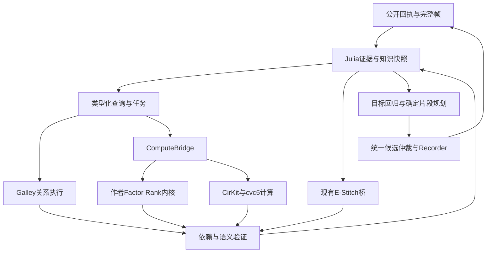

# 10｜通用开源能力：选型、真实API、项目接线与生产消费

本文件把调研清单收敛为可实施的依赖和调用关系。不是全部接入所有论文代码，也不是让每个库管理一份知识。项目统一的是**带类型、域、证据与版本的语义接口**；相应数学和搜索工作交给已选定的开源实现。下文所有项目新增文件/函数均是实施方案，只有明确标注的上游API和当前已有模块是现存代码。

## 1. 选择与固定来源

| 能力及阶段 | 选定实现与固定来源 | 省去的重复开发 | 还由项目负责 |
|---|---|---|---|
| 正式语义，已有 | Catlab0.17.6、ACSets0.2.29、GATlab0.2.4、AlgebraicRewriting0.5.0，沿现有锁 | 范畴/带属性集合/类型关系构造及基础检查 | Ground Atoms的经验意义、对象角色、证据与控制 |
| 正关系优化/稀疏计算，M1 | [Galley8eefbb5](https://github.com/finch-tensor/Galley.jl/tree/8eefbb52c64c9dd1f7cad39e30c9541a9ab9dc56)，Project版本0.2.2，MIT | 连接/归约物理优化、Finch稀疏格式与编译 | 逻辑域、未知、证据与下译正确性；不再另装独立Finch |
| 精确布尔代数，M1 | 上传Factor Rank作者包的 `atddc 0.1.0`，MIT | 精确矩阵、因子秩、布尔运算、最小化/规范化/局部旋转 | 有限关系编码、合法域、零维边界、常驻句柄与证据适配 |
| 约束判定M1/语法合成M2 | [cvc5 1.4.2](https://cvc5.github.io/docs/cvc5-1.4.2/api/python/base/quickstart.html)，官方Python包 `cvc5==1.4.2`，源许可见COPYING | SMT判定及SyGuS搜索 | typed AST下译、模型假设一致性、候选回代和经验验证 |
| 概率电路，M2 | [libcirkit0.3.1](https://pypi.org/project/libcirkit/0.3.1/)，commit `aa7c78c3da676638e9b26ba4b7754171922c0327`，GPLv3元数据 | 电路层/张量计算/编译/边缘查询/自动微分 | 动态变量、样本mask和去重、结构提议、实际因果验证 |
| 程序共享，已有+M2完善 | E-Stitch `e4cd59047b9e1c7d04bc035a3c1cadd66a1b7c92`、egg `196d7d4ba09fcbc28f9a35d206f54d45e24f8410`及现有项目补丁 | 类型项搜索、共享结构/函数抽取 | 真实语料、作用契约、语义发布、轮内持久恢复补丁 |
| 确定片段规划，M2 | [PDDL0.2.18](https://github.com/JuliaPlanners/PDDL.jl/tree/v0.2.18)、[SymbolicPlanners维护commit](https://github.com/JuliaPlanners/SymbolicPlanners.jl/tree/c127297a5e90cb662dec9bbdc1d13e906aeed792)，版本标识0.1.27 | 确定有限模型的状态空间规划 | 片段适用性、状态身份碰撞修复、公共动作映射与重验 |
| 历史有限状态任务，M2按任务启用 | [AALpy2.0](https://github.com/DES-Lab/AALpy/tree/da5612c31c0c40a62eb371e0997e3b26f71bdbe0)，`aalpy==2.0.0`、tag `v.2.0.0`，MIT | 离线RPNI自动机学习 | 合法前缀样本、符号映射、未知边、真实区分实验 |
| 共同JSON依赖迁移，M1 | JSON1.13.4 + Compose官方 `139021151ab8cc4bafb3b8fe88c4fd659f734cf3` | 复用已修复通用解析库 | 统一输入合同、规范身份与旧派生工件显式迁移，见12 |

来源锁记录source URL、精确版本/commit、源码或发布文件摘要、许可证路径、项目补丁摘要及适配器ABI（Application Binary Interface，应用二进制接口）/协议版本。依赖和补丁必须可定位；不把页面“最新”作为运行身份。

作者Factor Rank上传包SHA-256为 `629ca0335faffe63d002c86f6d0fa68d0f1b7381ffb067a35568b70dd20f1983`，上游Cargo.lock的SHA-256为 `eed033466138c2ab4917ad299af9bad51dbadfbabea1038ece3563f3cc895417`。保留作者源码与MIT通知，README/论文/数据的CC BY 4.0许可分别标注，研究数据不装入生产热路径。CirKit等组件的许可证按对应固定发行物记录，进程隔离不是更改许可证的手段。

以下不列为本轮生产依赖：SPFlow、ProbabilisticCircuits.jl、DeepLog、Z3、Popper、Metagol、Babble、egglog、Metatheory.jl、GraphBLAS、额外关系数据库、PyBMF/Caspailleur。它们保留研究比较价值；目前选定能力已有责任明确的实现，不能仅因论文相关就再加入同职能系统。

## 2. 接入拓扑与所有权



Julia是证据、对象身份、定义版本、程序库激活和公开动作的唯一权威。开源计算结果经过验证才进入新快照；物理表示相同并不合并不同真实对象。Python计算worker与原环境/裁判项目分开；不接环境凭据，不访问私有游戏字段。Galley无需跨语言；E-Stitch保留当前协议v3，其他纯计算用新增compute/v1。

## 3. 一条接入链到底调用什么

| 真实调用者/需求 | 项目适配位置（拟增/扩展） | 上游已有API | 输出如何被正式消费 |
|---|---|---|---|
| `RelationQueries`连接、投影、关系复合 | `GalleyAdapter.jl`将列域和共享变量映射成张量索引 | `Galley.Optimizer.Input/MapJoin/Aggregate/Materialize/Query/galley` | 结果张量恢复列域，交回同一`RelationEvaluation`；`AssociationIndex`、对象绑定和目标回归读取 |
| 同域条件蕴含/稳定布尔查询 | `FactorRankAdapter.jl → ComputeBridge.jl → rust/factor-kernel` | `term/hadamard/disjoin/negate/forget/point_eval/model_count/entails/minimize/canonicalize` | 句柄、精确结果与依赖返回条件索引/关系消费者；证据仍指原事件 |
| 条件可满足/等价/反例 | `ConstraintAdapter.jl → solver_adapter.py` | `TermManager/Solver/assertFormula/checkSat/getValue` | 语义层回代反例；只有当前域中有效证明能合并条件视图/剪枝 |
| 从真实分叉轨迹合成guard | `RelationPolicies`/谓词候选 → 同一ConstraintAdapter | `mkGrammar/addRules/synthFun/addSygusConstraint/checkSynth/getSynthSolutions` | 返回typed候选AST，经历史/留出/当前模型检验，供分支解释器和新实验 |
| 机制效果概率/缺失值边缘查询 | `CircuitAdapter.jl → cirkit_adapter.py` | `PipelineContext.compile`、`IntegrateQuery`、`evidence/integrate/multiply` | 冻结预测写入动作前记录，供候选排序及模型检验；不提升为数学因果定律 |
| 参数训练/变量修订后的重编译 | `CircuitLearning.jl → CircuitAdapter` | `Circuit/CategoricalLayer/HadamardLayer/SumLayer`、PyTorch Adam/backward | 候选模型工件返回；逐事件去重/变量域审查后形成新的参数/结构版本 |
| 真实关系程序共享 | 现有`SequenceCorpus/RelationPolicies/StitchBridge` | 现有固定E-Stitch worker和typed补丁 | 原`LibrarySnapshot`验证后激活；`program_producers`及策略执行器使用，回执再修订 |
| 可证明确定的有限计划 | `GoalRegression → PlanningAdapter.jl` | `load_domain/load_problem/initstate/MinStepsGoal/AStarPlanner/refine!` | 计划转ActionCandidate，统一仲裁选中，逐步用当前域重绑与Recorder执行 |
| 同画面异历史的区分任务 | `SceneMemory/ProjectionRevision → history_adapter.py` | `from aalpy.learning_algs import run_RPNI` | 返回候选状态/区分义务；Julia生成合法公共实验，反馈用于修订历史表示 |

所有拟增文件都要在 `TddESCat.jl` 的include/export、实际调用点、配置parser及suite中接线；不能只写一个适配类然后没有生产调用。每一行至少一个独立数值/关系裁判和一条实际消费者见证，详见09 I01–I16。

## 4. 具体安装布局、构建与依赖管理

### 4.1 Julia：直接复用Galley，保持一个应用环境

12先解决JSON/Compose真实依赖图。应用 `Project.toml`固定Galley源码，实际 `using Galley`；不把当前仓库内置Finch误当成外部另一个Finch版本。具体接口以固定 `src/Optimizer/PlanAST/plan.jl` 和 `test/suites/galley_tests.jl` 为准，旧README的示例不是唯一依据。

06已经给出可落实下译示例：共享逻辑变量对应相同索引，AND连接用MapJoin，布尔存在投影用 `Aggregate(|, false, ...)`。初值不可省略。自然数求和与布尔去重是不同合同；来源证明也不能被一个计数替代。先跑上游矩阵/归约样例，再跑项目关系支持/未知/证据测试，最后接真实调用。

小集合成员、区域分区和简单索引继续使用当前Julia算法、BitSet/BitArray。它们不需要被强行包装成巨大张量；执行前按同一语义挑选合适算子，运行错误不得偷偷换语义。

### 4.2 Rust：作者数学库是路径依赖，项目只做适配

拟新增目录：`third_party/factor-rank/code`保留作者代码；同级来源记录注明归档及许可证。`rust/factor-kernel`是常驻纯计算worker。其Cargo依赖：

```toml
[dependencies]
atddc = { path = "../../third_party/factor-rank/code" }
```

扩展现有根工作空间members，加入 `rust/factor-kernel` 和 `third_party/factor-rank/code`，保留现有E-Stitch与egg补丁。根Cargo.lock由Cargo真实解析生成，是生产有效锁；作者原锁只作上游原始验证/来源摘要，不能让多个锁文件各自决定同一构建。先在隔离原始作者包运行其锁定测试，再在集成工作空间执行 `cargo test --release --locked -p atddc` 与 `-p factor-kernel`；新包名需在实际Cargo中一致登记。

当前项目锁Rust1.90.0，作者说明最低Rust1.88；版本数字满足最低要求，但仍必须真实构建验证，不能推断所有依赖已经兼容。本轮缺少Cargo，未生成新的根锁或二进制。生产不得调用作者用于验证的全真值表构造/任意变树实现；06列出已读源码位置和正确边界。

### 4.3 Python：一个独立计算项目，两个主能力

拟新增 `python/compute/pyproject.toml`；保留现有 `python/pyproject.toml` 的ARC环境。计算包名 `tddesc-compute`，导入名 `tddesc_compute`。首批直接依赖为：

```toml
[project]
name = "tddesc-compute"
version = "0.1.0"
requires-python = ">=3.12,<3.13"
dependencies = [
  "libcirkit==0.3.1",
  "cvc5==1.4.2",
]

[project.optional-dependencies]
history = ["aalpy==2.0.0"]
```

这是项目片段，实施时补完整build-system/package发现配置及测试依赖，不能直接把此片段当成完整工程。`history`是功能片段的显式安装项，不是运行异常后的自动替代算法。CirKit导入为`cirkit`；其固定元数据要求Python≥3.10、PyTorch≥2.3、NumPy≥2.1，并约束SciPy、einops等。选定实际平台后用uv解析完整依赖，将实际CPU/GPU/PyTorch版本及设备写配置和锁，不能把最低版本当成已测组合。

实际开发时从仓库根目录运行：

```sh
uv lock --project python/compute
uv sync --locked --project python/compute
uv run --locked --project python/compute python -m tddesc_compute.worker --config config/compute.toml
```

`worker.py`与`--config`解析均需实现；这里给出目标启动合同，未声称当前命令可运行。明确启用历史任务时，锁定并同步history extra。参数/设备/路径来自配置文件，环境变量不承载模型与搜索配置；凭据不进入compute配置。

worker按operation分派到 `cirkit_adapter.py / solver_adapter.py / history_adapter.py`。它可以长期保留已编译模型，避免每次查询导入PyTorch或重启求解器；模型对象按05使用不可变版本与lease。SMT的Term不能跨TermManager或进程复用，求解上下文由worker内部管理，出界只传typed AST/值与证书引用。

### 4.4 规划器：同一Julia项目，修补一个真实边界

PDDL0.2.18、SymbolicPlanners指定维护commit加入同一应用依赖图。`PlanningAdapter.jl`先检查所有相关前提/后继完整确定，再输出PDDL模型。`AStarPlanner(NullHeuristic(); save_search=true, refine_method=:continue)`只是选定确定片段的初始接口，算法参数不偷偷降低。

固定上游源码用 `hash(state)`作搜索节点身份，不能作为本项目无碰撞语义依据。08指定小范围 `StateInterner` 修复：用完整状态相等检查分配会话内唯一ID，所有节点、open/closed、父链和恢复路径统一使用；强制碰撞测试通过后才启用规划消费。补丁来源/差异/摘要纳入来源锁；不重写整套A*。路径成本的浮点表示限制另作验证，不随便声明精确全局最优。

## 5. 调用步骤不是“装包以后自行接好”

每个后端依次完成同一条可审查链：

1. **来源落盘与原测试**：固定源、许可证、锁文件，在实际工具链运行上游基础测试。写清本机未执行项。
2. **薄适配**：只做项目类型/域/变量下译、真实API调用和状态归一化。05字段唯一，不允许各库起一套近似同义字段。
3. **独立语义对照**：用小域枚举/显式分布/完整状态比较原始答案、未知范围、数值类型与回撤，不能以另一个相同实现做裁判。
4. **接正式消费者**：改当前调用点并记录一次真实返回怎样改变查询、程序候选、预测或行动。所有真实动作仍通过Recorder。
5. **更新与恢复**：新证据/变量修订后正确失效与异步重建；老句柄、部分结果、worker崩溃、轮内搜索恢复分别验收。

这些是接入检查步骤，不是新增五个里程碑。M1/M2归属与门禁只按04/09。性能测量包含首次编译、传输、维护、验证及复用成本；作者数据、原型测试和ARC-AGI-3生产收益分开报告。

## 6. 已做与待做（R2更新）

R1已做：固定源/API阅读、旧JSON依赖链调查、作者源许可/边界检查、三组作者Python精确验证、逐调用接入和自研清单编写。R2已按14新增python/compute独立项目、真实uv.lock及能力验证，CirKit/cvc5/AALpy库计算已在本会话隔离环境通过，尚不等于生产适配。待做：Julia/Rust及目标固定Python工具链的完整依赖解析与锁定、适配器实现、原作者Rust与Julia运行、实际CirKit/cvc5/AALpy接入、规划补丁、完整轮内恢复及公开控制验收。

真正必须由项目实现的责任在11逐项给算法和消费者。它们不等于重造数学库，也不能靠再增加开源项目数量自动消失。
