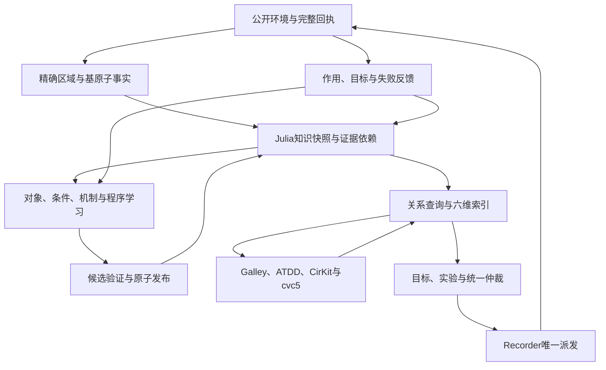
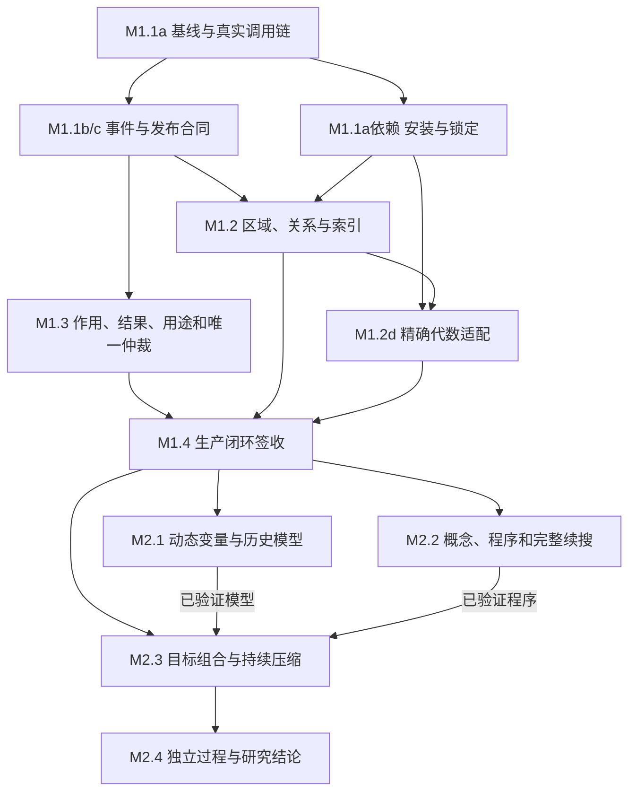

# 13｜第13版架构完整落实总计划：从当前源码到可验收的统一认知闭环

2026-11-26，台北时间，星期四。本文为 R2 整体实施主文档；依赖准备的实测结果见 [14](14-开源依赖安装准备与实际验证记录.md)。

仓库：`zdx3578/TddESCat`。文档分支：`docs/2026-11-26-v13-integration-plan`。本次核对的实现分支头为 `3da31dc59ebacadc5a2eb4e47637fc32e3b5e13e`；它比 `0d53a1c683fbe0ba3c9d8e41ac66cb6fe23dce81` 只增加源码复核文档，运行代码没有改变。以下“当前代码”均按这一不可变源码锚点判断，不能当作以后分支的自动结论。

**结论：需要这份总计划。前一轮已有相当具体的模块算法、接口和开源接入规格，但还不足以据此宣布“V13 已有完整的整体交付安排”。本文件补足需求覆盖、依赖顺序、现有消费者迁移、运行级闭环、阶段启用和最终完成判据。它不把准备依赖或完成模块单测冒充完整架构落地。**

本文保留原 M1/M2 两个里程碑及 09 的 P01–P46、I01–I16 编号。工作包仍使用 M1.1a 等既有编号，不建立另一套平行进度系统。01–03 保留原文；04 为简明开发入口；05–12 为细部合同。实施顺序、范围冲突和跨模块签收以本文及同步修订的 04/09 为准，细部数学合同仍以对应模块文件为准。若发现新的矛盾，先修订对应合同及独立测试，不在实现中悄悄选择有利解释。

## 1. 前一轮计划已有什么，还缺什么

### 1.1 已经具体的内容，应直接复用

- 05 已规定类型、域、证据、后端能力、返回状态、句柄租约、异步发布和恢复。
- 06 已说明区域、正关系、六维索引、Galley 与 Factor Rank 的实际接口和边界。
- 07 已说明对象/变量修订、六类发现触发、CirKit 样本编码与持续学习责任。
- 08 已说明反统一、条件验证、轨迹分支/循环、E-Stitch 续搜及规划片段。
- 09 已有两个里程碑、46 项功能验证与16项接入验证；10–12 已补开源调用、项目自研算法和 JSON 迁移。

因此不重新写一套世界模型、索引框架或程序学习器，也不再扩大开源依赖清单。下一步是使这些职责在现有真实调用链中逐项生效。

### 1.2 本轮查出的整体缺口

| 整体缺口 | 具体影响 | 本次处理 |
|---|---|---|
| 模块清单没有一张完整的“需求→源码→消费者→验收”图 | 很容易完成适配器，却没有任何正式决策使用结果 | §3/§5/§8 给出覆盖矩阵、交付顺序和每包消费者 |
| 安装、数学正确、语义适配、生产消费混在“接通”里 | `import` 成功或作者 demo 成功可能被当作项目完成 | §4 分别记录来源、安装、能力验证、项目接入、真实消费 |
| M1 精确矩形共享引用了 M2 的关系闭包 | 出现循环依赖，基础层无法按计划结束 | 已知完整关系的精确闭包内核前置 M1.2b；不完整关系的概念解释留 M2.1b |
| M1 已需要对象拆分/多区域组合，M2 才安排动态对象 | 首个动作闭环只能依靠固定区域对象假设 | M1.3a 做最小通用的证据驱动修订；M2 扩展六类触发、变量共享及预测学习 |
| 通用目标结果没有进入同一学习链 | 局部技能会做，但不一定知道现在为什么做 | M1 收集独立公共结果并接用途；M2 做一般目标依赖和程序组合 |
| 旧接触路径与新关系路径职责未完成迁移 | 一种玩法拥有完整目标组织，其他玩法只有局部效果 | 将接触作为通用角色关系的一种解释，共用目标、条件模型、仲裁与反馈 |
| 对“完整”的定义可能包含尚不可证明的研究结论 | 要么永远不能交付，要么把未完成算法隐去 | 必需工程能力与研究结论分别签收；未完成研究明确保留，不冒称完整研究目标已实现 |
| 只有回执/文件完整性，缺独立决策语义复算 | 文件没坏不代表分支、作用、目标用途判断正确 | 扩展现有 suite/回放审计，按公开前缀重算绑定、guard、预测和实际消费 |

## 2. 最终架构的职责与边界

### 2.1 保留三种认知过程、两个共同基础和一个行动边界

三种认知过程是 Grounding（语义落地）、世界模型与抽象学习、预测/主动实验/目标控制。它们从第一个公开回执起协作。两个共同基础是类型化知识与多维索引、可复用的关系/代数计算。只有 Recorder（公开动作记录与派发器）能提交游戏动作；后台计算服务不能控制环境。



图中计算后端只返回带域、版本和状态的结果。它们不创建另一个知识所有者。Rust 的 E-Stitch 搜索也从冻结候选语料工作，经 Julia 验证后才能成为正式库；不把压缩器输出直接赋予行动权限。

### 2.2 输入学习器的是具有明确语义的事实

公开像素只经过可复核的区域、邻接、变化等确定计算，然后成为 Ground Atoms（基原子事实）。Inductive Logic Programming（ILP，归纳逻辑程序设计）不从原始像素枚举规则。四连通区域是确定的观测分区；“哪个区域属于同一个对象”“点击者是不是受影响者”仍是可修订解释。

所有动画帧、公开动作参数、可用动作、进度及终态都保留。整体计划不读取 debug、游戏内部对象、关卡规则、私有元数据或环境源码答案。不能用公开 SDK 可访问某属性为理由扩大已约定的 learner 输入白名单。

### 2.3 统一的是语义合同与知识身份

- 布尔关系用于真假和约束；未知仍保留为未知。
- 精确有理数计算用于限定域的函数表示与压缩；负系数没有概率解释。
- 概率模型用于带假设的分布、预测与校准；概率值不等于因果识别证书。
- 程序用于具有前置条件、作用、中间观察和退出义务的组合行为。

这些内容共享类型、域、事件和版本；不强制塞入同一种物理图，也不通过替换加法/乘法把任何后端变成任意半环后端。选定后端的能力不覆盖请求时，返回准确的 unsupported 状态，并留下需实现的能力；不暗中运行旧求解器。

## 3. V13 全部需求的落实覆盖表

表中的“已有”只表示阅读到相应代码，不表示本轮已经重新运行全部测试。“待做”必须有后续生产消费者与签收记录。

| V13要求 | 当前源码基础 | 尚需落实的完整责任 | 正式消费者 | 工作包与验收 |
|---|---|---|---|---|
| 完整公开证据与可恢复身份 | PublicAPI、RunStore、Evidence、Recorder | 全部帧/公共结果的统一事件视图，确认与未知请求分离，快照读集 | Grounding、作用学习、独立回放 | M1.1b/c；P01–P07、I15 |
| 区域和精确关系 | `color_components`、Grounding、RelationQueries | 大区域不丢失，可逆差分、域改变、三值/完备性与证据 | 对应、机制绑定、关系检索 | M1.2a/b；P08–P12、I03/I04 |
| 六维偏序与联合检索 | AssociationIndex、ConceptIdentity、RelationQueries | 各维方向/证明、共享变量绑定、未索引范围、撤回和持续游标 | 候选生成、反例检索、目标回归 | M1.2c；P13–P15 |
| 精确计算压缩 | 已选作者atddc，尚无正式适配 | 布尔有限域、零/一变量、计数、反例绑定、句柄恢复、真实负载 | 条件包含、等价、有限域查询 | M1.2d；P16–P17、I05–I07 |
| 最小动作—对象因果单元 | LocalEffects、JointMechanisms、RelationTasks | 选择角色与作用角色、条件模型引用、远端/延迟/无变化、残差和未辨别义务 | 当前作用预测与实验 | M1.3a；P18–P21 |
| 公共目标结果与作用用途 | 回执已有结果；GoalLearning偏接触 | 结果事实独立保留；缺失前提、竞争解释与实际作用用途连接 | task_arbitration、目标候选、反馈结算 | M1.3a/b→M2.3a；P21–P24/P38–P39 |
| 所有合法动作及参数域 | 现有动作枚举、统一仲裁、公开派发 | 不以旧坐标上限表示完整域，未知/不可达分列，未选程序不推进 | 唯一真实动作派发 | M1.3b；P22–P24 |
| 动态对象、概念和变量 | ProjectionRevision、SceneMemory、ConceptConstruction | 六触发、可执行定义、反向绑定、历史重编码、条件区分 | 作用模型、概率查询和程序输入 | M2.1a/b；P25–P29 |
| 概率电路与在线修订 | CirKit选型完成，生产worker待做 | 数据/掩码、结构提议、训练、校准、不可变参数版本与异步激活 | 预测、实验排序和明确概率前像 | M2.1b；I08–I10 |
| 历史状态与未来实验区分 | SceneMemory、已有历史候选 | 离线前缀轨迹、缺边未知、状态拆分、未来响应实验 | 历史guard与机制条件 | M2.1c；P30–P31、I16 |
| 反统一、谓词发明、条件等价 | 类型项、ConceptConstruction、egg | 共享变量一致、可执行候选、cvc5验证、经验条件撤回 | 新概念检索、guard与程序语料 | M2.2a；P32–P33、I11 |
| 真实分支、循环与程序库 | RelationPolicies已有真实Sequence/Branch/Repeat | 关系/历史guard、循环进展契约、先验证后发布、完整轮内恢复 | producer索引、解释器与控制 | M2.2b；P34–P36、I12/I13 |
| 正向预测与反向目标组合 | ProgramSemantics、GoalRegression、ProjectedPlanning | 中间状态契约、AND/OR义务传播、存在/保证/概率前像分开 | 实际计划下一步与滚动重验证 | M2.3a；P37–P39、I14 |
| 七类持续压缩与反精化 | 若干共享/库/失败缓存已存在 | 各层触发、语义检查、可撤回、复用消费者、净成本 | 全链路计算与搜索 | M1精确三类；M2余四类；P40–P42 |
| 高覆盖、稳定与可信控制 | 有回放、效果和策略审计 | 公开前缀独立复算、声明域覆盖账本、错误/未知/不可辨识分列 | 开发裁决与下一轮真实实验 | M2.4；P43–P46 |

六维包括集合、属性、条件、对象映射、作用/机制精化、时间/历史范围；具体关系方向和边界见06。七类包括原始数据、关系、代数计算、语义、程序、动态状态、搜索。它们不是六套数据库或七个独立服务。

## 4. 开源接入与安装准备如何推进

### 4.1 每种通用责任保留一个主要实现

| 通用责任 | 固定选择 | 项目需要写什么 | 不由它保证什么 |
|---|---|---|---|
| 关系身份/范畴结构 | 既有Catlab/ACSets/GATlab/AlgebraicRewriting | 现有概念与关系责任的扩展 | 自动发现游戏机制 |
| 关系/稀疏计算 | Galley固定提交，含其内部Finch | 类型代数下译、证据/未知包装、真实消费者 | 动态本体、因果推断 |
| 精确布尔代数压缩 | Factor Rank作者atddc0.1.0 | 有限域编码、worker、反例提取、恢复 | 任意有理函数都能按布尔ATDD规范化 |
| 约束与条件合成 | cvc5 1.4.2 | 同一类型AST到SMT/SyGuS的编解码 | 从证据不足自动得到真因果规律 |
| 概率电路 | libcirkit0.3.1 | 样本、变量、结构提议、训练发布合同 | 自动完成项目的在线对象/因果结构学习 |
| 程序库学习 | 既有E-Stitch + egg固定补丁 | 语料、类型、契约、完整搜索恢复 | 自动定义正确目标与循环终止 |
| 确定有限片段规划 | PDDL0.2.18 + SymbolicPlanners固定维护提交 | 片段检查、状态碰撞修复、计划验证 | 不完备或随机世界的必胜规划 |
| 有限历史候选 | AALpy2.0.0离线RPNI | 公开轨迹编码、缺边、验证与区分实验 | 环境全域可达性、隐藏状态可识别性 |

精确源码提交及许可证继续以10为选型目录，不新增相同职责的第二个框架。Galley目前仓库说明与旧搜索摘要可能不同；锁固定源码并检查实际导出，不能依据旧的“已并入Finch”摘要混装版本。Factor Rank按用户提供作者补充包的摘要固定，而不是臆造PyPI/Cargo发布包。

### 4.2 安装和接通必须分开签收

每个依赖都填写以下五项，各项都是证据状态，不是凭总进度估计的百分比：

1. **来源确定**：上游地址/提交或wheel身份、许可证和摘要可核对。
2. **锁定与安装**：目标环境真实解析并安装；保存实际锁文件及命令。单纯手写版本列表不算完成。
3. **上游能力验证**：真实调用所需API，小域独立答案正确。
4. **项目语义接入**：通过compute协议、类型/未知/版本和恢复验证。
5. **生产消费**：正式查询或动作决策实际读取结果，反馈能撤回或修订其依赖。

本轮可先完成的主要是前3项。14逐项记录真实结果；不会用本会话Python环境已安装，替代目标开发机Julia/Rust/Python完整工具链通过。

### 4.3 正确的准备顺序和并行范围

- Julia链：先按12修改JSON与Compose依赖图，再在一个应用环境解析Galley及PDDL/规划器，运行原有Catlab/ACSets路径回归。新Manifest必须由Pkg实际产生。
- Rust链：核对已有E-Stitch补丁与作者atddc源码，放入同一workspace锁定；分别构建与测试后才做factor-kernel协议。Julia未准备不妨碍Rust作者测试。
- Python计算链：独立`python/compute`项目，锁定cvc5、CirKit与明确的AALpy任务依赖；不污染既有ARC环境/裁判项目。设备构建写配置/锁，不用环境变量注入运行参数。
- 原生启动检查：扩展现有`bootstrap.py/check_sources.py/check_toolchain.py`的组件检查职责，支持分别准备组件并明确整套是否就绪。一个组件缺失只阻塞依赖它的任务，不将别的已完成准备抹去。

来源核验也要同步扩展：现有`check_sources.py`只读`python/uv.lock`，并假设每个PyPI项目都有sdist。新增计算项目需要在同一来源锁明确所属`lock_path`、索引、平台、发行物类型与摘要；CPU PyTorch等wheel来源不能伪造sdist。`check_toolchain.py`的原E-Stitch检查保留，并按实际新增能力加入factor-kernel/compute检查，不能把原检查通过等同新组件通过。

现有`bootstrap.py`会先要求Julia/Cargo都存在，再执行Python同步；这不是按组件推进所需行为。其`UV_PROJECT_ENVIRONMENT`和`JULIA_*`设置也应迁移为文件配置和显式启动：Python用明确的项目/venv路径，Julia从配置读取路径并在加载包前设置`LOAD_PATH/DEPOT_PATH`。这属于同一安装入口的修改，不再增设一个长期第二安装器。新入口须能在完全干净机器按同一来源构建，不借用个人home缓存掩盖缺包。

工具链基线是Python3.12.9、Julia1.12.6、Rust1.90.0；本会话解释器若不同，记录为准备环境差异，不擅改正式锁。CPU依赖验证只证明相应构建能力，不设置生产永久只用CPU；GPU采用同一语义和其明确设备构建锁后独立验证。不会降低算法参数换取测试通过。

## 5. 整体实施依赖：两条线路并行，两个里程碑汇合

**优先把作用、目标用途和反馈接通，同时准备通用计算底座。** M1.3无需等待CirKit、完整ATDD性能优化或E-Stitch轮内恢复；这些模块也不应在没有真实查询负载前盲目优化。



图中是能力签收依赖，不要求工程师等待整个M1才做M2的独立上游实验。跨模块的正式启用必须满足前置合同。M1.3与M1.2使用相同关系接口，不各自再造事实表；先扩展既有`RelationQueries`行为，再替换其满足合同的执行实现，不保留两套旧新生产路径。

以下工作单必须逐包提交“修改源码、消费者接线、独立证据、未完成项”。工作包的完成不能仅以新增某个文件判定。

## 6. M1：精确语义底座与能产生真实改进的单步闭环

### 6.1 M1.1a：固定基线、入口和真实阻塞

**输入**：固定代码、真实配置、完整可读的公共运行记录、三个工具链及现有suite。**输出**：可重复的源码/依赖身份、正式入口调用图、待修复基线问题。

执行顺序：

1. 通过GitHub connector读取实际分支头与未合入差异；保留用户其他工作。每个包在开始时重新核对是否已有实现，不机械重做计划。
2. 从`TddESCat.jl`的include、`scripts/run.jl`、`OnlineSession.run_online!`和Python runner追到真实函数。记录哪些功能由配置关闭、哪些函数只供实验调用。
3. 用原有`replay`和suite验证能够重放的基线；没有本轮原始24/25款回执时，明确没有独立复算这些报告。
4. 记录首动作、确认回执到下一动作、学习/查询/序列化/编译的真实耗时与内存，确定实际负载，而不是从论文速度推测项目瓶颈。
5. 为§7的问题保存最小、可独立复核的公开或合成反例。合成oracle只在裁判端，不能作为学习输入。

**签收**：09的M1.1a记录存在；未运行/不可复跑有实际原因；已经完成的轨迹策略、重试、仲裁不得误报为尚不存在。

### 6.2 M1.1b/c：事实、读依赖和安全发布先成立

主要改`PublicAPI/Evidence/RunStore/RelationQueries/OnlineSession/Library`，复用现有原子写入和唯一所有者。05是字段合同，不新建一份EventStore。

```text
on_confirmed_receipt(receipt):
    require Recorder has durably persisted the confirmed receipt
    enter the single owner with EventRef and projection-definition-version idempotency
    derive exact frame facts and independent public outcome facts
    compare only predictions frozen before this action
    invalidate contradicted deterministic claims and affected dependent consumers
    publish a complete immediate snapshot
    queue residual, historical, probabilistic and program jobs on frozen inputs

on_background_result(result):
    verify backend identity, type, domain, status and actual read_dependencies
    revalidate relevant facts since frozen evidence_cutoff using actual read_dependencies
    retain training cutoff separately for parameter-learning jobs
    if full candidate/round is valid:
        recheck actual dependencies at the single-owner commit point
        atomically publish model/library/indices and visibility point
    else:
        retain incomplete work or explicit rejection with cause
```

- 已确认事件先保留，再做慢任务；后台失败不能丢回执。
- 确定规则反例即时失效。概率模型出现一个低概率结果不等于被逻辑反驳；按冻结预测与校准责任更新。
- 知识快照、训练截止、验证截止、发布时点分别记录，不能混成一个version。
- 同一个新模型、producer和索引同次激活；先写候选文件不等于正式发布。
- 循环证明的受影响强连通分量重新求最小不动点；一条证明撤回不删除仍有另一条支持的事实。

**消费者**：下一次绑定、guard、目标检索和动作预测读取新快照。**签收**：P01–P07/I15包含晚到job、worker重启、重复回执、不同租约、部分批次、崩溃和非相关更新场景。

### 6.3 M1.3a的先行部分：公共结果与条件化作用接入

这一部分在M1.1b/c之后即可开展，不等所有数学后端齐备。现有作用学习、条件搜索与仲裁继续复用。

**公共结果事实**必须直接来自公开回执。包括晋级、WIN、GAME_OVER、合法动作变化、RESET后可见变化；不要求整帧局部残差为零，也不要求已经学出producer。关卡切换产生大幅画面变化时，不硬套局部平移模型。

同时保留两种不同知识：

- “某事件发生晋级”是精确记录。
- “在什么条件下采取何动作导致晋级”是需要证据验证的候选机制。

```text
update_outcome_and_effects(event):
    record public outcome independently of local effect completeness
    retain pre-action state, role bindings and relevant history
    update known local effects and residual obligations separately
    associate outcome with preceding candidate dependencies, without claiming necessity
    for each action producer:
        reference the existing versioned condition model
        judge applicable / inapplicable / unknown under the current binding
        update mechanism refutation status only from genuine counterexamples
    create tasks for a missing needed relation or a concrete competing explanation
```

`RelationProducer`不再仅持裸`JointMechanism`并绕开`ActiveMechanism.condition`。复用`fit_joint_condition`、现有投影修订和统一关系谓词；不得再开一套“关系专用条件学习器”。公开结果挂接所有真实轨迹，保留终态；局部技能语料可以排除不能正确解释的局部Step，但公共结果流不能跟着删除。

当前guard不满足只代表该绑定不适用，不等于整个机制已被反驳；同一机制可以在其他合法上下文继续成立。

**消费者**：同属性召回、任务适用性、首次成功前的实验、结果学习。**签收**：同一场景具备局部残差时仍记录晋级；已否定的条件在下一步不再被当作适用；没有晋级正例时仍能提出有用途的局部任务。

### 6.4 M1.2a：全帧区域、差分和最小对象修订入口

`color_components`提供精确分区；`support_candidates`不应再用96像素等候选限额删除观测责任。原始区域先完整生成，较复杂对象解释再按证据惰性提出。

1. 对每个实际返回帧建立同色四连通分区，成员互斥、覆盖完整、原图可逆。
2. 在相同坐标域上维护变化/不变关系；桥点删除、分裂、合并要与全量重算一致。
3. 尺寸/坐标域变化产生新域；只保留有公开依据的局部对应，不默认旧坐标就是新坐标。
4. 为M1.3提供最小通用候选：单区内部需要区分的部分、多区共同响应、远端受影响区和中间动画变化。候选是可验证解释，不自动确认为对象。
5. 所有未解释变化保留义务；缺少可靠对应不能默认为无变化。

**消费者**：`LocalEffects/JointMechanisms/SceneMemory/RelationTasks`从同一事实入口读取。**签收**：P08–P09及P18–P20，无多帧漏读、全屏背景删失或分区错误。

### 6.5 M1.2b/c：关系、证明、精确闭包和六维索引

**关系核心**沿`RelationQueries/RelationSemantics`扩展：明确类型、共享变量、时间域、正支持、未知范围、逐输入后继完备性。Galley执行满足能力合同的正关系连接/投影/聚合；项目保留来源和未知语义。

这里前置的闭包内核只对明确的完整有限关系计算精确集合闭包/矩形支持。它服务M1的精确关系压缩，不声称缺失事实为假。M2.1b在同一内核上对不完整背景生成概念/布尔因子候选并验证，不再重写闭包算法。

索引的每次插入、撤回与查询都需要：同一稳定知识身份、类型/域/定义版本、证据依赖，以及未处理范围。必要条件索引用于硬筛选；不能证明必要的相似度只影响顺序。空集合、重复成员、哈希碰撞、定义变化和递归撤回必须覆盖。

**真实接线顺序**：先条件与对象召回，再机制联合绑定，再效果producer检索，再程序/目标查询。每替换一个消费者，按声明的新语义合同与独立裁判检查完整结果、未知与来源；保留旧的正确行为并明确记录错误修复的预期差异，并删除该消费者的旧私有扫描/冗余缓存。

**签收**：P10–P15/I03/I04。性能测试包含索引维护、依赖更新和失败恢复；索引miss不变成世界中的false。

### 6.6 M1.2d：Factor Rank与cvc5进入正式查询

Factor Rank先负责声明的有限布尔域。作者库直接复用，不重写秩分解、树旋转和规范化。项目补域编码、合法编码约束、零/一变量情况、具体反例绑定、进程句柄和持久工件。

首批真实工作负载：条件蕴含/等价、有限条件计数、合法作用域限制与具体反例。cvc5负责适合其理论的约束，两个后端通过能力合同按语义路由，不能为了某个库可用而改变问题含义。

```text
verify_implication(domain, C1, C2):
    validate types, legal domain and solver assumptions
    check whether domain AND C1 has an admissible assignment
    if the premise is proven empty:
        return vacuous implication with empty application scope, not a reusable mechanism
    if domain consistency/premise feasibility is unresolved:
        return the precise unknown/unsupported/incomplete/failed status
    query h = domain AND C1 AND NOT C2 in a supported exact backend
    if the completed exact result proves h zero / unsat:
        return proven implication within this declared domain
    elif the completed exact result proves h nonzero / sat:
        extract one assignment through exact cofactors/model API
        decode the typed binding and independently check domain, C1, NOT C2
        return counterexample binding and source assumptions
    else:
        propagate the precise unresolved execution/semantic/coverage status
```

空前提不能升级为可复用机制。布尔消元用OR，不将求和误作存在量词。作者测试里的完整真值表转换不能进入大域生产路径。规范化和跨树处理遵守06的前提；TTN有理函数与布尔ATDD不混称。

**签收**：P16–P17/I05–I07，至少一个正式关系查询消费Rust实际结果。作者Python脚本通过不能替代Rust、桥接与该消费者。

### 6.7 M1.3a/b：用途驱动的实验与唯一动作闭环

先形成最小但真实的用途接口：候选动作要么建立当前任务的缺失关系，要么区分对同一输入给出不同可见预测的竞争解释，要么完成已经开始且仍有效的步骤；第一帧没有目标或竞争机制时，还可执行“合法但尚无可判读作用证据”的动作—参数—角色—上下文覆盖义务，事前预测明确未知。无已知终局机制时，仍可运行这些任务；不能将局部子目标宣布为通关目标。

所有合法公开动作和参数域保留。坐标代表点只是先验排序，未经等价验证不能把剩余坐标删除。环境可能不可回到某些上下文，记录不可达/未知，不虚构试遍所有组合。

```text
propose_and_dispatch(snapshot):
    propose applicable task, experiment and program actions
    bind roles and evaluate versioned guards
    attach intended relation, distinguishable hypotheses, valid continuation or untested legal effect obligation
    peek program instruction; do not mutate a shared cursor
    arbitrate once over the same legal action domain
    persist chosen action, predicted effects, purpose, reads and proposed cursor change under command_id
    submit exactly once through Recorder
    if outcome is unconfirmed:
        retain unresolved request; do not retry or advance progress
    if confirmed:
        invoke on_confirmed_receipt exactly once through the idempotent single-owner handler
        check effect, purpose and public outcome separately within that transaction
        bind confirmed EventRef to command_id
        if the selected instruction's semantic execution contract is confirmed:
            commit its proposed cursor transition once
        else:
            record the action as executed but unverified/refuted
            invalidate or suspend its dependent suffix; do not label it as an unsent retry
        publish facts, invalidations and cursor state together
        start the next decision from the new snapshot
```

仲裁不采用“新策略默认高优先级”作为长期控制原则。必须可解释其任务用途、证据适用性和仍需区别的义务；相同局部技能已经确认且没有新用途时，支持数增长不会自动让它反复压过其他任务。

为避免无限候选生成使某类义务永远没机会，使用既有agenda的持久可续游标和公平推进：每次返回可用候选及尚未枚举范围；无效/已解决候选及时撤回，未解决而稳定可达的义务持续获得处理机会。公平推进不是保证有限时间内覆盖无限状态，也不允许偷偷截断合法动作域。

具体调度在现有`RelationAgenda`完成：新义务取得单调递增的登记序号；持续有效、可达且有可执行实验或推进动作的旧义务，不能被不断出现的新义务永久越过。先选最早就绪义务，在能服务它的合法动作内按目标用途/区分力/尚未取得的作用证据比较；相关前提未建立时登记依赖并暂列未就绪，不能虚称已完成。实际完成一次有证据的推进后，剩余工作重新排到队尾，未知请求保持冻结。各生成器保存独立枚举游标并交错推进，任何分批结束都留下后继，不删除候选。复杂查询异步进行，主循环不等待穷尽无界假设空间。

这个公平性只在“已就绪义务的前序项有限、每次实际处理可结束、环境允许相应动作”的条件下声明；不能保证不可达状态获得服务。P23需注入持续新任务，验证旧有效义务最终被派发或得到明确阻塞证据，而不只检查排序分值。

**签收**：P18–P24及相应协议门；用反例真实改变下一次公共请求，验证未选程序游标不变、一个决策只派发一次、RESET/未知回执/延迟作用都可正确续学。

### 6.8 M1.4汇合签收

M1交付的是统一精确事实与查询进入真实学习/控制的闭环。必须同时具备：

- M1必需功能与接入测试通过；每项有命令、输入、返回码和独立输出。
- 正式调用链使用统一关系与索引；作者ATDD的结果至少进入一条真实查询消费链。
- 公共目标结果不再因局部模型不完整而丢弃；条件模型与任务用途进入唯一仲裁。
- 反例即时撤回错误适用范围，后续请求真实改变；完整回执、未知请求和恢复责任不退化。
- H1语义与H2性能分别报告，不能因性能尚未改善伪造H2，也不能因局部性能不好退回旧agent。

## 7. 必须先解决的具体源码问题

以下是本次直接阅读源码后确认的改造点。后续实现必须复核实际分支，因为行号会随提交变化。

| 具体问题 | 代码位置（固定基线） | 当前逻辑 | 后果 | 对应解决方案 |
|---|---|---|---|---|
| 非选中策略可能消耗共享游标 | `RelationPolicies.jl:377–388`；`OnlineSession.jl:892–899` | 仲裁前调用有状态`next_relation_instruction!` | 程序进度可能先于实际执行 | M1.3b改peek+已选确认后commit；P23增未选候选场景 |
| 库先发布，轨迹语义后验证 | `PolicySemantics.jl:161,176` | `publish_stitch!`先于`verify_relation_episode` | 不合格候选可能先取得正式可见身份 | M1.1c先完整候选验证，再库/策略/索引原子激活 |
| 晋级/终态未贯通通用学习链 | `RelationTasks.jl:72–97`；`RelationPolicies.jl:2–35` | producer跳过advanced；轨迹跳过WIN/GAME_OVER及残差 | 关键目标样本没有进入同一路径 | M1.1b/M1.3a新增独立结果关系及前史链接，保留局部不完整状态 |
| 目标接口偏接触语义 | `GoalLearning.jl:2–37`；`OnlineSession.jl:763–774` | GoalSample持ContactSample，推进关系从接触拟合 | 通用局部作用与目标关系脱节 | M1定义公共结果/用途合同；M2.3将接触目标下译共同关系接口 |
| 关系producer未统一消费条件模型 | `RelationTasks.jl:21–26,230–264`；`OnlineSession.jl:99–163` | producer持裸规则，投影构造complete guard | 已有条件搜索结果未成为共同适用依据 | M1.3a引用同一ActiveMechanism及条件版本，unknown不变适用 |
| 支持候选仍有固定范围限制 | `Grounding.jl:32–74` | 96像素支持等进入候选范围 | 大对象/共同作用解释可能缺失 | M1.2a全事实保留，M1.3a通用惰性候选和未覆盖义务 |
| 坐标配置可能替代合法域 | `OnlineSession.jl:670`及公开候选生成 | 读取max_action_coordinates | 如被当完整范围会漏动作 | M1.3b完整合法域+可续枚举，参数只作用于明确分批，不删除候选 |
| guard语言仍主要为形状存在 | `RelationPolicies.jl:88–101,256–260` | 用模板存在分开训练轨迹 | 关系、计量、历史条件表达不足 | M2.2a/b共同类型语法+cvc5候选+Julia独立验证 |
| 循环范围只是已见上界 | `RelationPolicies.jl:272–319` | observed_bound限制重复 | 不能代表一般终止保证 | M2.2b分开范围、进展量、退出与终止证据 |
| 程序有producer，但契约仍有限见证 | `ProgramSemantics.jl:1–70`及`GoalRegression.jl` | 已有索引/有限轨迹效果 | 不足以保证组合中间条件/全后继 | M2.3a关系复合、三种前像、AND/OR义务传播 |
| 来源检查未覆盖新计算锁及wheel | `scripts/check_sources.py:main` | 只读旧python/uv.lock，PyPI项假定有sdist | compute依赖不能由统一来源检查准确核验 | M1.1a依赖增加lock_path、发行物类型、索引和平台摘要，复用原检查器 |
| 安装步骤全工具链串行阻塞 | `scripts/bootstrap.py:main` | 先找Julia/Rust再装Python | 已可独立准备组件也不能开始 | M1.1a依赖扩展同一入口的组件准备和汇合检查 |
| JSON升级受真实传递约束 | `Project.toml/Manifest.toml`、Compose依赖 | JSON0.21.4与旧Composecompat匹配 | 只改JSON字符串无法迁移 | 12完整迁移，固定Compose官方修复再Pkg解析 |
| 同属性统计仍读旧hypothesis字段 | `OnlineSession.jl`决策记录；`evaluate_public24.py` | 新任务路径与旧计数入口不一致 | 用旧计数不能评价真实同属性效果 | M1.3b/过程审计从最终派发、用途与反馈重算，不加冗余旧字段 |

该表不将所有问题宣称为某个游戏失败的唯一原因。它们是可定位、可独立检验的能力边界或逻辑风险；测试和真实过程需要分别确认影响。

## 8. M2：动态认知压缩、程序组合与持续控制

### 8.1 M2.1a：把六类触发统一为可执行变量修订

输入来自M1残差、作用冲突、不同历史、预测差异、重复结构和任务区分需要。沿07六类触发工作，不预造游戏对象类别。

```text
refine_grounding(trigger, snapshot):
    collect affected atoms, predicted effects and incompatible observations
    generate typed split/merge/role/attribute/history definitions
    require each definition to compute a value or explicit unknown from public evidence
    replay all applicable historical events under the new definition version
    keep competing explanations that current evidence cannot distinguish
    propose a separating experiment for remaining differences
    publish only validated definitions with reverse bindings and dependencies
```

M1已提供最小对象修订；本包扩展变量组织、共享、解释覆盖和六触发统一。新变量必须能回读“何时、什么角色、根据哪些事实得到这个值”；仅给latent编号不算完成。

“最小因果单元”还需实际的简化检查，沿同一候选入口实施，不另建最小化服务：

```text
minimize_supported_unit(unit, declared_language, evidence_scope):
    enumerate legal reductions of roles, support members, conditions and history distinctions
    for each reduction:
        replay all applicable evidence and compare predicted effects and task distinctions
        if a recorded counterexample separates them:
            retain the distinction and its witness
        elif a reachable experiment could separate them:
            retain an unresolved minimality obligation and schedule that experiment
        elif equivalence is proved only within the current finite model:
            share only in that model and domain
        else:
            record evidence-equivalent candidate, not a global minimality theorem
    persist the unchecked reduction frontier
```

必须区别较小表示、单步删减不可再简化、有限候选域中的包含极小、全局最小大小、真实世界最小因果单元。检查所有单项删除仍不自动证明任意多项重组都不可能；缺少完整有限域验证时不声称全局最小。反例或变量语言变化后，相关最小性结论重新打开。

**消费者**：条件模型、CirKit样本列、历史响应、程序guard。**签收**：P25–P26以及跨模块定义改变后的I09/I15，变化真实进入下一次预测而非只写到概念表。

### 8.2 M2.1b：动态关系闭包与CirKit持续学习

复用M1的已知关系闭包内核；部分背景的未知不填false，因子/概念是候选定义。新结构需要解释增益、预测区别、任务绑定与反例复核，不能只以更小秩或更高似然激活。

每个变量/域版本改变时，冻结适用的原始事件并按新定义重编码；参数更新使用不可变模型版本。CirKit承担电路编译、层、积分与自动微分；Julia承担可执行结构提议、样本/来源、训练截止、验证和发布。

完整步骤：

1. 唯一EventRef去重，分别保留帧序列和模型样本投影；去重不证明统计独立。
2. 每个缺失值以合法占位+observed mask进入计算；不当作额外类别。
3. 结构须满足所请求查询的可处理前提；显式规范化Sum权重，检查分类域和输出形状。
4. 参数训练与结构变化分开；一次结构重编译不覆盖正在被使用的参数句柄。
5. 对训练未见的公开前缀进行事前预测核验；计算规范化、边缘、条件、零分母和数值状态。
6. 完整工件经I10/I15验证激活；概率输出只在有效范围进入实验选择和明确的概率目标。

**签收**：P27–P29/I08–I10。新模型必须改变至少一条有理由的预测或实验候选；如果新结构没有收益，保留其拒绝理由，不强行压缩。

### 8.3 M2.1c：历史区分与预测状态

AALpy只接离线真实轨迹，不获得live环境控制权限。输入符号由已确认动作/绑定构成，输出由公共响应关系构成；保留前缀和未知边，不能用self-loop补未观察响应。相同画面不同历史的区别由未来可执行测试支持。

响应矩阵的每格先区分已观察、被反驳和缺失。候选历史状态合并要比较后续测试与目标用途；发现区别就拆分，相关guard/程序/索引一起失效或重验。

Predictive State Representations（PSR，预测状态表示）、加权自动机和谱秩识别属于原V13研究范围，不能悄悄删除。P31细分两个签收面：必需的历史区分/响应矩阵/精化闭环，以及谱模型的识别条件、有效概率和控制保持研究。后者不能以AALpy跑通替代；条件不足则明确研究未完成。工程可继续推进其他不依赖该研究结论的包，但最终不得声称所有V13研究目标都已实现。

**消费者**：历史条件与主动区分实验。**签收**：P30–P31/I16，回执能修订状态，未见输入保持未知，错误合并能撤回。

### 8.4 M2.2a：反统一、谓词发明与条件等价

使用既有类型项和共同关系语言：从有共享角色/结构的实例提出反统一候选，重复变量必须保持一致；共享语法只给候选，不自动推出等价。cvc5的Satisfiability Modulo Theories（SMT，可满足性模理论）验证和Syntax-Guided Synthesis（SyGuS，语法引导合成）使用同一AST合同。

guard语法来源于已存在可计算的关系/计量/历史谓词及类型组合，不按游戏名称选择模板。训练冲突不能直接作为矛盾公理写给求解器；先定位不同历史、对象绑定、概率结果或错误候选。返回候选在Julia独立解释、全相关历史和留出范围重验。

条件等价只能进入冻结条件视图。反例使该视图重建，不把经验等价永久合并进无条件egg基础。不可判定/条件不足的结果保留unknown。

**消费者**：六维索引、机制条件、轨迹guard和共享程序语料。**签收**：P32–P33/I11；新谓词须有实际调用与反例精化，不能只有一条定义记录。

### 8.5 M2.2b：轨迹到通用程序与完整续搜

当前Sequence/Branch/Repeat是真实基础，继续扩展，不退回“它们尚未存在”的计划。

- Sequence按真实事件顺序和关系依赖组合；共享角色来自证据，不能拼接不相容的两段历史。
- Branch在同一输入语义下出现不同可行延续时提出；两个分支都成功的样本不能强造互斥标签；guard未知会产生义务，而不是任选一支。
- Repeat从重复片段提议；验证入口、进展、不变式、退出条件及适用范围。观察上界不冒充一般终止证明。
- E-Stitch只从这些真实语料中学习可复用函数；完整候选先验证，再原子发布库/契约/producer。

轮内恢复在现有Rust路径小范围修改：将实际heap、节点ID和匹配、e-graph/类型分析、seen、footprints、incumbent、代价选择、库/语法/源身份组成可恢复会话。安全点原子保存；从相同冻结输入中断恢复后比较后续候选和结果，不能从种子重跑冒充续搜。

**消费者**：producer索引→目标回归→当前解释器→唯一派发。**签收**：P34–P36/I12/I13；完成轮次可以先消费，轮内完整恢复独立验收。

### 8.6 M2.3a：通用结果目标、组合前像与滚动控制

M1已记录所有公共结果并给任务用途；本包把目标学习从接触专用入口迁移到共同关系。接触经验仍可贡献候选与证据，只是不再承担全部目标语义。

目标推导需要处理成功、失败和仍未知道目标的时期：

1. 公开WIN/晋级是结果事实；收集前缀中的动作、状态、机制和程序，不把时间先后直接当必要因果前提。
2. 对可解释结果的候选依赖，查询已有原子/程序producer；缺失前提生成子目标或区分实验。
3. 在AND/OR义务图传播：一个动作可产生多个必要前提，一项前提可有多个producer。任一子目标成立不能直接返回根目标空计划。
4. 关系复合显式保留中间状态和guard；可能、保证和概率前像采用不同语义。
5. 只有非空且已完整覆盖的后继全满足目标，才报告模型内保证；环境模型正确性另由真实证据支持。
6. 明确有限、确定、完全已知片段下译PDDL/规划器；搜索状态不能仅以hash当身份，补规范内容比较和强制碰撞测试。
7. 每次动作前用当前公开帧重绑定角色并复核条件；条件改变时重新回归，不能盲执行旧计划。

**消费者**：同一个task_arbitration，最终动作仍由Recorder派发。**签收**：P37–P39/I14，包括非接触目标、失败后继、空后继、不同角色映射和途中条件改变。

### 8.7 M2.3b：七类持续压缩作为共同后台工作

压缩任务由证据变化、重复查询、共享结构和反例触发；不在每个动作后全历史全层重算。原始事实不因模型压缩删除，长期反例不按年龄丢弃。

| 压缩责任 | 接入点及消费者 | 必须看到的完成证据 |
|---|---|---|
| 原始数据 | RunStore/区域/差分→原帧回读与作用抽取 | 零差异重建、跨帧/尺寸变化一致 |
| 关系 | 共同闭包、共享支持和Galley查询→索引/绑定 | 不需全展开才能查询，撤回结果正确 |
| 代数计算 | atddc、规范键与公共子式→精确查询 | 同域精确语义，编译维护计入总成本 |
| 语义 | 反统一/概念定义→条件、角色、检索 | 新定义被使用，反例能恢复必要区分 |
| 程序 | E-Stitch库→producer/解释器 | 学得程序真实执行，失败和中间义务保留 |
| 动态状态 | 历史响应/有限状态候选→预测和guard | 未来区分保持，错误状态合并可拆分 |
| 搜索 | 蕴含剪枝、共享子问题、checkpoint→继续求解 | 合法解不丢失，版本改变能重开，实际续算 |

精确去重/剪枝需要证据；统计排序不删除未探索候选。维护成本高于收益时记录该转换未获净收益并修正执行计划，不用少做语义责任获得“加速”。同一共享带来的跨层收益不能重复累加。

**签收**：P40–P42，七类分别给出触发、前后结构、消费者、撤回/精化以及真实净成本。

### 8.8 M2.4：完整过程签收及研究结论

最后按§10的过程证据签收，先做合成与历史公开前缀，再做实际公开环境。public24脚本不等于public25目标集；实际可用清单与版本要固定，缺失项标记BLOCKED，不能删掉后称全量完成。

不以普通单游戏分数升降或偶然通关判断架构。主要检查无学习、反例无效、目标脱节、计算阻塞、错误重复请求、永久剪枝、错误置信和动作/对象缺覆盖等实质问题。公开晋级/WIN仍如实记录，但归因要有完整过程和可比条件。

## 9. 跨模块接口怎样真正接起来

### 9.1 一条正式接线的责任划分

| 连接 | 输入提供者 | 接收者必须检查 | 输出去向 |
|---|---|---|---|
| 公开回执→事实 | Recorder/Evidence | 确认状态、事件顺序、全部帧与公开字段 | Grounding、结果关系、RunStore |
| 事实→关系查询 | Grounding/现有关系所有者 | 类型、坐标/时间域、缺失和绑定一致性 | RelationQueries、六维索引 |
| 查询→后端 | RelationQueries/ComputeBridge | 能力、输入代数、快照、实际读集、批次完整性 | Galley/Factor/cvc5/CirKit |
| 后端→Julia | 纯计算worker | execution/semantic/coverage三层状态、工件/句柄身份、数值 | 查询答案或候选，不能直接激活知识 |
| 候选→发布 | 学习器/Library | 历史和当前范围、类型、来源、读集、新反例 | 同次激活模型/库/索引 |
| 知识→任务 | producer/GoalRegression/ExperimentDesign | 适用条件、角色、用途、未解决义务 | 统一仲裁候选 |
| 任务→真实行动 | task_arbitration | 合法域、冻结预测、唯一请求、游标提案 | Recorder |
| 回执→修订 | 作用/目标/独立审计 | 事前预测、实际效果、残差、目标与未知分离 | 新事实、反例、修订和下一动作 |

这些字段的逐项含义与协议schema见05，不再在本文件创造同义字段。共同读依赖统一叫`read_dependencies`；worker内句柄与可持久工件分开；每次借用有独立lease_id。新`compute/v1`与既有E-Stitch `protocol/v3`是不同协议，不能为了统一命名把它们混成一份。

### 9.2 跨语言启动、发布与退出

新增`ComputeBridge`负责固定身份和常驻服务管理；单次语义任务批量传入，避免每个像素/原子启动进程。Python计算服务只读冻结输入/写候选输出，无环境客户端、凭据或动作权限。Rust计算也是同样边界。

启动时做能力协商，检查源码/锁/设备构建与配置一致。声明缺失的能力准确阻塞依赖任务；不能伪装空答案。结束时停止新租约、按后端resume能力处理已接受请求：可续算者在真实安全点保存状态；不支持续算者标incomplete，保留冻结输入与已完成工件并失效进程句柄，重新运行不称续算。随后释放不再使用的句柄。未知公共请求不能通过重启被再次发送。

`OnlineSession`继续拥有事实发布和控制编排，但不会将所有后端细节写进去。其职责是调用现有所有者/适配器、收集候选和处理回执；代数降低放相应Adapter，变量编码放CircuitLearning，程序解释放现有ProgramSemantics/RelationPolicies。用调用关系审查避免单文件扩成所有算法的容器。

### 9.3 现有路径如何迁移

每个消费者按“同一语义接口→新正式执行→独立等价/范围验证→删除旧私有实现”迁移。迁移提交内部可以保存不可激活候选，生产入口不保留错误逻辑fallback。

- 视觉接触路径：保留已有测量和作用证据，转换成共同角色/条件/目标接口，移除其独占目标所有权。
- 关系producer：统一引用条件模型，不复制guard状态。
- 序列与策略：共同producer/用途合同，保留程序类型差异，删除仲裁前修改共享cursor的副作用。
- 索引与缓存：沿同一知识所有者发布，删除各调用者私下维护的重复身份或失效规则。
- 安装与验收：扩展既有bootstrap/suite，不同时保留第二套长期安装/评测系统。

## 10. 验收：怎样证明完整，而不是只有组件齐全

### 10.1 四类必须贯穿全部模块的验收场景

每类场景走真实公共接口和同一生产路径；场景生成器的真值仅归独立裁判。

| 场景 | 要暴露的错误 | 完整通过表现 |
|---|---|---|
| 远端作用+无关装饰变化+未知目标 | 把外观/整帧hash当机制，局部正确无用途 | 绑定选择与受影响角色，条件修订，建立有用前提或区分解释 |
| 同画面不同历史+延迟/无变化回执 | 缺失填false、历史合并、重复请求 | 历史变量或竞争解释被保留，未来实验真正区分，未知请求不重发 |
| 非接触晋级+局部残差+关卡切换 | producer删成功样本，目标依赖接触 | 独立公共结果保留，通用结果候选连接任务，跨域不伪造局部变换 |
| 模型/程序发布期间反例+worker崩溃 | 陈旧库、半索引、句柄错代、游标提前 | 精确事实不丢、错误条件撤回、完整候选才可见、正确恢复下一次控制 |

以上是组合功能场景，不是按游戏类型给求解器固定模板。算法只接受公开事实与共同类型语义。

### 10.2 独立审计必须回答因果链的每一环

每个实际选择的动作都可追溯：当时合法域→候选用途→绑定与guard→事前预测→最终仲裁→唯一请求→完整回执→作用/目标反馈→知识修订→下一次消费。

不能仅查hash、时间戳、文件条数。扩展现有Python审计，从原始公开前缀独立计算关键区域、角色绑定、条件真假、效果和退出；不得调用被测的同一个Julia/ATDD函数得到“参考答案”。小域的关系和电路用直接枚举；程序分支/循环按独立语义解释。

### 10.3 动作—对象最小因果单元如何报告闭合

每个声明范围分别报告：合法动作/参数、选择角色、受影响角色、上下文/历史、效果与不变部分、后继完整性、支持/反例/未知、实际任务用途和未来区分义务。

- **定义覆盖**：完整合法动作域和能够表达的作用语言已登记，不能等同全部真实作用已经发现。
- **实验覆盖**：实际试了哪些绑定与条件；没有执行、不可达、结果不可读的项单列。
- **模型覆盖**：对哪些可读结果能提出并检验预测；未解释变化和竞争解释单列。
- **控制覆盖**：哪些有效关系被后续任务真实消费并得到回执；仅提高似然或增加库条数不算。

“最小”相对于当前变量语言与已验证区分，不是自然界绝对粒度。有限公开交互不能证明所有未知上下文全局闭合。对已声明的有限合成域可以穷举；真实域以明确覆盖和剩余义务结算，不凭一个总置信分数掩盖缺口。

### 10.4 置信、稳定和因果强度分别判定

- 事件事实是真实记录；对象解释和机制是模型判断，分别存来源与状态。
- 同一事件的多帧、多个推导或多个投影不增加独立干预样本数；同一episode的连续样本也不自动独立。
- 概率模型按冻结的事前预测计算Brier Score（布里尔分数）、Log Loss（对数损失）和校准；训练样本不能同时充作独立验证。
- 分范围报告稳定性：同对象新时刻、同关新对象、跨关、变化条件、不同历史。不能把其中一个层次的支持数当作所有层次的保证。
- 需要数值置信区间时先声明采样/相关性和模型假设；没有相应条件就只报告范围内证据与误差，不造一个“高因果置信度”。实际动作干预仍可能有未观测状态、选择偏差或非平稳性。
- 必要性/充分性、条件预测、模型内形式证明、真实因果可识别性各自标注。PC、ATDD、SMT都不能独自把未识别的环境升级为已证因果模型。

### 10.5 工程通过和研究成功是两个结论

M1/P01–P24与M2/P25–P46仍逐项保留。P31研究面以及H1/H2/H3有独立结果列，不能把NOT_RUN/BLOCKED自动改PASS，也不能删研究项获得“全部完成”。

允许报告“已交付规定工程闭环，谱识别或净控制收益仍未验证”；不允许报告“全部V13目标完成”而隐藏这些项。因依赖条件阻塞的功能必须列出阻塞证据、影响的工作包和下一可执行动作。

性能计入区域抽取、编译、索引维护、训练、历史重编码、序列化、恢复与实际控制，不只报内核速度。比较固定公开版本、实际配置、硬件/并发和可比输入；不同随机轨迹的普通分数升降不作为主要归因。不能降低现有参数、缩小动作域或放弃历史换取提速。

## 11. 从现在起怎样开始执行

### 11.1 立即可做的准备

1. 保留本文与模块细部文档的Git历史；核对实现分支最新变化。
2. 已明确的Python计算依赖在独立项目解析、安装和能力验证；具体结果见14。
3. Julia/Rust准备按现有工具链和来源锁执行，缺工具/真实下载失败明确记录；不手工编造Manifest或Cargo.lock。
4. 将本轮确认的游标、副作用发布、公共结果删样、条件模型引用问题作为首批代码改造，不等长期研究算法完成。
5. 在现有suite中先接P01–P07、P21–P24的具体场景，确保第一批修复有真实消费者和独立证据。

### 11.2 每个提交必须保存什么

沿现有代码目录放实现，中文说明放当天`docs/changelog/日期-主题/`。工作包提交包含：实际源码位置、旧逻辑与后果、新逻辑、输入输出和消费者、真实运行命令/返回码、测试工件、仍未完成项。约20分钟或阶段节点commit/push，注明分支，不依赖本会话临时文件保管成果。

本次文档仍推到`docs/2026-11-26-v13-integration-plan`。后续运行代码在明确实施分支开展，不能把文档分支已push表述为已合入运行分支。没有通过的集成不能被文档commit取代；代码改变前必须先读相关合同。

### 11.3 最终交付的必要组成

- 全部选定依赖和工具链的真实可重建锁，来源/许可证及必要上游补丁说明。
- 共同语义/协议、六维索引、七类压缩和动态变量/程序/控制的实际源码。
- 每个开源后端从调用者、适配器、真实API到最终消费者的接线证据。
- 原始公开输入、事前预测、唯一动作和完整回执、版本修订与下一次消费的过程证据。
- P/I测试及研究假设的逐项结果，基线、消融、端到端成本与可重复命令。
- 未覆盖动作/对象/历史、不可识别机制、未执行实验、依赖阻塞和后续具体动作。

只有这些材料与真实生产闭环一致，才能签收对应V13能力。安装、代码量、文件数量、概念数量、压缩率或一次通关都不能替代上述完成条件。

## 12. 依据与当前交付状态

### 12.1 固定源码与主资料

- [当前核对分支头](https://github.com/zdx3578/TddESCat/commit/3da31dc59ebacadc5a2eb4e47637fc32e3b5e13e)；[实际运行源码锚点](https://github.com/zdx3578/TddESCat/tree/0d53a1c683fbe0ba3c9d8e41ac66cb6fe23dce81)。
- [RelationTasks](https://github.com/zdx3578/TddESCat/blob/0d53a1c683fbe0ba3c9d8e41ac66cb6fe23dce81/julia/TddESCat/src/RelationTasks.jl)、[RelationPolicies](https://github.com/zdx3578/TddESCat/blob/0d53a1c683fbe0ba3c9d8e41ac66cb6fe23dce81/julia/TddESCat/src/RelationPolicies.jl)、[PolicySemantics](https://github.com/zdx3578/TddESCat/blob/0d53a1c683fbe0ba3c9d8e41ac66cb6fe23dce81/julia/TddESCat/src/PolicySemantics.jl)、[GoalLearning](https://github.com/zdx3578/TddESCat/blob/0d53a1c683fbe0ba3c9d8e41ac66cb6fe23dce81/julia/TddESCat/src/GoalLearning.jl)。
- [OnlineSession](https://github.com/zdx3578/TddESCat/blob/0d53a1c683fbe0ba3c9d8e41ac66cb6fe23dce81/julia/TddESCat/src/OnlineSession.jl)、[ProgramSemantics](https://github.com/zdx3578/TddESCat/blob/0d53a1c683fbe0ba3c9d8e41ac66cb6fe23dce81/julia/TddESCat/src/ProgramSemantics.jl)、[bootstrap](https://github.com/zdx3578/TddESCat/blob/0d53a1c683fbe0ba3c9d8e41ac66cb6fe23dce81/scripts/bootstrap.py)。
- [本次前已新增的玩法耦合与目标关系复核](https://github.com/zdx3578/TddESCat/blob/3da31dc59ebacadc5a2eb4e47637fc32e3b5e13e/docs/changelog/2026-11-26-跨玩法泛化与统一关系闭环/07-玩法耦合与同属性探索价值复核.md)。本文核对了相关代码，不仅依据该复核摘要。
- [Factor Rank论文](https://arxiv.org/html/2611.10842v1)、[Galley官方实现](https://github.com/finch-tensor/Galley.jl)、[CirKit官方实现](https://github.com/april-tools/cirkit)、[cvc5官方SyGuS示例](https://cvc5.github.io/docs/latest/examples/sygus-fun.html)、[ARC-AGI-3官方SDK文档](https://github.com/arcprize/docs/blob/main/toolkit/arc_agi.mdx)。这些支持局部接口和能力，不证明本综合架构已经成功。

### 12.2 本次完成与未完成

本次交付整体计划、交叉依赖修订、源码问题定位和14中的实际安装准备。没有实施本文件所列全部生产模块；没有把dependency smoke当作I/P系统验收；没有重新执行ARC-AGI-3正式游戏；没有证明全域因果覆盖、高置信稳定控制、H2加速或H3认知收益。

实现中的新增函数/文件名是明确待写合同；实际完成后回填真实位置与命令。计划内容可以做到全面和可执行，科研结果仍必须通过后续证据回答。
