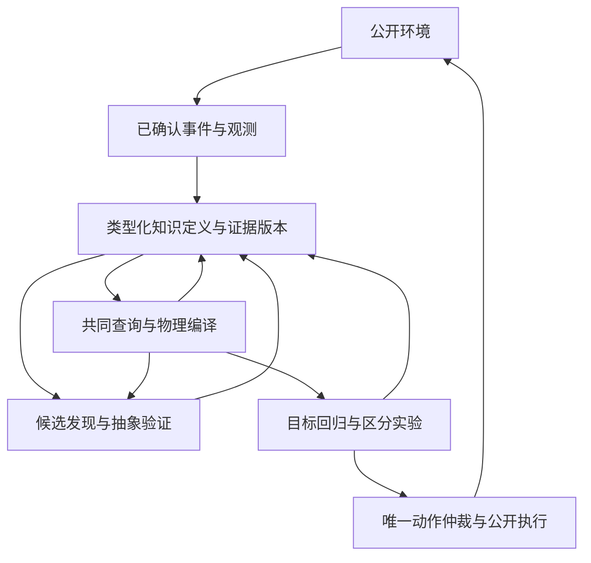

# V13 统一表示、计算与跨层抽象协作：架构再梳理

2026 年 11 月 28 日，台北时间，星期六。

本文依据本轮上传的《粘贴的文本 (1).txt》全文、现有 V13 的 05／06／07／08／13 文件，以及重新检索的论文原文和官方项目资料。它是对 V13 的架构研究与接口深化建议；本文的提交不代表这些算法已经进入运行系统。

文档基线：`zdx3578/TddESCat` 的 `docs/2026-11-26-v13-integration-plan`，提交 `08f77c8087ba3113ee25c5bd59353233e58bd221`。本轮查询到的实现分支 `impl/2026-11-23-toolchain-bootstrap` 头为 `3da31dc59ebacadc5a2eb4e47637fc32e3b5e13e`。这里只用实现分支确认工作上下文，没有重新审计全部运行代码。

## 一、总体判断：V13 的主方向成立，应进一步收敛共同接口

更紧密的结构可以概括为：**以有类型、有上下文、有版本的可执行关系与作用定义为共同知识中心；抽象、编译、预测、目标回归和真实行动共同使用它。**

其中，对象、概念、机制和程序具有不同的解释责任；位图、稀疏关系、Algebraic Tree Decision Diagram（代数树决策图，ATDD）、Probabilistic Circuit（概率电路，PC）和张量网络承担具体计算。两者通过同一知识定义与查询语义连接。新观测既能改变某个定义的可信范围，也能触发新的变量、作用结构或程序；更新沿明确依赖传播。

05 已有用于知识定义身份的 `DefinitionRef`、用于解释作用域的 `ScopeRef`、统一查询和唯一知识所有者；07 已有共同作用契约；08 已有反统一、条件视图和正反向作用语义；13 已有整体闭环。这些既有设计继续保留，此次真正深化四处：

1. 每次抽象明确**保留哪些查询，以及高层调用如何细化为可执行的低层调用**。
2. 让语义抽象和代数压缩围绕同一份定义的**对外接口与内部计算**协作，形成可检查的双向算法。
3. 共同查询分别声明取值代数、**纯求值／新采样／环境动作的作用，以及随机来源身份**，防止不合法共享或重写。
4. 把原有读依赖进一步具体化为**正支持、查询范围（包括负条件）、定义、模型参数、假设与物理产物依赖**，补足局部更新与异步发布的判定。

这些是建议落实的接口与算法增量，不是已经证明优于所有其他设计的统一理论。

## 二、对话演变的合理性与遗留问题

| 演变阶段 | 合理推进 | 仍需约束的推断 |
|---|---|---|
| 从 A Circus of Circuits 出发 | 认识决策图、电路与词／树自动机之间的表示联系 | 一类函数的表示对应，不自动成为通用认知架构 |
| 布尔电路与概率电路作为共同基础 | 希望共享约束、推理与概率计算 | 推理可处理依赖结构性质；编译成本和动态维护成本仍在 |
| 加入关系、半环、Functional Aggregate Query（函数聚合查询，FAQ）与 Atlas | 统一变量绑定、组合、聚合和消去的计算语义 | 不同代数之间的转换、聚合次序和递归须有明确条件 |
| 接入因子秩、张量分解与程序压缩 | 从仅执行知识，扩展到共享结构候选发现 | 低秩、重复代码和语义／因果抽象对应不同判据 |
| 以语义事实和同色连通区域起步 | 缩小 Inductive Logic Programming（归纳逻辑程序设计，ILP）的起始搜索空间；保留可解释的观测依据 | 连通区域是观测分割，功能对象与因果标签仍须学习 |
| V13 的纵向抽象、横向计算、真实反馈 | 正确解除把三个维度排成单一流水线的问题 | 需要把层间映射和共同消费者写成可执行合同 |
| 本轮的接口与更新收敛 | 同一定义服务于学习、查询、预测、执行与复核 | 整体收益仍须用系统证据检验，不能由文献拼接推导 |

第一篇综述的真实贡献是介绍布尔表示类及其自动机联系。[S1] 后续张量—电路论文建立受约束表示类之间的对应。[S5][S6] 这些都支持共享计算基础，但没有证明“所有认知内容可统一成一种小电路”。

之前最容易失真的跳跃有三类：把所有结构都画成图后认定同构；把计算压缩认定为概念正确；把预测稳定认定为已识别因果。V13 已经修正了其中相当部分。本轮应把剩余边界变成实际接口判定。

## 三、共同知识定义：先明确含义，再选择存储和计算

### 3.1 用一个通用作用例子说明

假设公开交互出现：选择某个区域并执行动作后，另一个区域发生改变。系统要学习的内容至少包括：

- 哪些区域或对象承担“选择对象”“受影响对象”“相关条件对象”的角色；
- 哪些上下文或历史条件与效果有关；
- 具体调用哪个公开动作、使用什么参数；
- 预测的变化是什么，哪些相关部分被认为不变；
- 什么时候检查效果，哪些回执仍不足以判断；
- 哪些证据支持该关系，哪些解释还不能区分。

“控制器”“门”等名称可以帮助人阅读，但这些名称本身不提供语义。可执行定义必须说明如何绑定角色、计算条件和解释效果。区域编号也不能直接成为跨帧对象身份。

同一个机制定义应被以下消费者引用：对象绑定查询、条件检验、效果预测、目标回归、程序调用、实验生成、执行后复核。它们可以需要不同物理结果，但不应各自复制一套条件逻辑。

### 3.2 同一含义的三个计算层面

| 层面 | 含义 | 变化示例 |
|---|---|---|
| 参数化定义 | 输入角色、条件、输出、作用与组合规则 | 修改机制前提会形成新的语义版本 |
| 某作用域中的解释 | 该定义在当前对象、事件、模型与有限域中的取值或预测 | 新观测会改变当前绑定、支持或模型参数 |
| 物理计算视图 | 某类查询的位图、关系表、因子化表示、电路或执行计划 | 改变变量树可能只改变实现，不改变含义 |

这种区分既避免重复知识库，也允许按工作负载保留多种计算表示。当前 05 的身份、范围和句柄合同可以承载它，不需要另建一个永久世界模型。

### 3.3 共同定义语言需要表达什么

静态属性是关系；带动作和前后状态的机制是转移关系；程序是关系的有类型组合与带观测的控制过程。参数可以是数值、对象角色、集合，也可以是带类型的子关系或子程序。

例如“对一个满足条件的集合应用共同变换”，集合本身可以由另一份可执行关系定义；变换参数也可以是一个子程序。共享表达式应保留这种嵌套，不必先展平成全部对象实例。下译到只支持一阶有限表达的后端时，必须进行明确的特化，或准确报告该片段尚不受支持。

有限查询实例不等于整个开放世界拥有永久固定的有限变量集。新的对象、谓词、关系域或历史状态出现，会产生新的域版本；参数化知识仍可通过合法角色映射继续复用。

## 四、哪些计算能够真正统一

Functional Aggregate Query（函数聚合查询，FAQ）提供了一个重要共同形式：[S2]

\[
H(x,z)=\bigoplus_y F(x,y)\otimes G(y,z).
\]

这里，`x` 和 `z` 是保留的输入输出，`y` 是两项知识连接后消去的中间绑定，`F`、`G` 是关系或因子函数。`⊗` 负责联合，`⊕` 负责聚合；具体含义由查询声明的代数解释确定。

| 查询 | 联合与聚合 | 可共享的工作 |
|---|---|---|
| 哪些对象满足条件 | 合取与存在投影 | 角色连接、条件过滤、对象绑定 |
| 有多少个不同合法绑定 | 去重后的计数 | 前述绑定查询及去重结果 |
| 某效果在模型中多大概率发生 | 因子乘积与边缘化 | 对齐后的变量与证据切片 |
| 哪个调用达到目标的代价最小 | 合法路径组合与最小聚合 | 机制适用域、效果与目标关系 |
| 两段机制怎样复合 | 对中间状态连接并消去 | 相同作用定义的前后接口 |

Provenance Semirings（溯源半环）支持用统一关系骨架计算不同标注，但标注转换与正关系查询任意交换需要相应半环同态条件。[S3] A Compositional Atlas 给出聚合、乘积和逐元素映射的可处理充分条件，包括分解性、平滑性、兼容性、确定性及映射条件。[S4]

因此，统一计算核心应当成为**可检查语义的查询语言及其编译过程**。一个通用 `multiply` 函数或一个“半环类型”标签不能代替这些条件。

### 4.1 量词顺序也是控制语义

设两个未区分状态等概率出现；动作 L 仅在第一种状态成功，动作 R 仅在第二种状态成功。行动前不知道是哪一种：

\[
\max_a \sum_s P(s)U(s,a)=\tfrac12,
\qquad
\sum_s P(s)\max_a U(s,a)=1.
\]

`s` 表示状态，`a` 表示动作，`P` 是状态概率，`U` 是成功取值。第二个式子允许知道状态之后再选动作，因此与第一个问题不同。优化器只能在语义允许的消元次序中搜索。Galley §4.5 对此给出了明确限制。[S8]

这也是一个真正可复用的偏序：变量消去的先后约束。但它与概念的抽象关系是不同的边，不能合为一种“更高／更低”。

### 4.2 精确有理数不能直接变成布尔支持或概率

有理数内部可出现抵消，例如 `1 + (-1) = 0`。如果先将每个非零子项都改为布尔真，再做 OR，就会得到真，改变了原函数。ATDD 的内部系数也不能直接解释成概率或因果置信度。

同样，布尔 `p OR p = p`；若不处理重复推导就换成自然数相加，会把同一个结果计两次。概率推断必须保留原始事件依赖、互斥或独立条件，不能把重复证据当独立样本。

### 4.3 共同表达式需要保留随机来源和真实作用

需要声明两条独立的信息。第一条是**取值解释**：布尔、计数、有理数、概率等。第二条是**运算作用**：纯求值、生成新样本、公共环境动作；此外保留所引用的随机来源身份。

- **纯求值**：输入、语义版本、上下文和已引用来源相同时，可以共享结果。对固定概率模型做确定性边缘化也属于纯求值。
- **生成新样本**：每次抽样的来源身份和相关性语义明确；独立抽样不能被公共子表达式消除合成同一个样本。
- **公共环境动作**：发送动作会改变交互历史；缓存预测不能替代一次真实动作。

一个简单例子：只抽一次公平随机变量 Z，然后令 X=Z、Y=Z，与独立抽取 X、Y，边缘分布一样，联合分布不同。表达式重写不能无条件把共享随机来源复制为两次独立抽样。

程序也不能只用最终画面证明等价。中间是否失败、是否产生可供下一分支使用的观察、是否终止、执行过哪些公开动作，都可能属于要保留的语义。

### 4.4 递归和学习的边界

连通、可达性和某些规则闭包需要不动点；带循环的程序需要状态、退出与观测语义。新谓词发明需要候选搜索；因果解释需要行动证据。这些过程可以共享关系计算，但不应声称已被一个有限求和乘积表达式完全解决。

## 五、最关键的统一：抽象合同与可执行细化

每次抽象应同时说明“忽略什么”和“保留什么”。这可将对象组合、条件泛化、机制迁移、历史压缩与程序库学习放进同一验证流程。

### 5.1 共同合同的内容

| 内容 | 具体要回答的问题 |
|---|---|
| 角色和类型 | 哪些是输入对象、集合、动作参数、历史量；哪些是输出或效果 |
| 上下文 | 哪个对象域、解释版本和条件下可以使用 |
| 向上映射 | 怎样由具体实例计算抽象描述，哪些差异被省略 |
| 向下解释 | 一个抽象查询／动作怎样获得具体绑定和公开可执行过程 |
| 保留查询 | 必须保持哪些约束、预测、失败条件、行动效果或目标相关行为 |
| 证据资格 | 哪些是定义内精确证明，哪些是模型一致，哪些仅有经验支持 |

向下解释通常返回一组合法实现或绑定，并不是向上抽象的唯一逆函数。信息被省略后，要支持未来精化，需要保留原始证据和解释见证，而不是宣称有损抽象自动可逆。

### 5.2 形式化检验与实际证据的分工

一般的要求是保留已声明查询。对每个需要保持的具体查询 q，给出抽象查询 q# 及映射 α，并在相应作用域检查：

\[
q^{\#}(\alpha(s))=\beta_q(q(s)).
\]

`s` 是具体状态描述，`α` 形成抽象描述，`q` 与 `q#` 分别在两种描述上回答对应问题；`β_q` 对齐答案类型，例如把具体对象标识映射为抽象角色，答案类型不变时取恒等映射。含参数或动作的查询还需相应参数／动作映射。只保留部分查询的抽象，不必保持整个具体状态。

在确定性、具有对应状态和动作的情形，可以采用更强的转移保持条件：

\[
\alpha_{out}\bigl(F_{concrete}(s,\rho(s,\bar a))\bigr)
=F_{abstract}\bigl(\alpha_{in}(s),\bar a\bigr).
\]

`F_concrete` 是具体调用的机制解释，`F_abstract` 是抽象机制；`α_in` 将输入转为抽象角色状态，`α_out` 将具体效果转为抽象效果；`ā` 是抽象动作，`ρ(s,ā)` 是该状态下选定的、合法可执行的具体动作或过程。含义是：先细化并执行模型中的具体过程再抽象，与先抽象再预测，应给出一致答案。这个较强条件适用于声明支持它的片段，不作为一切任务相关抽象的必要条件。映射未定义或具体过程不可执行时，不能宣称该抽象动作当前可用。

具体实现的选择只能依赖公开可获得的观测与历史。若向下解释产生多个实现，必须说明保证针对哪一个选择，或是否对全部获准实现成立；存在一个正确实现不能升级为任意绑定均正确，也不能暗中让选择过程读取不可观测状态。

对概率模型，应比较经过映射后的分布，而不是只比较最可能结果。若只要求近似一致，需要声明距离、误差及适用域；不能直接沿用精确证明。

*Causal and Compositional Abstraction* 把类型对齐、查询映射和解释一致性组织成可组合的抽象，并区分向上、向下与机制层抽象。[S10] 该文的因果模型仍假设无环，近似和循环情形被列为扩展方向。因此这里借用其合同思想，在线发现、循环执行与经验验证是本项目仍需实现的工作。

还必须单独检查：**两个模型之间一致，不证明它们都符合环境。** 形式交换关系和公开行动效果检验是两份不同证据。

### 5.3 用未来查询定义状态抽象

Predictive State Representation（预测状态表示，PSR）把状态与未来动作条件下的观测预测联系起来。[S11] 对当前系统，更直接可做的是维护一组具有区分意义的未来测试。

令 `h` 是公开交互历史，`Q` 是当前需要保持的测试集合。若两段历史在这些测试的预测上相同，可以提出共同抽象状态候选；没有测试到的地方保持未知。新测试区分它们时，就拆分该候选或增加必要历史谓词。

这一有限测试关系只保证当前声明的区分能力，不等于对所有未来行动策略的完全等价。双模拟关于策略保持的经典结论要求给定模型满足相应奖励和转移条件。[S12]

同一画面、不同历史可能对应不同响应。不能为简化编译，预设最后一帧已经是充分状态。谱学习可帮助寻找预测结构，但其可识别性、数据覆盖与数值稳定性需要另行研究；当前工程闭环不应等待完整谱识别算法才运行。

## 六、代数基底、语义概念与最小因果单元如何靠近

### 6.1 对外共享语义接口，对内共享计算

一个作用定义可以同时拥有：

1. 可执行的角色识别与条件关系；
2. 动作、效果与相关不变部分的解释；
3. 支持、反例、未知及可区分实验；
4. 位图、稀疏因子、电路或张量的具体实现。

代数分解在这份定义内部减少重复计算；概念抽象减少重复定义和不必要角色区分；因果验证决定哪些作用解释可以在何种范围被信任。这样三者能够共用查询、来源、身份和更新过程。

### 6.2 三种最小性仍然不同

| 最小性 | 实际减少的东西 | 不能直接推出 |
|---|---|---|
| 计算基底最小 | 固定函数与切分中的线性冗余 | 可解释对象或可独立干预变量 |
| 语义定义简化 | 重复条件、实例与表达结构 | 被忽略区别对所有任务都无关 |
| 作用单元不可约 | 在声明查询与行动范围内不能再删的角色、条件或状态区分 | 世界的唯一、绝对最小因果分解 |

例如把两个变量 x、y 改写为 u=x+y、v=x−y，可以保留代数信息，但“将 u 设为某个值”并没有唯一指定应对 x、y 做什么。因此可逆坐标变化也不自动提供可执行干预。

Factor Rank 的规范性针对给定布尔函数与变量树；基底身份依赖该语义与切分。[S7] 它不等于对本体、任务或因果机制做全局最小化。

### 6.3 一个具体的双向协作算法

**由计算走向抽象：**

1. 从公共子查询、重复程序或因子分解中找到共享结构。
2. 记录它原先依赖的对象角色、条件、历史和输出。
3. 尝试为共享结构建立可执行关系解释；参数保留必要角色与变量绑定。
4. 检查该解释能否保持声明的查询和公开作用预测。
5. 有语义解释与实际消费者的候选，发布为可复用定义；仅有代数价值的结构，保留为内部计算因子。

**由抽象走向计算：**

1. 合法抽象减少重复实例和重复条件定义。
2. 抽象后的角色接口形成新的因子组合结构。
3. 编译器据此重新选择连接顺序、公共子表达式和局部变量树。
4. 检查新计算视图与原定义在声明域内一致，并测量包括构建、查询、维护在内的总成本。

共同优化的对象是**可执行接口及其内部实现**。先满足必须保留的行为，再选择实际成本较低的实现。因子秩、树宽、接口元数、稀疏度、关系基数和更新范围分别计入相应代价，不压成一个含义不清的“认知压缩分数”。

LICS 的 String Diagram Algebraisation 将组合接口与计算分解联系起来；其复杂度条件涉及树宽、接口元数及特定概率任务的精度和接受概率。[S9] 这个理论支持关注接口规模，但没有给在线认知学习整体提供无条件效率保证。

*Online Structure Learning of Probabilistic Circuits* 的分裂先保持当前分布，随后利用新数据更新；合并则依据分支分布距离压缩模型。[S23] 这些统计操作可以向共同候选流程提供线索，但“split”不自动等于发现新概念，“merge”也不自动保持所有行动相关区别。

### 6.4 最小作用单元允许涉及多个对象

一个动作可能同时依赖选择源、远端目标、关系结构和历史条件。应表示为带角色的多元作用关系；不强制拆成若干彼此独立的“动作—单对象”配对。

候选最小性可用删除角色／条件／历史区分后的预测损失来检查。但删除后仍能解释已见数据，只能支持当前数据范围内的简化；若没有辨别性行动，还不能声称该因素因果无关。联合效应也不能被两两相关性检验穷尽。

## 七、各语义层怎样高效协作

| 语义层 | 应发布什么 | 从更高层获得什么反馈 | 共享计算 |
|---|---|---|---|
| 公开观测与基础区域 | 全部公开帧、事件、精确区域成员与可计算属性 | 哪些局部关系需要进一步测量／重新解释 | 网格、位集合、连通及差分 |
| 对象与关系解释 | 跨区域组合、跨帧对应、角色绑定及不确定性 | 共同作用或预测失败对对象边界的约束 | 关系连接、匹配、集合运算 |
| 概念与状态 | 可执行谓词、必要历史量、抽象映射 | 新反例要求保留的区分、新任务查询 | 关系外延、条件判定、预测测试 |
| 机制 | 带上下文的动作—角色—效果定义 | 目标回归提出的前提，实验区分结果 | 适用性、前像、后继与统计查询 |
| 程序与任务 | 可绑定程序、分支、循环、目标相关调用 | 实际执行观察、失效条件和新用途 | 作用复合、条件验证、共享子程序 |

这些层是解释的粒度，可以交叉和回溯。一个对象可以由多个区域组成，一个程序也可作为另一概念的定义部分。它们不要求沿一棵固定抽象树排列。

Inductive Logic Programming（归纳逻辑程序设计，ILP）接收已有可解释关系与 Ground Atoms（基原子事实），符合当前目标。*Dynamic Predicate Invention* 原文也从基原子、背景知识与元规则起步，并假定确定性、完全可观测环境。[S13] 我们应借用其预测—反例—修订过程，同时明确 ARC-AGI-3 下对象解释和历史状态可能仍不确定。

同色四连通分量是观测起点；“可推”“阻挡”“控制远端对象”属于待行动检验的世界解释。不能通过预先赠送这些标签来证明自主学习能力。

## 八、运行架构：一个知识中心，抽象、计算与控制共同工作



图中 `Q→K` 只允许返回已验证计算视图、代价统计或候选线索；后端不能自行改写事实。`C→K` 表示提出用途、查询与待区分义务，不能通过控制器偏好改变证据真值。

既有 Julia 知识所有者和公开执行入口继续承担发布与动作权限。Python／Rust 工作者读取冻结输入，提供计算或候选产物。应按有实际意义的子查询或任务批量调用，避免为每个像素或原子进行跨进程通信。

### 8.1 对象绑定只算一次，多个消费者复用

假设某机制的适用条件查询得到一组角色绑定。同一快照下，实验选择、效果预测、目标回归、程序实例化可以共同消费这份关系；每个消费者不再重复做形状匹配和条件连接。

缓存身份至少受定义、绑定域、上下文、知识／模型版本、查询语义约束。不同对象可以共用参数化定义与执行计划，但对象身份和事件身份继续不同。结构摘要命中后仍按已有规范进行严格比较。

### 8.2 正向预测和反向目标使用同一转移定义

设 T(s,a,s′) 表示在已声明模型中，动作 a 可将状态 s 转到 s′；G(s′) 是目标关系。

可能达成的前提：

\[
Pre_{exists}(G)(s,a)=\exists s':T(s,a,s')\land G(s').
\]

在该模型内保证达成的前提，还需要完整、非空的后继集合：

\[
Pre_{all}(G)(s,a)=CompleteSucc_T(s,a)
\land (\exists s':T(s,a,s'))
\land\forall s':(T(s,a,s')\Rightarrow G(s')).
\]

`CompleteSucc` 说明该查询所需的后继范围确实完整；非空条件避免空真。公开动作合法性还要在派发前检查。这些公式只保证声明模型内的结论；模型是否符合世界仍由公开证据约束。

概率目标则在同一个作用定义关联的有效概率模型上边缘化。不能把“存在成功后继”“成功概率较高”“所有后继满足目标”写成一个通用的 success 布尔值。

## 九、统一抽象与修订过程：候选共享，判据明确

下述算法是本轮建议的公共流程，复用 07、08 已有候选生成器和 05 发布事务。它不要求增加另一套学习调度器。

```text
refine_from_event_or_query(trigger, snapshot):
    locate the affected definitions, role bindings and required queries
    gather source instances with public evidence and explicit scopes

    if the trigger is a failed prediction:
        check observation completeness and ambiguous object correspondence
        identify competing explanations:
            missing condition, insufficient history, wrong role/effect,
            distributional uncertainty, or a new mechanism

    propose typed definition changes using applicable operations:
        shared subexpression, decomposition, composition, parameterization,
        anti-unification, relation factor, or distinguishing history test

    for each proposal:
        explain what distinction it removes or adds
        construct executable role and abstraction mappings
        specify the queries, effects and trace observations to preserve
        verify types, scope, substitutions and implemented primitives

        if it changes only a physical representation:
            verify denotation preservation in the declared domain
        else:
            check model consistency and all affected available evidence
            retain unsupported scope as unknown
            construct feasible public tests for competing explanations

        if the proposal has a valid consumer and its required checks complete:
            publish it with the appropriate proof or empirical status
        else:
            retain the completed work and unresolved obligations

    recompile only invalidated or demonstrably reusable query views
```

“发布”不意味着所有定义都升级为已证明世界事实。精确派生关系、经验机制候选和未完成验证的对象解释，保持各自资格。控制器按资格和当前用途消费。

有因果价值的复杂定义不能仅因暂时增加计算成本而被删除；优化可以调整物理表示，不能丢掉必需的行动区分。

## 十、多维偏序如何统一组织而不混淆含义

08 已明确只有满足相应性质或取商后才称偏序，本轮保留这一约束。

集合包含、属性限制、条件蕴含、对象结构映射、机制细化、时间关系，可以共用对象身份、上下文引用、索引和见证。它们的判断规则仍需分别声明。

- 条件蕴含在表达式层先形成预序；按语义等价取商后可以得到偏序。
- 对象重叠与相似本身不是抽象偏序。
- 机制细化要说明输入、输出和动作映射，以及保留目标。
- 时间前缀、子序列与预测行为等价是不同关系。
- 置信度、秩、成本不作为语义抽象顺序。

因此无需六套互不相通的知识库，也不假定知识具有固定六维数值坐标。索引先召回候选；有类型、上下文和见证的判断再确认关系。统一的是检索与证明接口，不是把所有边解释为同一种父子边。

Mutually Exclusive and Collectively Exhaustive（相互独立、完全穷尽，MECE）适合约束模块责任；知识本身可以同时具有集合、时间和作用关系，不能为了划分模块而禁止这种交叉。

## 十一、变化传播：决定紧密协作能否成立的关键

### 11.1 保留既有事务，区分变化语义

| 变化 | 必须更新 | 应保持的内容 |
|---|---|---|
| 新公开事实或当前状态变化 | 相关绑定、查询结果、范围监听与预测复核 | 原始历史事件和无关定义 |
| 对象／谓词／机制定义改变 | 新定义版本、受影响历史解释、程序契约、模型及索引 | 未受影响的语义定义和证据 |
| 经验假设被反例推翻 | 依赖该假设的证明、条件视图与控制资格 | 仍有独立有效证明的结论 |
| 概率参数更新 | 模型参数版本、概率查询缓存和必要校准信息 | 未变的角色类型及定义接口 |
| 变量树／布局／执行计划变化 | 相关物理句柄与实现证书 | 已证明保持的知识含义、历史因果证据 |

Factorized Incremental View Maintenance（因子化增量视图维护，F-IVM）与 DBSP 为可组合查询的增量维护提供依据。[S16][S17] 定义改变、经验资格撤回和纯数据 delta 的传播责任不同，不能只靠通用“节点变脏”处理。

### 11.2 查询范围和负条件监听必须具体落实

05 §4.1 已有完整域上的 `safe_not`，§5.1 已提到读取集合／范围；仍需把“新增事实怎样改变旧查询”写进算法。正向枚举、连接和聚合也需要范围监听：空绑定查询后插入新合法对象，或计数范围内新增对象，都会改变结果，却不会命中旧的正行读集。负条件是其中尤其容易漏掉的情形。

例如查询“路径范围内没有障碍”时，应记录：障碍关系的定义版本、被检查的空间及时间范围、过滤条件、域完整性依据。以后新增的事实只要满足该范围和过滤条件，就必须让旧结论失效。这个新事实不可能出现在旧的正读集中。

| 依赖内容 | 更新时如何命中 |
|---|---|
| 正支持 | 该事实／证明被撤回、替换或不再适用 |
| 查询范围，包括负条件 | 新增或改变的元组进入原扫描／连接／聚合／否定查询的范围；完整性证书变化 |
| 定义与域 | 角色解释、合法域或谓词含义版本变化 |
| 假设与模型参数 | 使用的机制假设撤回，或参数模型版本更新 |
| 物理产物 | worker 代际、变量树或布局改变；只失效依赖该实现的句柄 |

它们继续放在现有 `read_dependencies` 合同之下，采用明确的依赖种类；本轮不创建同义的另一个 dependencies 协议。优化后的实际读取计划也必须声明会被新元组改变的查询范围，不能仅回报有结果的行。

### 11.3 共同增量过程

```text
apply_confirmed_change(event):
    persist all public evidence before learning
    old = current published snapshot
    delta = exact fact and current-view changes from the confirmed event

    affected = positive reverse-dependency hits(delta)
    affected += range matches for scans, joins, aggregates and negation(delta)
    affected += changed domain, definition, hypothesis and parameter users

    maintain valid alternative proofs
    invalidate unsupported results and action qualifications immediately
    maintain the required exact indices that can complete in this transaction
    mark affected unfinished queries unavailable / unknown
    compare-and-publish exact facts and necessary invalidation against old
    on parent conflict: recompute affected sets against the new parent
    schedule frozen remaining work, including affected recursive components:
        recompute their least fixpoint from valid external support
    schedule affected learning or compilation tasks without blocking facts

accept_background_result(job, result):
    verify source versions, result completeness and declared semantics
    compare all relevant facts, query ranges, definitions, hypotheses,
            parameters, domains, encodings and physical handle generations
    if any required semantic or execution dependency became invalid:
        invalidate this artifact and retain the reason
    else:
        validate newly relevant evidence after the job cutoff
        prepare an independently complete unit and its dependent indices
        compare-and-publish with expected_parent = current
        on parent conflict: recheck dependencies and newly relevant evidence
```

这里沿用 05 的事务边界：先发布已确认精确事实与必要失效；不能等待全部强连通分量重算、全历史重编码和慢学习结束才发布。历史证据不因当前状态发生删除而被删除。物理优化可使用多种新执行计划，但没有语义资格的旧结果不能作为 fallback 继续参与控制。

### 11.4 删除、递归与等价撤回

结论有多个独立证明时，撤回一条证明不应删除仍被支持的结论。递归又不能靠循环支持维持自己：`p←base, q←p, p←q` 中撤回唯一 base 后，p、q 均应退出最小不动点。

既有 05 已选择受影响 Strongly Connected Component（强连通分量，SCC）重算。Delete/Rederive（删除后重新推导，DRed）及等价增量维护文献说明，撤销等价还可能需要恢复被规范重写的事实。[S18]

当前 egglog 文档有表行删除、subsume 和作用域操作；这不等于任意撤销一次经验 `union` 并恢复全部派生结构。[S19] 继续采用 08 已规定的精确基础视图和上下文冻结视图。Predicate E-Graphs 可作为条件关系设计参考，不据扩展摘要直接假定已有成熟非单调撤回实现。[S14]

## 十二、E-Stitch、条件等价与抽象程序的协作

E-Stitch 的官方定位是从等价图中的程序语料提取共享函数。[S15] 它适合在已具有可执行语义的程序上压缩，不能独立替代轨迹解释、循环条件学习和因果验证。

紧密接口应形成：

1. 原始公开轨迹经角色和作用定义解释，形成有上下文的程序候选。
2. 分支条件与循环条件具有可计算定义，执行状态与退出观察明确。
3. 仅把已证明适用的条件等价加入相应冻结视图。
4. E-Stitch 产生共享定义及回代／重写见证。
5. 项目验证类型、条件、动作顺序、必要中间观测、效果及终止资格。
6. 接受的函数重新登记为公共可调用定义，其条件和绑定查询可与其他消费者共享。

反统一提供共同参数化结构；不同结构参数仍允许嵌套。程序共享可以减少后续搜索，但“压缩更好”不自动说明控制效果更好。真实执行每次重新绑定当前对象，并经过同一个公开派发入口。

## 十三、一个完整的跨层例子

以下是用于说明接口的合成情境，不是针对某个游戏编写固定规则：一次公开动作选择局部区域后，远端结构发生变化；相同画面有时产生不同结果。

1. **观测入口**保存全部回执帧和公开结果，计算精确基础区域。不提前写入“按钮”或“门”的语义。
2. **对象解释**保留选择区域、变化区域及若干跨帧对应候选。远端变化进入同一次事件的效果范围。
3. **机制候选**建立“选择角色—受作用角色—上下文—效果”关系，和其他解释并存。
4. **共同查询**计算候选条件与绑定。预测、区分实验和程序调用复用该查询结果。
5. **反例处理**发现相同当前画面但不同历史有不同结果。系统检查回执完整性和对象对应后，提出必要历史谓词或状态拆分。
6. **抽象验证**说明新状态保留哪些未来响应测试；未测试的未来情况保持未知。
7. **语义复用**在其他对象上找到角色对齐的机制实例，将实例差别提升为参数。迁移仍检验上下文与公开动作含义。
8. **计算压缩**为稳定且重复的条件查询选择适当关系计划或 ATDD；不为每个对象重新生成同一逻辑。
9. **程序复用**从重复的有语义调用中提取共享函数，复核必要中间观察后交给控制器使用。
10. **后续修订**新事件使某负条件不再成立时，范围监听立即撤销相关适用判断，避免模型后台重编译期间继续使用旧条件。

此例中，每层都对同一机制身份和同一证据链负责。提高效率的主要来源，是减少重复解释、重复绑定、重复查询和全量重建；实际加速幅度必须测量。

## 十四、开源实现保持聚焦，减少重复开发

| 能力 | 当前接入方向 | 本轮新增的接合责任 |
|---|---|---|
| 公开证据、知识身份与控制 | 现有 Julia 所有者、Recorder、关系和程序语义 | 共同抽象合同、完整依赖种类、动作前复核 |
| 关系与稀疏代数执行 | Galley 及其当前内部 Finch 路径 | 类型化查询下译，合法消元顺序与公共子查询复用 |
| 有限精确布尔表示 | Factor Rank 作者实现 | 固定域与变量编码；规范视图只承担已验收能力 |
| 概率电路 | 既定 CirKit 路径 | 随机变量身份、缺失证据、模型版本和语义解释 |
| 有限条件验证与合成 | 既定 cvc5 路径 | 查询保存义务、角色映射、精确模型范围 |
| 程序库发现 | 现有 E-Stitch／egg 路径 | 带条件和轨迹观察的语料及重写验证 |
| 因果与动态抽象 | 项目已有机制、历史与实验任务 | 公共行动下的竞争解释、查询保持和覆盖义务 |

Galley 官方当前仓库说明其内部包含 Finch，并计划改为正常依赖关系。[S20] 不能按过期摘要再接入一套冲突版本。CirKit 与 DeepLog 的官方实现分别提供电路／张量计算与更广的神经符号模块组合。[S21][S22] DeepLog 值得作为特定片段的对照或未来候选后端；本轮没有证据证明引入它能替换现有知识、证据和控制所有权，因此不追加为第二个核心。

F-IVM、DBSP、Predicate E-Graphs 和因果抽象论文首先作为算法与合同依据。只有当某个现成实现能替换明确的重复工作，并通过当前数据、增量和作用语义验收时，才增设依赖。

### 14.1 性能判断采用真实总成本

编译是否值得，可比较预计重复查询节省与构建、迁移、更新的额外成本。这是选择正确执行计划，不是限制必须学习或探索的功能。

记录查询时间时还应记录编译时间、跨语言传输、模型维护、规范化、系数位长与失效重建。直接位图／稀疏访问也是正式执行计划。高压缩率不保证端到端低延迟；更小变量树切分秩也不保证在线变树过程便宜。

Factor Rank 的定理 20 给出相对于表示大小的算术操作次数；定理 23 的存在消去针对一个变量，表 1 的秩上界为 r²+2r。连续消去、变树中的中间膨胀和精确系数大小仍需测量。[S7] 不因论文有多项式操作就承诺所有知识查询组合都高效。

## 十五、现有计划需要怎样具体深化

本表区分“已经写入的责任”与“本轮应增补的细节”。本轮只提交研究文档；旧规格全文尚未因本表自动改写。

| 位置 | 已有逻辑 | 还需具体化的问题及后果 | 对应解决方案 |
|---|---|---|---|
| 05 §3、§4 | 类型化关系、作用域、代数与能力检查 | 取值解释、采样作用和共享随机来源的重写责任未集中定义 | 独立声明取值语义与作用种类，以及随机来源；各后端只接收支持的片段 |
| 05 §5.1、§5.2 | 实际读集合／范围、原子发布与异步结果复核 | 没有把新增元组命中枚举／聚合／负条件的判定写清 | 在 read_dependencies 中声明范围、过滤、域完整性，发布时匹配新增及修改事实 |
| 06 §2、§5 | 共同关系执行、索引、持续精确压缩 | 多消费者是否实际共享同一查询尚缺统一验收例 | 为机制绑定等公共查询登记唯一语义表达；按快照与依赖复用结果和计划 |
| 07 §3、§7、§8 | 六类发现触发、历史候选、作用覆盖 | 各类候选对保留行为的检验仍分散 | 统一声明测试集合、状态映射、动作细化与剩余区分义务 |
| 08 §2、§3、§4 | 反统一、条件等价、程序语料、正反向作用契约 | 抽象映射的组合与必须保留的中间观察未形成统一检查入口 | 在现有验证入口增加查询保持／轨迹作用检查，使用同一见证供控制复核 |
| 09、13 的验收安排 | 工程闭环、表示／效率／认知收益分别检查 | 还缺少针对“统一本身”的故障与复用案例 | 增补下节的跨消费者、负依赖、同画面异历史与随机来源检查 |

这些位置是现有设计文档定位，不把它们误标成已查明的运行代码缺陷。后续编码仍应按实际调用路径检查具体源码，不能仅依据本文或 changelog 宣布缺陷已修复。

## 十六、怎样验证统一架构确实更好

### 16.1 先检查语义闭环

| 检查情境 | 必须观察到的结果 |
|---|---|
| 一个条件同时被预测、实验和程序绑定查询使用 | 使用同一定义与有效共享结果；改变条件后所有受影响消费者同步失效 |
| 空绑定查询或已缓存计数后新增合法匹配对象 | 通过范围监听更新结果；不能因旧读集为空而永久复用空结果 |
| 已缓存“范围内不存在某对象”，随后插入匹配事实 | 范围监听触发；旧否定结论不能继续参与行动选择 |
| 同一画面有不同历史响应 | 保留区分义务，必要时引入历史谓词；不按帧内容直接合并状态 |
| 低秩因子可压缩但无法解释为动作相关概念 | 保留为计算因子；不自动发布因果变量 |
| 两程序最终画面相同，中间失败／观察不同 | 按声明的轨迹语义识别差异，不错误合并 |
| 同一随机来源复用与独立抽样 | 联合语义保持不同，不被公共子表达式优化混淆 |
| 回撤一个支持但还有独立证明 | 结论保留；无外部支持的递归循环则退出最小不动点 |
| 后台结果到达时新增了影响其负条件的事实 | 拒绝陈旧资格，保留完成产物与失效原因，不污染当前快照 |

这些用小型可枚举关系、合成公开事件和冻结轨迹即可独立检查。本轮没有实际运行这些新验收。

### 16.2 再分别检查三个研究假设

- **表示与语义保持**：关系、抽象与物理视图是否在声明域内给出相容答案；错误、未知与未覆盖是否保留。
- **计算共享收益**：相同绑定、条件和历史统计是否减少重复计算；纳入编译、传输、更新与失效成本后是否仍有收益。
- **认知与控制收益**：新概念是否被真实消费者使用；预测失败后能否找到必要区分；反例是否改变后续调用；动作效果是否更稳定可解释。

比较时使用相同公开语义输入、证据截止与可匹配任务过程。硬件时间与算法工作量分开；不以不同随机游戏的普通胜负起伏作为主要架构结论，也不把模型更小直接当作控制更强。

### 16.3 最小动作—对象作用关系的覆盖

每个已声明机制分别检查：公开合法动作与参数、选择角色与受作用角色、条件和历史、直接／延迟／联合效果、相关不变部分、支持与反例、可执行区分实验，以及未覆盖／不可达部分。

重复帧和重复推导不会增加独立行动证据；同一次动作的多个对象响应也不自动成为独立试验。稳定度与置信信息必须对应具体条件及证据范围，不能一个总分代表全域闭合。

目前没有新运行证据能说明这些能力已经达到很高水平。架构责任闭合、实现完成、经验覆盖充分是三个独立结论。

## 十七、后续落实顺序

延续现有两个里程碑，不另起一套并行里程碑体系。

**先收紧可执行共享。** 在 M1 现有接口和查询接入中，优先补齐负条件范围依赖、共同绑定查询、作用种类及动作前检查。用“一份条件，多个消费者，一次变化共同失效”的小闭环确认架构确实共用语义。

**再收紧跨层抽象。** 在 M2 的变量发明、历史学习和程序库接入中，共用抽象映射与保留查询合同；用“产生候选—保留必要区分—实际复用—反例局部精化”验证双向协作。谱学习、全局最优变量树和一般循环因果抽象继续作为明确研究项，不能被文档名称算作完成。

本轮最值得保留的研究目标是：**用统一的可执行知识定义连接语义、作用和计算；让抽象减少不必要的对外区分，让编译压缩内部计算，让真实行动持续检验两者是否仍足够。**

## 附录：本轮核验的主要原始来源

下列论文与项目提供局部理论或实现依据；本架构是综合建议，并非它们已证明的整体系统。检索日期为 2026-11-28。文中举例、算法整合与验收设计属于本次分析。

- **[S1]** [A Circus of Circuits](https://arxiv.org/abs/2404.09674)，2024。决策图、布尔电路与自动机的基础联系。
- **[S2]** [FAQ: Questions Asked Frequently](https://arxiv.org/abs/1504.04044)。函数聚合查询与合法变量消去次序。
- **[S3]** [Provenance Semirings](https://www.cs.ucdavis.edu/~green/papers/pods07.pdf)，PODS 2007。特别参照正关系代数与同态，以及递归所需语义。
- **[S4]** [A Compositional Atlas for Algebraic Circuits](https://papers.neurips.cc/paper_files/paper/2024/file/ff9c70659c39cdd801dd5f5a1201c29e-Paper-Conference.pdf)，NeurIPS 2024。特别参照 Theorems 1–4。
- **[S5]** [What is the Relationship between Tensor Factorizations and Circuits (and How Can We Exploit it)?](https://arxiv.org/abs/2409.07953)，TMLR 2025。层次因子分解与电路学习组织。
- **[S6]** [From Tensor Networks to Tractable Circuits, and back](https://arxiv.org/abs/2605.00106)，2026。张量列与边值决策图、树张量网络与结构可分解电路的对应。
- **[S7]** [Factor Rank: A Canonical Algebraic Generalization of Tree Decision Diagrams](https://arxiv.org/pdf/2611.10842)，2026，v1。给定函数／变量树的规范性；Theorems 20–24；§6 变树。
- **[S8]** [Galley: Modern Query Optimization for Sparse Tensor Programs](https://arxiv.org/html/2408.14706v5)，2025 修订版。§4.5 合法聚合顺序，§9 限制。
- **[S9]** [Fixed-Parameter Tractable Inference for Discrete Probabilistic Programs, via String Diagram Algebraisation](https://drops.dagstuhl.de/storage/00lipics/lipics-vol380-lics2026/html/LIPIcs.LICS.2026.76/LIPIcs.LICS.2026.76.html)，LICS 2026，官方修订全文。Theorems 34、58 与 §6.3；有限关系可以直接采用关系表解释，无须强制转算术电路。
- **[S10]** [Causal and Compositional Abstraction](https://arxiv.org/html/2602.16612v1)，2026。§4 查询映射，§6 机制层抽象，§8 循环／近似边界。
- **[S11]** [Predictive Representations of State](https://proceedings.neurips.cc/paper_files/paper/2001/file/1e4d36177d71bbb3558e43af9577d70e-Paper.pdf)，2001。未来动作—观测测试的预测状态。
- **[S12]** [Equivalence Notions and Model Minimization in Markov Decision Processes](https://cs.brown.edu/people/tdean/publications/archive/GivanetalAIJ-03.pdf)，2003。给定决策模型中的状态等价和策略保持。
- **[S13]** [Continual Learning and Refinement of Causal Models through Dynamic Predicate Invention](https://arxiv.org/html/2602.17217v1)，2026。§2.1–2.2 的确定性／完全可观测／基原子／背景知识／元规则前提，§5 的未来工作。
- **[S14]** [Predicate E-Graphs with Symbolic Conditional Rewriting](https://pldi26.sigplan.org/details/egraphs-2026-papers/3/Predicate-E-Graphs-with-Symbolic-Conditional-Rewriting)，EGRAPHS 2026 官方扩展摘要页面。条件假设、多父上下文图与相应等价视图。
- **[S15]** [E-Stitch: Top-Down Library Learning for E-Graphs](https://pldi26.sigplan.org/details/egraphs-2026-papers/7/E-Stitch-Top-Down-Library-Learning-for-E-Graphs)，EGRAPHS 2026。程序语料中的共同函数提取。
- **[S16]** [F-IVM: Analytics over Relational Databases under Updates](https://arxiv.org/abs/2303.08583)。因子化、环标注与增量维护。
- **[S17]** [DBSP: Automatic Incremental View Maintenance for Rich Query Languages](https://arxiv.org/abs/2203.16684)。组合式增量变换。
- **[S18]** [Combining Rewriting and Incremental Materialisation Maintenance for Datalog Programs with Equality](https://ijcai.org/proceedings/2015/441)，IJCAI 2015。递归删除、等价撤回和被重写事实恢复。
- **[S19]** [egglog 官方操作文档](https://egglog-python.readthedocs.io/stable/reference/egglog-translation.html)。表行删除与 union 等实际接口；不能混同为自动撤销所有等价推导。
- **[S20]** [Galley 官方仓库](https://github.com/finch-tensor/Galley.jl)。当前 Finch 部署关系与执行接口。
- **[S21]** [CirKit 官方仓库](https://github.com/april-tools/cirkit)。概率电路和张量网络的计算、学习框架。
- **[S22]** [The DeepLog Neurosymbolic Machine](https://arxiv.org/pdf/2508.13697) 及 [官方实现](https://github.com/ML-KULeuven/deeplog)。语言／计算模块分层及显式代数转换。
- **[S23]** [Online Structure Learning of Probabilistic Circuits](https://yoojungchoi.github.io/files/WagnerTPM26.pdf)，TPM 2026。分布保持 split、基于分布距离的 merge；这些操作不自动提供语义或因果抽象保证。

## 交付状态

已完成：上传文本与现有关键设计文档复核、原始文献检索、共同语义和抽象接口深化、跨层算法与验证案例整理。

尚未完成：把本文所有增补逐条写回 05–09 的正式协议规格；相应运行代码实现；新接口／跨层案例执行；实际 ARC-AGI-3 因果覆盖、效率及控制收益验证。本轮没有把已有依赖安装结果当作上述能力的完成证据。
