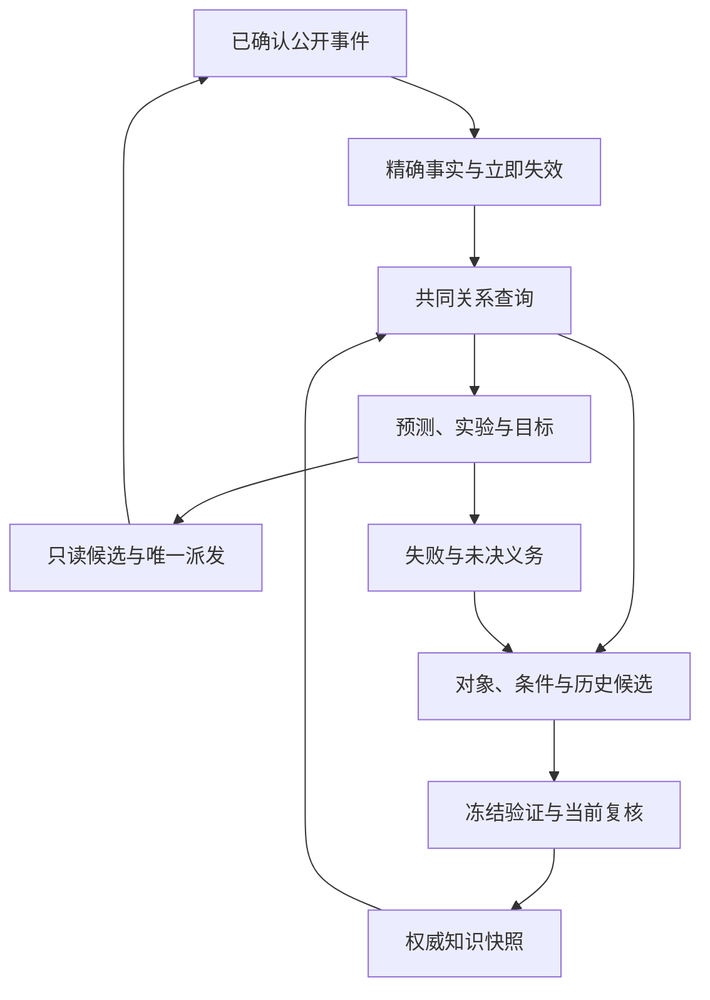

# 04｜V13联合抽象与统一计算：完整Codex落实执行册

台北日期：2026-11-28，星期六。状态：**可进入实施的修订计划，运行代码尚未按本册完成验收。**

本册把当天01/02研究和03源码复核收敛到正式实施任务，补充05–09、13的算法、接线、迁移和验收。它沿用原M1/M2、P01–P46及I01–I16，不建立另一套里程碑或进度编号。原规格的开源固定版本、完整恢复、协议边界和研究任务继续有效；本册不是删减版替代品。

## 0. Codex开始工作的依据

### 0.1 固定基线与提交目标

| 项目 | 本轮已确认的内容 |
|---|---|
| 仓库 | `zdx3578/TddESCat`，通过GitHub connector访问。当前附件及V13文档明确使用此仓库；不对其他旧仓库实施同名修改。 |
| 实现分支 | `impl/2026-11-23-toolchain-bootstrap` |
| 本轮源码锚点 | `3da31dc59ebacadc5a2eb4e47637fc32e3b5e13e` |
| 文档分支 | `docs/2026-11-26-v13-integration-plan` |
| 本轮文档读取父版 | `c88c260d1d390e83c8bf723964382d90c884d808`；03复核先行提交为`6e99ea534e77f46d531bcc3b7a17c9bb06151440` |
| 先读文档 | 同日03、本册；11月26日04–09、10–14。01/02作为研究依据，不能以研究描述覆盖正式执行合同。 |
| 历史安装状态 | 14有计算环境的安装及独立能力记录；并不代表Julia/Rust适配、生产消费者或游戏闭环已验收。 |
| 本次验证范围 | 固定远端源码、实际调用者及已有测试的静态复核；未检查用户机器的未提交工作树，未跑新游戏或性能实验。 |

开始实施时重新读取两分支头和本地工作状态，比较此锚点之后的真实差异。新提交已有相同修复则复核并复用；不得机械覆盖。不能只看changelog判断当前代码。新代码在现有实现分支落实；文档修订在上述文档分支保留来源，合入实现分支时记录确切提交，不把源代码偷偷提交到仅有计划的分支。

每个可审查节点及持续工作约20分钟提交并push，记录分支与SHA。所有计划、审计、验收、中文changelog进入当天 `docs/changelog/日期-内容/`；代码按真实模块目录放置。禁止SSH、强推覆盖并发修改、debug游戏数据和额外生产fallback。配置写文件，遵守现有较高运行参数，不用新小上限或丢历史制造提速。

### 0.2 本次最重要的修正

系统已保存全帧，已有部分中间帧处理、多部件平移、历史谓词、关系来源、程序分支/循环、目标回归、强策略和有限抽象检查。实施必须扩展这些既有路径。当前没有 `OnlineKnowledge.jl`：权威状态 `OnlineKnowledge` 定义在 `OnlineSession.jl:19–33`。`CircuitLearning.jl`、`CircuitAdapter.jl`、`ComputeBridge.jl`、`GalleyAdapter.jl`、`FactorRankAdapter.jl` 是原计划拟增模块，不能假装已经可调用。

16色和64×64坐标是当前公开协议域；问题是候选谓词、对象对应和因果覆盖语义，而不是协议有限域本身。

## 1. 最终要形成怎样的生产闭环

一个真实点击可以让两个远端区域先后改变，末帧又恢复。系统应只记录一次干预，却能查询全部阶段变化；从共同响应提出多部件角色，检查竞争解释；让同一个条件定义同时服务下一次预测、实验与目标控制。如果真实结果反驳该条件，下一次动作不能继续读取其旧确定结论。若这条链没有发生，接入更多计算库也不算V13闭环。



图中查询和候选都使用同一知识身份，物理张量/电路是派生执行视图。新发现不能绕过验证写成事实，worker不能绕过Julia发布或派发。

### 1.1 同一事件的严格顺序

1. 既有Recorder完成公共回执持久化；无法确认的请求维持隔离，不学习、不自动重发。
2. 写入不可变公开事实，立即撤销受影响结果的当前消费资格；发布快照。不能等慢结构学习完成才失效。
3. 按动作前冻结预测核验实际回执，结算当前动作、角色输出、程序进度及新义务。此步幂等；恢复时继续结算同一事件。
4. 最小结算完成后才允许下一次真实派发。对象全域搜索、概念格生成、电路训练和E-Stitch继续异步执行，不阻塞此边界。
5. 慢结果先在冻结输入验证，再按当前依赖范围复核，以父快照检查一次激活。
6. 每次动作重新查询当前角色、guard、公开合法性和结果资格，冻结新的预测与读集。

步骤2和3可以是有顺序的两个事务：前者确保新反例立即失效，后者完成控制结算。不能为了“一个大事务”让失效等待整个学习任务；也不能在二者之间继续用尚未结算的程序进度行动。

## 2. 改造责任必须落在现有模块

| 真实模块 | 继续负责什么 | 本轮必须改变什么 | 实际消费者 |
|---|---|---|---|
| PublicAPI/Evidence/RunStore | 唯一公开请求、确认、不可变证据和恢复 | 全帧/公共结果共同引用，回执结算幂等；保留已有unknown隔离 | 全部学习、回放、控制 |
| Grounding/LocalEffects/SpatialLearning | 精确区域、变化及支持解释 | 同事件全帧视图；支持生成、对应歧义和逐帧绑定 | JointMechanisms、Measurement、RelationTasks |
| JointMechanisms/InterventionLearning | 作用定义、共同效果和实验响应 | 角色元组及效果合同；选择角色与受影响角色分开 | 条件评价、预测、目标和策略输出 |
| RelationQueries/RelationSemantics | 类型化关系、来源及作用组合 | 共享查询DAG、范围依赖、逐输入完整性、统一AND/OR来源 | 索引、条件、前像、抽象验证 |
| AssociationIndex/ConceptIdentity | 稳定身份、召回与语义比较 | 六维联合查询、必要条件与排序分离、未索引范围 | 候选生成、反例、producer检索 |
| ConceptConstruction/RelationLearning/GuardRepair | 关系谓词与条件学习 | 从一般关系语法生成候选；移除独立的窄语义生产路径 | ActiveMechanism、程序guard |
| ProjectionRevision/SceneMemory/QueryAbstraction | 历史和抽象修订 | 公开历史重编码、反例来源、查询映射与动作细化 | 状态条件、规划、区分实验 |
| OnlineSession/Library | 权威知识及原子可见性 | 立即失效、冻结输入、当前范围复核、库/索引/producer共同激活 | 所有读者 |
| RelationTasks/ExperimentDesign/AssociationScheduler | 共同任务及实验义务 | 条件化producer、合法参数域、可续公平服务 | 唯一仲裁与派发 |
| RelationPolicies/PolicySemantics | 轨迹结构、程序学习和解释 | 只读peek、完整回放后发布、通用guard/退出与实际输出 | 程序producer、控制 |
| ProgramSemantics/GoalRegression/Plan/ProjectedPlanning | 作用复合、前像与策略 | 全路径共享变量，存在/保证/概率分开，失败回流 | 同一个task_arbitration |
| 既定计算适配模块 | Galley、ATDD、CirKit、cvc5、E-Stitch | 类型/域/工件/句柄/恢复的实际适配 | 原有共同查询与学习接口 |

保持一个知识所有者、一个关系语义入口和一个真实动作派发入口。可以在模块内部拆函数及测试，不新增一套“认知总控”来旁路 `run_online!`。

## 3. 共同接口：每一项为何存在

本节扩展05已有合同，不另造同义字段。下列函数名若当前尚无同名实现，表示目标职责；实施必须在调用图中标记“新增”或“替换”，不能当成上游库原生API。

### 3.1 身份和版本

- **DefinitionRef（定义引用）**：回答“正在计算哪个类型化关系/函数”。语义改变产生新版本；同摘要仍须严格内容比较。
- **FrameRef（帧引用）**：回答“哪个公开事件中的哪一帧”。同像素的不同时间帧有不同事件身份，像素存储可以共享。
- **ScopeRef（作用域引用）**：包括当前变量域、事件范围、解释/角色绑定版本、语义完整范围；防止把局部结果推广到未知对象。
- **SnapshotRef（快照引用）**：指出读取和发布的知识版本、已接纳事件截止及父版本；不等于电路工件版本。
- **read_dependencies（实际读依赖）**：包含正事实、定义、域以及扫描范围，空结果也登记。它决定哪些结果受新增/删除事实影响。
- **ArtifactRef/HandleRef（工件/句柄引用）**：前者是可持久验证的模型文件，后者仅在当前worker generation和lease内有效，不能混用。

`ConceptConstruction.evaluate_predicate` 当前合成的 `"action-before"` 必须由调用者传入真实帧/快照取代，再启用跨调用共享。否则不同真实帧可能被缓存键错误合并。纯测试也显式创建身份；生产不保留旧形态回退。

### 3.2 接口的实际责任

| 目标接口/现有入口 | 输入及含义 | 输出与消费 |
|---|---|---|
| 扩展 `evaluate_relation` | 快照、类型表达、显式共享变量、已绑定实参、要求的代数和范围 | 绑定访问视图、答案、证明、覆盖、未知、实际读集；所有关系消费者共用 |
| 扩展 `candidate_evaluation` | 同一ActiveMechanism及条件版本、当前角色候选、动作与公开历史 | 当前条件资格和联合效果预测；不能绕过条件只evaluate_joint_rule |
| 05的 `propose` | 可回读的残差/反例/目标缺口/复用触发及相关范围 | 候选可执行定义、生成来源、未决证据和搜索前沿；不是事实 |
| 05的 `revalidate` | 候选、冻结版本、声明历史、当前新增/修订范围 | 精确证明、经验支持、反例、未知及受影响消费者 |
| 扩展 `relation_policy_choice` 的只读peek | 当前cursor、快照、可执行角色与guard | 拟议指令/进度转移/读集，活动cursor不变 |
| 05的 `publish!` | 完整候选组、验证证书、当前父快照 | 原子激活定义、资格、producer与索引，或返回明确冲突 |
| 既有 `submit_action!` | 当前合法动作及冻结预测/来源 | 已确认回执或已有unknown隔离；其他模块无派发权 |

返回合同分别解释：`execution_status`说明算没算完；沿用05的`result_kind/value/semantic_status`表达结果类型、值与语义资格，不新增`answer`别名；`covered_scope/completeness`说明范围；`read_dependencies`说明依据；`remaining_work`说明未做部分。空列表不能兼任“未知”“无解”“失败”和“已全部做完”。

### 3.3 代数类型与作用类型正交

集合存在使用布尔OR/AND；不同对象计数先按对象身份去重；路径计数保留路径身份；概率使用有明确联合/条件结构的规范化分布；代价计算有自己的消元次序。不能替换运算符就宣称语义不变。

纯求值可以缓存；新随机采样需要保留随机来源与调用身份；环境动作有真实副作用且不能消去。概率边缘化本身是纯函数，不因返回概率就禁止缓存。对程序的等价判断保留必要观察、失败、终止及动作顺序。

构造一个程序AST是纯语法计算，与真正执行该程序的环境动作不同；E-Stitch仍可共享纯构造表达式。参数变化后的概率查询依赖模型结构和不可变参数版本，不能仅因语法定义相同复用旧数值。

## 4. M1.1b/c：先让证据、失效、发布和真实结算正确

### 4.1 全帧共同事件视图

在Evidence保留唯一原始档案，在Grounding建立派生视图。输入是已确认前事件与当前回执，不是自建游戏元数据。

```text
consume_confirmed_event(event):
    若 event 已有完整结算记录：返回同一记录
    校验 command、before_ref 与公开回执的对应
    普通连续动作：frames = [上一事件末帧] + 当前回执全部帧
    无前事件/RESET边界：用本次返回帧建立新观察序列，不伪造前态
    为每帧建立真实 FrameRef；为相邻帧记录有向顺序
    提取完整四连通分区、成员、颜色、邻接及相邻帧差分
    以同一个 event_ref 登记全部阶段；不创造额外动作
    公共结果与 available_actions 变化附在回执级
    发布精确事实与受影响资格的立即失效
    按冻结预测结算当前行动，登记残差、未知和待解释范围
    幂等提交最小结算，再唤醒相关慢学习任务
```

公共WIN/晋级等通常是回执级字段，不得虚构它发生在第几个动画帧。没有公开持续时间就只用顺序，不推断毫秒时间。帧域改变按类型域变更处理，不跨尺寸强行平移。

首次初始化或RESET没有普通前动作样本时，建立新的公开轨迹边界，不虚构before帧；初始化事实可以入库，但不把缺前态记录混成普通作用训练样本。RESET的实际结果与旧会话的关系只按公开证据判断，不假定重置后隐藏状态相同。

跨RESET、跨关或显式域改变不默认延续同一对象身份/局部作用。原始归档和回执关系保留；仅有明确映射证据时复用跨边界角色。首个RESET、确认后中断恢复及跨边界同像素身份未定一并进入P01–P03。

同一动作的多帧、多对象、多个证明仍属于同一干预组。统计样本可按任务切片，但必须保留组身份；独立性、训练/验证划分及置信计算不能把切片当独立试验。

### 4.2 事件消费者迁移

先把 `LocalEffects.observed_public_delta/observed_effects`、`motion_example`、`observe_spatial!`、计量器和 `RelationTasks.observe_relations!` 接到同一视图。原有“首次可见落点”“瞬态颜色”等成为共享轨迹上的查询，不各自重新解析。

之后迁移 `ProjectionRevision`、`relation_corpus/witnessed_relation_steps`、条件训练、程序回放。每一项输出保留帧序号和event引用。不可解释的阶段保留残差，不阻止已精确部分和公共结果入库。

`OnlineSession` 的 `new_scene` 分支不再以清空trial代替语义作用域切换。归档仍不可变；活动集按当前定义和域检索。晋级事件也进入公共结果和条件候选来源；旧关证据仅经明确角色/域映射后复用，避免无区别混训。

### 4.3 依赖传播与立即失效

每个基础scan在执行前登记范围，即使返回零行。范围至少由关系定义、类型域、时间/解释版本及选择谓词决定。不能只记录返回行。

```text
apply_fact_delta(delta, current):
    affected = 正事实逆依赖(delta.ids)
             ∪ 扫描范围与 delta 相交的订阅
             ∪ 域/定义/解释完备性变化的依赖
    对 affected 撤销“可作为当前确定依据”的资格
    新精确事实及失效集合立即发布
    按依赖拓扑登记增量任务；循环分量单独登记
    未完成结果只返回未知/不可消费，不返回旧答案
```

对于未知的影响区间或不完整变更日志，必须重新验证所声明的完整受影响范围，不能假定“没有记录所以没变化”。无关更新不使所有工件和作业作废。

范围相交的具体实现：每条变更保留删除前元组、插入后元组及旧/新域、定义版本；先按关系定义和作用域查订阅，再分别评价before/after元组是否可能满足订阅谓词。只有已证明二者均不相交才能跳过。谓词未知、日志缺失、域或解释集合变化，重验该订阅完整范围；新增左侧绑定产生的新右侧读取范围也必须在重算时登记。不能只看变更后的索引而漏掉已删除键。

### 4.4 异步候选发布

`PolicySemantics.prepare_policy_learning!` 不再传活动 `agenda`、`entries` 对象引用；保存episode引用、冻结解释快照及定义版本。结构合法不等于当前有效：

```text
accept_worker_result(job, result):
    核对协议、输入摘要、实际引擎pin及完整工件
    compute/v1涉及HandleRef时校验generation和lease
    E-Stitch protocol/v3文件作业校验manifest、冻结文件和工件摘要
    在 job 的冻结语义快照中展开并验证候选
    if 类型/回代/轨迹合同失败：拒绝，正式库不可见
    current = 当前权威快照
    delta = job读取范围到current的变化
    纯定义：检查引用语义仍相同
    物化答案：增量刷新或重算受影响范围
    学习候选：补查当前相关证据；保留真实训练截止
    若资格仍成立：准备库+模型+producer+索引完整激活组
    检查 current 仍为父快照后提交
    父版本冲突：读取新变化后复核，不盲写覆盖
```

`publish_stitch!` 必须从语义回放之前移到之后。不可见暂存工件不等于正式发布。继续复用RunStore/Library原子写入，不另建持久化库。恢复时只认完整快照指针，重新处理尚未结算的已确认事件；不重发真实动作。

## 5. M1.2a/M1.3a：对象、对应和共同作用角色

### 5.1 不把原子区域与对象假设混为一谈

原子区域采用精确同色四连通分区，包括背景、大区域和边缘区域；完整分区应能重建原帧。对象可以由多个区域组成、可以重叠、可以在一个区域内部被进一步区分。四连通是表示先验，不直接授予“按钮”“墙”“可控物体”标签。

保留当前平移、颜色、计量等通用原语的正确语义，但删除“所有对象必须经唯一整数平移匹配”的准入假设。

### 5.2 可实现的支持候选生成器

生成对象解释的输入是：当前残差、已有前后对应、待验证角色、相关公开历史和既有关系查询结果。

```text
expand_support_frontier(trigger, snapshot, cursor):
    seed = 触发涉及的完整原子区域、变化支持、已有角色
    从 cursor 取一个尚未展开的规范表达
    生成以下有类型操作：
        与已知变化/属性/对应支持求交、求差（分解）
        与相关支持求并或构造有序部件元组（组合）
        保留成员、相对位置和重复参数约束（参数化）
    用类型错误、精确矛盾、已证明等价去重
    其余候选写入前沿；相似度只改变访问顺序
    返回一个完整候选及其来源，或明确尚无候选/仍未完成
```

相关支持先由共同响应、空间关系、目标端口和历史对应召回；不预先枚举所有像素子集，也不把相接性当所有组合的必要条件。M1实现这些通用操作的最小闭环；M2增加候选来源及更广的可续语法，不另写一个对象发现器。

有限域中子集数量仍可指数增长。正确做法是按任务相关性优先、规范表达规模交错推进并保留未展开分支，不能把低排名永久删除后宣布完备。搜索完成只相对于声明的语法、域及版本。

### 5.3 跨帧对应作为联合关系

1. 对每对相邻帧建立旧支持、新支持及候选映射的关系；先用精确不变量索引，再检查映射。
2. 一一映射只用于明确声明的一一对应问题；分裂/合并使用多对多关系，新增/消失有独立解释。遮挡导致无法确认时保持未知。
3. 角色类型、部件关系、共享变量、已知同一/不相交条件与各阶段对应一次联合求解。
4. 多个相容绑定保留为候选集。不能因为有两个匹配就返回与“一个也没找到”相同的nothing，也不能任取最大或第一个。
5. 一个对象身份的延续必须有具体对应证据；功能角色相同不自动证明实体相同。
6. 事件级效果连接所有阶段，中间无法绑定则明确未决；不能把各阶段来自不同对象的见证拼成同一角色。

`RelationTasks` 的lineage由带解释版本的对应关系维护。先改唯一/歧义返回合同，再逐一迁移 `bind_motion/model_binding/locate_role`、机制评价及策略输出，避免只改数据类型而调用者仍取第一项。

### 5.4 同一个条件化作用供所有消费者使用

现有 `RelationProducer` 只持裸 `JointMechanism` 的路径改为引用同一机制及条件版本。统一角色绑定包含选择目标、受影响目标、上下文和必要历史；guard自由变量全部来自这一次联合绑定。

`candidate_evaluation` 不再固定查找第一个translation；不同原语通过明确输入/输出端口解释自己的作用。`prepare_relation_tests`、预测、规划和程序前置调用同一条件评价，不能临时制造 `complete=true` 的无条件guard。

反馈从实际公开轨迹读取输出端口：预测值只能用于比较，不能代替实际输出。当前未支持的端口语义明确unsupported或unknown，不将nothing当普通对象传给下一步。

延迟作用建立跨事件待结算义务，保留起始动作、预期响应、其后公开事件及所有介入动作。后续变化只能说明时间相关，不能默认归因最早动作；竞争解释通过可达公开实验区分。等待中的输出不推进依赖它的程序步骤，也不重发原动作。若公共接口没有独立观察操作，就不能虚构NOOP或偷读环境；后续合法动作及其可能干扰一起进入证据。已观察的直接效果先结算，尚未辨明的延迟部分继续unknown。

验收：同一非平移机制的远端/历史条件，在预测、实验、producer和程序guard得到相同资格；反例使这些消费者同时失效，下一次动作实际改变。

## 6. M1.2b/c/d：统一查询、增量维护与开源计算

### 6.1 查询求值算法

复用 `RelationQueries.evaluate_relation`，扩展为共享有向无环图（Directed Acyclic Graph，DAG）及按需访问，不另起数据库。

```text
evaluate_relation(snapshot, expression, bindings, request):
    检查列的类型、共享变量、时间角色、域及代数
    规范化纯表达；摘要命中后严格比较内容
    缓存键包含真实帧/历史、解释、域、实参及语义版本
    若读模型：同时检查结构与不可变参数版本/摘要的实际依赖
    每个基础扫描先登记范围，再取索引或声明范围的事实
    每个相同纯子式在该有效上下文只计算一次
    在执行前按能力选择索引/位集、Galley或精确ATDD计划
    还原绑定、证明、完整性、未知及实际读集
    给消费者成员查询/绑定迭代/聚合接口，避免强制展开.rows
```

下译必须保留集合与计数差异、变量身份及消元顺序。Galley返回数值/支持后，Julia仍负责证明与未知，不可将上游张量零项自动解释为世界false。

六维索引是同一关系组织中的不同有类型访问路径。重叠、相似、依赖和时间先后不是同一种偏序。严格蕴含或类型约束可排除候选，统计/形状相似只排序。未索引范围显式返回，不能以索引miss证明不存在。

### 6.2 增量插入、删除、聚合和否定

首个正确实现采用“受影响键/范围重算”，再由实际profile决定更细粒度delta内核；两者是同一新语义的物理计划，不保留旧agent回退。

- **连接**：从左右增量的删除前/插入后元组取得所有受影响连接键，更新基础索引，对这些键重算共同连接片段，只替换这些键贡献的证明分支；同一输出由其他键支持时保留其有效来源，不重建无关键。
- **投影**：维护每个输出绑定的替代来源。删除一个来源只移除相应OR分支，其他证明仍可成立。
- **聚合**：对象计数对目标身份去重，路径计数维护路径来源；组内插删触发相应组更新。布尔OR不能直接做减法。
- **否定**：只对有完整域证书的范围取补；新增匹配项、域扩大、解释新增都可推翻旧否定。
- **递归**：受影响强连通分量（Strongly Connected Component，SCC）从有效外部支持重新求最小不动点；不能只做引用计数而让环自己支持自己。正递归用半朴素迭代；含否定须分层或采用已声明的其他语义。无语义声明的递归计数不默认可终止。
- **未完成**：相关旧结果不能继续作为当前确定依据；返回未知/不可消费，其他无关子图继续使用。

`FiniteRelation.evidence` 当前扁平证据集合不能当完整AND/OR证明。迁移 `compose_relations` 到共同证明根，保留每条替代路径与中间绑定；否则一次撤回可能错误撤销所有路径或保留失效路径。

递归分量按有限元组去重求最小不动点，不枚举可能无限的循环证明路径。分量证书记录域、规则、有效外部支持及本次不动点版本；输出给有限见证。P04/P10必须包含`a <- external; b <- a; a <- b`：撤回external后a、b均不能自我维持，不能把循环引用伪装为无环proof。

### 6.3 开源接点与项目自研边界

| 能力 | 采用的既定实现 | 具体接入方式 | 项目仍须实现 |
|---|---|---|---|
| 关系优化/稀疏执行 | 正式06固定的Galley及其内置Finch | GalleyAdapter将类型化表达降低到Input/MapJoin/Aggregate/Materialize/Query/Plan；同Julia进程 | 域映射、未知、证明、依赖及生产消费 |
| 精确有限布尔计算 | 作者MIT `atddc 0.1.0` | FactorRankAdapter→ComputeBridge→`rust/factor-kernel`，复用作者构造/运算/最小化/规范化 | 合法bit编码、零维、反例绑定、能力检查、持久工件与lease |
| 约束与守卫合成 | 既定cvc5 | 既定`ConstraintAdapter.jl`→`ComputeBridge`→Python的`solver_adapter.py`纯计算worker；返回可解释AST/反例 | 语法、类型、来源、Julia独立回代和经验资格 |
| 概率电路 | 既定CirKit | CircuitLearning产生语义样本；CircuitAdapter编码；worker编译/训练/查询 | 变量发现、样本分组、历史重编码、结构修订及当前发布 |
| 程序库发现 | 现有E-Stitch/egg与protocol/v3 | 现有语料和桥；先验证轨迹结构，再提共享函数 | guard/循环生成、冻结语义、完整轮内恢复与控制消费 |
| 有限规划与历史候选 | 既有Plan/QueryAbstraction，既定PDDL/SymbolicPlanners/AALpy适配 | 本项目共同作用关系到已支持片段 | belief/角色/未知、公共可执行性和真实反例回流 |

版本与来源以10/12/14固定记录及锁文件为准，不把“最新发布”作为兼容证明。Galley所需JSON整图迁移包括Compose约束，不能只把本项目compat从0.21改成1.x。复用原来源检查、bootstrap及suite；不另装多个同责概率库或第二稀疏框架。

Factor Rank生产首期仍为有限布尔接口，内部有理数负系数不解释成概率。零函数/零变量必须单独处理。布尔存在投影不等于算术求和；不同变量树的规范hash不能直接证明不等。作者 `vtree_change` 的真值表路径不进入生产。动态调整只采用已验证局部旋转，保存旧工件供有效lease完成；任意新树多项式算法仍是独立待实现研究责任，不能冒充已具备。

### 6.4 多消费者接线的实施次序

先迁移ConceptConstruction的条件查询及真实scope；再迁移candidate_evaluation和RelationTasks；再迁移ProgramSemantics/GoalRegression；最后让联合抽象生成读取同一查询。每迁完一个消费者，删除其已替代的私有通用扫描/缓存/条件语义，不长期保留新旧生产双路。

M1至少有一个真实生产查询调用已接入ATDD，且同一关系被预测、任务和另一消费者共同使用。安装通过、单元查询通过、生产消费通过分别记录。

## 7. M1.3b：只读候选、共同义务和唯一真实动作

### 7.1 游标事务

```text
peek_relation_instruction(cursor, snapshot):
    在局部不可变栈中解释零动作节点；活动cursor不变
    guard由共同查询求值；unknown返回未决义务
    Step返回指令、拟议栈、角色要求及读集
    Stop返回带依据的停止；无进展纯循环明确标为未决/无效候选

arbitrate_and_dispatch(snapshot):
    收集现有producer的只读候选
    选择一个能服务当前就绪义务的合法动作
    复核当前条件、角色、公开动作参数和读集
    冻结command、cursor原版本、拟议转移及预测
    交现有submit_action!一次派发

settle_confirmed_action(event):
    行动已发生与预期语义成功分别记录
    依据实际全帧输出核验目标、角色及效果
    成功且原cursor版本相符：提交拟议进度
    失败/未知：挂起或撤回后缀，记录反例/未决绑定
    未选cursor不推进；其他实际动作改变其前提时明确重验
```

不能简单复制cursor却继续在内部共享可变栈；必须验证只读候选不改变任何活动状态。请求未知时不提交程序语义进度，也不能因此自动再次发同一动作。恢复以command/event结算记录保证一次性。

### 7.2 任务、目标和实验共用义务

义务是既有RelationAgenda任务的扩展，不再新增独立调度器。每项解释五件事：为何产生、要区分/实现什么、当前执行前提、怎样由真实回执结算、哪些范围仍未完成。全部引用已有事件、定义和作用域身份。

公平服务算法：

1. 增量检查受当前变化影响的任务；有证据已解决才关闭，缺前提保持阻塞。
2. 生成器以可续游标交错推进，新任务取得稳定登记顺序。
3. 选择最早仍有效、就绪、有合法的一步推进或辨别动作且单次服务可结束的义务；不要求预先知道最终目标可成功。长任务按完整子义务推进，前沿保留。
4. 在能服务该义务的合法动作中，比较实际目标用途、模型预测差异及尚缺证据；允许同一动作服务多个义务。
5. 不用来源名称固定决定胜负，也不为未知概率编造期望收益。
6. 回执仅结算实际发生的动作/绑定/上下文；完成一次有证据的服务后，剩余子义务移到队尾。未就绪项保留阻塞依赖，未知请求维持冻结；既防新任务饿死旧任务，也防一个长期义务永久独占。

公平性仅在持续就绪、前序有限、服务能结束及公开环境允许行动时成立。不可达或不可识别必须报告，不能声明全域覆盖。

### 7.3 ACTION1–7与因果覆盖

合法动作以当前公开available_actions为准；ACTION6沿当前公开0:63域维护参数，ACTION7与RESET分开。区域代表点仅作为候选优先顺序。没有有效等价见证，不得把一个代表点成功推广到整对象所有坐标。

覆盖分别记录：合法参数是否服务；对象/角色作用是否解释；竞争条件是否区分；是否实际用于可靠控制。再分别列出远端、延迟、联合效果、相关不变部分与未知。现有 `:replicated` 只作为经验资格，不自动等于高置信因果稳定性。

新反例拆分受影响参数等价类或角色条件，重开未验证义务。一次事件中的多个响应不能累加成多个独立因果实验。

## 8. M2.1：义务如何产生可执行对象、概念和历史变量

### 8.1 统一生成流程必须展开为可实现操作

入口仍是05的 `propose(snapshot, trigger)`；调度仍由现有任务所有者负责。七种触发不对应七个独立学习器：

| 触发 | 具体查询输入 | 首先尝试的生成操作 | 候选的直接消费者 |
|---|---|---|---|
| 未解释变化 | 真实差分、相关不变部分、当前预测范围 | 支持分解/组合、遗漏作用角色、阶段对应 | 同一作用解释和下一次预测 |
| 确定预测被反驳 | 冻结预测、实际回执、匹配域内正反例 | 区别谓词、条件收缩、角色重绑定 | 条件查询、失效与辨别实验 |
| 共同结构/响应 | 多实例的类型化绑定及完整效果合同 | 反统一、关系闭包、参数化 | 跨实例绑定、程序输入 |
| 同抽象异响应 | 对齐后的状态、动作、公开历史和结果 | 现有可见区别检查，再产生历史/随机解释 | 历史guard、预测状态 |
| 计划不能具体化 | 全路径冲突约束、最早失败接口 | 角色/中间条件恢复、抽象分区精化 | 目标回归、下一步绑定 |
| 目标缺少可用producer | 某个目标关系、候选producer与缺前提 | 关系逆查询、对象/条件候选、可达实验 | 子任务及实验义务 |
| 重复计算/程序片段 | 同语义共同子式、可复用因子及实际代价 | 共享定义、因子候选、库抽取 | 查询计划或语义候选，分别验收 |

```text
advance_abstraction_task(task, snapshot):
    以task中的事件/定义/范围读取相关正例、反例、未知例
    通过联合查询对齐角色与动作；不把相似当同一
    从持久前沿取一个类型正确的操作扩展
    规范化并精确去重，保存来源替换和作用域
    回代来源实例；不通过则拒绝该候选
    对声明查询/控制用途进行验证，区分数学与经验资格
    若有已知反例：保留区别见证，生成局部修订
    若欠缺证据：保留候选，登记可达辨别义务
    若可发布：经统一事务注册，通知真实消费者
    保存已展开节点和未展开前沿；未穷尽不得记complete
```

候选发布不是所有用途都自动授权。例如纯精确计算定义可以供查询复用；其作为因果机制的资格仍可未知。没有立刻提升控制的候选也可以作为未决研究定义保存，但不能拿“库条数增长”当作已完成认知提升。

### 8.2 类型化反统一

Anti-unification（反统一）在已有 `ConceptTerms` 和程序项上计算共同结构，输入是已对齐作用域的两个类型项，不是像素串。

```text
anti_unify(t1, t2, memo):
    若类型不相容：拒绝这一配对
    若规范项相同：返回原项及恒等替换
    若构造符相同且端口/作用类型相同：
        递归处理对应子项，并统一共享变量约束
    否则：
        对同一有序项对(t1,t2)复用同一个新类型变量
        记录两个来源的替换
    最后检查将替换回代后精确重建两个来源
```

同一子式重复出现必须复用同一变量；alpha-renaming（绑定变量重命名）不能改变自由变量身份。作用副作用或随机来源不同的项不按纯函数合并。得到的模板在新实例上还要重新绑定和验证，不能由训练实例回代成功推断全域适用。

### 8.3 完整切片闭包与部分关系候选

Formal Concept Analysis（形式概念分析，FCA）的闭包内核已在M1.2b前置，M2复用。固定有限对象集合、属性词汇与快照，对候选属性集A先求对象外延`E = A' = intersection(objects(a) for a in A)`；再求属性闭包`A'' = intersection(attributes(o) for o in E)`，核对`E = (A'')'`。空交按声明全集解释；空外延的形式闭包不授权实际对象绑定或控制。只有完整二值背景才能给出上述精确Galois closure（伽罗瓦闭包）。

对部分背景分别计算确定成员、尚可能成员和已反驳成员。未知属性不填0，也不从部分闭包推出全域蕴含。闭包表达式和成员集合都记录域版本；域扩张会使旧完整性结论需重验。

Relational Concept Analysis（关系概念分析，RCA）的关系属性直接下译共同join/存在查询，例如“有一个与其关联且满足概念C的角色”。定义依赖目标概念版本。三元及更高元作用保留同事件共享变量，不能随意拆成独立二元边。

每个生成轮固定当前有限词汇与类型域，在证据扎根的语义中求明确的不动点；新关系属性是下一轮的新增定义。循环概念不得以互相引用充当事实证明。标准RCA给出的不动点不代表唯一世界语义，不要求在行动前枚举整个概念格。

这里的不动点求值限于声明单调的正递归；否定、差集和非单调聚合先按06的语义分层。不能分层且无其他已实现语义时返回unsupported或未决，不以反复迭代默认保证收敛。

### 8.4 区别谓词搜索

对已经对齐的正反例绑定，计算当前可执行属性/关系查询的值。候选先来自实际不同的结构、数量、相对位置、角色关系和历史响应，不从隐藏标签取答案。

对每个候选谓词计算其排除哪些已确认反例、保留哪些支持、哪些样本仍未知；合取/析取及量词组合必须有类型和域。可将有限语法与正反约束交cvc5的Syntax-Guided Synthesis（语法引导合成，SyGuS）；返回项仍在Julia对冻结样本独立解释。未知样本不是负例；求解器unknown/未完成不变成“没有概念”。

不能把实际选了动作B视为动作A失败。两者都可能有效，标签应允许both-valid，避免人为学出错误互斥guard。

### 8.5 历史状态候选及PSR边界

当前 `OnlineSession` 的action-ID后缀不能代表完整历史。新的历史定义从原始公共事件计算，含动作参数、必要角色绑定、真实响应及结果；事件ID用于来源，不能作为记忆答案的语义特征。

```text
refine_history(response_conflict):
    核对同一语义域、动作参数、角色和观测完整性
    查询现有可见谓词能否区分；能则优先修正遗漏绑定/条件
    否则在公开前缀上生成：
        参数化事件后缀
        某关系最近成立/失效
        已确认特定事件的累计量
        过去角色及响应的可执行关系
    对相关历史重新编码；每个前缀只读它当时已有事件
    建立“前缀 × 可执行未来测试”的响应表
    未执行测试保持unknown；不同响应保留竞争解释
    若候选能解释区别，回验完整相关历史并登记辨别行动
    经当前发布复核后改变guard/预测/程序输入
```

AALpy只承担07已规定的离线候选任务；缺边不补self-loop。同一完整编码输入仍有矛盾输出时，不强迫确定性自动机合并。Predictive State Representation（预测状态表示，PSR）及谱识别保留P31独立研究面；低秩、有限样本相容或AALpy跑通不能代替其可识别性与有效概率验证。

同画面同动作不同结果可能来自对象绑定、参数遗漏、观测不足、历史或随机性，不能直接证明隐藏状态。环境无法重访同上下文时保留未决义务，不假定RESET产生同初始状态。

### 8.6 动态概率电路接线

复用07的CirKit方案与已固定参数训练合同；项目负责结构发现，不能虚构上游有本项目的 `structure_update`。

1. Julia从已签收定义产生语义变量及有限类别映射，逐项解释变量来自哪个公开关系；不让ILP从像素搜索。
2. 从原始历史重新编码样本；版本不同的变量不能拼成同一列。未观测值有mask，冲突解释不能任填一个值。
3. 同一事件的多帧/证明共享干预组；训练与验证按可说明的事件/轨迹组分离，避免相邻帧泄漏。
4. 从残差、关系闭包和依赖结构生成拆分/合并/条件化的电路结构候选，先检查可处理性条件，再交CirKit规范化参数与Adam训练。
5. 保存结构、编码、参数、优化器、引擎pin与冻结样本身份；用独立小域枚举检查查询及归一化。
6. 依据当前新增证据复核后发布不可变工件，失效相关旧预测资格。旧有效快照的lease可完成，不能原地修改其参数。
7. 概率只由明确模型在有效条件域返回；预测分布不自动等于干预或反事实分布。真实动作来源及可识别性假设分别记录。
8. 新变量必须进入实际条件/预测/实验或程序查询；只训练出一份模型文件不算接入。

## 9. M2.2：一般程序、条件等价与E-Stitch

### 9.1 从真实轨迹构造结构

复用 `RelationPolicies` 的Sequence/Branch/Repeat，扩展同一抽象语法树（Abstract Syntax Tree，AST）。先从共享角色的真实步骤构造相邻序列，再发现同入口的不同续行和重复片段。

- Sequence：保留输入/输出端口映射、必要中间观察和任务语义。
- Branch：用第8.4节一般关系/历史guard区分可行续行；未选择不是反例，未知不走默认false分支。
- Repeat：从重复片段提候选，分别登记入口、不变量、进展量、退出条件和已观察次数。历史最大次数只是覆盖信息。

可保证循环需在所声明模型中检查：入口非空且Pre蕴含不变量I；循环体具有完整非空后继并保持I；良基下降或有限终止证明；I成立且循环继续条件guard为假时蕴含所声明目标。公共晋级/终态单独作为边界结果处理。经验循环只能在当前可验证一步后重新观察、绑定和判定，不能由有限轨迹宣布普遍终止。未获保证的结构保留经验资格，不能以新任意小次数截断冒充解决终止问题。

### 9.2 条件等价与抽象保持

同一适用上下文内的程序等价应包含必要轨迹、失败和终止结果。有限训练同结果只能形成经验候选；不进入无条件e-class合并。

条件视图引用上下文定义、域和证据。条件被反例撤回后，重建受影响视图或失效使用资格；不要期待普通e-graph自动撤销已作的无条件union。索引中“类似”也不能直接升级为等价。

复用 `QueryAbstraction.factor_query/refine_partition/causal_square_witness`，显式提供：

- 具体状态/角色到抽象状态的映射；
- 查询答案的输出映射；
- 抽象动作到公开动作/序列的可执行下译；
- 所验证的有限域和存在/所有实现量词。

若查询满足 `q_abstract(alpha(s)) = beta(q_concrete(s))`，其中alpha映射状态、beta映射查询输出，只能证明该查询在该域保持。对控制还要验证动作和后继；不能把一个有限查询相等扩成任意未来行为等价。

现有有限算法中的工作中断必须保留前沿/未决范围，不能标记已穷尽。扩展同一算法的可续执行，不再新增一个不同语义的抽象验证器。

### 9.3 E-Stitch的责任与完整恢复

E-Stitch负责在已类型检查、具有真实来源的程序语料上抽取共享函数；分支guard与循环语义由本项目生成和验证。不能说接入E-Stitch就自动从原始游戏轨迹获得全部控制结构。

继续使用现有protocol/v3，与compute/v1分开。冻结旧库及语料来源、作用类型、角色槽位和语义签名。返回候选先暂存展开、回代全部来源、验证相关历史及当前条件，之后与producer/索引原子激活。

完整续搜必须恢复真实frontier、seen、搜索节点及匹配状态，并验证恢复后可达候选与不中断运行一致。只有已完成轮次文件，不等于轮内续搜。已完成独立轮次可按合同消费，未完成总体保持incomplete。

## 10. M2.3：全路径控制、目标回归与反例精化

### 10.1 目标接口

目标是一个有类型、有作用域和可判断结果的关系查询；公共晋级/终态是结果来源，接触只是其一个可能前提。将 `GoalSample`、`learned_advancement` 和 `advancement_task` 下译到这一接口，而不是新增与它们平行的“通用目标系统”。

回归得到的是**某一producer/计划的前提**，并不必然是目标在世界中的全局必要条件。多个可实现同一目标的producer是OR选择，一个producer内部共同前提是AND义务；公共成功轨迹也不证明所有此前动作都必要。

### 10.2 联合绑定与三种前像

将一个计划的全部中间状态、角色和历史约束放进一个关系问题：

```text
T_sequence(s0, sn, shared_roles) =
    exists s1 ... s(n-1), local_roles:
        T1(s0, s1, roles1)
        AND T2(s1, s2, roles2)
        ...
        AND all port maps, role equalities, guards,
            legal actions, required observations and public boundaries
```

这里同一个中间变量只有一个一致赋值；不能每步重新选择互不相容的见证。该公式仅表达存在路径。

- **可能前像**：存在合法后继/路径到目标，输出具体一致见证；现实适用资格另列。
- **保证前像**：该输入的动作可用，后继完整非空，并且所有合法后继满足后续义务。未知或失败后继不能过滤。复用Plan的belief强策略与AND/OR检查。
- **概率前像**：只有规范化转移概率、随机来源和条件化语义成立才计算。不能以“成功绑定数/所有绑定数”默认当概率。

观测之后才能选择的动作，不得在查询变换时提前依赖未来观测。有限投影模型标为complete只说明其内部转移枚举，不能自动证明真实世界不存在未观测后继。

### 10.3 失败驱动精化算法

```text
refine_failed_plan(plan, evidence, snapshot):
    先独立核验可靠观测是否直接反驳已对齐域/角色下的确定预测
    若是：立即撤回相应资格并保存反例；其他未知不能掩盖该反例
    在冻结计划合同下求全路径共享绑定
    if 数据/后继/范围不完整：
        返回unknown，登记所缺查询或可达实验
    elif 完整有限模型内无联合绑定：
        找最早无法延续的中间接口及冲突约束
        检查编码、角色和域映射，排除实现错误
        用具体区别见证调用已有factor_query/refine_partition
        将遗漏关系/角色/历史条件交共同候选生成
    elif 随机结果未达目标：
        更新该模型的统计证据，不凭一次结果否定整个分布
    发布修订及依赖失效
    重新绑定、回归和选择下一动作
```

求解器反例是模型内见证，不能伪造成真实公共事件。角色错误先修角色；语义合并过粗才拆抽象；实现错误不当作新物理规律。若有多个相容解释，保留竞争集合和辨别任务。

每次只由既有Recorder执行当前实际动作，回执后滚动重验。强计划、经验可行计划和辨别实验分别标明资格，但使用同一仲裁器。

## 11. 七类压缩如何共同工作而不互相冒充

| 类型 | 触发及具体产物 | 保持责任 | 反例/变化后的动作 |
|---|---|---|---|
| 原始数据 | 重复帧、区域、差分共享 | 精确重建全部公开输入与时间身份 | 原数据引用不变，修复派生编码 |
| 关系 | 共享连接、矩形因子、证明子图 | 声明域的绑定、计数和来源 | 更新受影响键、闭包及证明 |
| 代数 | ATDD/张量局部分解及变量树 | 精确函数/代数类型，含合法域约束 | 新不可变物理工件，独立验证 |
| 语义 | 参数化概念、角色及条件 | 指定查询与适用范围 | 拆分必要区分，重验消费者 |
| 程序 | E-Stitch共享函数和控制结构 | 必要动作、观察、失败与终止语义 | 条件视图失效，重回代程序 |
| 动态状态 | 历史等价候选与预测状态 | 已声明未来测试和控制区分 | 分裂历史类，重编码特征 |
| 搜索 | 等价去重、已证明排除和失败约束 | 不删仍合法解；范围与前提可追溯 | 前提撤回后重开相关分支 |

共同工作流是：发现重复或残差→生成候选→各自正确性检查→共享发布→实际消费者采用→测量维护和执行成本。共享因子可提出语义候选，新的语义端口也可改变连接/分区；二者不因此等同。

采用某个物理压缩要计入构建、查询、更新、证据维护、桥接、内存和失效重建。秩更小或节点更少不保证在线更快。没有净收益时如实保留H2未达，不删除历史或降低责任。旧版本保留只用于独立实验与历史回放，不作为生产失败回退。

## 12. 两个里程碑的完整施工顺序与签收

### 12.1 M1：精确事实与共同计算支撑真实单步闭环

| 原工作包 | 具体完成物 | 依赖与可并行范围 | 必须签收的消费者/门 |
|---|---|---|---|
| M1.1a | 当前基线、真实调用图、来源锁、现有入口与过程基线 | 首先做；计算依赖准备可并行 | 记录已有能力与未运行项；I01/I02 |
| M1.1b/c | 全帧/公共结果事实、真实scope、读范围、立即失效、冻结候选及原子发布 | 基础合同先行，不等全部后端 | P01–P07、I15，以及I11的约束查询/协议部分；后续决策读到新事实/失效 |
| M1.3a先行 | 条件化producer、公共结果用途、晋级事件与完整历史检索 | 与M1.2并行，使用同一关系接口 | P18–P21；公共结果真实进入任务和下一次预测 |
| M1.2a | 完整区域、逐帧差分、支持操作、对应歧义 | 接全帧事实；不等复杂PC | P08–P09、P18–P20；原始回执可重建与解释 |
| M1.2b/c | 共同查询、证明、完整闭包、共享索引和增量 | 接真实scope/发布合同 | P10–P15、I03/I04；条件/任务/目标多消费者迁移 |
| M1.2d | 作者ATDD Rust适配、能力/域/句柄、正式查询使用 | 安装准备可先行；接共同表达与协议 | P16–P17、I05–I07；至少一条生产查询 |
| M1.3b | 只读peek、确认后语义结算、共同义务与唯一派发 | 合同确定后可先修游标，再接通用角色 | P22–P24；未选不推进、unknown不重发、反例改下一动作 |
| M1.4 | 独立公开闭环及成本对照、发现问题的修复 | 汇合以上 | M1全部工程门；速度结论与正确性分别裁决 |

**M1结束不能只交适配器。** 必须实际经过公开事件→统一事实→条件/作用→候选→一次派发→反例/支持→新快照→下一动作。物理后端未达到I门，则对应包未完成；可以继续其他无依赖工作，不能宣布整M1已通过。

### 12.2 M2：抽象生成、程序控制与反例持续精化

| 原工作包 | 具体完成物 | 前置 | 必须签收的消费者/门 |
|---|---|---|---|
| M2.1a | 七触发的共同前沿、对象/角色/变量修订及回代 | M1事实/查询/发布 | P25–P26；新定义真实改变绑定与预测 |
| M2.1b | 部分关系候选、闭包复用、CirKit持续训练与发布 | M1精确闭包及compute协议 | P27–P29、I08–I10；未知/分组/重编码正确 |
| M2.1c | 参数化历史、响应表、状态细化与可达实验 | 公开完整前缀与共同义务 | P30–P31、I16；谱PSR研究独立保留 |
| M2.2a | 类型化反统一、一般谓词、条件等价 | 关系语法及当前证据验证 | P32–P33、I11；回代与反例撤回 |
| M2.2b | 一般分支/循环、E-Stitch和完整续搜 | 真实轨迹/作用合同 | P34–P36、I12/I13；程序被producer及控制采用 |
| M2.3a | 通用目标、全路径绑定、三种前像及失败精化 | 条件化producer/角色/模型完整性 | P37–P39、I14；错误计划被阻止或标未知 |
| M2.3b | 七类压缩协作、严格搜索剪枝、精化重开 | 对应层各自正确性门 | P40–P42；每类真实生产复用与净成本 |
| M2.4 | 完整公共过程、留出复用、因果义务报告 | 全链路 | P43–P46；H1/H2/H3分别裁决 |

不把工程接通等同科研目标全部成功。P31谱识别、未解决的变量识别或未达的H2/H3，保留未完成/不成立结论，不通过改名或换一个简单算法宣布完成。

### 12.3 每个工作包交付的实际记录

每项记录改动函数及调用者、输入输出变化、删除的旧生产路径、配置消费、独立场景、真实命令/返回码、公开证据和未完成原因。报告以问题和功能为中心；不能只给文件列表、接口定义或测试数量。测试结果区分PASS/FAIL/BLOCKED/NOT_RUN，不运行就不填PASS。

## 13. 功能闭环验收：在旧P/I编号下加场景

以下补充09现有清单，不替代任何原P01–P46或I01–I16要求。已有测试文件是扩展位置，拟新增适配测试必须明确标为新增；本轮未执行它们。

| 旧编号 | 必须新增/强化的独立场景 | 实际通过条件 |
|---|---|---|
| P01–P03 | 首次RESET/无前事件、跨边界身份未定、确认后恢复；点击后多帧变化恢复；终态伴残差 | 不虚构前态或身份；全部帧可重建；一次事件只结算一次；公共结果不被局部不完整过滤 |
| P04 | 同结论两条替代证明；递归环失去外部支持 | 单条撤回不误杀另一条；无外部支持的环不自证 |
| P05–P07 | 同像素不同历史；空扫描后插入；无关/相关异步变化；发布中断 | scope不串读；空结果失效；无关工作保留；相关工作重验；无半发布 |
| P08–P09 | 大于96支持、三部件以上、同色接触后分开运动、域改变 | 原子事实完整；候选及残差可回读；不以支持大小宣称对象不存在 |
| P10–P12 | 两条路径到一个对象；聚合插删；否定域扩张；共享连接 | 存在/对象数/路径数分别正确；来源与范围随变化更新 |
| P13–P15 | 联合角色冲突；未索引范围；两个不同真实帧走同谓词入口 | 联合绑定真实一致；索引miss不判假；真实scope保证隔离 |
| P16–P17 | ATDD零维/零函数、非法域bit、负内部系数、局部旋转 | 独立精确枚举一致；未走生产真值表变树；真实查询消费 |
| P18–P20 | 一动作多对象/多阶段、非平移条件、两个同形角色 | 一个干预组；统一条件评价；联合消歧或明确unknown |
| P21 | 晋级/终态进入结果关系与历史检索 | 目标producer和条件检验真实读取，未丢当次样本用途 |
| P22–P24 | 两个坐标效果不同；多个候选共享cursor；未选/unknown回执；持续新任务 | 未验证坐标未冒充覆盖；游标仅成功结算后推进；旧就绪义务不饿死；下一动作随反例改变 |
| P25–P29 | 已采用对象/概念被拆分；部分属性背景；变量版本改变 | 未知不填零；绑定/guard/概率特征同版本；新定义有实际消费者 |
| P30–P31 | 同ACTION6不同坐标/历史；缺测试格；确定性编码冲突 | 参数和响应区别保留；未见不self-loop；PSR结论按识别条件分列 |
| P32–P33 | 重复变量反统一；条件等价反例；空适用域 | 回代重建；条件视图撤回；空真不授权实际复用 |
| P34–P36 | 两支都可行、未知guard、超过历史次数的循环候选；E-Stitch回放失败 | 不伪造负例；未知不默认分支；循环资格正确；失败候选正式不可见 |
| P37–P39 | 两段独立成功但中间对象冲突；失败/未知后继；替代producer | 不误报路径或保证；producer前提不当全局必要条件；失败精化改下一绑定 |
| P40–P42 | 已剪枝前提撤回、搜索中断恢复、物理压缩与语义反例 | 合法候选重新开放；真实前沿恢复；各层正确性和成本单独成立 |
| P43–P46 | 同段公开前缀回放、留出对象/关卡、跨域反例及中断报告 | 过程可独立复算；实际复用与修订；全部覆盖义务/未知有来源，不凭通关成绩宣称因果完备 |

优先扩展现有 `tests/julia/local_effects.jl`、`spatial_learning.jl`、`guard_repair.jl`、`association_kernel.jl`、`semantic_kernel.jl`、`dependency_contracts.jl`、`finite_policy.jl`、`relation_policies.jl`，以及 `tests/bench/check_evidence.py`、`check_unified_relations.py`、`check_relation_policies.py`、`check_projection_revision.py` 等实际入口。先确认最新树中位置及现有断言，再补具体缺口。

独立裁判只消费公共输入与项目输出；合成场景的生成真值留在隔离测试端，不能进learner。沿已有suite增加 `v13_m1/v13_m2` 配置及计划中的过程审计，不另写只检查日志字段的验收器。

### 13.1 三个关键端到端用例

**用例甲：末帧不变而中间有作用。** 公开动作回执产生远端先后变化又恢复。检查全帧关系、共同事件身份、残差触发、对象候选、实际辨别行动与后续修订。只检查“有frame数组”不算通过。

**用例乙：两个技能分别成功但不能组合。** 第一个技能当前绑定到甲位置，第二个只接受乙位置。整体查询必须发现共同中间绑定冲突；从最早接口恢复必要关系。另有替代producer时不得宣布目标全局不可达。

**用例丙：已发布条件出现反例。** 反例改变范围查询及作用资格；旧程序/概率预测不得作为当前确定依据；后台候选仍在计算时，下一次合法行动使用当前未决义务。重启后该反例、失效及未完成前沿仍在。

### 13.2 效率与可靠性怎么评价

先固定同一输入语义及公开轨迹，比较独立求值与共享/增量求值的答案、证明和未知范围；一致后比较构建、冷启动、查询、更新、证明维护、桥接、内存、首动作和后续动作间隔。不能只给电路核心耗时。

真实闭环允许因决策不同产生不同轨迹，因此不能把不同历史中的结果当相同反事实。按可比较过程分析极端不学习、计算阻塞、覆盖遗漏和修订不生效等问题；不以普通游戏随机分数涨跌作主要结论。

可靠性至少分开对象身份确定性、机制适用范围、效果概率、统计置信、因果区分及实际控制结果。多帧/多证明不扩充独立样本。若需要统计区间，先声明样本单位、依赖和适用模型；样本条件不足就报告未知，不能给装饰性高置信分数。

H1为表示/语义正确，H2为完整计算成本收益，H3为自主发现及真实控制改善。三个结论分别交证据，任何一个未达都如实保留。

## 14. 正式规格补订、配置与提交检查

### 14.1 本轮同步落点

| 正式文件 | 必须补订的责任 | 对应本册 |
|---|---|---|
| 04执行入口 | 本次源码基线、必读执行册、沿用两个里程碑 | 0、12 |
| 05统一接口 | 作用与值分开、范围依赖、真实scope、冻结验证、分阶段事务 | 3、4、7 |
| 06关系计算 | 多消费者共享、影响键更新、完整闭包、证明迁移与物理代价 | 5、6、11 |
| 07动态Grounding | 全帧、联合角色、可续生成、部分闭包、历史及概率输入 | 5、8 |
| 08程序控制 | peek/结算、条件化producer、一般guard、全路径量词与精化 | 7、9、10 |
| 09验收 | 将新增场景并入既有P/I；不改为只检查接口存在 | 12、13 |
| 13总计划 | 上述施工依赖、已有能力复用、跨包签收与本册入口 | 全册 |

正式文件保留历史来源、版本与原验收表，新增明确修订段；如旧正文产生冲突，直接改写冲突句而非仅在远处附注。原有具体上游调用、有限域编码、模型工件、完整恢复和研究验收继续执行。

### 14.2 配置和迁移

所有算法配置进入现有TOML与严格parser；新增字段同时加入schema、消费者、摘要和测试。已有较高参数不自行调低。候选语言、历史长度、动作参数范围及支持大小不能由小默认上限伪装成语义完备域。

确有持久格式变化时使用显式离线转换器，保留原始档案和迁移记录；生产只读新正式合同，不保留多份兼容fallback。代码中的所有 `.rows` 直接展开、旧scope构造、裸producer条件、family特判游标及异步活动引用都要沿调用链迁移完成。

模块出现新文件必须更新TddESCat的include/export与实际入口。配置项没有消费者、适配器只出现在测试、返回状态未被调用者处理、失败后旧结果仍可行动，均判接口未闭合。

### 14.3 每次提交的功能闭环检查

1. 当前生产入口是否调用新逻辑，是否存在仍走旧语义的消费者？
2. 输入来源、类型、时间、版本、未知与错误状态是否逐级保留？
3. 新知识是否实际改变预测、检索、任务、程序绑定或下一动作？
4. 反例是否撤回所有受影响资格，且保留不受影响工作？
5. 中断恢复后是否不丢事件/前沿、不重复真实动作、不半发布？
6. 测试是否独立判断功能，而非复写实现或只检查记录数？
7. 提交中是否包含中文变更、真实验证及未完成项，且远端已读回？

仓库与分支变更、未运行环境、上游能力缺口或真实游戏不可比，明确写在对应工作包，不用默认成功占位。

## 15. 完成标准与仍待实施事项

本册完成的是详细实施规格和源码对应分析。生产代码改造、依赖整图验证、适配器正式接入、P/I独立验收及公开游戏过程尚需执行；不得把本次文档提交写成V13架构已经实现。

完整落实至少要交付：同一生产入口的全部接线、已有消费者迁移、配置与锁、可恢复证据/模型/搜索、逐P/I真实结果、H1/H2/H3独立结论，以及动作—对象—上下文—效果—目标控制仍未闭合范围。

不能承诺有限公开交互识别任意未知环境的唯一因果模型。工程的责任是给出正确的可执行定义、明确的未知、能改变下一次行动的反例修订，以及可追溯的覆盖和控制证据。

## 16. 固定依据

源码位置与审查结论见同日 [03-附件复核与当前源码修正裁决](03-附件复核与当前源码修正裁决.md)。研究来源及限定见01、02和03第6节。

关键原始资料：
- [Counterexample-Guided Cartesian Abstraction Refinement](https://cdn.aaai.org/ojs/13605/13605-40-17123-1-2-20201228.pdf)：已知模型中的精化方法，不等同黑盒世界完全识别。
- [The fixed-point semantics of relational concept analysis](https://moex.inria.fr/files/papers/euzenat2025a.pdf)：明确RCA不动点语义和多解边界。
- [Constructing Symbolic Representations for High-Level Planning](https://cs.brown.edu/people/gdk/pubs/orig_sym_aaai.pdf)：动作前提/效果与规划符号的关系。
- FAQ、Provenance Semirings、Compositional Atlas、Factor Rank、PSR、CirKit、Galley、E-Stitch的固定来源及真实API继续采用正式05–08、10–14，不用研究论文名替代代码验收。


